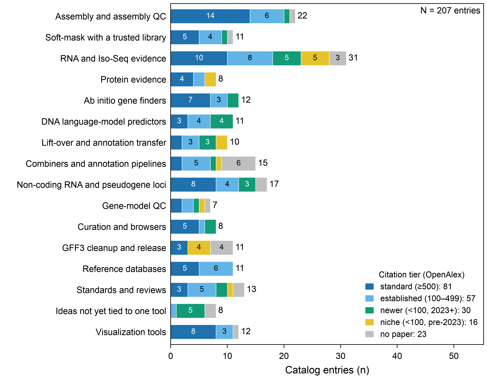
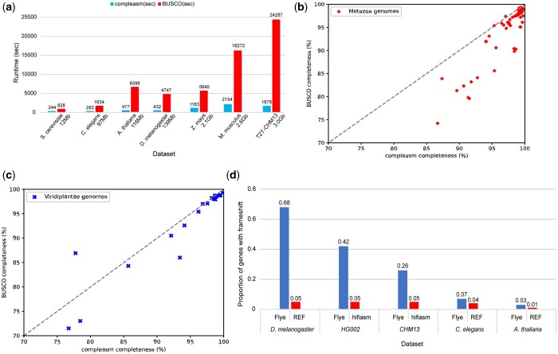
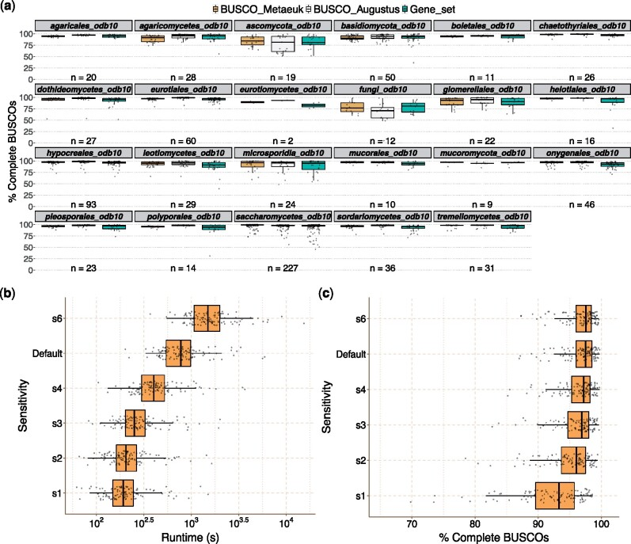

# gene-structure-annotation
[中文](README.zh.md)

This repository provides pipelines for structural genome annotation.
Chinese teaching is in [`docs/zh/`](docs/zh/).
Runnable documents stay English in [`docs/BILINGUAL.md`](docs/BILINGUAL.md).
Plant simulations are in [`examples/plant_sim/`](examples/plant_sim/).

## Overview

Structural annotation is the primary layer. It finds genes on a genome and provides coordinates, GFF3, and proteins.


*Figure. The structural annotation route of this repository: six stages from assembly QC to the release handed to gene-function-annotation, with the default tool at each stage and the six primary branches (S1, S11, S2, S3, S13, S14). Pick one primary branch from the data you have. Schematic drawn for this repository from README (Usage, Branches, Default route); editable SVG: [`structure_route_map.svg`](docs/figures/guide/structure_route_map.svg).*

TE soft-mask is a prerequisite. TE library construction is a separate job in [vitis-te](https://github.com/Xuzhen-Li/vitis-te) and [`docs/TE_LIBRARY.md`](docs/TE_LIBRARY.md).
GO, KEGG, and readable names are in the sibling repository [`gene-function-annotation`](https://github.com/Xuzhen-Li/gene-function-annotation). This repository does not generate functional annotation tables.

Three layers:
1. Structure: This repository.
2. Function: [`gene-function-annotation`](https://github.com/Xuzhen-Li/gene-function-annotation).
3. TE library build: [vitis-te](https://github.com/Xuzhen-Li/vitis-te) and [`TE_LIBRARY.md`](docs/TE_LIBRARY.md).

Boundary definitions are in [`docs/BOUNDARY.md`](docs/BOUNDARY.md).

Chinese shortest path is [`docs/zh/README.md`](docs/zh/README.md). English entry point is [`docs/START_HERE.md`](docs/START_HERE.md).
Quickstart is at [Wiki Start-tonight](https://github.com/Xuzhen-Li/gene-structure-annotation/wiki/Start-tonight). Offline version is [`docs/CLASSROOM_TONIGHT.md`](docs/CLASSROOM_TONIGHT.md).
Track work at [Annotation board (Project #2)](https://github.com/users/Xuzhen-Li/projects/2).


This page also serves as the 2026-11 methods catalog: 207 tools, databases and ideas across 15 type sections (updated 2026-11-14). The default path is unchanged (see Usage and `docs/ROADMAP.md`). Stage order remains in the roadmap and in `catalog/`.

## Usage

Chinese teaching entry is [`docs/zh/`](docs/zh/).
If already assembled, treat Asm0/Asm1 as a checklist and set `ASSEMBLY_OK=yes`. Edit every `/path/to` in `local.env` before any `mkdir`.
For a close curated reference GFF, set `close_curated_ref: true` in your answers (see `examples/plant_sim/03_solanum_s11`). Default `false` gives S1; a half-done Liftoff stays `false`.

Step 1: Provide evidence.
```bash
git clone https://github.com/Xuzhen-Li/gene-structure-annotation.git
cd gene-structure-annotation
cp pipeline/flow_tool/answers.example.yaml my_answers.yaml
# edit yes/no: RNA? proteins? close reference? paper bar?
python3 pipeline/flow_tool/flow.py --answers my_answers.yaml -o my_plan.md
```
Open `my_plan.md` to see the selected branch and stage explanations.

Step 2: Configure paths.
```bash
cp config/example.env config/local.env
# set GENOME_FA, BUSCO_LINEAGE, RNA_BAM / PROTEIN_DB, TE lib, WORK_DIR, THREADS
```

Step 3: Execution.
Finish `my_plan.md`. Read [Wiki Concepts](https://github.com/Xuzhen-Li/gene-structure-annotation/wiki/Concepts) or [`docs/zh/05_softmask与A0.md`](docs/zh/05_softmask与A0.md). Write `grade=` and `status=` separately. Do not write `status=L1`.
Run on cluster only after [Done when](https://github.com/Xuzhen-Li/gene-structure-annotation/wiki/Start-tonight#done-when) is ticked and `python3 pipeline/print_qc_commands.py` exits 0 with no `[STOP]`. Otherwise no `RUN=1`. Browsing with `--env config/example.env` will show `[STOP]`; this is expected.
Follow stages in `my_plan.md` and check [`docs/EVALUATION_CHECKLIST.md`](docs/EVALUATION_CHECKLIST.md). Read full rules in [`docs/EVALUATION.md`](docs/EVALUATION.md).
Provisional results are not L1. Read [`docs/EVALUATION.md`](docs/EVALUATION.md) for L0 vs L1.
The default branch is S1 for RNA and proteins with no close reference.
Handoff to function uses [`docs/HANDOFF_STRUCTURE_TO_FUNCTION.md`](docs/HANDOFF_STRUCTURE_TO_FUNCTION.md) with `RELEASE_TAG` and `PROTEINS_FA=…/release/<TAG>/proteins.faa`.

## Branches

Choose a branch based on evidence.
S11: Close curated reference GFF (Liftoff, LiftOn, CAT). Lift-only is S11-lite.
S1: RNA and proteins (BRAKER, StringTie).
S2: Proteins only (GALBA, GeMoMa).
S3: Heavy Iso-seq (IsoQuant, SQANTI).
S13: GPU ab initio comparison (Helixer, Tiberius, ANNEVO).
S14: Full classic PASA plus EVM route (`docs/steps/dclab/`). The Integrate step (EVM) runs only for S14 or when a second gene set exists (dual-track).

Overlays:
L2: Acceptance level L1 plus S5 overlay for Paper/T2T bar.
S7: Plant NLR or tandem windows overlay when `plant_tandem_focus: true`.

Full map is at [`docs/ROADMAP.md`](docs/ROADMAP.md).
Workflow chart with tool choices and decision points (2026-11-14): [`docs/ROADMAP.md#workflow-2026-11-14`](docs/ROADMAP.md#workflow-2026-11-14).


*Figure. Choosing the primary branch from the data at hand, with the first tools and the main check for each branch (the same choice as the table in book chapter 18 and README, Branches). S13, S14, S4 and the overlays run beside the primary draft. Schematic drawn for this repository; editable SVG: [`structure_branch_decision.svg`](docs/figures/guide/structure_branch_decision.svg).*

## Documentation

Chinese teaching and start is [`docs/zh/`](docs/zh/) and [`docs/START_HERE.md`](docs/START_HERE.md).

Narrated auto-plan: [`pipeline/flow_tool/`](pipeline/flow_tool/)
Stage I/O and evaluation: [`docs/STAGE_IO.md`](docs/STAGE_IO.md), [`docs/EVALUATION_CHECKLIST.md`](docs/EVALUATION_CHECKLIST.md), [`docs/EVALUATION.md`](docs/EVALUATION.md)
TE soft-mask: [`docs/TE_LIBRARY.md`](docs/TE_LIBRARY.md), [`docs/TRUSTED_TE_PATH.md`](docs/TRUSTED_TE_PATH.md)
Branch map and walkthrough: [`docs/ROADMAP.md`](docs/ROADMAP.md), [`docs/QUICKSTART.md`](docs/QUICKSTART.md)
Three-layer boundary: [`docs/BOUNDARY.md`](docs/BOUNDARY.md)
Post-assembly notes: [`docs/POST_ASSEMBLY.md`](docs/POST_ASSEMBLY.md)
QC sources: [`docs/QUALITY_SOURCES.md`](docs/QUALITY_SOURCES.md)
EDTA manual: [`docs/tools/edta.md`](docs/tools/edta.md)
BUSCO lineages: [`docs/LINEAGES.md`](docs/LINEAGES.md)
S11 gap-fill: [`pipeline/A2e_s11_gapfill.md`](pipeline/A2e_s11_gapfill.md), [`pipeline/A2c_liftoff.md`](pipeline/A2c_liftoff.md)
Golden pack checklist: [`examples/golden_pack/`](examples/golden_pack/)
Protein database: [`pipeline/A2_protein_db.md`](pipeline/A2_protein_db.md)
Helixer vs BRAKER: [`docs/COMPARE_HELIXER_BRAKER.md`](docs/COMPARE_HELIXER_BRAKER.md)
Merge and entry modes: [`docs/MERGE_AND_ENTRIES.md`](docs/MERGE_AND_ENTRIES.md)
Multi-source aggregation (EVM, optional TSEBRA / Mikado / PASA update): [`pipeline/A4_aggregation.md`](pipeline/A4_aggregation.md) Step A4 combines several gene sets and evidence into one final gene set with EVidenceModeler (EVM).
EGAPx compare: [`docs/EGAPX_COMPARE.md`](docs/EGAPX_COMPARE.md)
Scenarios and tools: [`docs/SCENARIOS.md`](docs/SCENARIOS.md), [`docs/TOOLS.md`](docs/TOOLS.md), [`docs/cases/vitis-t2t-s1-s5.md`](docs/cases/vitis-t2t-s1-s5.md), [`docs/TUTORIALS_AND_MEETINGS.md`](docs/TUTORIALS_AND_MEETINGS.md), [`docs/PLAYBOOK.md`](docs/PLAYBOOK.md)

## Scope

This is not functional annotation. Use [`gene-function-annotation`](https://github.com/Xuzhen-Li/gene-function-annotation) for GO/KEGG.
This is not a standalone TE library build. Use [vitis-te](https://github.com/Xuzhen-Li/vitis-te) and `docs/TE_LIBRARY.md`.
This is not for pangenome graphs. Use [vitis-pangenome](https://github.com/Xuzhen-Li/vitis-pangenome).
Do not commit private FASTQ/BAM files.

Author: Xuzhen Li, [ORCID](https://orcid.org/0000-0003-3670-6657).

## Methods catalog

This page lists, by type, the 207 methods, tools, databases and ideas from the 2026-11 survey (78 in the type catalog, 57 first-pass cards in `catalog/`) and the 2026-11-14 update (2 older-version entries merged, 41 added). The default path remains the one in Usage and in `docs/ROADMAP.md`; the catalog does not change it. Stage order stays in the roadmap and in `catalog/`. Full tables and errata are in `docs/CATALOG_BY_TYPE_2026-11.md` and `docs/CATALOG_NEW_TOOLS_2026-11.md`.

**2026-11-14 update.** Each section now opens with a **Clusters:** list. It groups the entries as alternatives (pick one), complementary (use together) or in order (run in sequence), with a note on when to pick which. Inside a list, “A or B” means pick one of the two and “A → B” is one fixed route. Different versions of one program are now one entry named for the latest version; older versions are only mentioned in that entry's note. A workflow chart with tool choices and decision points is in [`docs/ROADMAP.md`](docs/ROADMAP.md#workflow-2026-11-14).

**2026-11-25 update.** Each type section now shows its entries as one table: tool link, role (default, branch tool or alternative, as stated on this page), what it does and when to use it, paper, lab, tier with OpenAlex citations, and a short evaluation quoted from the paper abstract, a benchmark paper or the GitHub repository. 33 entries were added after three search passes (a drafted candidate list, OpenAlex keyword searches, and curated tool lists plus benchmark papers); each added entry has a DOI that resolves to a matching title, and each link was opened before use. The catalog now has 207 entries, including a new visualization section; the counts in the list below are current. Per-entry data are in `catalog/SOFTWARE_AUTHORITY.tsv` and the same tables, without the section notes, are in [`docs/software/README.md`](docs/software/README.md). A book-style study guide is in [`book/`](book/README.md).

## Contents

- [Default route](#default-route)
- [Tier rule](#tier-rule)
- [Pipelines and the steps they cover](#pipelines) (16)
- [1. Assembly and assembly QC](#section-1) (22)
- [2. Soft-mask with a trusted library](#section-2) (11)
- [3. RNA and Iso-Seq evidence](#section-3) (31)
- [4. Protein evidence](#section-4) (8)
- [5. Ab initio gene finders](#section-5) (12)
- [6. DNA language-model predictors](#section-6) (11)
- [7. Lift-over and annotation transfer](#section-7) (10)
- [8. Combiners and annotation pipelines](#section-8) (15)
- [9. Non-coding RNA and pseudogene loci](#section-9) (17)
- [10. Gene-model QC](#section-10) (7)
- [11. Curation and browsers](#section-11) (8)
- [12. GFF3 cleanup and release](#section-12) (11)
- [13. Reference databases](#section-13) (11)
- [14. Standards and reviews](#section-14) (13)
- [15. Ideas not yet tied to one tool](#section-15) (8)
- [Visualization tools](#visualization) (12 new, plus cross-listed entries)
  - [Genome browsers and editors](#viz-1) (5)
  - [Gene-structure and isoform diagrams](#viz-2) (6)
  - [Track and chromosome plots](#viz-3) (5)
  - [Synteny and dot plots](#viz-4) (3)
- [Data needed alongside the genome](#data-needs)
- [Figure credits](#figure-credits)

How the sections line up with this repo: assembly and QC (Asm0/Asm1) → soft-mask (A0) → evidence and a draft branch (S11/S1/S2/S3/S13/S14) → combiners (A4) → model QC and last-mile → release and handoff (A6). Stage IDs stay in `docs/ROADMAP.md` and `catalog/`.

<a id="default-route"></a>
### Default route

The default branch is S1 (RNA and proteins, no close reference). Soft-mask with the vitis-te library run through RepeatMasker (A0); align RNA with HISAT2 or STAR and assemble with StringTie; for long reads use minimap2 and IsoQuant; then run BRAKER4 with protein evidence (miniprot hints, or GeMoMa). The other branches are S11 (Liftoff, LiftOn, CAT), S2 (GALBA2, GeMoMa), S3 (IsoQuant, SQANTI3), S13 (Helixer, Tiberius, ANNEVO) and S14 (PASA plus EVM). This is the route stated in Usage, Branches and the Clusters lists on this page and in `docs/ROADMAP.md`; the tables below mark these tools as default or branch tools and every other entry as an alternative.

<a id="tier-rule"></a>
### Tier rule

> **Tier rule (stated once):** the indicator is the OpenAlex citation count of the paper (retrieved 2026-11-25). standard: 500 or more; established: 100–499; newer: fewer than 100 and the paper is from 2023 or later; niche: fewer than 100 and from before 2023; no paper: no title-matched paper. General-purpose tools have counts from every field. Lab is the corresponding author in the paper metadata with the first institution (+N for further corresponding authors; the last author when none is flagged). Evaluation quotes the paper abstract (“Authors:” marks a claim made by the tool authors), a benchmark paper with its DOI, or the GitHub repository (description and last push date). This catalog has 207 entries: standard 81, established 57, newer 30, niche 16, no paper 23.



*Figure. Catalog entries per type section, coloured by citation tier (tier rule above). Counts computed from `catalog/SOFTWARE_AUTHORITY.tsv` (207 entries; OpenAlex counts retrieved 2026-11-25) by `docs/figures/guide/src/make_catalog_charts.py`.*


*Figure. Publication year against OpenAlex citations for the 184 catalog entries with a paper; diamonds mark repository defaults. A citation count says how widely a paper is cited, not how accurate the tool is on your genome. Source: `catalog/SOFTWARE_AUTHORITY.tsv`; script `docs/figures/guide/src/make_catalog_charts.py`.*

<a id="pipelines"></a>
### Pipelines and the steps they cover

yes means the paper abstract or the catalog note states the step; a dash only means it is not stated there. The Basis column names the source.

| Pipeline | Soft-mask | RNA evidence | Protein evidence | Ab initio training | Lift-over | Combine / select | ncRNA / pseudogene | Model QC | Tier · citations | Basis |
|---|---|---|---|---|---|---|---|---|---|---|
| [BRAKER4](https://github.com/Gaius-Augustus/BRAKER4) · default (S1) | masked genome as input | yes | yes | yes | — | yes (TSEBRA) | — | — | standard · 1004 | doi:10.1101/gr.278090.123 (abstract) |
| [GALBA2](https://github.com/Gaius-Augustus/GALBA2) · branch S2 | masked genome as input | — | yes (miniprot) | yes (AUGUSTUS) | — | — | — | — | established · 127 | doi:10.1186/s12859-023-05449-z (abstract) |
| MAKER2 | — | yes | yes | yes | — | yes | — | yes (AED) | standard · 2370 | catalog note |
| [MAKER-P](https://github.com/Yandell-Lab/maker) | — | yes | yes | yes | — | yes | yes | — | established · 451 | doi:10.1104/pp.113.230144 (abstract) |
| [funannotate](https://github.com/nextgenusfs/funannotate) | — | yes (PASA) | yes | yes | — | yes (EVM) | — | — | established · 407 | catalog note |
| [EVidenceModeler (EVM)](https://github.com/EVidenceModeler/EVidenceModeler) · branch S14 (A4) | — | via PASA | as input | as input | — | yes | — | — | standard · 4661 | doi:10.1186/gb-2008-9-1-r7 (abstract) |
| [EASEL](https://gitlab.com/PlantGenomicsLab/easel) | — | yes (StringTie2/PsiCLASS) | yes (OrthoDB hints) | yes (AUGUSTUS) | — | yes (random-forest filter) | — | — | no paper | catalog note |
| [Sylvan](https://github.com/plantgenomicslab/Sylvan) | — | yes (EVM/PASA) | yes (miniprot) | yes (Helixer, GETA) | yes (Liftoff) | yes (EVM + filter) | — | — | no paper | catalog note |
| [REAT](https://github.com/EI-CoreBioinformatics/reat) | — | yes | yes | yes | — | yes (Mikado) | — | — | no paper | catalog note |
| [GETA](https://github.com/chenlianfu/geta) | — | yes | yes | yes (AUGUSTUS) | — | — | — | — | no paper | catalog note |
| [EviAnn](https://github.com/alekseyzimin/EviAnn_release) | — | yes | yes | no training | — | yes | — | — | newer · 36 | catalog note |
| [FINDER](https://github.com/sagnikbanerjee15/Finder) | — | yes | yes | — | — | — | — | — | niche · 47 | doi:10.1186/s12859-021-04120-9 (title) |
| [GenSAS](https://www.gensas.org/) | — | yes | yes | — | — | — | — | manual curation (JBrowse, Apollo) | established · 173 | doi:10.1007/978-1-4939-9173-0_3 (abstract) |
| [Comparative Annotation Toolkit (CAT)](https://github.com/ComparativeGenomicsToolkit/Comparative-Annotation-Toolkit) · branch S11 | — | — | — | — | yes | — | — | — | established · 141 | doi:10.1101/gr.233460.117 (abstract) |
| [Liftoff](https://github.com/agshumate/Liftoff) · branch S11 | — | — | — | — | yes | — | — | — | standard · 1144 | doi:10.1093/bioinformatics/btaa1016 (abstract) |
| [LiftOn](https://github.com/Kuanhao-Chao/LiftOn) · branch S11 | — | — | yes (protein alignments) | — | yes | — | — | — | newer · 51 | doi:10.1101/gr.279620.124 (abstract) |

<a id="section-1"></a>
## 1. Assembly and assembly QC

Tools that decide whether an assembly is ready to annotate, or that produce the haplotype FASTA itself (Asm0, Asm1).

**Needs:** the assembly FASTA; add the assembly reads when checking k-mers or base accuracy. BUSCO needs a lineage that matches the clade (see `docs/LINEAGES.md`). [Data needs by scenario](#data-needs)

**Clusters:**
- *Assemble and scaffold* (alternatives): hifiasm, Verkko, YaHS, RagTag. hifiasm is the default for HiFi (+Hi-C); pick Verkko when ultra-long ONT is available for T2T. Scaffold with YaHS when Hi-C is available; use RagTag only with a close reference.
- *Accuracy and completeness* (complementary): Merqury, CRAQ, Inspector, GCI, compleasm, LTR Assembly Index (LAI), QUAST, gfastats. Run together: Merqury for QV, compleasm for gene space, and LAI for repeat space; CRAQ and Inspector locate error sites; gfastats and QUAST generate summary tables.
- *Contamination and chromosome ends* (complementary): NCBI FCS-GX, BlobToolKit, Tiara, tidk, quarTeT. FCS-GX is required before NCBI submission; BlobToolKit and Tiara classify flagged contigs. tidk and quarTeT confirm telomeres on T2T chromosomes.
- *Read k-mer profiling* (complementary): GenomeScope 2.0 / Smudgeplot, KAT (K-mer Analysis Toolkit). Run before or right after assembly to estimate genome size, heterozygosity and ploidy from reads.



*compleasm compared with BUSCO on the same assemblies (Fig. 1). Huang and Li 2023, Bioinformatics, Fig. 1, doi:10.1093/bioinformatics/btad595, PMC10558035, CC BY.*

| Tool | Role | What it does / when to use | Paper | Lab (corresponding author, institution) | Tier · citations | Evaluation (source) |
|---|---|---|---|---|---|---|
| [hifiasm](https://github.com/chhylp123/hifiasm) | default (HiFi) | Haplotype-resolved de novo assembler for PacBio HiFi reads (trio, Hi-C or ultra-long phasing modes). | [Nature Methods 2021](https://doi.org/10.1038/s41592-020-01056-5) | Heng Li (Harvard University) | standard · 6724 | GitHub last push 2026-05 |
| [Verkko](https://github.com/marbl/verkko) | alternative | Telomere-to-telomere diploid assembly combining HiFi and ultra-long ONT reads in a graph. | [Nature Biotechnology 2023](https://doi.org/10.1038/s41587-023-01662-6) | Adam M. Phillippy (National Institutes of Health) +1 | established · 464 | GitHub last push 2026-11 |
| [YaHS](https://github.com/c-zhou/yahs) | alternative | Hi-C scaffolder producing chromosome-scale scaffolds from contigs. | [Bioinformatics 2022](https://doi.org/10.1093/bioinformatics/btac808) | Richard Michael Durbin (University of Cambridge) | standard · 2689 | Authors: “It can be run with a single-line command, requires minimal input from users (an assembly file and an alignment file) which is compatible with similar tools and provides assembly results in multiple formats, thereby enabling rapid, robust and scalable …”; GitHub last push 2024-11 |
| [RagTag](https://github.com/malonge/RagTag) | alternative | Reference-guided correction, scaffolding and patching of draft assemblies. | [Genome biology 2022](https://doi.org/10.1186/s13059-022-02823-7) | Michael C. Schatz (Johns Hopkins University) +1 | standard · 1166 | Paper: “Here, we introduce RagTag, a toolset for automating assembly scaffolding and patching, and we establish chromosome-scale reference genomes for the widely used tomato genotype M82 along with Sweet-100, a new rapid-cycling genotype that we developed to …”; GitHub last push 2026-10 |
| [GenomeScope 2.0 / Smudgeplot](https://github.com/tbenavi1/genomescope2.0) | alternative | k-mer profiling of genome size, heterozygosity and ploidy from reads. | [Nature Communications 2020](https://doi.org/10.1038/s41467-020-14998-3) | T. Rhyker Ranallo-Benavidez (Johns Hopkins University) | standard · 3192 | Authors: “We describe and evaluate a practical implementation of the polyploid-aware mixture model that quickly and accurately infers genome properties across thousands of simulated and several real datasets spanning a broad range of complexity.”; GitHub last push 2025-10 |
| [Merqury](https://github.com/marbl/merqury) | alternative | Reference-free k-mer QV, completeness and phasing assessment of assemblies. | [Genome biology 2020](https://doi.org/10.1186/s13059-020-02134-9) | Arang Rhie (National Institutes of Health) | standard · 4080 | Authors: “By comparing k-mers in a de novo assembly to those found in unassembled high-accuracy reads, Merqury estimates base-level accuracy and completeness.”; GitHub last push 2026-07 |
| [QUAST](https://github.com/ablab/quast) | alternative | Assembly contiguity and misassembly statistics, optionally against a reference. | [Bioinformatics 2013](https://doi.org/10.1093/bioinformatics/btt086) | Glenn Tesler (Saint Petersburg Academic University) | standard · 12516 | Authors: “This tool improves on leading assembly comparison software with new ideas and quality metrics.”; GitHub last push 2026-11 |
| [Inspector](https://github.com/Maggi-Chen/Inspector) | alternative | Reference-free assembly evaluation and error correction using long reads. | [Genome biology 2021](https://doi.org/10.1186/s13059-021-02527-4) | Zechen Chong (University of Alabama at Birmingham) | established · 249 | Authors: “Based on in silico and long-read assembly results from multiple long-read data and assemblers, we demonstrate that in addition to providing generic metrics, Inspector can accurately identify both large-scale and small-scale assembly errors.”; GitHub last push 2024-08 |
| [KAT (K-mer Analysis Toolkit)](https://github.com/EarlhamInst/KAT) | alternative | k-mer spectra comparison of reads vs assembly (copy-number plots). | [Bioinformatics 2016](https://doi.org/10.1093/bioinformatics/btw663) | Bernardo Clavijo (Earlham Institute) | standard · 630 | Paper: “We present the K-mer Analysis Toolkit (KAT): a multi-purpose software toolkit for reference-free quality control (QC) of WGS reads and de novo genome assemblies, primarily via their k-mer frequencies and GC composition.”; GitHub last push 2022-11 |
| [BlobToolKit](https://github.com/genomehubs/blobtoolkit) | alternative | Interactive GC/coverage/taxonomy plots to spot contaminant contigs. | [G3 Genes Genomes Genetics 2020](https://doi.org/10.1534/g3.119.400908) | RICHARD J. CHALLIS (Wellcome Sanger Institute) | standard · 2759 | Paper: “We present BlobToolKit, a software suite to aid researchers in identifying and isolating non-target data in draft and publicly available genome assemblies.”; GitHub last push 2026-11 |
| [Tiara](https://github.com/ibe-uw/tiara) | alternative | Deep-learning classification of contigs into nuclear, organellar and prokaryotic origin. | [Bioinformatics 2021](https://doi.org/10.1093/bioinformatics/btab672) | Anna Karnkowska (University of Warsaw) | established · 185 | Authors: “Using the test dataset, we have shown that Tiara performed similarly to EukRep for prokaryotes classification and outperformed it for eukaryotes classification with lower calculation time.”; GitHub last push 2024-03 |
| [tidk](https://github.com/tolkit/telomeric-identifier) | alternative | Finds and plots telomeric repeats along an assembly. | [Bioinformatics 2025](https://doi.org/10.1093/bioinformatics/btaf049) | Max R. Brown (Anglia Ruskin University) | established · 204 | Authors: “Our algorithm is shown to be accurate in genomes for which the telomeric repeat unit is known and is tested across a wide variety of newly assembled genomes to uncover new telomeric repeat units.”; GitHub last push 2026-11 |
| [quarTeT](https://github.com/aaranyue/quarTeT) | alternative | Telomere-to-telomere toolkit: reference-guided assembly, gap filling, telomere and centromere identification. | [Horticulture Research 2023](https://doi.org/10.1093/hr/uhad127) | Yi Yue (Anhui Agricultural University) +2 | established · 426 | Authors: “As a case study, by adopting the entire modular functions of quarTeT, we have achieved the Actinidia chinensis genome assembly that is of a quality comparable to the reported genome Hongyang v4.0, which was assembled with the addition of manual handling.”; GitHub last push 2026-06 |
| [GCI](https://github.com/yeeus/GCI) | alternative | Genome Continuity Inspector: read-mapping based continuity score for near-complete assemblies. | [Bioinformatics 2024](https://doi.org/10.1093/bioinformatics/btae633) | Guojie Zhang (Women's Hospital, School of Medicine, Zhejiang University) +1 | newer · 46 | Paper: “Here, we present a tool called Genome Continuity Inspector (GCI), designed to assess genome assembly continuity at single-base resolution, and evaluate how close an assembly is to the T2T level.”; GitHub last push 2026-11 |
| [gfastats](https://github.com/vgl-hub/gfastats) | alternative | Fast summary statistics and manipulation of FASTA/GFA assemblies. | [Bioinformatics 2022](https://doi.org/10.1093/bioinformatics/btac460) | Giulio Formenti (Rockefeller University) | standard · 1400 | GitHub last push 2026-11 |
| [CRAQ](https://github.com/JiaoLaboratory/CRAQ) | alternative | Reference-free assembly assessment from clipped-read alignments (regional and structural errors). | no paper | — | no paper | Repo description: “Identification of errors in draft genome assemblies with single-base pair resolution for quality assessment and improvement”; GitHub last push 2025-12 |
| [NCBI FCS-GX](https://github.com/ncbi/fcs) | alternative | Detects and removes foreign-organism contamination in assemblies before submission/annotation. | [Genome biology 2024](https://doi.org/10.1186/s13059-024-03198-7) | Terence D. Murphy (National Institutes of Health) | standard · 605 | Authors: “Testing FCS-GX on artificially fragmented genomes demonstrates high sensitivity and specificity for diverse contaminant species.”; GitHub last push 2025-03 |
| [compleasm](https://github.com/huangnengCSU/compleasm) | alternative | Reimplements BUSCO on top of miniprot using the same lineage sets; much faster and often more accurate for gene-space completeness in large plant assemblies. | [Bioinformatics 2023](https://doi.org/10.1093/bioinformatics/btad595) | Heng Li (Harvard University) | established · 423 | Authors: “It is 14 times faster than BUSCO for human assemblies and reports a more accurate completeness of 99.6% than BUSCO’s 95.7%, which is in close agreement with the annotation completeness of 99.5% for T2T-CHM13.”; GitHub last push 2026-10 |
| [LTR Assembly Index (LAI)](https://github.com/oushujun/LTR_retriever) | alternative | Scores the proportion of intact LTR retrotransposon (LTR-RT) length to total LTR-RT length in an assembly; a repeat-space check that complements BUSCO before annotation. | [Nucleic Acids Research 2018](https://doi.org/10.1093/nar/gky730) | Shujun Ou (Michigan State University) | standard · 947 | Authors: “Moreover, LAI can facilitate iterative assembly improvement with assembler selection and identify low-quality genomic regions.”; GitHub last push 2026-11 |
| [purge_dups](https://github.com/dfguan/purge_dups) | alternative | Removes haplotypic duplicates and overlaps from a primary assembly using read depth; run before annotation on heterozygous genomes. | [Bioinformatics 2020](https://doi.org/10.1093/bioinformatics/btaa025) | Yadong Wang (Harbin Institute of Technology) +1 | standard · 2887 | Authors: “In comparison with current tools, we demonstrate that purge_dups can reduce heterozygous duplication and increase assembly continuity while maintaining completeness of the primary assembly.”; GitHub last push 2025-10 |
| [Purge Haplotigs](https://bitbucket.org/mroachawri/purge_haplotigs) | alternative | Reassigns allelic contigs out of a diploid primary assembly using coverage; older alternative to purge_dups. | [BMC Bioinformatics 2018](https://doi.org/10.1186/s12859-018-2485-7) | Michael J. Roach (Australian Wine Research Institute) | standard · 1263 | Authors: “Purge Haplotigs improves the haploid and diploid representations of third-gen sequencing based genome assemblies by identifying and reassigning allelic contigs.” |
| [LTR_retriever](https://github.com/oushujun/LTR_retriever) | alternative | Filters LTR retrotransposon candidates to a high-confidence set; it is the program that computes LAI. | [PLANT PHYSIOLOGY 2017](https://doi.org/10.1104/pp.17.01310) | Ning Jiang (Michigan State University) | standard · 1703 | Authors: “LTR_retriever demonstrated significant improvements by achieving high levels of sensitivity (91%), specificity (97%), accuracy (96%), and precision (90%) in rice (Oryza sativa).”; GitHub last push 2026-11 |

<a id="section-2"></a>
## 2. Soft-mask with a trusted library

Masking repeats with a trusted TE library, or low-complexity masking. This repo does not build TE libraries.

**Needs:** a trusted TE library from vitis-te (or another curated library). This section only soft-masks; it does not build a TE library. [Data needs by scenario](#data-needs)

**Clusters:**
- *Library and masker* (complementary): Dfam, RepeatMasker. Default A0: the vitis-te library (Dfam adds known families) run through RepeatMasker.
- *Tandem and satellite repeats* (complementary): Tandem Repeats Finder (TRF), ULTRA, TRASH. Add to the mask when centromeres or long satellites are present; TRASH also classifies centromeric arrays.
- *Library-free and library-build (compare only)* (alternatives): WindowMasker, Red, Earl Grey. WindowMasker and Red mask without a library; Earl Grey builds and applies its own library. All three are only for comparison with the A0 mask and never replace the vitis-te library on the default path.


| Tool | Role | What it does / when to use | Paper | Lab (corresponding author, institution) | Tier · citations | Evaluation (source) |
|---|---|---|---|---|---|---|
| [RepeatMasker](https://github.com/Dfam-consortium/RepeatMasker) | default (A0) | Masks repeats with a supplied library (Dfam or a curated species library); -xsmall gives soft-masking. | no paper | — | no paper | Repo description: “RepeatMasker is a program that screens DNA sequences for interspersed repeats and low complexity DNA sequences.”; GitHub last push 2026-10 |
| [Dfam](https://www.dfam.org/) | resource | Open database of TE families and profile HMMs used by RepeatMasker. | [Mobile DNA 2021](https://doi.org/10.1186/s13100-020-00230-y) | Jessica M. Storer (Institute for Systems Biology) +2 | standard · 838 | Authors: “This expansion demonstrates the utility of many of Dfam's new features and provides insight into the long term challenges ahead for improving de novo generated transposable element datasets.” |
| [Tandem Repeats Finder (TRF)](https://github.com/Benson-Genomics-Lab/TRF) | alternative | Detects tandem repeats. | [Nucleic Acids Research 1999](https://doi.org/10.1093/nar/27.2.573) | Gary Benson (Icahn School of Medicine at Mount Sinai) | standard · 10371 | Paper: “In this paper, we present a new algorithm for finding tandem repeats which works without the need to specify either the pattern or pattern size.”; GitHub last push 2023-01 |
| [WindowMasker](https://www.ncbi.nlm.nih.gov/IEB/ToolBox/CPP_DOC/lxr/source/src/app/winmasker/) | alternative | Library-free masking of over-represented k-mers (NCBI). | [Bioinformatics 2005](https://doi.org/10.1093/bioinformatics/bti774) | Richa Agarwala (National Institutes of Health) | established · 354 | no abstract or repo text available; see paper |
| [ULTRA](https://github.com/TravisWheelerLab/ULTRA) | alternative | Probabilistic labeling of tandem / low-complexity repeats; output can feed soft-masking alongside a trusted TE library. | [Bioinformatics Advances 2024](https://doi.org/10.1093/bioadv/vbae149) | Daniel R. Olson (University of Montana) | newer · 20 | Authors: “Tools that annotate repetitive sequence are now more important than ever, so that we can better understand newly uncovered repetitive sequences, and also so that we can mitigate errors in bioinformatic software caused by those repetitive sequences.”; GitHub last push 2026-11 |
| Red | alternative | Library-free de novo repeat detector that produces a quick soft-mask when no trusted library exists yet. Use only as a comparison track against the vitis-te library. | [BMC Bioinformatics 2015](https://doi.org/10.1186/s12859-015-0654-5) | Hani Z. Girgis (National Institutes of Health) | established · 275 | Authors: “It is sensitive to both transposons and simple repeats; in contrast, available tools such as RepeatScout and ReCon are sensitive to transposons, and WindowMasker to simple repeats.” |
| [TRASH](https://github.com/vlothec/TRASH) | alternative | Finds and classifies tandem and satellite repeat arrays such as centromeric repeats; useful for masking or flagging T2T centromeres before gene finding. | [Bioinformatics 2023](https://doi.org/10.1093/bioinformatics/btad308) | Ian R. Henderson (University of Cambridge) | established · 115 | Authors: “TRASH analyses a fasta assembly file, identifies regions occupied by repeats and then precisely maps them and their higher order structures.”; GitHub last push 2025-03 |
| [Earl Grey](https://github.com/TobyBaril/EarlGrey) | alternative | Automated TE annotation pipeline built around RepeatModeler2 and RepeatMasker. Library building belongs to vitis-te; listed here only for mask comparison. | [Molecular Biology and Evolution 2024](https://doi.org/10.1093/molbev/msae068) | Tobias Baril (University of Exeter) +1 | established · 292 | Authors: “Using nine simulated genomes and an annotation of Drosophila melanogaster, we show that Earl Grey outperforms current widely used TE annotation methodologies in ameliorating the issues mentioned above while scoring highly in benchmarking for TE annotation and …”; GitHub last push 2026-11 |
| [RepeatModeler2](https://github.com/Dfam-consortium/RepeatModeler) | alternative | Builds a de novo repeat library for a new genome; the usual source of the library that RepeatMasker then uses. | [Proceedings of the National Academy of Sciences 2020](https://doi.org/10.1073/pnas.1921046117) | Arian F. A. Smit (Institute for Systems Biology) | standard · 4333 | Authors: “This program brings substantial improvements over the original version of RepeatModeler, one of the most widely used tools for TE discovery.”; GitHub last push 2026-11 |
| [EDTA](https://github.com/oushujun/EDTA) | alternative | Builds a filtered, non-redundant TE library from LTR, TIR and Helitron finders; a common source of the library used for soft-masking plant genomes. | [Genome biology 2019](https://doi.org/10.1186/s13059-019-1905-y) | Ning Jiang (Michigan State University) +2 | standard · 1683 | GitHub last push 2026-11 |
| [BEDTools (maskfasta)](https://github.com/arq5x/bedtools2) | alternative, general-purpose | General interval toolkit; maskfasta -soft turns a repeat BED/GFF into a soft-masked FASTA. | [Bioinformatics 2010](https://doi.org/10.1093/bioinformatics/btq033) | Aaron R. Quinlan (University of Virginia) +1 | standard · 30267 | GitHub last push 2026-06 |

<a id="section-3"></a>
## 3. RNA and Iso-Seq evidence

Short-read and long-read RNA alignment, transcript assembly and ORF calling used as evidence for gene models (A1b).

**Needs:** short-read RNA-seq from the same genotype where possible (FASTQ or a ready `RNA_BAM`); for the S3 branch, add deep Iso-Seq / long-read RNA. [Data needs by scenario](#data-needs)

**Clusters:**
- *Short-read path* (in order): fastp, HISAT2 or STAR, Portcullis, StringTie (v3 line) or Scallop2 or Aletsch. Trim, align, filter junctions with Portcullis before assembly, then assemble: StringTie is the default; Scallop2 or Aletsch for many shallow samples. TransDecoder can then call ORFs on the assembled transcripts.
- *Trinity route* (in order): Trinity, PASA, TransDecoder. Only when a genome-free transcript assembly is needed: PASA aligns and updates the Trinity assemblies, then TransDecoder calls ORFs.
- *Long-read isoforms* (in order): IsoSeq (PacBio), IsoQuant or Bambu or FLAIR or Mandalorion or ESPRESSO or TAMA or FLIC (Full-length isoform constructor) or Isocall or TAGET, SQANTI3. IsoSeq preprocessing applies to PacBio reads only. Pick one isoform builder: IsoQuant is the default, FLAIR suits ONT, Mandalorion accurate reads. Always finish with SQANTI3 QC before isoforms become evidence.
- *Long-read aligners* (alternatives): minimap2, uLTRA, deSALT. minimap2 splice mode is the default; uLTRA improves small-exon alignment when an annotation exists.
- *Translation evidence* (complementary): RiboCode, Ribo-TISH, RiboBA, PhyloCSF++, KuPID. Use only for small ORFs, uORFs or disputed start sites; requires Ribo-seq or conservation tracks.


*StringTie2 transcript assembly on plant RNA-seq (Fig. 2). Kovaka et al. 2019, Genome Biol., Fig. 2, doi:10.1186/s13059-019-1910-1, PMC6912988, CC BY.*


*IsoQuant on real long RNA reads (Fig. 2). The source panel is short (719×189). Prjibelski et al. 2023, Nat. Biotechnol., Fig. 2, doi:10.1038/s41587-022-01565-y, PMC10344776, CC BY.*

| Tool | Role | What it does / when to use | Paper | Lab (corresponding author, institution) | Tier · citations | Evaluation (source) |
|---|---|---|---|---|---|---|
| [HISAT2](https://github.com/DaehwanKimLab/hisat2) | default route (HISAT2 or STAR) | Spliced aligner for short RNA-seq reads (graph-based index). | [Nature Biotechnology 2019](https://doi.org/10.1038/s41587-019-0201-4) | Daehwan Kim (The University of Texas Southwestern Medical Center) | standard · 17059 | GitHub last push 2026-07 |
| [STAR](https://github.com/alexdobin/STAR) | default route (HISAT2 or STAR) | Ultrafast spliced short-read aligner with two-pass junction discovery. | [Bioinformatics 2012](https://doi.org/10.1093/bioinformatics/bts635) | Alexander Dobin (Cold Spring Harbor Laboratory) | standard · 56248 | Authors: “STAR outperforms other aligners by a factor of >50 in mapping speed, aligning to the human genome 550 million 2 × 76 bp paired-end reads per hour on a modest 12-core server, while at the same time improving alignment sensitivity and precision.”; GitHub last push 2025-03 |
| [minimap2](https://github.com/lh3/minimap2) | default (long-read aligner) | Long-read and cDNA/Iso-Seq spliced aligner (-ax splice). | [Bioinformatics 2018](https://doi.org/10.1093/bioinformatics/bty191) | Heng Li (Broad Institute) | standard · 17121 | Authors: “It works with accurate short reads of ≥100 bp in length, ≥1 kb genomic reads at error rate ∼15%, full-length noisy Direct RNA or cDNA reads and assembly contigs or closely related full chromosomes of hundreds of megabases in length.”; GitHub last push 2026-05 |
| [fastp](https://github.com/OpenGene/fastp) | alternative | All-in-one FASTQ QC and adapter trimming. | [Bioinformatics 2018](https://doi.org/10.1093/bioinformatics/bty560) | Shifu Chen (Chinese Academy of Sciences) | standard · 33355 | Authors: “Based on our evaluation, fastp is 2–5 times faster than other FASTQ preprocessing tools such as Trimmomatic or Cutadapt despite performing far more operations than similar tools.”; GitHub last push 2026-10 |
| [Trinity](https://github.com/trinityrnaseq/trinityrnaseq) | alternative | De novo and genome-guided transcriptome assembly from RNA-seq. | [Nature Biotechnology 2011](https://doi.org/10.1038/nbt.1883) | Nir Friedman (Hebrew University of Jerusalem) +1 | standard · 23513 | GitHub last push 2026-11 |
| [PASA](https://github.com/PASApipeline/PASApipeline) | branch S14 | Aligns and assembles transcripts into gene structures; also updates models with UTRs and isoforms. | [Nucleic Acids Research 2003](https://doi.org/10.1093/nar/gkg770) | Brian J. Haas | standard · 2576 | Authors: “Complete and partial gene structures identified by this method were used to improve The Institute for Genomic Research Arabidopsis genome annotation (TIGR release v.4.0).”; GitHub last push 2026-11 |
| [TransDecoder](https://github.com/TransDecoder/TransDecoder) | alternative | Finds candidate coding regions in transcripts (ORFs with homology/Pfam support). | no paper | — | no paper | Repo description: “TransDecoder source”; GitHub last push 2026-11 |
| [IsoQuant](https://github.com/ablab/IsoQuant) | default (long reads, S3) | Long-read transcript discovery and quantification against a genome. | [Nature Biotechnology 2023](https://doi.org/10.1038/s41587-022-01565-y) | Andrey D. Prjibelski (University of Helsinki) +1 | established · 349 | Authors: “Here we present IsoQuant-a computational tool using intron graphs that accurately reconstructs transcripts both with and without reference genome annotation.”; GitHub last push 2026-11 |
| [Bambu](https://github.com/GoekeLab/bambu) | alternative | Context-aware long-read transcript discovery and quantification (R/Bioconductor). | [Nature Methods 2023](https://doi.org/10.1038/s41592-023-01908-w) | Jonathan Göke (Agency for Science, Technology and Research) | established · 236 | GitHub last push 2026-10 |
| [SQANTI3](https://github.com/ConesaLab/SQANTI3) | branch S3 | Classifies and filters long-read isoforms against a reference annotation. | [Nature Methods 2024](https://doi.org/10.1038/s41592-024-02229-2) | Ana Conesa (Consejo Superior de Investigaciones Científicas) | established · 267 | GitHub last push 2026-11 |
| [TAMA](https://github.com/GenomeRIK/tama) | alternative | Collapses and merges long-read transcript models; annotation tools for Iso-Seq. | [BMC Genomics 2020](https://doi.org/10.1186/s12864-020-07123-7) | Richard I Kuo (Roslin Institute) | established · 191 | Authors: “TAMA achieved high sensitivity and precision for gene and transcript model predictions in both reference guided and unguided approaches in our benchmark tests using simulated Pacific Biosciences (PacBio) and Nanopore sequencing data and real PacBio datasets.”; GitHub last push 2023-04 |
| [IsoSeq (PacBio)](https://github.com/PacificBiosciences/IsoSeq) | alternative | Official PacBio Iso-Seq processing (refine, cluster, collapse). | no paper | — | no paper | Repo description: “Iso-Seq - Scalable De Novo Isoform Discovery from Single-Molecule PacBio Reads”; GitHub last push 2026-06 |
| [StringTie (v3 line)](https://github.com/gpertea/stringtie) | default | Reference-guided / de novo transcript assembly from short and long RNA reads; used as transcript evidence and as the compare track. | [Genome biology 2019](https://doi.org/10.1186/s13059-019-1910-1) | Mihaela Pertea (Johns Hopkins University) | standard · 2287 | Authors: “The ability to assemble these long reads can greatly improve the sensitivity of long-read analyses.”; GitHub last push 2026-11 |
| [FLIC (Full-length isoform constructor)](https://github.com/albidgy/FLIC) | alternative | Builds full-length isoforms from long reads using replicate concordance and TSS/polyA peak calling. | [Bioinformatics 2022](https://doi.org/10.1093/bioinformatics/btaf551) | Aleksey A. Penin (Russian Academy of Sciences) | niche · 1 | Authors: “demonstrate that FLIC accurately reconstructs known and novel isoforms, outperforming existing tools, especially in the absence of reference annotations.”; GitHub last push 2026-09 |
| [Isocall](https://github.com/PacificBiosciences/isocall) | alternative | Joint calling of known and novel isoforms across many PacBio Iso-Seq samples (alternative to isoseq cluster/collapse). | no paper | — | no paper | Repo description: “A method to joint-call RNA isoforms across many IsoSeq samples”; GitHub last push 2026-08 |
| [ESPRESSO](https://github.com/Xinglab/espresso) | alternative | Discovery and quantification of isoforms from error-prone long-read RNA-seq. | [Science Advances 2023](https://doi.org/10.1126/sciadv.abq5072) | Yuan Gao (Children's Hospital of Philadelphia) +3 | established · 106 | Authors: “ESPRESSO jointly considers alignments of all long reads aligned to a gene and uses error profiles of individual reads to improve the identification of splice junctions and the discovery of their corresponding transcript isoforms.”; GitHub last push 2026-03 |
| TAGET | alternative | Iso-Seq toolkit: alignment with CNN splice-site correction, isoform classification, expression. | [Nature Communications 2023](https://doi.org/10.1038/s41467-023-41649-0) | Susheng Miao (Harbin Medical University) +1 | newer · 16 | Authors: “TAGET gives significantly more precise novel splice site prediction and enables more accurate novel isoform and gene fusion discoveries, as validated by experimental validations and comparisons with RNA-seq data.” |
| [RiboCode](https://github.com/xryanglab/RiboCode) | alternative | Identifies actively translated ORFs from ribosome-profiling data. | [Nucleic Acids Research 2018](https://doi.org/10.1093/nar/gky179) | Xuerui Yang (Tsinghua University) | established · 193 | Authors: “Being tested with simulated and real ribosome profiling data, and validated with cell type-specific QTI-seq and mass spectrometry data, RiboCode exhibits superior efficiency, sensitivity, and accuracy for de novo annotation of the translatome, which covers …”; GitHub last push 2022-07 |
| [Ribo-TISH](https://github.com/zhpn1024/ribotish) | alternative | Translation initiation sites and ORFs from (QTI-seq / regular) Ribo-seq. | [Nature Communications 2017](https://doi.org/10.1038/s41467-017-01981-8) | Yiwen Chen (The University of Texas MD Anderson Cancer Center) | established · 172 | Authors: “Ribo-TISH can also predict novel open reading frames (ORFs) from regular ribosome profiling (rRibo-seq) data and outperform several established methods in both computational efficiency and prediction accuracy.”; GitHub last push 2025-10 |
| [PhyloCSF++](https://github.com/cpockrandt/PhyloCSFpp) | alternative | Fast PhyloCSF: codon-substitution evidence of protein-coding potential from multi-species alignments. | [Bioinformatics 2021](https://doi.org/10.1093/bioinformatics/btab756) | Christopher Pockrandt (Johns Hopkins University) +1 | niche · 18 | GitHub last push 2022-01 |
| KuPID | alternative | k-mer-based upstream preprocessing of long reads for isoform discovery (preprint). | [bioRxiv (Cold Spring Harbor Laboratory) 2025](https://doi.org/10.64898/2025.12.05.692400) | Molly Borowiak (Carnegie Mellon University) | newer · 0 | Authors: “This manuscript introduces KuPID, a method for preprocessing long RNAseq reads with the goal of better identifying novel isoform transcripts.” |
| RiboBA | alternative | Bias-aware probabilistic ORF identification across Ribo-seq protocols (preprint). | [Nucleic Acids Research 2026](https://doi.org/10.64898/2026.03.17.712439) | Ruolin Yang (Northwest A&F University) | newer · 2 | Authors: “In simulations with known P-site positions, RiboBA improved exact nucleotide- and codon-level P-site assignment relative to a conventional fixed-offset approach.” |
| [FLAIR](https://github.com/BrooksLabUCSC/flair) | alternative | Corrects, collapses and quantifies full-length isoforms from nanopore or PacBio reads aligned to a genome. Introduced in the cited CLL study. | [Nature Communications 2020](https://doi.org/10.1038/s41467-020-15171-6) | Angela Norie Brooks (University of California, Santa Cruz) | standard · 568 | Paper: “We report nanopore sequencing of full-length cDNA from CLL samples with and without SF3B1 mutation, as well as normal B cell samples, giving a total of 149 million pass reads.”; GitHub last push 2026-11 |
| [Mandalorion](https://github.com/christopher-vollmers/Mandalorion) | alternative | Identifies and quantifies high-confidence isoforms from accurate full-length reads (PacBio Iso-Seq or R2C2). | [Genome biology 2023](https://doi.org/10.1186/s13059-023-02999-6) | Christopher Vollmers (University of California, Santa Cruz) | newer · 48 | Authors: “It further improves upon the already strong performance of Mandalorion v3.6 used in the LRGASP consortium challenge.”; GitHub last push 2026-11 |
| [uLTRA](https://github.com/ksahlin/ultra) | alternative | Aligns long RNA reads to the genome using an existing annotation as a guide; more accurate on small exons than standard minimap2 splice mode. Distinct from the ULTRA repeat labeller in section 2. | [Bioinformatics 2021](https://doi.org/10.1093/bioinformatics/btab540) | Kristoffer Sahlin (Stockholm University) | niche · 54 | Authors: “We show that uLTRA produces higher accuracy over state-of-the-art aligners with substantially higher accuracy for small exons on simulated and synthetic data.”; GitHub last push 2026-10 |
| [deSALT](https://github.com/ydLiu-HIT/deSALT) | alternative | Fast spliced aligner for noisy long RNA reads based on a de Bruijn graph index. | [Genome biology 2019](https://doi.org/10.1186/s13059-019-1895-9) | Yadong Wang (Harbin Institute of Technology) | niche · 72 | GitHub last push 2022-09 |
| [Scallop2](https://github.com/Shao-Group/scallop2) | alternative | Reference-based transcript assembler for paired- and multi-end short reads; an alternative to StringTie for S1 evidence. | [Nature Computational Science 2022](https://doi.org/10.1038/s43588-022-00216-1) | Mingfu Shao (Pennsylvania State University) | niche · 39 | GitHub last push 2026-10 |
| [Aletsch](https://github.com/Shao-Group/aletsch) | alternative | Jointly assembles transcripts across many RNA-seq samples, which helps when individual tissue libraries are shallow. | [Bioinformatics 2024](https://doi.org/10.1093/bioinformatics/btae215) | Mingfu Shao (Pennsylvania State University) | newer · 3 | Authors: “Our experiments, conducted on RNA-seq data from several protocols, firmly demonstrate Aletsch's significant outperformance over existing meta-assemblers.”; GitHub last push 2025-04 |
| [Portcullis](https://github.com/EI-CoreBioinformatics/portcullis) | alternative | Filters false splice junctions from RNA-seq alignments before gene finding; used in the REAT and Mikado workflows. [preprint] | [GigaScience 2018](https://doi.org/10.1101/217620) | Daniel Mapleson (Norwich Research Park) +1 | established · 154 | Authors: “Key to this is the accurate identification of exon-exon junctions from RNA sequenced (RNA-seq) reads.”; GitHub last push 2022-03 |
| Sorghum Iso-Seq transcriptome survey | alternative | Early plant study showing how single-molecule full-length reads revise gene models and uncover missed isoforms. | [Nature Communications 2016](https://doi.org/10.1038/ncomms11706) | Anireddy S. N. Reddy (Colorado State University) | standard · 744 | Paper: “Here we sequenced the sorghum transcriptome using Pacific Biosciences single-molecule real-time long-read isoform sequencing and developed a pipeline called TAPIS (Transcriptome Analysis Pipeline for Isoform Sequencing) to identify full-length splice isoforms …” |
| [rMATS](https://github.com/Xinglab/rmats-turbo) | alternative | Detects differential alternative splicing events between conditions with replicates; downstream of a finished annotation. | [Proceedings of the National Academy of Sciences 2014](https://doi.org/10.1073/pnas.1419161111) | Yi Xing | standard · 3063 | Authors: “The performance of rMATS is evaluated by the analysis of simulated and real RNA-Seq data. rMATS outperformed two existing methods for replicate RNA-Seq data in all simulation settings, and RT-PCR yielded a high validation rate (94%) in an RNA-Seq dataset of …”; GitHub last push 2026-08 |

> Benchmark note: RGASP benchmark: most tools find exons and junctions well, but assembling complete isoforms stays a major challenge (doi:10.1038/nmeth.2714). LRGASP: longer, more accurate long reads gave more accurate transcripts than extra depth, and reference-based tools did best in well-annotated genomes (doi:10.1038/s41592-024-02298-3).

<a id="section-4"></a>
## 4. Protein evidence

Protein-to-genome alignment that supplies hints or homology drafts (A2 inputs).

**Needs:** a protein set (`PROTEIN_DB`) from close species or a curated database, for alignment to the genome (miniprot, GeneMark-EP, GALBA / GeMoMa). [Data needs by scenario](#data-needs)

**Clusters:**
- *Genome-wide protein hints* (alternatives): miniprot, ProtHint, MetaEuk, Spaln, GenomeThreader. miniprot is the default and is what GALBA2 uses; ProtHint is the protein-evidence step of the BRAKER (GeneMark-EP+/ETP) modes. MetaEuk outputs gene models, not hints: use it only as a quick protein-only second opinion.
- *Exact per-locus alignment* (alternatives): Exonerate, Scipio, GeneWise. Slow; use on a few loci during curation rather than genome-wide.


*GALBA protein-to-genome gene prediction on plant data (Fig. 5). Brůna et al. 2023, BMC Bioinformatics, Fig. 5, doi:10.1186/s12859-023-05449-z, PMC10472564, CC BY.*

| Tool | Role | What it does / when to use | Paper | Lab (corresponding author, institution) | Tier · citations | Evaluation (source) |
|---|---|---|---|---|---|---|
| [miniprot](https://github.com/lh3/miniprot) | default (protein hints) | Fast protein-to-genome spliced alignment. | [Bioinformatics 2023](https://doi.org/10.1093/bioinformatics/btad014) | Heng Li (Harvard University) | standard · 627 | Authors: “It is tens of times faster than existing tools while achieving comparable accuracy on real data.”; GitHub last push 2026-01 |
| [GenomeThreader](https://genomethreader.org/) | alternative | Spliced alignment of proteins/cDNA to genomes. | [Information and Software Technology 2005](https://doi.org/10.1016/j.infsof.2005.09.005) | Stefan Kurtz (Universität Hamburg) | established · 416 | no abstract or repo text available; see paper |
| Exonerate | alternative | Generic sequence alignment including protein2genome spliced models. | [BMC Bioinformatics 2005](https://doi.org/10.1186/1471-2105-6-31) | Guy Slater (European Bioinformatics Institute) | standard · 3332 | Authors: “The speed and accuracy of this approach compares favourably with existing methods.” |
| [Spaln](https://github.com/ogotoh/spaln) | alternative | Spliced alignment of cDNA/protein to genome with species-specific parameters. | [Bioinformatics 2008](https://doi.org/10.1093/bioinformatics/btn460) | Osamu Gotoh (Kyoto University) | niche · 63 | Authors: “When the query and the target sequences are reasonably similar, e.g. between mammalian orthologs, Spaln runs one to two orders of magnitude faster than conventional approaches that rely on Blast search followed by dynamic-programming-based spliced alignment.”; GitHub last push 2026-07 |
| [ProtHint](https://github.com/gatech-genemark/ProtHint) | alternative | Turns spliced alignments of cross-species proteins into intron and start/stop hints; the protein-evidence step of the BRAKER2/BRAKER3 (GeneMark-EP+/ETP) modes. GALBA uses miniprot instead. | [NAR Genomics and Bioinformatics 2021](https://doi.org/10.1093/nargab/lqaa108) | Mark Yu. Borodovsky (Georgia Institute of Technology) | standard · 1815 | GitHub last push 2023-10 |
| [MetaEuk](https://github.com/soedinglab/metaeuk) | alternative | Fast protein-guided eukaryotic gene discovery built on MMseqs2; useful as a quick protein-only second opinion. | [Microbiome 2020](https://doi.org/10.1186/s40168-020-00808-x) | Eli Levy Karin (Max Planck Institute for Biophysical Chemistry) +1 | established · 360 | Authors: “We used a benchmark of seven diverse, annotated genomes to show that MetaEuk is highly sensitive even under conditions of low sequence similarity to the reference database.”; GitHub last push 2026-09 |
| [Scipio](https://www.webscipio.org/) | alternative | Maps a known protein to the genome to recover its exact exon-intron structure; well suited for curating a few gene family members. | [BMC Research Notes 2011](https://doi.org/10.1186/1756-0500-4-265) | Martin Kollmar (Max Planck Institute for Biophysical Chemistry) | niche · 57 | Authors: “Scipio and WebScipio have fundamentally been extended to better reconstruct very short exons and intron splice sites and to be better suited for cross-species gene structure predictions.” |
| GeneWise | alternative | Classic frameshift-tolerant protein-to-genome aligner; still a reference for checking miniprot and Spaln on difficult loci. | [Genome Research 2004](https://doi.org/10.1101/gr.1865504) | Ewan Birney (European Bioinformatics Institute) | standard · 3142 | Paper: “We present two algorithms in this paper: GeneWise, which predicts gene structure using similar protein sequences, and Genomewise, which provides a gene structure final parse across cDNA- and EST-defined spliced structure.” |

<a id="section-5"></a>
## 5. Ab initio gene finders

Ab initio or evidence-hinted gene finders that invent gene models on the masked genome (A2).

**Needs:** the soft-masked genome; RNA and/or proteins if the engine can take hints (BRAKER). Helixer / Tiberius can run from the genome alone, but should not silently replace an evidence-based S1 draft. [Data needs by scenario](#data-needs)

**Clusters:**
- *Evidence-trained pipelines* (alternatives): BRAKER4, GALBA2. BRAKER4 for S1 (RNA-seq + proteins, the BRAKER3 method); with proteins only BRAKER4 runs the BRAKER2 mode; GALBA2 for S2 with close-species proteins.
- *Engines inside the pipelines* (complementary): GeneMark-ETP, AUGUSTUS. GeneMark-ETP trains on the evidence and AUGUSTUS is trained on its predictions; run them on their own only for debugging or comparison.
- *Deep-learning finders (no training)* (alternatives): Helixer, Tiberius, ANNEVO. The S13 compare track; Helixer has plant models, Tiberius is strongest where trained clades match.
- *Legacy HMM finders* (complementary): SNAP, GlimmerHMM. Use only as extra inputs for MAKER2 or EVM comparisons.


*Helixer gene models at a cassava locus (Fig. 3). Stiehler et al. 2021, Bioinformatics, Fig. 3, doi:10.1093/bioinformatics/btaa1044, PMC8016489, CC BY.*


*Tiberius precision-recall compared with peer gene finders (Fig. 3). Gabriel, Becker, Hoff and Stanke 2024, Bioinformatics, Fig. 3, doi:10.1093/bioinformatics/btae685, PMC11645249, CC BY.*


*Helixer exon-level precision-recall in the 2026 methods paper (Fig. 1). Holst et al. 2026, Nat. Methods, Fig. 1, doi:10.1038/s41592-025-02939-1, PMC13076211, CC BY.*

| Tool | Role | What it does / when to use | Paper | Lab (corresponding author, institution) | Tier · citations | Evaluation (source) |
|---|---|---|---|---|---|---|
| [AUGUSTUS](https://github.com/Gaius-Augustus/Augustus) | alternative | HMM gene finder with hints from RNA/protein evidence. | [Bioinformatics 2008](https://doi.org/10.1093/bioinformatics/btn013) | Mario Stanke (University of California, Santa Cruz) | standard · 2763 | GitHub last push 2026-11 |
| [BRAKER4](https://github.com/Gaius-Augustus/BRAKER4) | default (S1) | BRAKER4 is the Snakemake reimplementation of BRAKER3 that runs GeneMark-ETP and AUGUSTUS with RNA-seq and protein evidence and merges predictions with TSEBRA. The method paper is BRAKER3 (below); the braker.pl BRAKER3 release remains the fallback when containers are unavailable. With proteins only, it runs the mode first published as BRAKER2 (GeneMark-EP+, doi:10.1093/nargab/lqaa108). | [Genome Research 2024](https://doi.org/10.1101/gr.278090.123) | Katharina J. Hoff (Universität Greifswald) | standard · 1004 | Cited BRAKER3 paper: beat BRAKER1, BRAKER2, MAKER2, Funannotate and FINDER on 11 genomes; transcript F1 about 20 points above BRAKER1/2 (doi:10.1101/gr.278090.123).; GitHub last push 2026-11 |
| [GALBA2](https://github.com/Gaius-Augustus/GALBA2) | branch S2 | GALBA2 is the Snakemake port of GALBA that trains AUGUSTUS from miniprot alignments of proteins from a related species (S2). The method paper is GALBA (below); the original GALBA release serves as the fallback. | [BMC Bioinformatics 2023](https://doi.org/10.1186/s12859-023-05449-z) | Katharina J. Hoff (Universität Greifswald) | established · 127 | GitHub last push 2026-11 |
| [SNAP](https://github.com/KorfLab/SNAP) | alternative | Semi-HMM ab initio gene finder trainable on new genomes. | [BMC Bioinformatics 2004](https://doi.org/10.1186/1471-2105-5-59) | Ian F. Korf (Wellcome Sanger Institute) | standard · 3585 | GitHub last push 2022-10 |
| [GlimmerHMM](https://ccb.jhu.edu/software/glimmerhmm/) | alternative | Generalized HMM eukaryotic gene finder. | [Bioinformatics 2004](https://doi.org/10.1093/bioinformatics/bth315) | William H. Majoros | standard · 2180 | no abstract or repo text available; see paper |
| [Tiberius](https://github.com/Gaius-Augustus/Tiberius) | branch S13 | End-to-end deep learning plus HMM ab initio gene prediction. | [Bioinformatics 2024](https://doi.org/10.1093/bioinformatics/btae685) | Lars Gabriel (Universität Greifswald) +1 | newer · 69 | Authors: trained and tested on mammalian genomes; gene-level F1 62% on human versus 21% for the next ab initio tool, and ab initio accuracy matching BRAKER3 there (doi:10.1093/bioinformatics/btae685). Plant use needs a plant-trained model.; Authors: “It significantly outperforms existing ab initio methods, achieving F1 scores of 62% at gene level for the human genome, compared to 21% for the next best ab initio method.”; GitHub last push 2026-11 |
| [GeneMark-ETP](https://github.com/gatech-genemark/GeneMark-ETP) | alternative | Gene finder integrating transcript and protein evidence with self-training (core of BRAKER3). | [Genome Research 2024](https://doi.org/10.1101/gr.278373.123) | Mark Yu. Borodovsky (Georgia Institute of Technology) | established · 276 | Authors: “GeneMark-ETP outperforms gene finders using a single type of extrinsic evidence.”; GitHub last push 2025-04 |
| [ANNEVO](https://github.com/xjtu-omics/ANNEVO) | branch S13 | Deep-learning ab initio gene annotation modelling evolutionary context. [preprint] | [Nature Methods 2026](https://doi.org/10.21203/rs.3.rs-6402260/v1) | Kai Ye (First Affiliated Hospital of Xi'an Jiaotong University) | newer · 56 | Authors: “Through extensive benchmarking on 566 species, we demonstrate that ANNEVO significantly outperforms existing ab initio methods and achieves performance comparable to state-of-the-art annotation pipelines.”; GitHub last push 2026-08 |
| [Helixer](https://github.com/weberlab-hhu/Helixer) | branch S13 | Deep-learning and HMM ab initio gene predictor that runs from genome sequence alone using pretrained plant models; serves as the S13 comparison track. The 2020 paper (doi:10.1093/bioinformatics/btaa1044) describes the earlier base-wise version. | [Nature Methods 2025](https://doi.org/10.1038/s41592-025-02939-1) | Marie Bolger (Forschungszentrum Jülich) | established · 239 | Authors: “The accurate identification of genes is vital for understanding biological function, yet this remains challenging across many newly sequenced or less-studied species.”; GitHub last push 2026-11 |
| [GeneMark-ES](https://github.com/gatech-genemark/GeneMark-E-Docs) | alternative | Self-trained ab initio gene finder that needs no external evidence; the base of GeneMark-ET/EP+/ETP. | [Nucleic Acids Research 2005](https://doi.org/10.1093/nar/gki937) | Alexandre Lomsadze (Georgia Institute of Technology) | standard · 1098 | GitHub last push 2020-10 |
| [GeneMark-ET](https://github.com/gatech-genemark/GeneMark-E-Docs) | alternative | GeneMark self-training guided by RNA-seq intron hints; used inside BRAKER1. | [Nucleic Acids Research 2014](https://doi.org/10.1093/nar/gku557) | Mark Yu. Borodovsky (Georgia Institute of Technology) | standard · 607 | Authors: “We demonstrated in computational experiments that the proposed method of incorporation of 'unassembled' RNA-Seq reads improves the accuracy of gene prediction; particularly, for the 1.3 GB genome of Aedes aegypti the mean value of prediction Sensitivity and …”; GitHub last push 2020-10 |
| [BRAKER2](https://github.com/Gaius-Augustus/BRAKER) | alternative | BRAKER mode trained from protein hints (GeneMark-EP+ and AUGUSTUS) when RNA-seq is missing. | [NAR Genomics and Bioinformatics 2021](https://doi.org/10.1093/nargab/lqaa108) | Mark Yu. Borodovsky (Georgia Institute of Technology) | standard · 1815 | GitHub last push 2026-11 |

> Benchmark note: G3PO, an independent benchmark of widely used ab initio predictors on curated genes from 147 organisms, found ab initio structure prediction very challenging on draft assemblies (doi:10.1186/s12864-020-6707-9). The plant benchmark of BRAKER and MAKER on five plant genomes recommends combining evidence-based and ab initio prediction (doi:10.1002/aps3.11533).

<a id="section-6"></a>
## 6. DNA language-model predictors

DNA language-model gene predictors, used here as an S13 compare track unless a documented exception applies.

**Needs:** the soft-masked genome and a GPU for the usual S13 compare. Treat the output as a compare track unless a documented exception applies. [Data needs by scenario](#data-needs)

**Clusters:**
- *Gene callers built on language models* (alternatives): Carbon-A + Carbon Annotation Database (CADB), GENATATORs. Use as comparison tracks only; check against BUSCO and PSAURON before trusting.
- *Nucleotide-level segmenters* (alternatives): SegmentNT, Nucleotide Transformer v3 (NTv3), GENA-LM. Output per-base exon, intron and splice-site probabilities; useful as hints, not as final models.
- *Foundation models (features only)* (complementary): AgroNT, PlantCaduceus, Evo 2. Plant-trained AgroNT and PlantCaduceus, plus cross-domain Evo 2: provide embeddings and variant effects, not gene models.

| Tool | Role | What it does / when to use | Paper | Lab (corresponding author, institution) | Tier · citations | Evaluation (source) |
|---|---|---|---|---|---|---|
| [Carbon-A + Carbon Annotation Database (CADB)](https://huggingface.co/HuggingFaceBio/Carbon-A-1.2B) | alternative | 1.2B-parameter encoder predicting protein-coding genes from DNA across eukaryotes with per-gene confidence; CADB applies it to GenBank assemblies (566M loci). | [bioRxiv (Cold Spring Harbor Laboratory) 2026](https://doi.org/10.64898/2026.10.20.760448) | Qiuyi Li (Beijing Academy of Artificial Intelligence) | newer · 0 | Authors: “Across 42 benchmark genomes, Carbon-A achieves the highest overall nucleotide-, exon-, and gene-level F1 scores among the evaluated models.” |
| [Nucleotide Transformer v3 (NTv3)](https://github.com/instadeepai/nucleotide-transformer) | alternative | Long-context cross-kingdom DNA foundation model; reports gene-annotation performance above ab initio predictors in mammals, plants, insects. | [bioRxiv (Cold Spring Harbor Laboratory) 2025](https://doi.org/10.64898/2025.12.22.695963) | Thomas Pierrot | newer · 48 | Authors: “Leveraging these learned functional representations, NTv3 outperforms leading ab initio gene predictors across mammals, plants and insects, with fewer spurious gene models and improved recovery and reduced fragmentation of long genes.”; GitHub last push 2026-11 |
| GENATATORs | alternative | Ab initio gene annotation with DNA language models (preprint 2026). | [Lecture notes in computer science 2026](https://doi.org/10.64898/2026.06.17.732686) | Aleksei Shmelev (National Research University Higher School of Economics) | newer · 1 | no abstract or repo text available; see paper |
| [AgroNT](https://huggingface.co/InstaDeepAI/agro-nucleotide-transformer-1b) | alternative | DNA language model trained on 48 edible-plant genomes; downstream tasks include regulatory and splice-site style predictions. | [Communications Biology 2024](https://doi.org/10.1038/s42003-024-06465-2) | Thomas Pierrot +1 | established · 148 | Paper: “We present AgroNT, a foundational large language model trained on genomes from 48 plant species with a predominant focus on crop species.” |
| [PlantCaduceus](https://github.com/kuleshov-group/PlantCaduceus) | alternative | Cross-species plant DNA language model at single-nucleotide resolution (splice/TIS/TTS annotation tasks). | [Proceedings of the National Academy of Sciences 2025](https://doi.org/10.1073/pnas.2421738122) | Jingjing Zhai (Cornell University) +3 | established · 114 | Paper: “We introduce PlantCaduceus, a plant DNA LM that learns evolutionary conservation patterns in 16 angiosperm genomes by modeling both DNA strands simultaneously.”; GitHub last push 2026-11 |
| [Evo 2](https://github.com/ArcInstitute/evo2) | alternative | Genome language model across domains of life; zero-shot features for exon/intron and variant effect. | [Nature 2026](https://doi.org/10.1101/2025.02.18.638918) | Patrick D. Hsu (Arc Research Institute) +1 | standard · 722 | Authors: “Evo 2 learns to accurately predict the functional impacts of genetic variation—from noncoding pathogenic mutations to clinically significant BRCA1 variants—without task-specific fine-tuning.”; GitHub last push 2026-06 |
| [SegmentNT](https://github.com/instadeepai/nucleotide-transformer) | alternative | Segments DNA at single-base resolution into exons, introns, splice sites and regulatory elements on a Nucleotide Transformer backbone. | [Nature Methods 2025](https://doi.org/10.1038/s41592-025-02881-2) | Thomas Pierrot | newer · 47 | Paper: “Here we frame the genome annotation problem as multilabel semantic segmentation and introduce a methodology for fine-tuning pretrained DNA foundation models to segment 14 different genic and regulatory elements at single-nucleotide resolution.”; GitHub last push 2026-11 |
| [GENA-LM](https://github.com/AIRI-Institute/GENA_LM) | alternative | Open DNA language models for long inputs with fine-tuned splice-site and annotation tasks; a research comparison track rather than a gene caller. | [Nucleic Acids Research 2025](https://doi.org/10.1093/nar/gkae1310) | Veniamin Fishman (Institute of Cytology and Genetics) +2 | established · 196 | Paper: “To address this need, we introduce GENA language model (GENA-LM), a suite of transformer-based foundational DNA language models capable of handling input lengths up to 36 000 base pairs.”; GitHub last push 2026-11 |
| [DNABERT](https://github.com/jerryji1993/DNABERT) | alternative | Early BERT-style DNA language model; a base model that must be fine-tuned per task, not a gene caller. | [Bioinformatics 2021](https://doi.org/10.1093/bioinformatics/btab083) | Han Liu (Northwestern University) +1 | standard · 1789 | Authors: “We compared DNABERT to the most widely used programs for genome-wide regulatory elements prediction and demonstrate its ease of use, accuracy and efficiency.”; GitHub last push 2026-01 |
| [Nucleotide Transformer](https://github.com/instadeepai/nucleotide-transformer) | alternative | Multi-species DNA foundation models (the v1/v2 line before NTv3); fine-tune or probe for splice sites and similar tasks. | [Nature Methods 2024](https://doi.org/10.1038/s41592-024-02523-z) | M. Lopez +1 | standard · 1083 | Authors: “Here, we present an extensive study of foundation models pre-trained on DNA sequences, named Nucleotide Transformer, ranging from 50 million up to 2.5 billion parameters and integrating information from 3,202 human genomes and 850 genomes from diverse species.”; GitHub last push 2026-11 |
| [HyenaDNA](https://github.com/HazyResearch/hyena-dna) | alternative | Long-context DNA model at single-nucleotide resolution (preprint); research use. | [arXiv 2023](https://doi.org/10.48550/arxiv.2306.15794) | Chris Ré | established · 385 | Authors: “HyenaDNA scales sub-quadratically in sequence length (training up to 160x faster than Transformer), uses single nucleotide tokens, and has full global context at each layer.”; GitHub last push 2025-04 |

<a id="section-7"></a>
## 7. Lift-over and annotation transfer

Transfer of a close, curated annotation onto a new assembly (A2b / S11 / S4).

**Needs:** a close, curated reference GFF (same species or a trusted haplotype) plus the target genome; gap-fill evidence if claiming full S11 rather than S11-lite. [Data needs by scenario](#data-needs)

**Clusters:**
- *Coordinate lift* (alternatives): Liftoff, LiftOn, Comparative Annotation Toolkit (CAT), GrAnnoT. Prefer LiftOn (protein-aware) over Liftoff for a close curated reference (S11); use CAT for multiple genomes via a HAL alignment, and GrAnnoT across a pangenome graph.
- *Homology-based prediction* (alternatives): GeMoMa, TOGA2. GeMoMa predicts new models from reference proteins and intron positions; TOGA2 projects genes through whole-genome alignment chains and infers orthology. Both suit more distant references than a coordinate lift.
- *Check and polish after transfer* (complementary): LiftoffTools, GENESPACE, SynGAP. LiftoffTools reports changed genes and GENESPACE shows synteny gaps (checks); SynGAP then fixes missing or split models.


| Tool | Role | What it does / when to use | Paper | Lab (corresponding author, institution) | Tier · citations | Evaluation (source) |
|---|---|---|---|---|---|---|
| [GeMoMa](https://www.jstacs.de/index.php/GeMoMa) | branch S2 | Homology-based gene prediction using intron-position conservation and optional RNA-seq. | [Methods in molecular biology 2019](https://doi.org/10.1007/978-1-4939-9173-0_9) | Jens Keilwagen (Julius Kühn-Institut) | standard · 617 | no abstract or repo text available; see paper |
| [Liftoff](https://github.com/agshumate/Liftoff) | branch S11 | Maps gene annotation from a reference to a target assembly of the same/close species. | [Bioinformatics 2021](https://doi.org/10.1093/bioinformatics/btaa1016) | Alaina Shumate (Johns Hopkins University) | standard · 1144 | Authors: “We show that Liftoff can accurately map 99.9% of genes between two versions of the human reference genome with an average sequence identity >99.9%.”; GitHub last push 2023-08 |
| [LiftOn](https://github.com/Kuanhao-Chao/LiftOn) | branch S11 | Combines DNA (Liftoff) and protein (miniprot) alignments to improve lift-over. | [Genome Research 2024](https://doi.org/10.1101/gr.279620.124) | Kuan-Hao Chao (Johns Hopkins University) | newer · 51 | Authors: “Here we introduce LiftOn, a homology-based software tool that integrates DNA and protein alignments to enhance the accuracy of genome-scale annotation and to allow mapping between relatively distant species.”; GitHub last push 2026-10 |
| [Comparative Annotation Toolkit (CAT)](https://github.com/ComparativeGenomicsToolkit/Comparative-Annotation-Toolkit) | branch S11 | Projects annotation through a Cactus whole-genome alignment and merges with ab initio. | [Genome Research 2018](https://doi.org/10.1101/gr.233460.117) | Benedict Paten (Howard Hughes Medical Institute) | established · 141 | Authors: “We show that CAT can be used to improve annotations on the rat genome, annotate the great apes, annotate a diverse set of mammals, and annotate personal, diploid human genomes.”; GitHub last push 2025-05 |
| [GrAnnoT](https://forge.ird.fr/diade/dynadiv/grannot) | alternative | Transfers GFF3 annotation through a pangenome graph (GFA) to embedded genomes; outputs graph annotation (GAF) and per-genome GFF3. | [Peer Community Journal 2025](https://doi.org/10.24072/pcjournal.651) | François Sabot (Institut de Recherche pour le Développement) | newer · 10 | Paper: “We introduce here GrAnnoT, a tool designed for an efficient and reliable integration of annotation information in such variation graphs.” |
| [TOGA2](https://github.com/hillerlab/TOGA2) | alternative | TOGA2 is the faster successor to TOGA that integrates annotation projection with orthology inference from whole-genome alignments. The method paper is TOGA (below). | [Science 2023](https://doi.org/10.1126/science.abn3107) | Michael Hiller (Goethe University Frankfurt) +1 | established · 237 | GitHub last push 2026-11 |
| [LiftoffTools](https://github.com/agshumate/LiftoffTools) | alternative | Compares annotations mapped between assemblies: sequence variants in genes, synteny, copy-number changes. | [F1000Research 2022](https://doi.org/10.12688/f1000research.124059.2) | Alaina Shumate (Johns Hopkins University) | niche · 22 | Paper: “Here we present LiftoffTools, a toolkit to automate the detection and analysis of gene sequence variants, synteny, and gene copy number changes.”; GitHub last push 2023-08 |
| [GENESPACE](https://github.com/jtlovell/GENESPACE) | alternative | Synteny-constrained orthology across genomes; finds missing/extra genes in syntenic context. | [eLife 2022](https://doi.org/10.7554/eLife.78526) | John T. Lovell (Lawrence Berkeley National Laboratory) | established · 439 | Paper: “Here, we present GENESPACE, which addresses these challenges by integrating conserved gene order and orthology to define the expected physical position of all genes across multiple genomes.”; GitHub last push 2025-01 |
| [SynGAP](https://github.com/yanyew/SynGAP) | alternative | Uses synteny with a related annotated genome to identify and fix missing, split or merged gene models; serves as the LM05 polish step across haplotypes. | [Genome biology 2024](https://doi.org/10.1186/s13059-024-03359-8) | Chengjie Chen (South China Agricultural University) +1 | newer · 18 | Authors: “SynGAP offers exceptional capabilities in the improvement of gene structure annotation quality and the profiling of integrative gene synteny between species.”; GitHub last push 2025-12 |
| [AugustusCGP](https://github.com/Gaius-Augustus/Augustus) | alternative | Comparative mode of AUGUSTUS that predicts genes in several aligned genomes at once; used by CAT. | [Bioinformatics 2016](https://doi.org/10.1093/bioinformatics/btw494) | Stefanie König (Universität Greifswald) +1 | niche · 70 | GitHub last push 2026-11 |

<a id="section-8"></a>
## 8. Combiners and annotation pipelines

Tools that merge several draft gene sets or wrap a whole annotation stack (A4).

**Needs:** two or more draft gene sets and/or transcript assemblies, plus the evidence used to score them (RNA, proteins, junctions). EVM is for S14 or a true dual-track merge, not every genome. [Data needs by scenario](#data-needs)

**Clusters:**
- *Combiners (pick by inputs)* (alternatives): TSEBRA, Mikado, EVidenceModeler (EVM). Use TSEBRA for BRAKER outputs, Mikado for multiple transcript sets, and EVM for multiple weighted sources (S14).
- *End-to-end pipelines* (alternatives): MAKER2, funannotate, EGAPx, GETA, REAT, EASEL, Sylvan, Ensembl automatic annotation pipeline (ensembl-anno), EviAnn. EGAPx is the S8 parallel run; EviAnn provides a fast evidence-only check. The remaining pipelines are alternatives to the BRAKER3 trunk, not add-ons.


*TSEBRA sensitivity and specificity on Arabidopsis (Fig. 3). Gabriel et al. 2021, BMC Bioinformatics, Fig. 3, doi:10.1186/s12859-021-04482-0, PMC8620231, CC BY.*


*Mikado transcript selection at an Arabidopsis locus (Fig. 1). Venturini et al. 2018, GigaScience, Fig. 1, doi:10.1093/gigascience/giy093, PMC6105091, CC BY.*


*EVidenceModeler gene-model consensus at a rice locus (Fig. 5). Haas et al. 2008, Genome Biol., Fig. 5, doi:10.1186/gb-2008-9-1-r7, PMC2395244, CC BY.*

| Tool | Role | What it does / when to use | Paper | Lab (corresponding author, institution) | Tier · citations | Evaluation (source) |
|---|---|---|---|---|---|---|
| [EVidenceModeler (EVM)](https://github.com/EVidenceModeler/EVidenceModeler) | branch S14 (A4) | Weighted consensus of predictions and alignments into gene models. | [Genome biology 2008](https://doi.org/10.1186/gb-2008-9-1-r7) | Brian J. Haas (Broad Institute) | standard · 4661 | GitHub last push 2026-09 |
| [TSEBRA](https://github.com/Gaius-Augustus/TSEBRA) | alternative | Transcript selector combining BRAKER predictions using extrinsic evidence. | [BMC Bioinformatics 2021](https://doi.org/10.1186/s12859-021-04482-0) | Mario Stanke (Universität Greifswald) | established · 426 | Authors: “We show in computational experiments on genomes of 11 species that TSEBRA achieves higher accuracy than either BRAKER1 or BRAKER2 running alone and that TSEBRA compares favorably with the combiner tool EVidenceModeler.”; GitHub last push 2026-11 |
| [Mikado](https://github.com/EI-CoreBioinformatics/mikado) | alternative | Picks best transcript models at each locus from multiple assemblies/predictions. | [GigaScience 2018](https://doi.org/10.1093/gigascience/giy093) | David Swarbreck (Norwich Research Park) | established · 231 | Authors: “Here, we show that the accuracy of transcript reconstruction can be boosted by combining multiple methods, and we present a novel algorithm to integrate multiple RNA-seq assemblies into a coherent transcript annotation.”; GitHub last push 2026-01 |
| MAKER2 | alternative | Annotation pipeline combining evidence alignment and ab initio predictors with AED scores. | [BMC Bioinformatics 2011](https://doi.org/10.1186/1471-2105-12-491) | Mark D. Yandell (University of Utah) | standard · 2370 | Scored below BRAKER3 in the 11-genome BRAKER3 benchmark (doi:10.1101/gr.278090.123).; Authors: “We show that MAKER2 can produce accurate annotations for novel genomes where training-data are limited, of low quality or even non-existent.” |
| [funannotate](https://github.com/nextgenusfs/funannotate) | alternative | Eukaryotic annotation pipeline (predict, update, annotate) built on EVM/PASA. | [Zenodo (CERN European Organization for Nuclear Research) 2018](https://doi.org/10.5281/zenodo.1134477) | Winter, David | established · 407 | Scored below BRAKER3 in the 11-genome BRAKER3 benchmark (doi:10.1101/gr.278090.123).; GitHub last push 2026-11 |
| [EGAPx](https://github.com/ncbi/egapx) | alternative | Public release of NCBI's Eukaryotic Genome Annotation Pipeline. | no paper | — | no paper | Repo description: “Eukaryotic Genome Annotation Pipeline-External caller scripts and documentation”; GitHub last push 2026-09 |
| [GETA](https://github.com/chenlianfu/geta) | alternative | Genome-wide Electronic Transcript Annotation pipeline (transcripts, homology, AUGUSTUS). | no paper | — | no paper | GitHub last push 2026-10 |
| [REAT](https://github.com/EI-CoreBioinformatics/reat) | alternative | Robust Eukaryotic Annotation Toolkit (transcriptome, homology and prediction workflows, Mikado-based). | no paper | — | no paper | Repo description: “Robust Eukaryotic Annotation Toolkit”; GitHub last push 2025-02 |
| [EASEL](https://gitlab.com/PlantGenomicsLab/easel) | alternative | Nextflow pipeline: StringTie2/PsiCLASS transcripts, TransDecoder, AUGUSTUS trained on transcript and OrthoDB protein hints, random-forest filtering using RNA-folding and other features. | no paper | — | no paper | no abstract or repo text available; see paper |
| [Sylvan](https://github.com/plantgenomicslab/Sylvan) | alternative | Snakemake pipeline combining EVM/PASA, GETA, Helixer, Liftoff and miniprot evidence, then semi-supervised random-forest filtering and boundary refinement. | no paper | — | no paper | Repo description: “Comprehensive genome annotation pipeline for plant combining EVM/PASA, GETA, AUGUSTUS and Helixer with semi-supervised filtering for high-quality gene models.”; GitHub last push 2026-11 |
| [Ensembl automatic annotation pipeline (ensembl-anno)](https://github.com/Ensembl/ensembl-anno) | alternative | Public code of Ensembl's automatic gene annotation pipeline. | no paper | — | no paper | Repo description: “Ensembl Automatic annotation pipeline”; GitHub last push 2026-11 |
| [EviAnn](https://github.com/alekseyzimin/EviAnn_release) | alternative | Builds gene models directly from RNA and protein evidence without ab initio training; fast, and a useful check against BRAKER4. | [Nature Methods 2026](https://doi.org/10.1038/s41592-026-03156-0) | Aleksey V. Zimin (Johns Hopkins University) | newer · 36 | GitHub last push 2026-11 |
| [MAKER-P](https://github.com/Yandell-Lab/maker) | alternative | Plant-tuned MAKER setup for large plant genomes, with repeat and ncRNA handling. | [PLANT PHYSIOLOGY 2013](https://doi.org/10.1104/pp.113.230144) | Mark D. Yandell | established · 451 | Authors: “We have optimized and extended the widely used annotation engine MAKER in order to better support plant genome annotation efforts.”; GitHub last push 2024-08 |
| [FINDER](https://github.com/sagnikbanerjee15/Finder) | alternative | Automated eukaryotic gene annotation from RNA-seq data and associated protein sequences. | [BMC Bioinformatics 2021](https://doi.org/10.1186/s12859-021-04120-9) | Carson M. Andorf (Agricultural Research Service) | niche · 47 | Scored below BRAKER3 in the 11-genome BRAKER3 benchmark (doi:10.1101/gr.278090.123).; Authors: “This hinders the creation of an accurate and holistic representation of the transcriptomic landscape across multiple tissue types and experimental conditions.”; GitHub last push 2023-07 |
| [GenSAS](https://www.gensas.org/) | alternative | Web platform that runs repeat masking, gene prediction and evidence combination without local installs. | [Methods in molecular biology 2019](https://doi.org/10.1007/978-1-4939-9173-0_3) | Jodi L. Humann (Washington State University) | established · 173 | no abstract or repo text available; see paper |

> Benchmark note: The plant benchmark of BRAKER and MAKER workflows found that transcripts from RNA alignments alone are not enough, and that combining evidence-based and ab initio prediction, with short plus long reads, improves annotation (doi:10.1002/aps3.11533).

<a id="section-9"></a>
## 9. Non-coding RNA and pseudogene loci

Loci that are not the protein-coding draft: tRNA, rRNA, miRNA, lncRNA and pseudogenes.

**Needs:** the genome plus, for many ncRNA tools, a covariance-model or reference RNA set; keep protein-coding draft and ncRNA loci as separate products unless a documented merge rule exists. [Data needs by scenario](#data-needs)

**Clusters:**
- *Structured ncRNA* (complementary): Infernal 1.1, tRNAscan-SE 2.0, ARAGORN, barrnap, RNAmmer. Infernal with Rfam covers most families; use tRNAscan-SE for tRNA and barrnap for rRNA.
- *Small-RNA loci* (alternatives): ShortStack 4, miRDeep-P2. Require small-RNA-seq; evaluate miRNAs against the plant criteria in section 14.
- *Coding potential (vote)* (complementary): CPC2, CPAT, LncFinder, FEELnc, PlantLncBoost, RNAsamba, PLEKv2. Use two or three and keep agreements; PlantLncBoost is trained on plants.
- *Pseudogenes* (alternatives): PseudoPipe, P-GRe, Shiu lab PseudogenePipeline. Run after the protein-coding set is frozen.


| Tool | Role | What it does / when to use | Paper | Lab (corresponding author, institution) | Tier · citations | Evaluation (source) |
|---|---|---|---|---|---|---|
| ARAGORN | alternative | Detects tRNA and tmRNA genes. | [Nucleic Acids Research 2004](https://doi.org/10.1093/nar/gkh152) | Dean Laslett (Murdoch University) | standard · 3084 | Authors: “ARAGORN achieves a detection sensitivity of 99% from a set of 1290 eubacterial, eukaryotic and archaeal tRNA genes and detects all complete tmRNA sequences in the tmRNA database, improving on the performance of the BRUCE program.” |
| [RNAmmer](https://services.healthtech.dtu.dk/services/RNAmmer-1.2/) | alternative | HMM-based rRNA gene prediction. | [Nucleic Acids Research 2007](https://doi.org/10.1093/nar/gkm160) | Karin Lagesen (University of Oslo) | standard · 6678 | Authors: “from running RNAmmer on a large set of genomes indicate that the location of rRNAs can be predicted with a very high level of accuracy.” |
| [CPAT](https://github.com/liguowang/cpat) | alternative | Alignment-free coding-potential assessment of transcripts. | [Nucleic Acids Research 2013](https://doi.org/10.1093/nar/gkt006) | Jean‐Pierre Kocher (Mayo Clinic) +1 | standard · 2278 | Authors: “CPAT software outperformed (sensitivity: 0.96, specificity: 0.97) other state-of-the-art alignment-based software such as Coding-Potential Calculator (sensitivity: 0.99, specificity: 0.74) and Phylo Codon Substitution Frequencies (sensitivity: 0.90, …”; GitHub last push 2024-02 |
| LncFinder | alternative | lncRNA identification with heterologous features and machine learning (R package). | [Briefings in Bioinformatics 2018](https://doi.org/10.1093/bib/bby065) | Ying Li (Jilin University) | established · 184 | Authors: “Experimental results show that our method outperforms several state-of-the-art tools on multiple species with more robust and satisfactory results.” |
| PseudoPipe | alternative | Homology-based pseudogene identification pipeline. | [Bioinformatics 2006](https://doi.org/10.1093/bioinformatics/btl116) | Mark Gerstein (Yale University) | established · 217 | no abstract or repo text available; see paper |
| [Infernal 1.1](https://github.com/EddyRivasLab/infernal) | alternative | Covariance-model RNA homology search (engine for Rfam). | [Bioinformatics 2013](https://doi.org/10.1093/bioinformatics/btt509) | Eric P. Nawrocki (Howard Hughes Medical Institute) | standard · 4145 | GitHub last push 2026-11 |
| [tRNAscan-SE 2.0](https://github.com/UCSC-LoweLab/tRNAscan-SE) | alternative | tRNA gene detection with isotype classification and pseudo-tRNA flags. | [Nucleic Acids Research 2021](https://doi.org/10.1093/nar/gkab688) | Todd M. Lowe (University of California, Santa Cruz) | standard · 2252 | Authors: “Utilizing a vastly larger training set, we created nearly one hundred specialized isotype- and clade-specific models, greatly improving tRNAscan-SE’s ability to identify and classify both typical and atypical tRNAs.”; GitHub last push 2026-07 |
| [barrnap](https://github.com/tseemann/barrnap) | alternative | Fast rRNA locus prediction (includes eukaryotic models). | no paper | — | no paper | Repo description: “:microscope: :leo: Microbial RNA annotation”; GitHub last push 2026-04 |
| [ShortStack 4](https://github.com/MikeAxtell/ShortStack) | alternative | Small-RNA locus annotation and MIRNA calling from sRNA-seq. | [RNA 2013](https://doi.org/10.1261/rna.035279.112) | Michael J. Axtell (Pennsylvania State University) | standard · 579 | Authors: “In this study, ShortStack is demonstrated to perform accurate annotations and useful descriptions of diverse small RNA genes from four plants (Arabidopsis, tomato, rice, and maize) and three animals (Drosophila, mice, and humans).”; GitHub last push 2025-10 |
| [PlantLncBoost](https://github.com/xuechantian/PlantLncBoost) | alternative | Gradient-boosting plant lncRNA identification from sequence features. | [New Phytologist 2025](https://doi.org/10.1111/nph.70211) | Libo Jiang (Shandong University of Technology) +1 | newer · 18 | Authors: “Here, we present PlantLncBoost, a novel computational tool designed to improve the generalization in plant lncRNA identification.”; GitHub last push 2025-03 |
| [FEELnc](https://github.com/tderrien/FEELnc) | alternative | lncRNA annotation from transcript assemblies (filter, coding potential, classifier). | [Nucleic Acids Research 2017](https://doi.org/10.1093/nar/gkw1306) | Thomas Derrien (Centre National de la Recherche Scientifique) | standard · 544 | Authors: “Here, we present FEELnc (FlExible Extraction of LncRNAs), an alignment-free program that accurately annotates lncRNAs based on a Random Forest model trained with general features such as multi k-mer frequencies and relaxed open reading frames.”; GitHub last push 2025-07 |
| [CPC2](https://cpc2.gao-lab.org/) | alternative | Fast coding-potential calculator for transcripts. | [Nucleic Acids Research 2017](https://doi.org/10.1093/nar/gkx428) | Yu-Jian Kang (Peking University) +2 | standard · 1931 | Authors: “CPC2 runs ∼1000 times faster than CPC1 and exhibits superior accuracy compared with CPC1, especially for long non-coding transcripts.” |
| P-GRe | alternative | Pseudogene prediction: finds loci from parent proteins, rebuilds pseudo-CDS, reports frameshifts/stops, outputs GFF. | [Genomics 2026](https://doi.org/10.1016/j.ygeno.2026.111216) | Christophe Dunand (Centre National de la Recherche Scientifique) +1 | newer · 3 | Authors: “The aligner miniprot has been integrated in our pipeline, because of its high speed and sensitivity.” |
| [Shiu lab PseudogenePipeline](https://github.com/ShiuLab/PseudogenePipeline) | alternative | Classic plant pseudogene pipeline with repeat filtering and GFF output. | no paper | — | no paper | GitHub last push 2023-06 |
| miRDeep-P2 | alternative | Fast plant miRNA locus discovery from sRNA-seq with updated plant criteria. | [Bioinformatics 2018](https://doi.org/10.1093/bioinformatics/bty972) | Xiaozeng Yang (Beijing Academy of Agriculture and Forestry Sciences) | established · 153 | Authors: “Taken together, our results demonstrate miRDP2 as a fast and accurate tool for analyzing the miRNA transcriptome in plants.” |
| [RNAsamba](https://github.com/apcamargo/RNAsamba) | alternative | Neural network that scores protein-coding potential from the full transcript and its ORF; serves as an additional vote for lncRNA versus mRNA classification. | [NAR Genomics and Bioinformatics 2020](https://doi.org/10.1093/nargab/lqz024) | Marcelo Falsarella Carazzolle (Universidade Estadual de Campinas (UNICAMP)) | established · 142 | Authors: “We evaluated RNAsamba's classification performance using transcripts coming from humans and several other model organisms and show that it recurrently outperforms other state-of-the-art methods.”; GitHub last push 2022-10 |
| [PLEKv2](https://sourceforge.net/projects/plek/) | alternative | Alignment-free lncRNA versus mRNA classifier based on sequence features and a coding-net model; v2 replaces the 2014 k-mer PLEK (doi:10.1186/1471-2105-15-311). Useful when no close protein database is available. | [BMC Genomics 2024](https://doi.org/10.1186/s12864-024-10662-y) | Aimin Li (Xi'an University of Technology) +1 | newer · 18 | Authors: “To distinguish between lncRNA and mRNA transcripts quickly and accurately, we upgraded the PLEK alignment-free tool to its next version, PLEKv2, and constructed models tailored for both animals and plants.” |

<a id="section-10"></a>
## 10. Gene-model QC

Checks on gene models and the proteins translated from them (A3, A5, last-mile 01–02).

**Needs:** proteins translated from the GFF (`PROTEINS_FA`) and a BUSCO lineage; PSAURON and OMArk use the same proteins. RNA BAM is optional but useful for support checks. [Data needs by scenario](#data-needs)

**Clusters:**
- *Completeness* (complementary): BUSCO, OMArk. Use BUSCO for the standard score; OMArk adds contamination and fragment checks.
- *Per-model scores* (complementary): PSAURON, GeneValidator, ABAQS. Rank models by score and review the weakest ones first.
- *Format and compare* (complementary): gffread / gffcompare, AGAT. Use gffcompare against a previous release, and AGAT for summary statistics and fixes.



*BUSCO v5 workflows for eukaryotic assessments (Fig. 2). Manni et al. 2021, Mol. Biol. Evol., Fig. 2, doi:10.1093/molbev/msab199, PMC8476166, CC BY.*


*OMArk consistency on UniProt reference proteomes (Fig. 4). Nevers et al. 2025, Nat. Biotechnol. 43(1):124-133, Fig. 4, doi:10.1038/s41587-024-02147-w (online 2024-02-21), PMC11738984, CC BY.*


*PSAURON scores on TAIR10 CDS (Fig. 5). Sommer, Zimin and Salzberg 2025, NAR Genom. Bioinform., Fig. 5, doi:10.1093/nargab/lqae189, PMC11704789, CC BY.*

| Tool | Role | What it does / when to use | Paper | Lab (corresponding author, institution) | Tier · citations | Evaluation (source) |
|---|---|---|---|---|---|---|
| [gffread / gffcompare](https://github.com/gpertea/gffread) | alternative | Extract CDS/proteins from GFF (gffread) and compare two annotations at base/exon/locus level (gffcompare). | [F1000Research 2020](https://doi.org/10.12688/f1000research.23297.2) | Mihaela Pertea (Johns Hopkins University) | standard · 2151 | GitHub last push 2026-11 |
| [AGAT](https://github.com/NBISweden/AGAT) | alternative | GFF/GTF toolkit: statistics, fixing, longest-isoform selection, ID management, format conversion. | [Zenodo (CERN European Organization for Nuclear Research) 2019](https://doi.org/10.5281/zenodo.3552717) | tayyrov | established · 409 | GitHub last push 2026-09 |
| BUSCO | alternative | Evaluates gene-set completeness against lineage single-copy orthologs (protein mode). Lineage datasets now come from OrthoDB v12 (2024 update, doi:10.1093/nar/gkae987); compleasm (section 1) runs the same lineages faster. | [Molecular Biology and Evolution 2021](https://doi.org/10.1093/molbev/msab199) | Evgeny M. Zdobnov (University of Geneva) | standard · 6853 | compleasm paper: compleasm ran 14 times faster than BUSCO on human assemblies and reported 99.6% versus 95.7% completeness on T2T-CHM13 (doi:10.1093/bioinformatics/btad595).; Authors: “Here, we present new functionalities and major improvements of the BUSCO software, as well as the renewal and expansion of the underlying data sets in sync with the OrthoDB v10 release.” |
| [ABAQS](https://github.com/mycocosm-lbl/abaqs) | alternative | Accuracy-Based Annotation Quality Score combining completeness, gene-model validity and protein-profile checks. | no paper | — | no paper | Repo description: “Accuracy-Based Annotation Quality Score (ABAQS)”; GitHub last push 2026-11 |
| [GeneValidator](https://github.com/wurmlab/genevalidator) | alternative | Flags problem gene models by comparing each protein with database homologs (length, coverage, duplication, merged genes). | [Bioinformatics 2016](https://doi.org/10.1093/bioinformatics/btw015) | Yannick Wurm (Queen Mary University of London) | niche · 39 | Paper: “We developed GeneValidator (GV) to automatically identify problematic gene predictions and to aid manual curation.”; GitHub last push 2024-03 |
| [OMArk](https://github.com/DessimozLab/OMArk) | alternative | Assesses a predicted proteome for completeness, lineage consistency and contamination against OMA gene families; flags fragments and spurious genes missed by BUSCO. | [Nature Biotechnology 2024](https://doi.org/10.1038/s41587-024-02147-w) | Yannis Nevers (SIB Swiss Institute of Bioinformatics) | established · 228 | Authors: also checks consistency and contamination, which completeness scores such as BUSCO do not catch (doi:10.1038/s41587-024-02147-w).; Paper: “We introduce OMArk, a software package that relies on fast, alignment-free sequence comparisons between a query proteome and precomputed gene families across the tree of life.”; GitHub last push 2026-10 |
| [PSAURON](https://github.com/salzberg-lab/PSAURON) | alternative | Scores each predicted protein-coding model using a machine-learning classifier; low scores flag likely spurious genes for review. | [NAR Genomics and Bioinformatics 2025](https://doi.org/10.1093/nargab/lqae189) | Markus J. Sommer (Johns Hopkins University) | newer · 40 | Authors: “Validation against established benchmarks demonstrates PSAURON's effectiveness and correlation with recognized measures of protein quality, highlighting its potential use as a widely applicable method to evaluate precision in gene annotation.”; GitHub last push 2026-05 |

> Benchmark note: No single QC number is enough: BUSCO/compleasm measure completeness, OMArk adds consistency and contamination (doi:10.1038/s41587-024-02147-w), and PSAURON scores whether each protein looks like a real coding sequence (doi:10.1093/nargab/lqae189).

<a id="section-11"></a>
## 11. Curation and browsers

Evidence packs, browsers and editors used in last-mile curation (LM03–LM04).

**Needs:** the draft GFF, genome, and an evidence pack (BAM, protein alignments, RNA coverage) before GSAman or a browser session. [Data needs by scenario](#data-needs)

**Clusters:**
- *Collaborative web curation* (complementary): Apollo 3, JBrowse 2. Apollo 3 runs as a plugin on JBrowse 2; use the two together for team curation.
- *Desktop and manual curators* (alternatives): IGV, Artemis / ACT, GSAman, TBtools-II. Use for local inspection of a few loci; GSAman handles LM04 edits.


| Tool | Role | What it does / when to use | Paper | Lab (corresponding author, institution) | Tier · citations | Evaluation (source) |
|---|---|---|---|---|---|---|
| [IGV](https://github.com/igvteam/igv) | alternative, general-purpose | Desktop genome viewer for alignments and annotations. | [Nature Biotechnology 2011](https://doi.org/10.1038/nbt.1754) | James T Robinson (Broad Institute) +1 | standard · 16992 | GitHub last push 2026-11 |
| [igv.js / igv-reports](https://github.com/igvteam/igv-reports) | alternative, general-purpose | Embeddable IGV; igv-reports builds self-contained HTML pages of loci with tracks. | [Bioinformatics 2022](https://doi.org/10.1093/bioinformatics/btac830) | James T Robinson (University of California San Diego) | standard · 648 | GitHub last push 2026-11 |
| [Artemis / ACT](https://github.com/sanger-pathogens/Artemis) | alternative, general-purpose | Genome browser/annotation editor and comparison tool. | [Bioinformatics 2011](https://doi.org/10.1093/bioinformatics/btr703) | Tim J. Carver (Wellcome Sanger Institute) | standard · 1410 | Paper: “We present Artemis as a tool for integrated visualization and computational analysis of different types of HTS datasets in the context of a reference genome and its corresponding annotation.”; GitHub last push 2025-12 |
| [Apollo 3](https://github.com/GMOD/Apollo3) | alternative | Collaborative gene-model editor built on JBrowse 2 for local or server deployment. Apollo 2 (2019 paper, doi:10.1371/journal.pcbi.1006790) is the older server release; use it only when a community portal still runs it. | [bioRxiv (Cold Spring Harbor Laboratory) 2026](https://doi.org/10.64898/2026.06.08.730970) | Ian H Holmes (University of California, Berkeley) | newer · 1 | Authors: “Its functionality is inspired by existing manual genome annotation tools such as Apollo, Artemis, and Otter, combining features from those tools with an updated and more scalable architecture and technology stack.”; GitHub last push 2026-11 |
| [JBrowse 2](https://github.com/GMOD/jbrowse-components) | alternative, general-purpose | Genome browser with synteny and SV views; host evidence tracks for curation. | [Genome biology 2023](https://doi.org/10.1186/s13059-023-02914-z) | Ian H Holmes (University of California, Berkeley) | standard · 907 | Authors: “These improvements are enabled by a ground-up redesign using modern web technology.”; GitHub last push 2026-11 |
| GSAman | alternative | Desktop curator for editing gene-structure models against aligned evidence; serves as the LM04 manual curation tool. | [The Innovation 2026](https://doi.org/10.1016/j.xinn.2026.101471) | Chengjie Chen (South China Agricultural University) +2 | newer · 5 | Authors: “In contrast to web-based platforms such as Apollo2, which generally require server deployment and do not provide full offline functionality, GSAman delivers a fully local, responsive interface for real-time annotation refinement, thereby improving …” |
| [TBtools-II](https://github.com/CJ-Chen/TBtools-II) | alternative, general-purpose | Plant-focused desktop toolkit for GFF viewing, sequence extraction and gene-structure plotting; convenient for quick checks on a few loci. | [Molecular Plant 2023](https://doi.org/10.1016/j.molp.2023.09.010) | Chengjie Chen (South China Agricultural University) +1 | standard · 4462 | GitHub last push 2026-10 |
| ORCAE | alternative | Wiki-style web resource for community curation of gene models. | [Nature Methods 2012](https://doi.org/10.1038/nmeth.2242) | Lieven Sterck (Ghent University) | established · 226 | no abstract or repo text available; see paper |

<a id="section-12"></a>
## 12. GFF3 cleanup and release

GFF3 cleanup, validation and submission (last-mile 06, A6).

**Needs:** the curated GFF and genome only, plus the METHODS / checklist fields already listed in `docs/PLAYBOOK.md`. [Data needs by scenario](#data-needs)

**Clusters:**
- *Validate* (complementary): GenomeTools (gt gff3validator), GFF3toolkit, gxfkit, noodles. Validate before every release.
- *Submission converters* (alternatives): table2asn, EMBLmyGFF3, Genome Annotation Generator (GAG). Use table2asn for NCBI and EMBLmyGFF3 for ENA.
- *Utilities* (complementary): SeqKit 2, GTFtools, CrossMap. Handle sequence extraction, summary statistics and coordinate conversion between assembly versions.


| Tool | Role | What it does / when to use | Paper | Lab (corresponding author, institution) | Tier · citations | Evaluation (source) |
|---|---|---|---|---|---|---|
| [SeqKit 2](https://github.com/shenwei356/seqkit) | alternative | FASTA/Q toolkit (stats, grep, translate, dedup). | [iMeta 2024](https://doi.org/10.1002/imt2.191) | Wei Shen (Second Affiliated Hospital of Chongqing Medical University) | standard · 667 | Authors: “SeqKit2 consistently outperforms its predecessor, albeit with marginally higher memory usage, while maintaining competitive runtimes against other tools.”; GitHub last push 2026-11 |
| [Genome Annotation Generator (GAG)](https://github.com/genomeannotation/GAG) | alternative | Generates and corrects NCBI .tbl annotation tables from GFF3. | [GigaScience 2018](https://doi.org/10.1093/gigascience/giy018) | Scott M. Geib (Daniel K. Inouye U.S. Pacific Basin Agricultural Research Center) | niche · 73 | Authors: “With WGS becoming commonplace, genome sequencing projects are moving away from the genome centers and into the ecology or biology lab, where fewer resources are present to support the process of genome assembly curation.”; GitHub last push 2018-03 |
| [GenomeTools (gt gff3validator)](https://github.com/genometools/genometools) | alternative | GFF3 validation, sorting, tidy. | [IEEE Transactions on Computational Biology and Bioinformatics 2013](https://doi.org/10.1109/TCBB.2013.68) | Stefan Kurtz (Universität Hamburg) | standard · 547 | Paper: “In this paper, we present the GenomeTools, a convenient and efficient software library and associated software tools for developing bioinformatics software intended to create, process or convert annotation graphs.”; GitHub last push 2026-11 |
| [EMBLmyGFF3](https://github.com/NBISweden/EMBLmyGFF3) | alternative | Converts GFF3 + FASTA to EMBL flat file for ENA submission. | [BMC Research Notes 2018](https://doi.org/10.1186/s13104-018-3686-x) | Jacques Dainat (Uppsala University) | niche · 49 | Paper: “Here we present EMBLmyGFF3, a robust universal converter from GFF3 format to EMBL format compatible with genome annotation submission to the European Nucleotide Archive.”; GitHub last push 2025-07 |
| [table2asn](https://www.ncbi.nlm.nih.gov/genbank/table2asn/) | alternative | NCBI tool converting GFF3/FASTA to ASN.1 submission with validation report. | no paper | — | no paper | no abstract or repo text available; see paper |
| [GFF3toolkit](https://github.com/NAL-i5K/GFF3toolkit) | alternative | GFF3 QC/fix/merge utilities from the i5k Workspace@NAL. | no paper | — | no paper | Repo description: “Python programs for processing GFF3 files”; GitHub last push 2026-11 |
| [noodles](https://github.com/zaeleus/noodles) | alternative | Rust I/O libraries including GFF3/GTF readers and writers. | no paper | — | no paper | Repo description: “Bioinformatics I/O libraries in Rust”; GitHub last push 2026-11 |
| [gxfkit](https://github.com/benngaihk/gxfkit) | alternative | Rust GFF3/GTF conversion aiming at AGAT-compatible output with large speedups. | no paper | — | no paper | GitHub last push 2026-07 |
| GTFtools | alternative | Calculates gene-model features from GTF files (lengths, intron and UTR sets, isoform statistics) for release summaries. | [Bioinformatics 2022](https://doi.org/10.1093/bioinformatics/btac561) | Hong‐Dong Li (Central South University) | niche · 33 | Paper: “We introduce GTFtools, a stand-alone command-line software that provides a set of functions to calculate various gene features, including splice sites, independent introns, transcription start sites (TSS)-flanking regions, UTRs, isoform coordination and …” |
| [CrossMap](https://github.com/liguowang/CrossMap) | alternative | Converts GFF, BED, VCF and BAM coordinates between assembly versions using a chain file, for example from PN40024 v4 to T2T. | [Bioinformatics 2013](https://doi.org/10.1093/bioinformatics/btt730) | Jean‐Pierre Kocher (Mayo Clinic) +1 | standard · 829 | Paper: “Here we developed CrossMap, a versatile and efficient tool for converting genome coordinates between assemblies.”; GitHub last push 2026-07 |
| [GFF3sort](https://github.com/billzt/gff3sort) | alternative | Sorts GFF3 so that parent features come before children, for tabix indexing in browsers. | [BMC Bioinformatics 2017](https://doi.org/10.1186/s12859-017-1930-3) | Sandui Guo (Chinese Academy of Agricultural Sciences) +1 | niche · 12 | Authors: “Based on our test datasets from seven species, GFF3sort produced accurate sorting results with acceptable efficiency compared with currently available tools.”; GitHub last push 2020-06 |

<a id="section-13"></a>
## 13. Reference databases

Reference genomes and annotations used as evidence or as a close GFF.

**Needs:** no extra sequencing — these are reference genomes and annotations used as evidence or as a close GFF. Check that the version matches the one named in METHODS. [Data needs by scenario](#data-needs)

**Clusters:**
- *Protein evidence sets* (complementary): OrthoDB v12, UniProt 2025. OrthoDB Viridiplantae is the standard protein set for BRAKER3/BRAKER4; GALBA2 needs one or a few close-species proteomes instead; add Swiss-Prot for a small clean set.
- *Comparison gene sets* (complementary): Phytozome, Ensembl Plants (Ensembl Genomes 2022), PLAZA 5.0, NCBI RefSeq, Araport11, PN40024 reference annotation (PN_T2T / v5). Compare gene counts and structures against related species and the grape reference.
- *ncRNA references* (complementary): Rfam 15, RNAcentral. Use Rfam models with Infernal, and RNAcentral to assign names to hits.


| Tool | Role | What it does / when to use | Paper | Lab (corresponding author, institution) | Tier · citations | Evaluation (source) |
|---|---|---|---|---|---|---|
| [RNAcentral](https://rnacentral.org/) | resource | Integrated non-coding RNA sequence database. | [Nucleic Acids Research 2020](https://doi.org/10.1093/nar/gkaa921) | Zasha Weinberg | established · 441 | no abstract or repo text available; see paper |
| [Phytozome](https://phytozome-next.jgi.doe.gov/) | resource | Plant genome and annotation portal (JGI). | [Nucleic Acids Research 2011](https://doi.org/10.1093/nar/gkr944) | David M. Goodstein (Joint Genome Institute) | standard · 6177 | no abstract or repo text available; see paper |
| [Ensembl Plants (Ensembl Genomes 2022)](https://plants.ensembl.org/) | resource | Plant genomes, gene models and comparative data. | [Nucleic Acids Research 2021](https://doi.org/10.1093/nar/gkab1007) | Andrew D. Yates (European Bioinformatics Institute) | established · 498 | Authors: “Here, we present our largest increase in plant, metazoan and fungal genomes since the project's inception creating one of the world's most comprehensive genomic resources and describe our efforts to reduce genome redundancy in our Bacteria portal.” |
| [Araport11](https://www.arabidopsis.org/) | resource | Re-annotation of the Arabidopsis Col-0 genome. | [The Plant Journal 2017](https://doi.org/10.1111/tpj.13415) | Christopher D. Town (J. Craig Venter Institute) | standard · 1521 | no abstract or repo text available; see paper |
| [Rfam 15](https://rfam.org) | resource | RNA family covariance models; scan with Infernal cmscan for rRNA, snoRNA, riboswitch-like loci. | [Nucleic Acids Research 2024](https://doi.org/10.1093/nar/gkae1023) | Blake Sweeney (European Bioinformatics Institute) | established · 279 | Authors: “This paper introduces major improvements, including the expansion of Rfamseq to 26 106 genomes, a 76% increase, incorporating the latest UniProt reference proteomes and additional viral genomes.” |
| [OrthoDB v12](https://www.orthodb.org/) | resource | Ortholog catalog whose Viridiplantae protein partition is the standard protein evidence for BRAKER3/BRAKER4 (GALBA/GALBA2 should use one or a few close-species proteomes instead); the same update also refreshes BUSCO lineages. | [Nucleic Acids Research 2024](https://doi.org/10.1093/nar/gkae987) | Evgeny M. Zdobnov (University of Geneva) +1 | standard · 592 | no abstract or repo text available; see paper |
| [UniProt 2025](https://www.uniprot.org/) | resource | Reviewed Swiss-Prot plant proteins provide a compact, clean evidence set for protein hints and GeneValidator checks. | [Nucleic Acids Research 2024](https://doi.org/10.1093/nar/gkae1010) | Jian Zhang | standard · 3617 | Paper: “In this publication, we describe ongoing changes to our production pipeline to limit the sequences available in UniProtKB to high-quality, non-redundant reference proteomes.” |
| [PLAZA 5.0](https://bioinformatics.psb.ugent.be/plaza/) | resource | Plant comparative genomics platform with gene families and synteny; useful for checking gene counts and split or merged models across species. | [Nucleic Acids Research 2021](https://doi.org/10.1093/nar/gkab1024) | Klaas Vandepoele (Ghent University) | established · 281 | Authors: “This latest release also comes with a set of new and updated features: a new BED import functionality for the workbench, improved interactive visualizations for functional enrichments and genome-wide mapping of gene sets, and a fully redesigned and extended …” |
| [NCBI RefSeq](https://www.ncbi.nlm.nih.gov/refseq/) | resource | Curated and Gnomon-predicted transcripts and proteins; serves as the comparison set when running the S8 EGAPx path. | [Nucleic Acids Research 2015](https://doi.org/10.1093/nar/gkv1189) | Kim D. Pruitt (National Institutes of Health) | standard · 7254 | Authors: “This paper summarizes the current status of the viral, prokaryotic, and eukaryotic branches of the RefSeq project, reports on improvements to data access and details efforts to further expand the taxonomic representation of the collection.” |
| [PN40024 reference annotation (PN_T2T / v5)](https://grapedia.org/) | resource | Current grape reference gene sets on PN_T2T (v5), alongside earlier v4 (doi:10.1093/g3journal/jkad067) and VCost.v3 on 12X.v2 (doi:10.1016/j.gdata.2017.09.002); the comparison set for any new Vitis annotation. | [Horticulture Research 2023](https://doi.org/10.1093/hr/uhad061) | Camille Rustenholz (Institut National de Recherche pour l'Agriculture, l'Alimentation et l'Environnement) +3 | established · 294 | Authors: “Even though PN40024 derives from nine generations of selfing, we still found nine genomic hotspots of heterozygous sites associated with biological processes, such as the oxidation-reduction process and protein phosphorylation.” |
| [Gramene 2021](https://www.gramene.org/) | alternative | Plant comparative genomics and pathway portal integrated with Ensembl Plants. | [Nucleic Acids Research 2020](https://doi.org/10.1093/nar/gkaa979) | Doreen Ware (Agricultural Research Service) | established · 136 | no abstract or repo text available; see paper |

<a id="section-14"></a>
## 14. Standards and reviews

Standards, formats and reviews. Not a data recipe.

**Needs:** not a data recipe. These are standards, formats and reviews. [Data needs by scenario](#data-needs)

**Clusters:**
- *Formats and naming* (complementary): Sequence Ontology, GFF3 specification, The grapevine gene nomenclature system. Rules that every release must follow.
- *Guides and benchmarks* (complementary): A beginner's guide to eukaryotic genome annotation, Ten steps to get started in genome assembly and annotation, Twelve quick steps for genome assembly and annotation, Tips for improving genome annotation quality, Welcome to the big leaves (plant annotation best practice), Ab initio gene predictor benchmark, LRGASP benchmark, EBP annotation standards report, Plant microRNA annotation criteria. Read the plant best-practice paper first; the benchmarks show where each tool fails.


| Tool | Role | What it does / when to use | Paper | Lab (corresponding author, institution) | Tier · citations | Evaluation (source) |
|---|---|---|---|---|---|---|
| [Sequence Ontology](https://github.com/The-Sequence-Ontology/SO-Ontologies) | reference | Ontology of feature types used in GFF3 column 3. | [Genome biology 2005](https://doi.org/10.1186/gb-2005-6-5-r44) | Michael Ashburner (University of Cambridge) | standard · 929 | GitHub last push 2026-08 |
| [GFF3 specification](https://github.com/The-Sequence-Ontology/Specifications) | reference | Formal GFF3 format specification. | no paper | — | no paper | Repo description: “GFF and GVF specification documents”; GitHub last push 2024-06 |
| The grapevine gene nomenclature system | reference | Proposed naming rules for grapevine genes and loci. | [BMC Genomics 2014](https://doi.org/10.1186/1471-2164-15-1077) | Jérôme Grimplet (Consejo Superior de Investigaciones Científicas) | established · 124 | Authors: “To better exploit the results obtained by the international community, we think that a coordinated nomenclature for gene naming in species with sequenced genomes is essential.” |
| A beginner's guide to eukaryotic genome annotation | reference | Review of evidence types, pipelines and quality metrics (AED). | [Nature Reviews Genetics 2012](https://doi.org/10.1038/nrg3174) | Mark D. Yandell (University of Utah) | standard · 797 | no abstract or repo text available; see paper |
| Ten steps to get started in genome assembly and annotation | reference | Practical guide covering assembly through annotation. | [F1000Research 2018](https://doi.org/10.12688/f1000research.13598.1) | Henrik Lantz (Uppsala University) | established · 157 | Paper: “As a part of the ELIXIR-EXCELERATE efforts in capacity building, we present here 10 steps to facilitate researchers getting started in genome assembly and genome annotation.” |
| [LRGASP benchmark](https://github.com/LRGASP/lrgasp-submissions) | reference | Community benchmark of long-read RNA-seq methods for transcript identification and quantification; shows trade-offs between read depth, length and accuracy. | [Nature Methods 2024](https://doi.org/10.1038/s41592-024-02298-3) | Christopher Vollmers (University of California, Santa Cruz) +6 | established · 312 | GitHub last push 2023-12 |
| Tips for improving genome annotation quality | reference | Practical checklist: evidence choice, masking level, manual review, metrics. | [Genomics Communications 2025](https://doi.org/10.48130/gcomm-0025-0006) | Lan Lan (Murdoch University) | newer · 21 | Authors: “To reduce the annotation errors, we briefly list six tips during the annotation process, and the noteworthy details in different widely used annotation tools/pipelines such as MAKER and EvidenceModeler, to improve annotation quality.” |
| [EBP annotation standards report](https://www.earthbiogenome.org/report-on-annotation-standards) | reference | Earth BioGenome Project report on minimum annotation standards and metadata. | no paper | — | no paper | no abstract or repo text available; see paper |
| Welcome to the big leaves (plant annotation best practice) | reference | Benchmarks plant annotation pipelines and provides practical guidance on evidence, masking and BUSCO for non-model plants. | [Applications in Plant Sciences 2023](https://doi.org/10.1002/aps3.11533) | Jill Wegrzyn (University of Connecticut) | newer · 67 | no abstract or repo text available; see paper |
| Ab initio gene predictor benchmark | reference | Benchmarks ab initio gene finders across diverse eukaryotes and explains why exon-level accuracy drops on long, intron-rich genes. | [BMC Genomics 2020](https://doi.org/10.1186/s12864-020-6707-9) | Julie Thompson (Centre National de la Recherche Scientifique) | established · 122 | Authors: “New benchmark methods are needed to evaluate the accuracy of gene prediction methods in the face of incomplete genome assemblies, low genome coverage and quality, complex gene structures, or a lack of suitable sequences for evidence-based annotations.” |
| Twelve quick steps for genome assembly and annotation | reference | Concise walkthrough of assembly, masking, annotation and QC; a short companion to the beginner guides listed above. | [PLoS Computational Biology 2020](https://doi.org/10.1371/journal.pcbi.1008325) | Hyungtaek Jung (Queensland University of Technology) +1 | niche · 94 | Authors: “In genomics, generating a high-quality genome assembly/annotation has become an indispensable tool for better understanding the biology of any species.” |
| Plant microRNA annotation criteria | reference | Community criteria for validating plant miRNA loci from small-RNA data; sets the standard for any miRNA calls in a release. | [The Plant Cell 2018](https://doi.org/10.1105/tpc.17.00851) | Blake C. Meyers (Donald Danforth Plant Science Center) | established · 486 | Authors: “We argue that improved annotation systems are needed for miRNAs and all other classes of plant small RNAs.” |
| RGASP transcript reconstruction assessment | reference | Benchmark of RNA-seq transcript reconstruction methods; useful for choosing assemblers. | [Nature Methods 2013](https://doi.org/10.1038/nmeth.2714) | Paul Bertone (European Bioinformatics Institute) | standard · 827 | Authors: “Consequently, the complexity of higher eukaryotic genomes imposes severe limitations on transcript recall and splice product discrimination that are likely to remain limiting factors for the analysis of current-generation RNA-seq data.” |

<a id="section-15"></a>
## 15. Ideas not yet tied to one tool

Ideas recorded in the 2026-11 survey. Nothing here changes the default path until it is tested.

**Needs:** depends on the idea; nothing here changes the default path until it is tested. [Data needs by scenario](#data-needs)

**Clusters:**
- *Workflow rules* (complementary): Soft-mask hand-off rule (idea), Family-window review using function results (idea), Track annotation edit distance (AED) per model, Harmonise models across haplotypes before pangenome PAV. Rules to adopt in this repo's workflow once tested.
- *Known error modes* (complementary): Chimeric mis-annotation survey, Annotation affects orthology (idea). Explain how gene-model errors propagate into orthology and functional analysis.
- *AI-assisted curation* (alternatives): GeneWhisperer, Human-AI collaborative annotation framework. Proposals only; always require human sign-off.


| Tool | Role | What it does / when to use | Paper | Lab (corresponding author, institution) | Tier · citations | Evaluation (source) |
|---|---|---|---|---|---|---|
| [Soft-mask hand-off rule (idea)](https://github.com/Xuzhen-Li/gene-structure-annotation/blob/main/docs/BOUNDARY.md) | idea | Structure consumes a curated TE library produced elsewhere; record library name, version and sha256 in METHODS, and keep NLR/gene families out of the library (see existing ProtExcluder note). | no paper | — | no paper | Repo description: “Pipelines for structural genome annotation, providing gene models and GFF3 outputs from FASTA and evidence.”; GitHub last push 2026-11 |
| Chimeric mis-annotation survey | idea | Shows fused (chimeric) gene models remain common in non-model eukaryote annotations; gives detection heuristics. | [BMC Genomics 2025](https://doi.org/10.1186/s12864-025-11765-w) | Andreas Bachler (Commonwealth Scientific and Industrial Research Organisation) | newer · 7 | Authors: “By addressing these annotation errors, we improve genomic data reliability and facilitate a deeper understanding of non-model organisms.” |
| Annotation affects orthology (idea) | idea | Structural annotation choices change orthology inference; compare annotations before cross-species claims. | [Bioinformatics 2025](https://doi.org/10.1093/bioinformatics/btaf365) | Silvia Prieto-Baños (SIB Swiss Institute of Bioinformatics) +1 | newer · 26 | Authors: “We observe significant discrepancies between sources, namely in the proportion of orthologous genes per genome, the completeness of Hierarchical Orthologous Groups, and the accuracy and recall of the predicted orthologs on a standard orthology benchmark.” |
| GeneWhisperer | idea | LLM assistant with task tools for manual gene annotation (preprint). | [bioRxiv (Cold Spring Harbor Laboratory) 2025](https://doi.org/10.1101/2025.03.30.646211) | Xiaomei Li (Commonwealth Scientific and Industrial Research Organisation) | newer · 5 | Paper: “In response to these challenges, we present GeneWhisperer, an innovative assistant system designed to facilitate the manual gene functional annotation process.” |
| Human-AI collaborative annotation framework | idea | Conceptual framework for dividing genome-annotation work between AI and curators. | [Briefings in Bioinformatics 2025](https://doi.org/10.1093/bib/bbaf377) | Xiaomei Li (Commonwealth Scientific and Industrial Research Organisation) +1 | newer · 8 | Authors: “These combined outcomes from automated tools and manual curation highlight the importance of integrating human expertise with artificial intelligence (AI) capabilities to improve both the accuracy and efficiency of genome annotation.” |
| [Family-window review using function results (idea)](https://github.com/Xuzhen-Li/gene-function-annotation) | idea | Scenario S7 can take an NLR/TF window list produced in gene-function-annotation and re-check gene models in those windows; the classifiers themselves stay in the function catalog. | no paper | — | no paper | Repo description: “Assigns functional labels like GO, KEGG, and domains to protein sequences after structure annotation.”; GitHub last push 2026-11 |
| Track annotation edit distance (AED) per model | idea | Keep each model's agreement with evidence (AED, defined by Eilbeck et al. 2009 and reported by MAKER2) as a release column so curators can sort weak models first. | [BMC Bioinformatics 2009](https://doi.org/10.1186/1471-2105-10-67) | Mark D. Yandell (University of Utah) | established · 171 | no abstract or repo text available; see paper |
| [Harmonise models across haplotypes before pangenome PAV](https://github.com/Xuzhen-Li/vitis-pangenome) | idea | Polish both haplotypes against each other by synteny (SynGAP-style) before passing proteins to vitis-pangenome, ensuring gene PAV reflects biology rather than annotation noise. | [Genome biology 2024](https://doi.org/10.1186/s13059-024-03359-8) | Chengjie Chen (South China Agricultural University) +1 | newer · 18 | GitHub last push 2026-11 |

<a id="visualization"></a>
## Visualization tools

Tools for looking at gene models and for figures. Rows marked general-purpose are not specific to annotation. Rows that already appear in a type section are listed again here with a pointer and are not counted twice.

<a id="viz-1"></a>
### Genome browsers and editors

| Tool | Role | What it does / when to use | Paper | Lab (corresponding author, institution) | Tier · citations | Evaluation (source) |
|---|---|---|---|---|---|---|
| [IGV](https://github.com/igvteam/igv) | alternative, general-purpose | Desktop genome viewer for alignments and annotations. (see section 11) | [Nature Biotechnology 2011](https://doi.org/10.1038/nbt.1754) | James T Robinson (Broad Institute) +1 | standard · 16992 | GitHub last push 2026-11 |
| [igv.js / igv-reports](https://github.com/igvteam/igv-reports) | alternative, general-purpose | Embeddable IGV; igv-reports builds self-contained HTML pages of loci with tracks. (see section 11) | [Bioinformatics 2022](https://doi.org/10.1093/bioinformatics/btac830) | James T Robinson (University of California San Diego) | standard · 648 | GitHub last push 2026-11 |
| [JBrowse 2](https://github.com/GMOD/jbrowse-components) | alternative, general-purpose | Genome browser with synteny and SV views; host evidence tracks for curation. (see section 11) | [Genome biology 2023](https://doi.org/10.1186/s13059-023-02914-z) | Ian H Holmes (University of California, Berkeley) | standard · 907 | Authors: “These improvements are enabled by a ground-up redesign using modern web technology.”; GitHub last push 2026-11 |
| [Apollo 3](https://github.com/GMOD/Apollo3) | alternative | Collaborative gene-model editor built on JBrowse 2 for local or server deployment. Apollo 2 (2019 paper, doi:10.1371/journal.pcbi.1006790) is the older server release; use it only when a community portal still runs it. (see section 11) | [bioRxiv (Cold Spring Harbor Laboratory) 2026](https://doi.org/10.64898/2026.06.08.730970) | Ian H Holmes (University of California, Berkeley) | newer · 1 | Authors: “Its functionality is inspired by existing manual genome annotation tools such as Apollo, Artemis, and Otter, combining features from those tools with an updated and more scalable architecture and technology stack.”; GitHub last push 2026-11 |
| [Artemis / ACT](https://github.com/sanger-pathogens/Artemis) | alternative, general-purpose | Genome browser/annotation editor and comparison tool. (see section 11) | [Bioinformatics 2011](https://doi.org/10.1093/bioinformatics/btr703) | Tim J. Carver (Wellcome Sanger Institute) | standard · 1410 | Paper: “We present Artemis as a tool for integrated visualization and computational analysis of different types of HTS datasets in the context of a reference genome and its corresponding annotation.”; GitHub last push 2025-12 |

<a id="viz-2"></a>
### Gene-structure and isoform diagrams

| Tool | Role | What it does / when to use | Paper | Lab (corresponding author, institution) | Tier · citations | Evaluation (source) |
|---|---|---|---|---|---|---|
| [GSDS 2.0](https://gsds.gao-lab.org/) | alternative | Web server that draws exon-intron diagrams from GFF/BED; common in gene-family papers. | [Bioinformatics 2014](https://doi.org/10.1093/bioinformatics/btu817) | Ge Gao (Peking University) | standard · 5152 | Paper: “Here, we reported the upgraded GSDS 2.0 with a newly designed interface, supports for more types of annotation features and formats, as well as an integrated visual editor for editing the generated figure.” |
| [IBS 2.0](https://ibs.renlab.org/) | alternative, general-purpose | Draws gene structures and protein domain diagrams for figures. | [Nucleic Acids Research 2022](https://doi.org/10.1093/nar/gkac373) | Jian Min Ren (Sun Yat-sen University) | established · 279 | Paper: “Here, we present a professional tool called IBS 2.0 for illustrating the organization of both protein and nucleotide sequences.” |
| [gggenes](https://github.com/wilkox/gggenes) | alternative | ggplot2 extension that draws gene arrow maps for small loci or clusters (no paper). | no paper | — | no paper | Repo description: “➡️️➡️️⬅️️➡️️ Draw gene arrow maps in ggplot2”; GitHub last push 2026-07 |
| [ggtranscript](https://github.com/dzhang32/ggtranscript) | alternative | ggplot2 extension for transcript isoform structures; good for comparing isoforms against a reference. | [Bioinformatics 2022](https://doi.org/10.1093/bioinformatics/btac409) | David Zhang (Aligning Science Across Parkinson's) | standard · 911 | Paper: “Here, we introduce ggtranscript, an R package that provides a fast and flexible method to visualize and compare transcripts.”; GitHub last push 2024-08 |
| [ggsashimi](https://github.com/guigolab/ggsashimi) | alternative, general-purpose | Command-line sashimi plots of splice junction coverage from BAM files. | [PLoS Computational Biology 2018](https://doi.org/10.1371/journal.pcbi.1006360) | Alessandra Breschi (Universitat Pompeu Fabra) | established · 314 | Paper: “We present ggsashimi, a command-line tool for the visualization of splicing events across multiple samples.”; GitHub last push 2024-06 |
| [TBtools-II](https://github.com/CJ-Chen/TBtools-II) | alternative, general-purpose | Plant-focused desktop toolkit for GFF viewing, sequence extraction and gene-structure plotting; convenient for quick checks on a few loci. (see section 11) | [Molecular Plant 2023](https://doi.org/10.1016/j.molp.2023.09.010) | Chengjie Chen (South China Agricultural University) +1 | standard · 4462 | GitHub last push 2026-10 |

<a id="viz-3"></a>
### Track and chromosome plots

| Tool | Role | What it does / when to use | Paper | Lab (corresponding author, institution) | Tier · citations | Evaluation (source) |
|---|---|---|---|---|---|---|
| [pyGenomeTracks](https://github.com/deeptools/pyGenomeTracks) | alternative, general-purpose | Scripted, reproducible browser-style track figures (genes, coverage, Hi-C). | [Bioinformatics 2020](https://doi.org/10.1093/bioinformatics/btaa692) | Fidel Ramírez (Max Planck Institute of Immunobiology and Epigenetics) | standard · 575 | GitHub last push 2026-11 |
| [Gviz](https://bioconductor.org/packages/Gviz/) | alternative, general-purpose | R/Bioconductor track plots of gene models and data for a region. | [Methods in molecular biology 2016](https://doi.org/10.1007/978-1-4939-3578-9_16) | Florian Hahne (Novartis (Switzerland)) | standard · 988 | no abstract or repo text available; see paper |
| [karyoploteR](https://bioconductor.org/packages/karyoploteR/) | alternative, general-purpose | R/Bioconductor package to plot data along whole chromosomes, e.g. gene density. | [Bioinformatics 2017](https://doi.org/10.1093/bioinformatics/btx346) | Bernat Gel (Institut d'Investigació en Ciències de la Salut Germans Trias i Pujol) | standard · 845 | no abstract or repo text available; see paper |
| [plotgardener](https://github.com/PhanstielLab/plotgardener) | alternative, general-purpose | R package for precise multi-panel genomic figures. | [Bioinformatics 2022](https://doi.org/10.1093/bioinformatics/btac057) | Douglas H. Phanstiel (University of North Carolina at Chapel Hill) | established · 170 | Paper: “We present plotgardener, a coordinate-based genomic data visualization package that offers a new paradigm for multi-plot figure generation in R.”; GitHub last push 2026-07 |
| Circos | alternative, general-purpose | Circular genome plots for densities, links and synteny. | [Genome Research 2009](https://doi.org/10.1101/gr.092759.109) | Martin I. Krzywinski (Canada's Michael Smith Genome Sciences Centre) | standard · 12544 | no abstract or repo text available; see paper |

<a id="viz-4"></a>
### Synteny and dot plots

| Tool | Role | What it does / when to use | Paper | Lab (corresponding author, institution) | Tier · citations | Evaluation (source) |
|---|---|---|---|---|---|---|
| [JCVI (MCscan)](https://github.com/tanghaibao/jcvi) | alternative, general-purpose | Python toolkit for synteny, macro/micro-synteny plots and dot plots between annotated genomes. | [iMeta 2024](https://doi.org/10.1002/imt2.211) | Haibao Tang (Fujian Agriculture and Forestry University) +1 | standard · 576 | GitHub last push 2026-11 |
| [D-GENIES](https://github.com/genotoul-bioinfo/dgenies) | alternative, general-purpose | Interactive dot plots of whole-genome alignments. | [PeerJ 2018](https://doi.org/10.7717/peerj.4958) | Christophe Klopp (Institut National de Recherche pour l'Agriculture, l'Alimentation et l'Environnement) | standard · 892 | GitHub last push 2026-09 |
| [GENESPACE](https://github.com/jtlovell/GENESPACE) | alternative | Synteny-constrained orthology across genomes; finds missing/extra genes in syntenic context. (see section 7) | [eLife 2022](https://doi.org/10.7554/eLife.78526) | John T. Lovell (Lawrence Berkeley National Laboratory) | established · 439 | Paper: “Here, we present GENESPACE, which addresses these challenges by integrating conserved gene order and orthology to define the expected physical position of all genes across multiple genomes.”; GitHub last push 2025-01 |

<a id="data-needs"></a>
## Data needed alongside the genome

The main input is a genome FASTA (`GENOME_FA`). The notes below say what else each situation usually needs. They do not change the default S1 path until a change is tested.

| Situation | Minimum | Recommended | Typical tools in this repo | Common pitfall |
|---|---|---|---|---|
| Assembly already done (Asm0/Asm1 as checklist) | `GENOME_FA`, `ASSEMBLY_OK=yes` | Assembly reads for k-mer / QV checks; a matching BUSCO lineage | BUSCO (genome), compleasm (optional) | Using a lineage from the wrong clade, or mixing odb10 with odb12 names without saying so (`docs/LINEAGES.md`) |
| Soft-mask (A0) | Trusted TE library | Library version and source in METHODS | RepeatMasker / EDTA `make_masked.pl` (mask only) | Building a new TE library inside this repo — that job belongs to vitis-te |
| Default S1 (RNA + proteins, no close GFF) | RNA-seq (or `RNA_BAM`) and `PROTEIN_DB` | Same-genotype, multi-tissue RNA | HISAT2/STAR, StringTie, BRAKER3/4, GeMoMa or miniprot | RNA from another cultivar used as if it were the target genotype |
| Proteins only (S2) | `PROTEIN_DB` | Closer proteomes rather than a generic set | GALBA / GALBA2, GeMoMa, miniprot | Claiming complete UTRs from protein evidence alone |
| Deep Iso-Seq (S3) | Long-read RNA + a mapper (minimap2) | Short-read RNA as well; SQANTI-style filters | IsoQuant, SQANTI, EviAnn, BRAKER for orphans | Skipping SQANTI (or equivalent) filters |
| Close curated GFF (S11) | Trusted close GFF | Gap-fill evidence (RNA / proteins) | Liftoff, LiftOn, CAT; then trunk QC | Calling lift-only S11-lite an L1 release |
| GPU ab initio compare (S13) | Soft-masked genome + GPU | Keep an evidence draft beside it | Helixer, Tiberius, ANNEVO | Silently replacing S1 when RNA exists |
| Classic EVM stack (S14) | RNA and/or proteins to train and weight | Documented EVM weights | PASA, AUGUSTUS/GeneMark, EVM | Running EVM on every genome as if it were required |
| Paper / T2T bar (S5 overlay) | The S1 or S14 draft plus deeper QC | OMArk, deeper GSAman, evidence pack | OMArk, PSAURON, BUSCO protein, GSAman | Treating a provisional merge as L1 |
| Multi-haplotype (S4 / LM05) | The second haplotype assembly | SynGAP after transfer | Liftoff, SynGAP | Purging haplotypes because BUSCO Duplicated is high (see S9) |
| Handoff to function (A6) | Release tag and `proteins.faa` (one representative per gene) | Curated GFF if the function repo will use coordinates | AGAT / gffread | Sending an unfrozen draft without `RELEASE_TAG` |

### Cross-cutting pitfalls

- TE *library construction* is a separate job (vitis-te). This repo only soft-masks with a trusted library.
- Functional labels (GO, KEGG, domains, readable names, NLR/TF classifiers including HRP) belong in gene-function-annotation. A protein tool that says "structure" usually means 3D structure, not gene models.
- `grade=` and `status=` are separate fields. Do not write `status=L1`. Provisional ≠ L1 (`docs/EVALUATION.md`).
- A close reference is same species / cultivar (or a near-identical haplotype) with a curated GFF you trust — not merely "a GFF exists in the same family".
- BUSCO lineage must match the clade; record odb10 vs odb12 (`docs/LINEAGES.md`). Compleasm is a useful compare, not an automatic replacement for BUSCO.
- High BUSCO Duplicated can be real haplotypes (S9). Do not purge haplotypes only to lower D.
- If gene counts collapse after TSEBRA, run the A5d mono-exonic:multi-exonic gene ratio check (Copetti) before accepting the merge.

Items still marked `[待确认]` in the 2026-11 catalogs (for example CRAQ) stay marked until someone opens a primary source.

Longer notes, including the Chinese table, are in [`docs/SCENARIOS.md#data-needs-details`](docs/SCENARIOS.md#data-needs-details).


<a id="figure-credits"></a>
## Figure credits

Self-drawn overview figures in `docs/figures/` belong to this repository. Catalog figures below are unaltered JPEGs from CC BY papers (Europe PMC license field `cc by`, checked 2026-11-13). No NC/ND material is used.

| File | Credit |
|---|---|
| [`docs/figures/catalog/08_compleasm_vs_busco.jpg`](docs/figures/catalog/08_compleasm_vs_busco.jpg) | compleasm compared with BUSCO on the same assemblies (Fig. 1). Huang and Li 2023, Bioinformatics, Fig. 1, doi:10.1093/bioinformatics/btad595, PMC10558035, CC BY. |
| [`docs/figures/catalog/03_stringtie2_plant_rnaseq.jpg`](docs/figures/catalog/03_stringtie2_plant_rnaseq.jpg) | StringTie2 transcript assembly on plant RNA-seq (Fig. 2). Kovaka et al. 2019, Genome Biol., Fig. 2, doi:10.1186/s13059-019-1910-1, PMC6912988, CC BY. |
| [`docs/figures/catalog/07_isoquant_real_reads.jpg`](docs/figures/catalog/07_isoquant_real_reads.jpg) | IsoQuant on real long RNA reads (Fig. 2). The source panel is short (719×189). Prjibelski et al. 2023, Nat. Biotechnol., Fig. 2, doi:10.1038/s41587-022-01565-y, PMC10344776, CC BY. |
| [`docs/figures/catalog/04_galba_f1_plants.jpg`](docs/figures/catalog/04_galba_f1_plants.jpg) | GALBA protein-to-genome gene prediction on plant data (Fig. 5). Brůna et al. 2023, BMC Bioinformatics, Fig. 5, doi:10.1186/s12859-023-05449-z, PMC10472564, CC BY. |
| [`docs/figures/catalog/05_helixer_cassava_locus.jpg`](docs/figures/catalog/05_helixer_cassava_locus.jpg) | Helixer gene models at a cassava locus (Fig. 3). Stiehler et al. 2021, Bioinformatics, Fig. 3, doi:10.1093/bioinformatics/btaa1044, PMC8016489, CC BY. |
| [`docs/figures/catalog/12_tiberius_pr_vs_peers.jpg`](docs/figures/catalog/12_tiberius_pr_vs_peers.jpg) | Tiberius precision-recall compared with peer gene finders (Fig. 3). Gabriel, Becker, Hoff and Stanke 2024, Bioinformatics, Fig. 3, doi:10.1093/bioinformatics/btae685, PMC11645249, CC BY. |
| [`docs/figures/catalog/06_helixer_2026_exon_pr.jpg`](docs/figures/catalog/06_helixer_2026_exon_pr.jpg) | Helixer exon-level precision-recall in the 2026 methods paper (Fig. 1). Holst et al. 2026, Nat. Methods, Fig. 1, doi:10.1038/s41592-025-02939-1, PMC13076211, CC BY. |
| [`docs/figures/catalog/09_tsebra_sn_sp_arabidopsis.jpg`](docs/figures/catalog/09_tsebra_sn_sp_arabidopsis.jpg) | TSEBRA sensitivity and specificity on Arabidopsis (Fig. 3). Gabriel et al. 2021, BMC Bioinformatics, Fig. 3, doi:10.1186/s12859-021-04482-0, PMC8620231, CC BY. |
| [`docs/figures/catalog/10_mikado_arabidopsis_locus.jpg`](docs/figures/catalog/10_mikado_arabidopsis_locus.jpg) | Mikado transcript selection at an Arabidopsis locus (Fig. 1). Venturini et al. 2018, GigaScience, Fig. 1, doi:10.1093/gigascience/giy093, PMC6105091, CC BY. |
| [`docs/figures/catalog/13_evm_rice_locus.jpg`](docs/figures/catalog/13_evm_rice_locus.jpg) | EVidenceModeler gene-model consensus at a rice locus (Fig. 5). Haas et al. 2008, Genome Biol., Fig. 5, doi:10.1186/gb-2008-9-1-r7, PMC2395244, CC BY. |
| [`docs/figures/catalog/01_busco_v5_eukaryote_workflows.jpg`](docs/figures/catalog/01_busco_v5_eukaryote_workflows.jpg) | BUSCO v5 workflows for eukaryotic assessments (Fig. 2). Manni et al. 2021, Mol. Biol. Evol., Fig. 2, doi:10.1093/molbev/msab199, PMC8476166, CC BY. |
| [`docs/figures/catalog/02_omark_uniprot_proteomes.jpg`](docs/figures/catalog/02_omark_uniprot_proteomes.jpg) | OMArk consistency on UniProt reference proteomes (Fig. 4). Nevers et al. 2025, Nat. Biotechnol. 43(1):124-133, Fig. 4, doi:10.1038/s41587-024-02147-w (online 2024-02-21), PMC11738984, CC BY. |
| [`docs/figures/catalog/11_psauron_tair10_cds.jpg`](docs/figures/catalog/11_psauron_tair10_cds.jpg) | PSAURON scores on TAIR10 CDS (Fig. 5). Sommer, Zimin and Salzberg 2025, NAR Genom. Bioinform., Fig. 5, doi:10.1093/nargab/lqae189, PMC11704789, CC BY. |

> For grape projects that reuse these annotation steps (gene presence/absence, NLR and metabolic gene families), see [vitis-open-directions](https://github.com/Xuzhen-Li/vitis-open-directions).
