# gene-structure-annotation
[中文](README.zh.md)

This repository provides pipelines for structural genome annotation.
Chinese teaching is in [`docs/zh/`](docs/zh/).
Runnable documents stay English in [`docs/BILINGUAL.md`](docs/BILINGUAL.md).
Plant simulations are in [`examples/plant_sim/`](examples/plant_sim/).

## Overview

Structural annotation is the primary layer. It finds genes on a genome and provides coordinates, GFF3, and proteins.

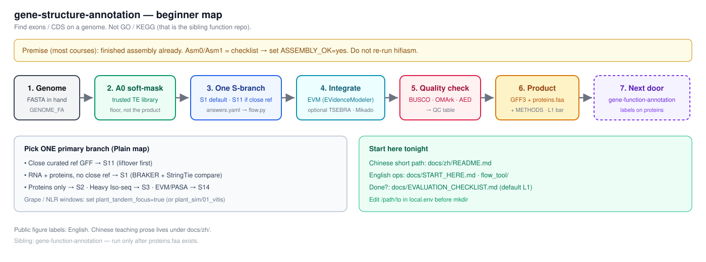

TE soft-mask is a prerequisite. TE library construction is a separate job in [vitis-te](https://github.com/Xuzhen-Li/vitis-te) and [`docs/TE_LIBRARY.md`](docs/TE_LIBRARY.md).
GO, KEGG, and readable names are in the sibling repository [`gene-function-annotation`](https://github.com/Xuzhen-Li/gene-function-annotation). This repository does not generate functional annotation tables.

Three layers:
1. Structure: This repository.
2. Function: [`gene-function-annotation`](https://github.com/Xuzhen-Li/gene-function-annotation).
3. TE library build: [vitis-te](https://github.com/Xuzhen-Li/vitis-te) and [`TE_LIBRARY.md`](docs/TE_LIBRARY.md).

Boundary definitions are in [`docs/BOUNDARY.md`](docs/BOUNDARY.md).

Chinese shortest path is [`docs/zh/README.md`](docs/zh/README.md). English entry point is [`docs/START_HERE.md`](docs/START_HERE.md).
Quickstart is at [Wiki Start-tonight](https://github.com/Xuzhen-Li/gene-structure-annotation/wiki/Start-tonight). Offline version is [`docs/CLASSROOM_TONIGHT.md`](docs/CLASSROOM_TONIGHT.md).
Track work at [Annotation board (Project #2)](https://github.com/users/Xuzhen-Li/projects/2).


This page also serves as the 2026-11 methods catalog: 174 tools, databases and ideas across 15 type sections (updated 2026-11-14). The default path is unchanged (see Usage and `docs/ROADMAP.md`). Stage order remains in the roadmap and in `catalog/`.

## Usage

Chinese teaching entry is [`docs/zh/`](docs/zh/).
If already assembled, treat Asm0/Asm1 as a checklist and set `ASSEMBLY_OK=yes`. Edit every `/path/to` in `local.env` before any `mkdir`.
For a close curated reference GFF, set `close_curated_ref: true` in your answers (see `examples/plant_sim/03_solanum_s11`). Default `false` gives S1; a half-done Liftoff stays `false`.

Step 1: Provide evidence.
```bash
git clone https://github.com/Xuzhen-Li/gene-structure-annotation.git
cd gene-structure-annotation
cp pipeline/flow_tool/answers.example.yaml my_answers.yaml
# edit yes/no: RNA? proteins? close reference? paper bar?
python3 pipeline/flow_tool/flow.py --answers my_answers.yaml -o my_plan.md
```
Open `my_plan.md` to see the selected branch and stage explanations.

Step 2: Configure paths.
```bash
cp config/example.env config/local.env
# set GENOME_FA, BUSCO_LINEAGE, RNA_BAM / PROTEIN_DB, TE lib, WORK_DIR, THREADS
```

Step 3: Execution.
Finish `my_plan.md`. Read [Wiki Concepts](https://github.com/Xuzhen-Li/gene-structure-annotation/wiki/Concepts) or [`docs/zh/05_softmask与A0.md`](docs/zh/05_softmask与A0.md). Write `grade=` and `status=` separately. Do not write `status=L1`.
Run on cluster only after [Done when](https://github.com/Xuzhen-Li/gene-structure-annotation/wiki/Start-tonight#done-when) is ticked and `python3 pipeline/print_qc_commands.py` exits 0 with no `[STOP]`. Otherwise no `RUN=1`. Browsing with `--env config/example.env` will show `[STOP]`; this is expected.
Follow stages in `my_plan.md` and check [`docs/EVALUATION_CHECKLIST.md`](docs/EVALUATION_CHECKLIST.md). Read full rules in [`docs/EVALUATION.md`](docs/EVALUATION.md).
Provisional results are not L1. Read [`docs/EVALUATION.md`](docs/EVALUATION.md) for L0 vs L1.
The default branch is S1 for RNA and proteins with no close reference.
Handoff to function uses [`docs/HANDOFF_STRUCTURE_TO_FUNCTION.md`](docs/HANDOFF_STRUCTURE_TO_FUNCTION.md) with `RELEASE_TAG` and `PROTEINS_FA=…/release/<TAG>/proteins.faa`.

## Branches

Choose a branch based on evidence.
S11: Close curated reference GFF (Liftoff, LiftOn, CAT). Lift-only is S11-lite.
S1: RNA and proteins (BRAKER, StringTie).
S2: Proteins only (GALBA, GeMoMa).
S3: Heavy Iso-seq (IsoQuant, SQANTI).
S13: GPU ab initio comparison (Helixer, Tiberius, ANNEVO).
S14: Full classic PASA plus EVM route (`docs/steps/dclab/`). The Integrate step (EVM) runs only for S14 or when a second gene set exists (dual-track).

Overlays:
L2: Acceptance level L1 plus S5 overlay for Paper/T2T bar.
S7: Plant NLR or tandem windows overlay when `plant_tandem_focus: true`.

Full map is at [`docs/ROADMAP.md`](docs/ROADMAP.md).
Workflow chart with tool choices and decision points (2026-11-14): [`docs/ROADMAP.md#workflow-2026-11-14`](docs/ROADMAP.md#workflow-2026-11-14).

## Documentation

Chinese teaching and start is [`docs/zh/`](docs/zh/) and [`docs/START_HERE.md`](docs/START_HERE.md).

Narrated auto-plan: [`pipeline/flow_tool/`](pipeline/flow_tool/)
Stage I/O and evaluation: [`docs/STAGE_IO.md`](docs/STAGE_IO.md), [`docs/EVALUATION_CHECKLIST.md`](docs/EVALUATION_CHECKLIST.md), [`docs/EVALUATION.md`](docs/EVALUATION.md)
TE soft-mask: [`docs/TE_LIBRARY.md`](docs/TE_LIBRARY.md), [`docs/TRUSTED_TE_PATH.md`](docs/TRUSTED_TE_PATH.md)
Branch map and walkthrough: [`docs/ROADMAP.md`](docs/ROADMAP.md), [`docs/QUICKSTART.md`](docs/QUICKSTART.md)
Three-layer boundary: [`docs/BOUNDARY.md`](docs/BOUNDARY.md)
Post-assembly notes: [`docs/POST_ASSEMBLY.md`](docs/POST_ASSEMBLY.md)
QC sources: [`docs/QUALITY_SOURCES.md`](docs/QUALITY_SOURCES.md)
EDTA manual: [`docs/tools/edta.md`](docs/tools/edta.md)
BUSCO lineages: [`docs/LINEAGES.md`](docs/LINEAGES.md)
S11 gap-fill: [`pipeline/A2e_s11_gapfill.md`](pipeline/A2e_s11_gapfill.md), [`pipeline/A2c_liftoff.md`](pipeline/A2c_liftoff.md)
Golden pack checklist: [`examples/golden_pack/`](examples/golden_pack/)
Protein database: [`pipeline/A2_protein_db.md`](pipeline/A2_protein_db.md)
Helixer vs BRAKER: [`docs/COMPARE_HELIXER_BRAKER.md`](docs/COMPARE_HELIXER_BRAKER.md)
Merge and entry modes: [`docs/MERGE_AND_ENTRIES.md`](docs/MERGE_AND_ENTRIES.md)
Multi-source aggregation (EVM, optional TSEBRA / Mikado / PASA update): [`pipeline/A4_aggregation.md`](pipeline/A4_aggregation.md) Step A4 combines several gene sets and evidence into one final gene set with EVidenceModeler (EVM).
EGAPx compare: [`docs/EGAPX_COMPARE.md`](docs/EGAPX_COMPARE.md)
Scenarios and tools: [`docs/SCENARIOS.md`](docs/SCENARIOS.md), [`docs/TOOLS.md`](docs/TOOLS.md), [`docs/cases/vitis-t2t-s1-s5.md`](docs/cases/vitis-t2t-s1-s5.md), [`docs/TUTORIALS_AND_MEETINGS.md`](docs/TUTORIALS_AND_MEETINGS.md), [`docs/PLAYBOOK.md`](docs/PLAYBOOK.md)

## Scope

This is not functional annotation. Use [`gene-function-annotation`](https://github.com/Xuzhen-Li/gene-function-annotation) for GO/KEGG.
This is not a standalone TE library build. Use [vitis-te](https://github.com/Xuzhen-Li/vitis-te) and `docs/TE_LIBRARY.md`.
This is not for pangenome graphs. Use [vitis-pangenome](https://github.com/Xuzhen-Li/vitis-pangenome).
Do not commit private FASTQ/BAM files.

Author: Xuzhen Li, [ORCID](https://orcid.org/0000-0003-3670-6657).

## Methods catalog

This page lists, by type, the 174 methods, tools, databases and ideas from the 2026-11 survey (78 in the type catalog, 57 first-pass cards in `catalog/`) and the 2026-11-14 update (2 older-version entries merged, 41 added). The default path remains the one in Usage and in `docs/ROADMAP.md`; the catalog does not change it. Stage order stays in the roadmap and in `catalog/`. Full tables and errata are in `docs/CATALOG_BY_TYPE_2026-11.md` and `docs/CATALOG_NEW_TOOLS_2026-11.md`.

**2026-11-14 update.** Each section now opens with a **Clusters:** list. It groups the entries as alternatives (pick one), complementary (use together) or in order (run in sequence), with a note on when to pick which. Inside a list, “A or B” means pick one of the two and “A → B” is one fixed route. Different versions of one program are now one entry named for the latest version; older versions are only mentioned in that entry's note. A workflow chart with tool choices and decision points is in [`docs/ROADMAP.md`](docs/ROADMAP.md#workflow-2026-11-14).

## Contents

1. [Assembly and assembly QC](#section-1) (19)
2. [Soft-mask with a trusted library](#section-2) (8)
3. [RNA and Iso-Seq evidence](#section-3) (30)
4. [Protein evidence](#section-4) (8)
5. [Ab initio gene finders](#section-5) (9)
6. [DNA language-model predictors](#section-6) (8)
7. [Lift-over and annotation transfer](#section-7) (9)
8. [Combiners and annotation pipelines](#section-8) (12)
9. [Non-coding RNA and pseudogene loci](#section-9) (17)
10. [Gene-model QC](#section-10) (7)
11. [Curation and browsers](#section-11) (7)
12. [GFF3 cleanup and release](#section-12) (10)
13. [Reference databases](#section-13) (10)
14. [Standards and reviews](#section-14) (12)
15. [Ideas not yet tied to one tool](#section-15) (8)

- [Data needed alongside the genome](#data-needs)
- [Figure credits](#figure-credits)

How the sections line up with this repo: assembly and QC (Asm0/Asm1) → soft-mask (A0) → evidence and a draft branch (S11/S1/S2/S3/S13/S14) → combiners (A4) → model QC and last-mile → release and handoff (A6). Stage IDs stay in `docs/ROADMAP.md` and `catalog/`.

<a id="section-1"></a>
## 1. Assembly and assembly QC

Tools that decide whether an assembly is ready to annotate, or that produce the haplotype FASTA itself (Asm0, Asm1).

**Needs:** the assembly FASTA; add the assembly reads when checking k-mers or base accuracy. BUSCO needs a lineage that matches the clade (see `docs/LINEAGES.md`). [Data needs by scenario](#data-needs)

**Clusters:**
- *Assemble and scaffold* (alternatives): hifiasm, Verkko, YaHS, RagTag. hifiasm is the default for HiFi (+Hi-C); pick Verkko when ultra-long ONT is available for T2T. Scaffold with YaHS when Hi-C is available; use RagTag only with a close reference.
- *Accuracy and completeness* (complementary): Merqury, CRAQ, Inspector, GCI, compleasm, LTR Assembly Index (LAI), QUAST, gfastats. Run together: Merqury for QV, compleasm for gene space, and LAI for repeat space; CRAQ and Inspector locate error sites; gfastats and QUAST generate summary tables.
- *Contamination and chromosome ends* (complementary): NCBI FCS-GX, BlobToolKit, Tiara, tidk, quarTeT. FCS-GX is required before NCBI submission; BlobToolKit and Tiara classify flagged contigs. tidk and quarTeT confirm telomeres on T2T chromosomes.
- *Read k-mer profiling* (complementary): GenomeScope 2.0 / Smudgeplot, KAT (K-mer Analysis Toolkit). Run before or right after assembly to estimate genome size, heterozygosity and ploidy from reads.

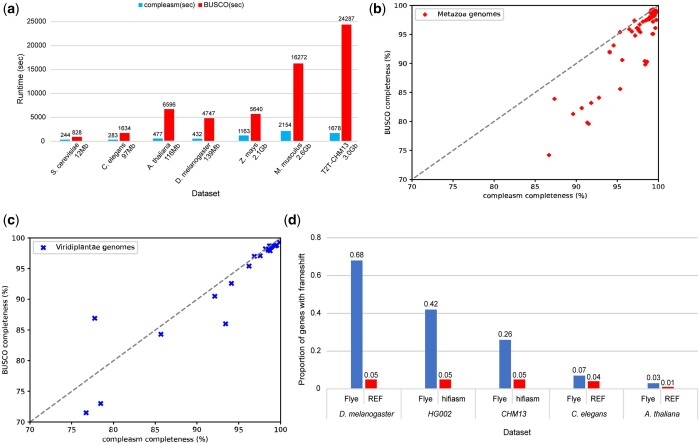

*compleasm compared with BUSCO on the same assemblies (Fig. 1). Huang and Li 2023, Bioinformatics, Fig. 1, doi:10.1093/bioinformatics/btad595, PMC10558035, CC BY.*

- **hifiasm** (tool) — Haplotype-resolved de novo assembler for PacBio HiFi reads (trio, Hi-C or ultra-long phasing modes). [doi:10.1038/s41592-020-01056-5](https://doi.org/10.1038/s41592-020-01056-5) · [link](https://github.com/chhylp123/hifiasm)
- **Verkko** (tool) — Telomere-to-telomere diploid assembly combining HiFi and ultra-long ONT reads in a graph. [doi:10.1038/s41587-023-01662-6](https://doi.org/10.1038/s41587-023-01662-6) · [link](https://github.com/marbl/verkko)
- **YaHS** (tool) — Hi-C scaffolder producing chromosome-scale scaffolds from contigs. [doi:10.1093/bioinformatics/btac808](https://doi.org/10.1093/bioinformatics/btac808) · [link](https://github.com/c-zhou/yahs)
- **RagTag** (tool) — Reference-guided correction, scaffolding and patching of draft assemblies. [doi:10.1186/s13059-022-02823-7](https://doi.org/10.1186/s13059-022-02823-7) · [link](https://github.com/malonge/RagTag)
- **GenomeScope 2.0 / Smudgeplot** (tool) — k-mer profiling of genome size, heterozygosity and ploidy from reads. [doi:10.1038/s41467-020-14998-3](https://doi.org/10.1038/s41467-020-14998-3) · [link](https://github.com/tbenavi1/genomescope2.0)
- **Merqury** (tool) — Reference-free k-mer QV, completeness and phasing assessment of assemblies. [doi:10.1186/s13059-020-02134-9](https://doi.org/10.1186/s13059-020-02134-9) · [link](https://github.com/marbl/merqury)
- **QUAST** (tool) — Assembly contiguity and misassembly statistics, optionally against a reference. [doi:10.1093/bioinformatics/btt086](https://doi.org/10.1093/bioinformatics/btt086) · [link](https://github.com/ablab/quast)
- **Inspector** (tool) — Reference-free assembly evaluation and error correction using long reads. [doi:10.1186/s13059-021-02527-4](https://doi.org/10.1186/s13059-021-02527-4) · [link](https://github.com/Maggi-Chen/Inspector)
- **KAT (K-mer Analysis Toolkit)** (tool) — k-mer spectra comparison of reads vs assembly (copy-number plots). [doi:10.1093/bioinformatics/btw663](https://doi.org/10.1093/bioinformatics/btw663) · [link](https://github.com/EarlhamInst/KAT)
- **BlobToolKit** (tool) — Interactive GC/coverage/taxonomy plots to spot contaminant contigs. [doi:10.1534/g3.119.400908](https://doi.org/10.1534/g3.119.400908) · [link](https://github.com/genomehubs/blobtoolkit)
- **Tiara** (tool) — Deep-learning classification of contigs into nuclear, organellar and prokaryotic origin. [doi:10.1093/bioinformatics/btab672](https://doi.org/10.1093/bioinformatics/btab672) · [link](https://github.com/ibe-uw/tiara)
- **tidk** (tool) — Finds and plots telomeric repeats along an assembly. [doi:10.1093/bioinformatics/btaf049](https://doi.org/10.1093/bioinformatics/btaf049) · [link](https://github.com/tolkit/telomeric-identifier)
- **quarTeT** (tool) — Telomere-to-telomere toolkit: reference-guided assembly, gap filling, telomere and centromere identification. [doi:10.1093/hr/uhad127](https://doi.org/10.1093/hr/uhad127) · [link](https://github.com/aaranyue/quarTeT)
- **GCI** (tool) — Genome Continuity Inspector: read-mapping based continuity score for near-complete assemblies. [doi:10.1093/bioinformatics/btae633](https://doi.org/10.1093/bioinformatics/btae633) · [link](https://github.com/yeeus/GCI)
- **gfastats** (tool) — Fast summary statistics and manipulation of FASTA/GFA assemblies. [doi:10.1093/bioinformatics/btac460](https://doi.org/10.1093/bioinformatics/btac460) · [link](https://github.com/vgl-hub/gfastats)
- **CRAQ** (tool) — Reference-free assembly assessment from clipped-read alignments (regional and structural errors). [link](https://github.com/JiaoLaboratory/CRAQ) [待确认]
- **NCBI FCS-GX** (tool) — Detects and removes foreign-organism contamination in assemblies before submission/annotation. [doi:10.1186/s13059-024-03198-7](https://doi.org/10.1186/s13059-024-03198-7) · [link](https://github.com/ncbi/fcs)
- **compleasm** (tool) — Reimplements BUSCO on top of miniprot using the same lineage sets; much faster and often more accurate for gene-space completeness in large plant assemblies. [doi:10.1093/bioinformatics/btad595](https://doi.org/10.1093/bioinformatics/btad595) · [link](https://github.com/huangnengCSU/compleasm)
- **LTR Assembly Index (LAI)** (tool) — Scores the proportion of intact LTR retrotransposon (LTR-RT) length to total LTR-RT length in an assembly; a repeat-space check that complements BUSCO before annotation. [doi:10.1093/nar/gky730](https://doi.org/10.1093/nar/gky730) · [link](https://github.com/oushujun/LTR_retriever)

<a id="section-2"></a>
## 2. Soft-mask with a trusted library

Masking repeats with a trusted TE library, or low-complexity masking. This repo does not build TE libraries.

**Needs:** a trusted TE library from vitis-te (or another curated library). This section only soft-masks; it does not build a TE library. [Data needs by scenario](#data-needs)

**Clusters:**
- *Library and masker* (complementary): Dfam, RepeatMasker. Default A0: the vitis-te library (Dfam adds known families) run through RepeatMasker.
- *Tandem and satellite repeats* (complementary): Tandem Repeats Finder (TRF), ULTRA, TRASH. Add to the mask when centromeres or long satellites are present; TRASH also classifies centromeric arrays.
- *Library-free and library-build (compare only)* (alternatives): WindowMasker, Red, Earl Grey. WindowMasker and Red mask without a library; Earl Grey builds and applies its own library. All three are only for comparison with the A0 mask and never replace the vitis-te library on the default path.


- **RepeatMasker** (tool) — Masks repeats with a supplied library (Dfam or a curated species library); -xsmall gives soft-masking. [link](https://github.com/Dfam-consortium/RepeatMasker)
- **Dfam** (resource) — Open database of TE families and profile HMMs used by RepeatMasker. [doi:10.1186/s13100-020-00230-y](https://doi.org/10.1186/s13100-020-00230-y) · [link](https://www.dfam.org/)
- **Tandem Repeats Finder (TRF)** (tool) — Detects tandem repeats. [doi:10.1093/nar/27.2.573](https://doi.org/10.1093/nar/27.2.573) · [link](https://github.com/Benson-Genomics-Lab/TRF)
- **WindowMasker** (tool) — Library-free masking of over-represented k-mers (NCBI). [doi:10.1093/bioinformatics/bti774](https://doi.org/10.1093/bioinformatics/bti774) · [link](https://www.ncbi.nlm.nih.gov/IEB/ToolBox/CPP_DOC/lxr/source/src/app/winmasker/)
- **ULTRA** (tool) — Probabilistic labeling of tandem / low-complexity repeats; output can feed soft-masking alongside a trusted TE library. [doi:10.1093/bioadv/vbae149](https://doi.org/10.1093/bioadv/vbae149) · [link](https://github.com/TravisWheelerLab/ULTRA)
- **Red** (tool) — Library-free de novo repeat detector that produces a quick soft-mask when no trusted library exists yet. Use only as a comparison track against the vitis-te library. [doi:10.1186/s12859-015-0654-5](https://doi.org/10.1186/s12859-015-0654-5)
- **TRASH** (tool) — Finds and classifies tandem and satellite repeat arrays such as centromeric repeats; useful for masking or flagging T2T centromeres before gene finding. [doi:10.1093/bioinformatics/btad308](https://doi.org/10.1093/bioinformatics/btad308) · [link](https://github.com/vlothec/TRASH)
- **Earl Grey** (tool) — Automated TE annotation pipeline built around RepeatModeler2 and RepeatMasker. Library building belongs to vitis-te; listed here only for mask comparison. [doi:10.1093/molbev/msae068](https://doi.org/10.1093/molbev/msae068) · [link](https://github.com/TobyBaril/EarlGrey)

<a id="section-3"></a>
## 3. RNA and Iso-Seq evidence

Short-read and long-read RNA alignment, transcript assembly and ORF calling used as evidence for gene models (A1b).

**Needs:** short-read RNA-seq from the same genotype where possible (FASTQ or a ready `RNA_BAM`); for the S3 branch, add deep Iso-Seq / long-read RNA. [Data needs by scenario](#data-needs)

**Clusters:**
- *Short-read path* (in order): fastp, HISAT2 or STAR, Portcullis, StringTie (v3 line) or Scallop2 or Aletsch. Trim, align, filter junctions with Portcullis before assembly, then assemble: StringTie is the default; Scallop2 or Aletsch for many shallow samples. TransDecoder can then call ORFs on the assembled transcripts.
- *Trinity route* (in order): Trinity, PASA, TransDecoder. Only when a genome-free transcript assembly is needed: PASA aligns and updates the Trinity assemblies, then TransDecoder calls ORFs.
- *Long-read isoforms* (in order): IsoSeq (PacBio), IsoQuant or Bambu or FLAIR or Mandalorion or ESPRESSO or TAMA or FLIC (Full-length isoform constructor) or Isocall or TAGET, SQANTI3. IsoSeq preprocessing applies to PacBio reads only. Pick one isoform builder: IsoQuant is the default, FLAIR suits ONT, Mandalorion accurate reads. Always finish with SQANTI3 QC before isoforms become evidence.
- *Long-read aligners* (alternatives): minimap2, uLTRA, deSALT. minimap2 splice mode is the default; uLTRA improves small-exon alignment when an annotation exists.
- *Translation evidence* (complementary): RiboCode, Ribo-TISH, RiboBA, PhyloCSF++, KuPID. Use only for small ORFs, uORFs or disputed start sites; requires Ribo-seq or conservation tracks.

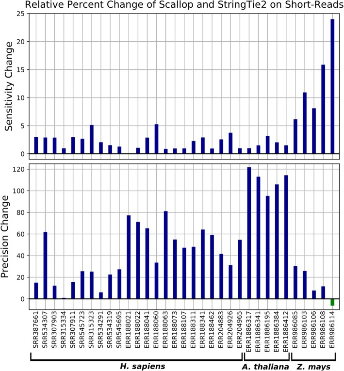

*StringTie2 transcript assembly on plant RNA-seq (Fig. 2). Kovaka et al. 2019, Genome Biol., Fig. 2, doi:10.1186/s13059-019-1910-1, PMC6912988, CC BY.*

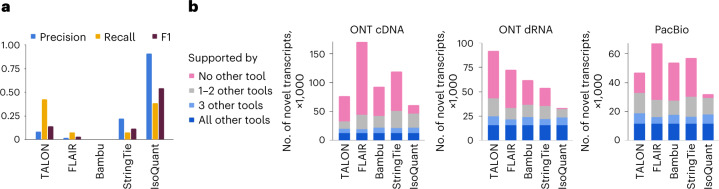

*IsoQuant on real long RNA reads (Fig. 2). The source panel is short (719×189). Prjibelski et al. 2023, Nat. Biotechnol., Fig. 2, doi:10.1038/s41587-022-01565-y, PMC10344776, CC BY.*

- **HISAT2** (tool) — Spliced aligner for short RNA-seq reads (graph-based index). [doi:10.1038/s41587-019-0201-4](https://doi.org/10.1038/s41587-019-0201-4) · [link](https://github.com/DaehwanKimLab/hisat2)
- **STAR** (tool) — Ultrafast spliced short-read aligner with two-pass junction discovery. [doi:10.1093/bioinformatics/bts635](https://doi.org/10.1093/bioinformatics/bts635) · [link](https://github.com/alexdobin/STAR)
- **minimap2** (tool) — Long-read and cDNA/Iso-Seq spliced aligner (-ax splice). [doi:10.1093/bioinformatics/bty191](https://doi.org/10.1093/bioinformatics/bty191) · [link](https://github.com/lh3/minimap2)
- **fastp** (tool) — All-in-one FASTQ QC and adapter trimming. [doi:10.1093/bioinformatics/bty560](https://doi.org/10.1093/bioinformatics/bty560) · [link](https://github.com/OpenGene/fastp)
- **Trinity** (tool) — De novo and genome-guided transcriptome assembly from RNA-seq. [doi:10.1038/nbt.1883](https://doi.org/10.1038/nbt.1883) · [link](https://github.com/trinityrnaseq/trinityrnaseq)
- **PASA** (tool) — Aligns and assembles transcripts into gene structures; also updates models with UTRs and isoforms. [doi:10.1093/nar/gkg770](https://doi.org/10.1093/nar/gkg770) · [link](https://github.com/PASApipeline/PASApipeline)
- **TransDecoder** (tool) — Finds candidate coding regions in transcripts (ORFs with homology/Pfam support). [link](https://github.com/TransDecoder/TransDecoder)
- **IsoQuant** (tool) — Long-read transcript discovery and quantification against a genome. [doi:10.1038/s41587-022-01565-y](https://doi.org/10.1038/s41587-022-01565-y) · [link](https://github.com/ablab/IsoQuant)
- **Bambu** (tool) — Context-aware long-read transcript discovery and quantification (R/Bioconductor). [doi:10.1038/s41592-023-01908-w](https://doi.org/10.1038/s41592-023-01908-w) · [link](https://github.com/GoekeLab/bambu)
- **SQANTI3** (tool) — Classifies and filters long-read isoforms against a reference annotation. [doi:10.1038/s41592-024-02229-2](https://doi.org/10.1038/s41592-024-02229-2) · [link](https://github.com/ConesaLab/SQANTI3)
- **TAMA** (tool) — Collapses and merges long-read transcript models; annotation tools for Iso-Seq. [doi:10.1186/s12864-020-07123-7](https://doi.org/10.1186/s12864-020-07123-7) · [link](https://github.com/GenomeRIK/tama)
- **IsoSeq (PacBio)** (tool) — Official PacBio Iso-Seq processing (refine, cluster, collapse). [link](https://github.com/PacificBiosciences/IsoSeq)
- **StringTie (v3 line)** (tool) — Reference-guided / de novo transcript assembly from short and long RNA reads; used as transcript evidence and as the compare track. [doi:10.1186/s13059-019-1910-1](https://doi.org/10.1186/s13059-019-1910-1) · [link](https://github.com/gpertea/stringtie)
- **FLIC (Full-length isoform constructor)** (tool) — Builds full-length isoforms from long reads using replicate concordance and TSS/polyA peak calling. [doi:10.1093/bioinformatics/btaf551](https://doi.org/10.1093/bioinformatics/btaf551) · [link](https://github.com/albidgy/FLIC)
- **Isocall** (tool) — Joint calling of known and novel isoforms across many PacBio Iso-Seq samples (alternative to isoseq cluster/collapse). [link](https://github.com/PacificBiosciences/isocall)
- **ESPRESSO** (tool) — Discovery and quantification of isoforms from error-prone long-read RNA-seq. [doi:10.1126/sciadv.abq5072](https://doi.org/10.1126/sciadv.abq5072) · [link](https://github.com/Xinglab/espresso)
- **TAGET** (tool) — Iso-Seq toolkit: alignment with CNN splice-site correction, isoform classification, expression. [doi:10.1038/s41467-023-41649-0](https://doi.org/10.1038/s41467-023-41649-0) [待确认]
- **RiboCode** (tool) — Identifies actively translated ORFs from ribosome-profiling data. [doi:10.1093/nar/gky179](https://doi.org/10.1093/nar/gky179) · [link](https://github.com/xryanglab/RiboCode)
- **Ribo-TISH** (tool) — Translation initiation sites and ORFs from (QTI-seq / regular) Ribo-seq. [doi:10.1038/s41467-017-01981-8](https://doi.org/10.1038/s41467-017-01981-8) · [link](https://github.com/zhpn1024/ribotish)
- **PhyloCSF++** (tool) — Fast PhyloCSF: codon-substitution evidence of protein-coding potential from multi-species alignments. [doi:10.1093/bioinformatics/btab756](https://doi.org/10.1093/bioinformatics/btab756) · [link](https://github.com/cpockrandt/PhyloCSFpp)
- **KuPID** (tool) — k-mer-based upstream preprocessing of long reads for isoform discovery (preprint). [doi:10.64898/2025.12.05.692400](https://doi.org/10.64898/2025.12.05.692400) [待确认]
- **RiboBA** (tool) — Bias-aware probabilistic ORF identification across Ribo-seq protocols (preprint). [doi:10.64898/2026.03.17.712439](https://doi.org/10.64898/2026.03.17.712439) [待确认]
- **FLAIR** (tool) — Corrects, collapses and quantifies full-length isoforms from nanopore or PacBio reads aligned to a genome. Introduced in the cited CLL study. [doi:10.1038/s41467-020-15171-6](https://doi.org/10.1038/s41467-020-15171-6) · [link](https://github.com/BrooksLabUCSC/flair)
- **Mandalorion** (tool) — Identifies and quantifies high-confidence isoforms from accurate full-length reads (PacBio Iso-Seq or R2C2). [doi:10.1186/s13059-023-02999-6](https://doi.org/10.1186/s13059-023-02999-6) · [link](https://github.com/christopher-vollmers/Mandalorion)
- **uLTRA** (tool) — Aligns long RNA reads to the genome using an existing annotation as a guide; more accurate on small exons than standard minimap2 splice mode. Distinct from the ULTRA repeat labeller in section 2. [doi:10.1093/bioinformatics/btab540](https://doi.org/10.1093/bioinformatics/btab540) · [link](https://github.com/ksahlin/ultra)
- **deSALT** (tool) — Fast spliced aligner for noisy long RNA reads based on a de Bruijn graph index. [doi:10.1186/s13059-019-1895-9](https://doi.org/10.1186/s13059-019-1895-9) · [link](https://github.com/ydLiu-HIT/deSALT)
- **Scallop2** (tool) — Reference-based transcript assembler for paired- and multi-end short reads; an alternative to StringTie for S1 evidence. [doi:10.1038/s43588-022-00216-1](https://doi.org/10.1038/s43588-022-00216-1) · [link](https://github.com/Shao-Group/scallop2)
- **Aletsch** (tool) — Jointly assembles transcripts across many RNA-seq samples, which helps when individual tissue libraries are shallow. [doi:10.1093/bioinformatics/btae215](https://doi.org/10.1093/bioinformatics/btae215) · [link](https://github.com/Shao-Group/aletsch)
- **Portcullis** (tool) — Filters false splice junctions from RNA-seq alignments before gene finding; used in the REAT and Mikado workflows. [preprint] [doi:10.1101/217620](https://doi.org/10.1101/217620) · [link](https://github.com/EI-CoreBioinformatics/portcullis)
- **Sorghum Iso-Seq transcriptome survey** (analysis) — Early plant study showing how single-molecule full-length reads revise gene models and uncover missed isoforms. [doi:10.1038/ncomms11706](https://doi.org/10.1038/ncomms11706)

<a id="section-4"></a>
## 4. Protein evidence

Protein-to-genome alignment that supplies hints or homology drafts (A2 inputs).

**Needs:** a protein set (`PROTEIN_DB`) from close species or a curated database, for alignment to the genome (miniprot, GeneMark-EP, GALBA / GeMoMa). [Data needs by scenario](#data-needs)

**Clusters:**
- *Genome-wide protein hints* (alternatives): miniprot, ProtHint, MetaEuk, Spaln, GenomeThreader. miniprot is the default and is what GALBA2 uses; ProtHint is the protein-evidence step of the BRAKER (GeneMark-EP+/ETP) modes. MetaEuk outputs gene models, not hints: use it only as a quick protein-only second opinion.
- *Exact per-locus alignment* (alternatives): Exonerate, Scipio, GeneWise. Slow; use on a few loci during curation rather than genome-wide.

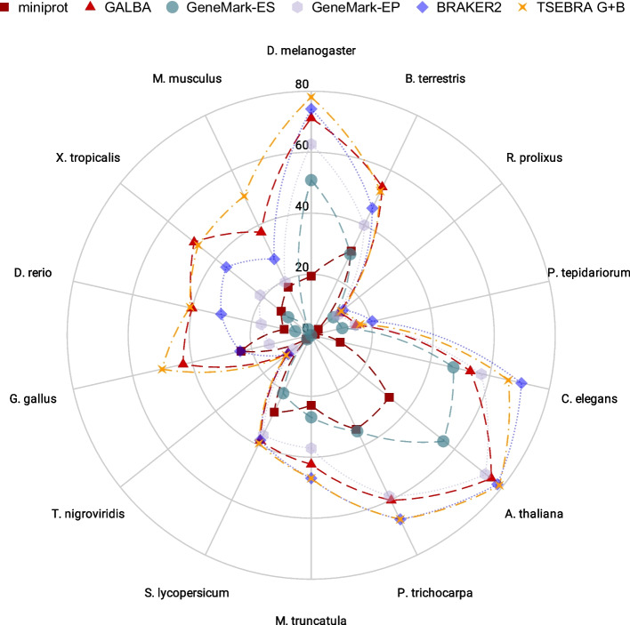

*GALBA protein-to-genome gene prediction on plant data (Fig. 5). Brůna et al. 2023, BMC Bioinformatics, Fig. 5, doi:10.1186/s12859-023-05449-z, PMC10472564, CC BY.*

- **miniprot** (tool) — Fast protein-to-genome spliced alignment. [doi:10.1093/bioinformatics/btad014](https://doi.org/10.1093/bioinformatics/btad014) · [link](https://github.com/lh3/miniprot)
- **GenomeThreader** (tool) — Spliced alignment of proteins/cDNA to genomes. [doi:10.1016/j.infsof.2005.09.005](https://doi.org/10.1016/j.infsof.2005.09.005) · [link](https://genomethreader.org/)
- **Exonerate** (tool) — Generic sequence alignment including protein2genome spliced models. [doi:10.1186/1471-2105-6-31](https://doi.org/10.1186/1471-2105-6-31)
- **Spaln** (tool) — Spliced alignment of cDNA/protein to genome with species-specific parameters. [doi:10.1093/bioinformatics/btn460](https://doi.org/10.1093/bioinformatics/btn460) · [link](https://github.com/ogotoh/spaln)
- **ProtHint** (tool) — Turns spliced alignments of cross-species proteins into intron and start/stop hints; the protein-evidence step of the BRAKER2/BRAKER3 (GeneMark-EP+/ETP) modes. GALBA uses miniprot instead. [doi:10.1093/nargab/lqaa108](https://doi.org/10.1093/nargab/lqaa108) · [link](https://github.com/gatech-genemark/ProtHint)
- **MetaEuk** (tool) — Fast protein-guided eukaryotic gene discovery built on MMseqs2; useful as a quick protein-only second opinion. [doi:10.1186/s40168-020-00808-x](https://doi.org/10.1186/s40168-020-00808-x) · [link](https://github.com/soedinglab/metaeuk)
- **Scipio** (tool) — Maps a known protein to the genome to recover its exact exon-intron structure; well suited for curating a few gene family members. [doi:10.1186/1756-0500-4-265](https://doi.org/10.1186/1756-0500-4-265) · [link](https://www.webscipio.org/)
- **GeneWise** (tool) — Classic frameshift-tolerant protein-to-genome aligner; still a reference for checking miniprot and Spaln on difficult loci. [doi:10.1101/gr.1865504](https://doi.org/10.1101/gr.1865504)

<a id="section-5"></a>
## 5. Ab initio gene finders

Ab initio or evidence-hinted gene finders that invent gene models on the masked genome (A2).

**Needs:** the soft-masked genome; RNA and/or proteins if the engine can take hints (BRAKER). Helixer / Tiberius can run from the genome alone, but should not silently replace an evidence-based S1 draft. [Data needs by scenario](#data-needs)

**Clusters:**
- *Evidence-trained pipelines* (alternatives): BRAKER4, GALBA2. BRAKER4 for S1 (RNA-seq + proteins, the BRAKER3 method); with proteins only BRAKER4 runs the BRAKER2 mode; GALBA2 for S2 with close-species proteins.
- *Engines inside the pipelines* (complementary): GeneMark-ETP, AUGUSTUS. GeneMark-ETP trains on the evidence and AUGUSTUS is trained on its predictions; run them on their own only for debugging or comparison.
- *Deep-learning finders (no training)* (alternatives): Helixer, Tiberius, ANNEVO. The S13 compare track; Helixer has plant models, Tiberius is strongest where trained clades match.
- *Legacy HMM finders* (complementary): SNAP, GlimmerHMM. Use only as extra inputs for MAKER2 or EVM comparisons.

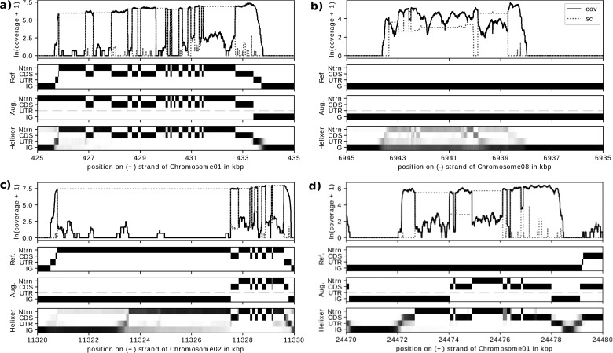

*Helixer gene models at a cassava locus (Fig. 3). Stiehler et al. 2021, Bioinformatics, Fig. 3, doi:10.1093/bioinformatics/btaa1044, PMC8016489, CC BY.*

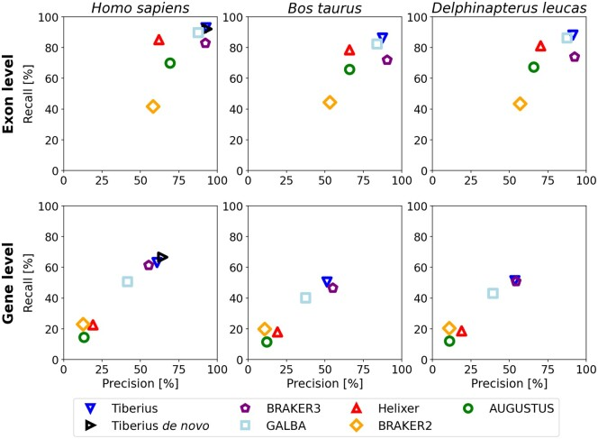

*Tiberius precision-recall compared with peer gene finders (Fig. 3). Gabriel, Becker, Hoff and Stanke 2024, Bioinformatics, Fig. 3, doi:10.1093/bioinformatics/btae685, PMC11645249, CC BY.*

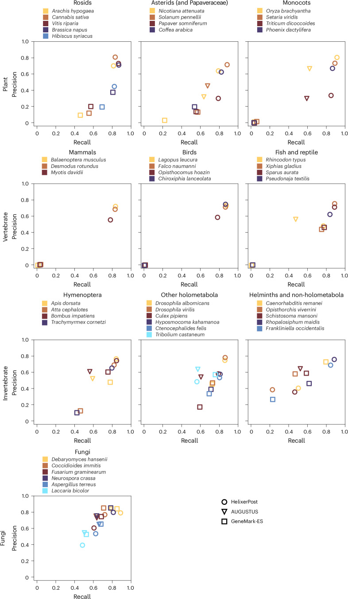

*Helixer exon-level precision-recall in the 2026 methods paper (Fig. 1). Holst et al. 2026, Nat. Methods, Fig. 1, doi:10.1038/s41592-025-02939-1, PMC13076211, CC BY.*

- **AUGUSTUS** (tool) — HMM gene finder with hints from RNA/protein evidence. [doi:10.1093/bioinformatics/btn013](https://doi.org/10.1093/bioinformatics/btn013) · [link](https://github.com/Gaius-Augustus/Augustus)
- **BRAKER4** (tool) — BRAKER4 is the Snakemake reimplementation of BRAKER3 that runs GeneMark-ETP and AUGUSTUS with RNA-seq and protein evidence and merges predictions with TSEBRA. The method paper is BRAKER3 (below); the braker.pl BRAKER3 release remains the fallback when containers are unavailable. With proteins only, it runs the mode first published as BRAKER2 (GeneMark-EP+, doi:10.1093/nargab/lqaa108). [doi:10.1101/gr.278090.123](https://doi.org/10.1101/gr.278090.123) · [link](https://github.com/Gaius-Augustus/BRAKER4)
- **GALBA2** (tool) — GALBA2 is the Snakemake port of GALBA that trains AUGUSTUS from miniprot alignments of proteins from a related species (S2). The method paper is GALBA (below); the original GALBA release serves as the fallback. [doi:10.1186/s12859-023-05449-z](https://doi.org/10.1186/s12859-023-05449-z) · [link](https://github.com/Gaius-Augustus/GALBA2)
- **SNAP** (tool) — Semi-HMM ab initio gene finder trainable on new genomes. [doi:10.1186/1471-2105-5-59](https://doi.org/10.1186/1471-2105-5-59) · [link](https://github.com/KorfLab/SNAP)
- **GlimmerHMM** (tool) — Generalized HMM eukaryotic gene finder. [doi:10.1093/bioinformatics/bth315](https://doi.org/10.1093/bioinformatics/bth315) · [link](https://ccb.jhu.edu/software/glimmerhmm/)
- **Tiberius** (tool) — End-to-end deep learning plus HMM ab initio gene prediction. [doi:10.1093/bioinformatics/btae685](https://doi.org/10.1093/bioinformatics/btae685) · [link](https://github.com/Gaius-Augustus/Tiberius)
- **GeneMark-ETP** (tool) — Gene finder integrating transcript and protein evidence with self-training (core of BRAKER3). [doi:10.1101/gr.278373.123](https://doi.org/10.1101/gr.278373.123) · [link](https://github.com/gatech-genemark/GeneMark-ETP)
- **ANNEVO** (tool) — Deep-learning ab initio gene annotation modelling evolutionary context. [preprint] [doi:10.21203/rs.3.rs-6402260/v1](https://doi.org/10.21203/rs.3.rs-6402260/v1) · [link](https://github.com/xjtu-omics/ANNEVO)
- **Helixer** (tool) — Deep-learning and HMM ab initio gene predictor that runs from genome sequence alone using pretrained plant models; serves as the S13 comparison track. The 2020 paper (doi:10.1093/bioinformatics/btaa1044) describes the earlier base-wise version. [doi:10.1038/s41592-025-02939-1](https://doi.org/10.1038/s41592-025-02939-1) · [link](https://github.com/weberlab-hhu/Helixer)

<a id="section-6"></a>
## 6. DNA language-model predictors

DNA language-model gene predictors, used here as an S13 compare track unless a documented exception applies.

**Needs:** the soft-masked genome and a GPU for the usual S13 compare. Treat the output as a compare track unless a documented exception applies. [Data needs by scenario](#data-needs)

**Clusters:**
- *Gene callers built on language models* (alternatives): Carbon-A + Carbon Annotation Database (CADB), GENATATORs. Use as comparison tracks only; check against BUSCO and PSAURON before trusting.
- *Nucleotide-level segmenters* (alternatives): SegmentNT, Nucleotide Transformer v3 (NTv3), GENA-LM. Output per-base exon, intron and splice-site probabilities; useful as hints, not as final models.
- *Foundation models (features only)* (complementary): AgroNT, PlantCaduceus, Evo 2. Plant-trained AgroNT and PlantCaduceus, plus cross-domain Evo 2: provide embeddings and variant effects, not gene models.

- **Carbon-A + Carbon Annotation Database (CADB)** (tool / resource) — 1.2B-parameter encoder predicting protein-coding genes from DNA across eukaryotes with per-gene confidence; CADB applies it to GenBank assemblies (566M loci). [doi:10.64898/2026.10.20.760448](https://doi.org/10.64898/2026.10.20.760448) · [link](https://huggingface.co/HuggingFaceBio/Carbon-A-1.2B)
- **Nucleotide Transformer v3 (NTv3)** (tool) — Long-context cross-kingdom DNA foundation model; reports gene-annotation performance above ab initio predictors in mammals, plants, insects. [doi:10.64898/2025.12.22.695963](https://doi.org/10.64898/2025.12.22.695963) · [link](https://github.com/instadeepai/nucleotide-transformer) [待确认]
- **GENATATORs** (tool) — Ab initio gene annotation with DNA language models (preprint 2026). [doi:10.64898/2026.06.17.732686](https://doi.org/10.64898/2026.06.17.732686) [待确认]
- **AgroNT** (tool) — DNA language model trained on 48 edible-plant genomes; downstream tasks include regulatory and splice-site style predictions. [doi:10.1038/s42003-024-06465-2](https://doi.org/10.1038/s42003-024-06465-2) · [link](https://huggingface.co/InstaDeepAI/agro-nucleotide-transformer-1b)
- **PlantCaduceus** (tool) — Cross-species plant DNA language model at single-nucleotide resolution (splice/TIS/TTS annotation tasks). [doi:10.1073/pnas.2421738122](https://doi.org/10.1073/pnas.2421738122) · [link](https://github.com/kuleshov-group/PlantCaduceus)
- **Evo 2** (tool) — Genome language model across domains of life; zero-shot features for exon/intron and variant effect. [doi:10.1101/2025.02.18.638918](https://doi.org/10.1101/2025.02.18.638918) · [link](https://github.com/ArcInstitute/evo2)
- **SegmentNT** (tool) — Segments DNA at single-base resolution into exons, introns, splice sites and regulatory elements on a Nucleotide Transformer backbone. [doi:10.1038/s41592-025-02881-2](https://doi.org/10.1038/s41592-025-02881-2) · [link](https://github.com/instadeepai/nucleotide-transformer)
- **GENA-LM** (tool) — Open DNA language models for long inputs with fine-tuned splice-site and annotation tasks; a research comparison track rather than a gene caller. [doi:10.1093/nar/gkae1310](https://doi.org/10.1093/nar/gkae1310) · [link](https://github.com/AIRI-Institute/GENA_LM)

<a id="section-7"></a>
## 7. Lift-over and annotation transfer

Transfer of a close, curated annotation onto a new assembly (A2b / S11 / S4).

**Needs:** a close, curated reference GFF (same species or a trusted haplotype) plus the target genome; gap-fill evidence if claiming full S11 rather than S11-lite. [Data needs by scenario](#data-needs)

**Clusters:**
- *Coordinate lift* (alternatives): Liftoff, LiftOn, Comparative Annotation Toolkit (CAT), GrAnnoT. Prefer LiftOn (protein-aware) over Liftoff for a close curated reference (S11); use CAT for multiple genomes via a HAL alignment, and GrAnnoT across a pangenome graph.
- *Homology-based prediction* (alternatives): GeMoMa, TOGA2. GeMoMa predicts new models from reference proteins and intron positions; TOGA2 projects genes through whole-genome alignment chains and infers orthology. Both suit more distant references than a coordinate lift.
- *Check and polish after transfer* (complementary): LiftoffTools, GENESPACE, SynGAP. LiftoffTools reports changed genes and GENESPACE shows synteny gaps (checks); SynGAP then fixes missing or split models.


- **GeMoMa** (tool) — Homology-based gene prediction using intron-position conservation and optional RNA-seq. [doi:10.1007/978-1-4939-9173-0_9](https://doi.org/10.1007/978-1-4939-9173-0_9) · [link](https://www.jstacs.de/index.php/GeMoMa)
- **Liftoff** (tool) — Maps gene annotation from a reference to a target assembly of the same/close species. [doi:10.1093/bioinformatics/btaa1016](https://doi.org/10.1093/bioinformatics/btaa1016) · [link](https://github.com/agshumate/Liftoff)
- **LiftOn** (tool) — Combines DNA (Liftoff) and protein (miniprot) alignments to improve lift-over. [doi:10.1101/gr.279620.124](https://doi.org/10.1101/gr.279620.124) · [link](https://github.com/Kuanhao-Chao/LiftOn)
- **Comparative Annotation Toolkit (CAT)** (tool) — Projects annotation through a Cactus whole-genome alignment and merges with ab initio. [doi:10.1101/gr.233460.117](https://doi.org/10.1101/gr.233460.117) · [link](https://github.com/ComparativeGenomicsToolkit/Comparative-Annotation-Toolkit)
- **GrAnnoT** (tool) — Transfers GFF3 annotation through a pangenome graph (GFA) to embedded genomes; outputs graph annotation (GAF) and per-genome GFF3. [doi:10.24072/pcjournal.651](https://doi.org/10.24072/pcjournal.651) · [link](https://forge.ird.fr/diade/dynadiv/grannot)
- **TOGA2** (tool) — TOGA2 is the faster successor to TOGA that integrates annotation projection with orthology inference from whole-genome alignments. The method paper is TOGA (below). [doi:10.1126/science.abn3107](https://doi.org/10.1126/science.abn3107) · [link](https://github.com/hillerlab/TOGA2)
- **LiftoffTools** (tool) — Compares annotations mapped between assemblies: sequence variants in genes, synteny, copy-number changes. [doi:10.12688/f1000research.124059.2](https://doi.org/10.12688/f1000research.124059.2) · [link](https://github.com/agshumate/LiftoffTools)
- **GENESPACE** (tool) — Synteny-constrained orthology across genomes; finds missing/extra genes in syntenic context. [doi:10.7554/eLife.78526](https://doi.org/10.7554/eLife.78526) · [link](https://github.com/jtlovell/GENESPACE)
- **SynGAP** (tool) — Uses synteny with a related annotated genome to identify and fix missing, split or merged gene models; serves as the LM05 polish step across haplotypes. [doi:10.1186/s13059-024-03359-8](https://doi.org/10.1186/s13059-024-03359-8) · [link](https://github.com/yanyew/SynGAP)

<a id="section-8"></a>
## 8. Combiners and annotation pipelines

Tools that merge several draft gene sets or wrap a whole annotation stack (A4).

**Needs:** two or more draft gene sets and/or transcript assemblies, plus the evidence used to score them (RNA, proteins, junctions). EVM is for S14 or a true dual-track merge, not every genome. [Data needs by scenario](#data-needs)

**Clusters:**
- *Combiners (pick by inputs)* (alternatives): TSEBRA, Mikado, EVidenceModeler (EVM). Use TSEBRA for BRAKER outputs, Mikado for multiple transcript sets, and EVM for multiple weighted sources (S14).
- *End-to-end pipelines* (alternatives): MAKER2, funannotate, EGAPx, GETA, REAT, EASEL, Sylvan, Ensembl automatic annotation pipeline (ensembl-anno), EviAnn. EGAPx is the S8 parallel run; EviAnn provides a fast evidence-only check. The remaining pipelines are alternatives to the BRAKER3 trunk, not add-ons.

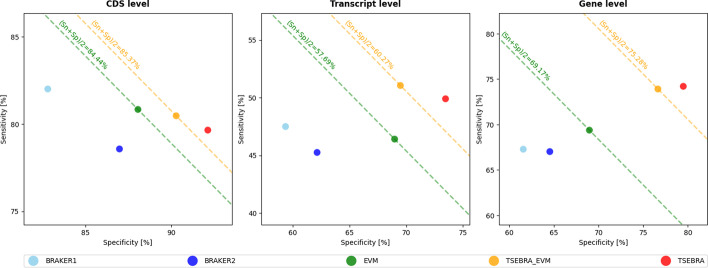

*TSEBRA sensitivity and specificity on Arabidopsis (Fig. 3). Gabriel et al. 2021, BMC Bioinformatics, Fig. 3, doi:10.1186/s12859-021-04482-0, PMC8620231, CC BY.*

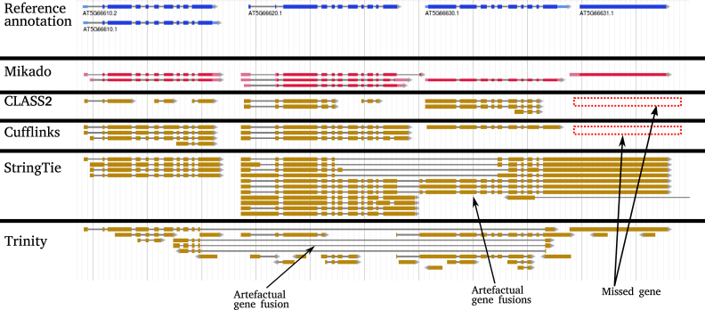

*Mikado transcript selection at an Arabidopsis locus (Fig. 1). Venturini et al. 2018, GigaScience, Fig. 1, doi:10.1093/gigascience/giy093, PMC6105091, CC BY.*

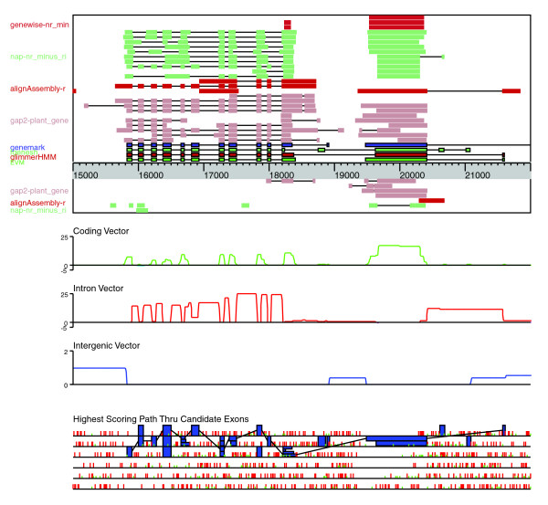

*EVidenceModeler gene-model consensus at a rice locus (Fig. 5). Haas et al. 2008, Genome Biol., Fig. 5, doi:10.1186/gb-2008-9-1-r7, PMC2395244, CC BY.*

- **EVidenceModeler (EVM)** (tool) — Weighted consensus of predictions and alignments into gene models. [doi:10.1186/gb-2008-9-1-r7](https://doi.org/10.1186/gb-2008-9-1-r7) · [link](https://github.com/EVidenceModeler/EVidenceModeler)
- **TSEBRA** (tool) — Transcript selector combining BRAKER predictions using extrinsic evidence. [doi:10.1186/s12859-021-04482-0](https://doi.org/10.1186/s12859-021-04482-0) · [link](https://github.com/Gaius-Augustus/TSEBRA)
- **Mikado** (tool) — Picks best transcript models at each locus from multiple assemblies/predictions. [doi:10.1093/gigascience/giy093](https://doi.org/10.1093/gigascience/giy093) · [link](https://github.com/EI-CoreBioinformatics/mikado)
- **MAKER2** (tool) — Annotation pipeline combining evidence alignment and ab initio predictors with AED scores. [doi:10.1186/1471-2105-12-491](https://doi.org/10.1186/1471-2105-12-491)
- **funannotate** (tool) — Eukaryotic annotation pipeline (predict, update, annotate) built on EVM/PASA. [doi:10.5281/zenodo.1134477](https://doi.org/10.5281/zenodo.1134477) · [link](https://github.com/nextgenusfs/funannotate)
- **EGAPx** (tool) — Public release of NCBI's Eukaryotic Genome Annotation Pipeline. [link](https://github.com/ncbi/egapx)
- **GETA** (tool) — Genome-wide Electronic Transcript Annotation pipeline (transcripts, homology, AUGUSTUS). [link](https://github.com/chenlianfu/geta)
- **REAT** (tool) — Robust Eukaryotic Annotation Toolkit (transcriptome, homology and prediction workflows, Mikado-based). [link](https://github.com/EI-CoreBioinformatics/reat)
- **EASEL** (tool) — Nextflow pipeline: StringTie2/PsiCLASS transcripts, TransDecoder, AUGUSTUS trained on transcript and OrthoDB protein hints, random-forest filtering using RNA-folding and other features. [link](https://gitlab.com/PlantGenomicsLab/easel)
- **Sylvan** (tool) — Snakemake pipeline combining EVM/PASA, GETA, Helixer, Liftoff and miniprot evidence, then semi-supervised random-forest filtering and boundary refinement. [link](https://github.com/plantgenomicslab/Sylvan) [待确认]
- **Ensembl automatic annotation pipeline (ensembl-anno)** (tool) — Public code of Ensembl's automatic gene annotation pipeline. [link](https://github.com/Ensembl/ensembl-anno) [待确认]
- **EviAnn** (tool) — Builds gene models directly from RNA and protein evidence without ab initio training; fast, and a useful check against BRAKER4. [doi:10.1038/s41592-026-03156-0](https://doi.org/10.1038/s41592-026-03156-0) · [link](https://github.com/alekseyzimin/EviAnn_release)

<a id="section-9"></a>
## 9. Non-coding RNA and pseudogene loci

Loci that are not the protein-coding draft: tRNA, rRNA, miRNA, lncRNA and pseudogenes.

**Needs:** the genome plus, for many ncRNA tools, a covariance-model or reference RNA set; keep protein-coding draft and ncRNA loci as separate products unless a documented merge rule exists. [Data needs by scenario](#data-needs)

**Clusters:**
- *Structured ncRNA* (complementary): Infernal 1.1, tRNAscan-SE 2.0, ARAGORN, barrnap, RNAmmer. Infernal with Rfam covers most families; use tRNAscan-SE for tRNA and barrnap for rRNA.
- *Small-RNA loci* (alternatives): ShortStack 4, miRDeep-P2. Require small-RNA-seq; evaluate miRNAs against the plant criteria in section 14.
- *Coding potential (vote)* (complementary): CPC2, CPAT, LncFinder, FEELnc, PlantLncBoost, RNAsamba, PLEKv2. Use two or three and keep agreements; PlantLncBoost is trained on plants.
- *Pseudogenes* (alternatives): PseudoPipe, P-GRe, Shiu lab PseudogenePipeline. Run after the protein-coding set is frozen.


- **ARAGORN** (tool) — Detects tRNA and tmRNA genes. [doi:10.1093/nar/gkh152](https://doi.org/10.1093/nar/gkh152)
- **RNAmmer** (tool) — HMM-based rRNA gene prediction. [doi:10.1093/nar/gkm160](https://doi.org/10.1093/nar/gkm160) · [link](https://services.healthtech.dtu.dk/services/RNAmmer-1.2/)
- **CPAT** (tool) — Alignment-free coding-potential assessment of transcripts. [doi:10.1093/nar/gkt006](https://doi.org/10.1093/nar/gkt006) · [link](https://github.com/liguowang/cpat)
- **LncFinder** (tool) — lncRNA identification with heterologous features and machine learning (R package). [doi:10.1093/bib/bby065](https://doi.org/10.1093/bib/bby065)
- **PseudoPipe** (tool) — Homology-based pseudogene identification pipeline. [doi:10.1093/bioinformatics/btl116](https://doi.org/10.1093/bioinformatics/btl116)
- **Infernal 1.1** (tool) — Covariance-model RNA homology search (engine for Rfam). [doi:10.1093/bioinformatics/btt509](https://doi.org/10.1093/bioinformatics/btt509) · [link](https://github.com/EddyRivasLab/infernal)
- **tRNAscan-SE 2.0** (tool) — tRNA gene detection with isotype classification and pseudo-tRNA flags. [doi:10.1093/nar/gkab688](https://doi.org/10.1093/nar/gkab688) · [link](https://github.com/UCSC-LoweLab/tRNAscan-SE)
- **barrnap** (tool) — Fast rRNA locus prediction (includes eukaryotic models). [link](https://github.com/tseemann/barrnap)
- **ShortStack 4** (tool) — Small-RNA locus annotation and MIRNA calling from sRNA-seq. [doi:10.1261/rna.035279.112](https://doi.org/10.1261/rna.035279.112) · [link](https://github.com/MikeAxtell/ShortStack)
- **PlantLncBoost** (tool) — Gradient-boosting plant lncRNA identification from sequence features. [doi:10.1111/nph.70211](https://doi.org/10.1111/nph.70211) · [link](https://github.com/xuechantian/PlantLncBoost) [待确认]
- **FEELnc** (tool) — lncRNA annotation from transcript assemblies (filter, coding potential, classifier). [doi:10.1093/nar/gkw1306](https://doi.org/10.1093/nar/gkw1306) · [link](https://github.com/tderrien/FEELnc)
- **CPC2** (tool) — Fast coding-potential calculator for transcripts. [doi:10.1093/nar/gkx428](https://doi.org/10.1093/nar/gkx428) · [link](https://cpc2.gao-lab.org/)
- **P-GRe** (tool) — Pseudogene prediction: finds loci from parent proteins, rebuilds pseudo-CDS, reports frameshifts/stops, outputs GFF. [doi:10.1016/j.ygeno.2026.111216](https://doi.org/10.1016/j.ygeno.2026.111216)
- **Shiu lab PseudogenePipeline** (tool) — Classic plant pseudogene pipeline with repeat filtering and GFF output. [link](https://github.com/ShiuLab/PseudogenePipeline)
- **miRDeep-P2** (tool) — Fast plant miRNA locus discovery from sRNA-seq with updated plant criteria. [doi:10.1093/bioinformatics/bty972](https://doi.org/10.1093/bioinformatics/bty972)
- **RNAsamba** (tool) — Neural network that scores protein-coding potential from the full transcript and its ORF; serves as an additional vote for lncRNA versus mRNA classification. [doi:10.1093/nargab/lqz024](https://doi.org/10.1093/nargab/lqz024) · [link](https://github.com/apcamargo/RNAsamba)
- **PLEKv2** (tool) — Alignment-free lncRNA versus mRNA classifier based on sequence features and a coding-net model; v2 replaces the 2014 k-mer PLEK (doi:10.1186/1471-2105-15-311). Useful when no close protein database is available. [doi:10.1186/s12864-024-10662-y](https://doi.org/10.1186/s12864-024-10662-y) · [link](https://sourceforge.net/projects/plek/)

<a id="section-10"></a>
## 10. Gene-model QC

Checks on gene models and the proteins translated from them (A3, A5, last-mile 01–02).

**Needs:** proteins translated from the GFF (`PROTEINS_FA`) and a BUSCO lineage; PSAURON and OMArk use the same proteins. RNA BAM is optional but useful for support checks. [Data needs by scenario](#data-needs)

**Clusters:**
- *Completeness* (complementary): BUSCO, OMArk. Use BUSCO for the standard score; OMArk adds contamination and fragment checks.
- *Per-model scores* (complementary): PSAURON, GeneValidator, ABAQS. Rank models by score and review the weakest ones first.
- *Format and compare* (complementary): gffread / gffcompare, AGAT. Use gffcompare against a previous release, and AGAT for summary statistics and fixes.

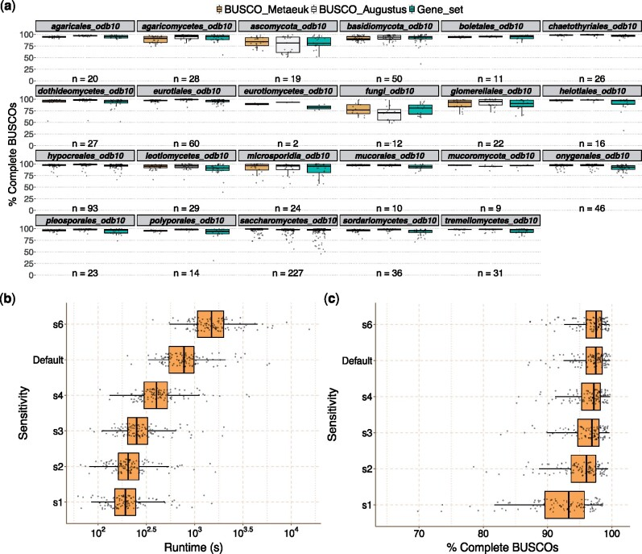

*BUSCO v5 workflows for eukaryotic assessments (Fig. 2). Manni et al. 2021, Mol. Biol. Evol., Fig. 2, doi:10.1093/molbev/msab199, PMC8476166, CC BY.*

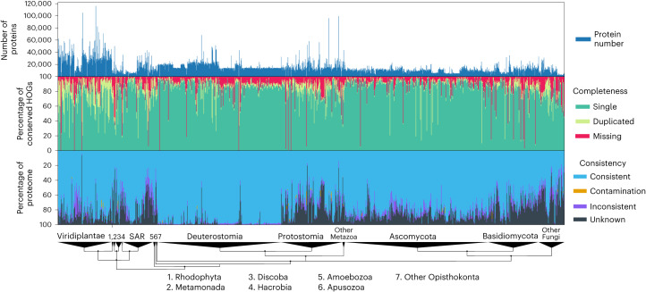

*OMArk consistency on UniProt reference proteomes (Fig. 4). Nevers et al. 2025, Nat. Biotechnol. 43(1):124-133, Fig. 4, doi:10.1038/s41587-024-02147-w (online 2024-02-21), PMC11738984, CC BY.*

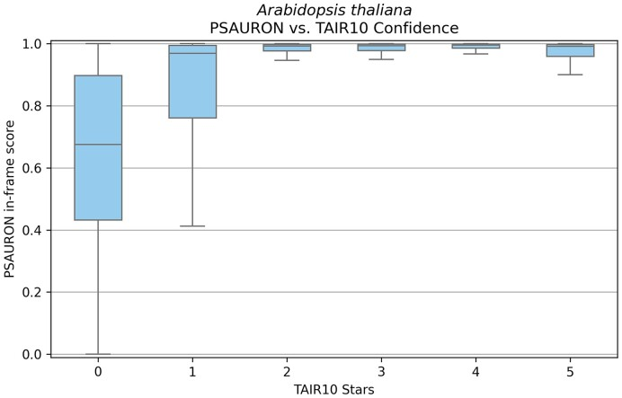

*PSAURON scores on TAIR10 CDS (Fig. 5). Sommer, Zimin and Salzberg 2025, NAR Genom. Bioinform., Fig. 5, doi:10.1093/nargab/lqae189, PMC11704789, CC BY.*

- **gffread / gffcompare** (tool) — Extract CDS/proteins from GFF (gffread) and compare two annotations at base/exon/locus level (gffcompare). [doi:10.12688/f1000research.23297.2](https://doi.org/10.12688/f1000research.23297.2) · [link](https://github.com/gpertea/gffread)
- **AGAT** (tool) — GFF/GTF toolkit: statistics, fixing, longest-isoform selection, ID management, format conversion. [doi:10.5281/zenodo.3552717](https://doi.org/10.5281/zenodo.3552717) · [link](https://github.com/NBISweden/AGAT)
- **BUSCO** (tool) — Evaluates gene-set completeness against lineage single-copy orthologs (protein mode). Lineage datasets now come from OrthoDB v12 (2024 update, doi:10.1093/nar/gkae987); compleasm (section 1) runs the same lineages faster. [doi:10.1093/molbev/msab199](https://doi.org/10.1093/molbev/msab199)
- **ABAQS** (tool) — Accuracy-Based Annotation Quality Score combining completeness, gene-model validity and protein-profile checks. [link](https://github.com/mycocosm-lbl/abaqs) [待确认]
- **GeneValidator** (tool) — Flags problem gene models by comparing each protein with database homologs (length, coverage, duplication, merged genes). [doi:10.1093/bioinformatics/btw015](https://doi.org/10.1093/bioinformatics/btw015) · [link](https://github.com/wurmlab/genevalidator)
- **OMArk** (tool) — Assesses a predicted proteome for completeness, lineage consistency and contamination against OMA gene families; flags fragments and spurious genes missed by BUSCO. [doi:10.1038/s41587-024-02147-w](https://doi.org/10.1038/s41587-024-02147-w) · [link](https://github.com/DessimozLab/OMArk)
- **PSAURON** (tool) — Scores each predicted protein-coding model using a machine-learning classifier; low scores flag likely spurious genes for review. [doi:10.1093/nargab/lqae189](https://doi.org/10.1093/nargab/lqae189) · [link](https://github.com/salzberg-lab/PSAURON)

<a id="section-11"></a>
## 11. Curation and browsers

Evidence packs, browsers and editors used in last-mile curation (LM03–LM04).

**Needs:** the draft GFF, genome, and an evidence pack (BAM, protein alignments, RNA coverage) before GSAman or a browser session. [Data needs by scenario](#data-needs)

**Clusters:**
- *Collaborative web curation* (complementary): Apollo 3, JBrowse 2. Apollo 3 runs as a plugin on JBrowse 2; use the two together for team curation.
- *Desktop and manual curators* (alternatives): IGV, Artemis / ACT, GSAman, TBtools-II. Use for local inspection of a few loci; GSAman handles LM04 edits.


- **IGV** (tool) — Desktop genome viewer for alignments and annotations. [doi:10.1038/nbt.1754](https://doi.org/10.1038/nbt.1754) · [link](https://github.com/igvteam/igv)
- **igv.js / igv-reports** (tool) — Embeddable IGV; igv-reports builds self-contained HTML pages of loci with tracks. [doi:10.1093/bioinformatics/btac830](https://doi.org/10.1093/bioinformatics/btac830) · [link](https://github.com/igvteam/igv-reports)
- **Artemis / ACT** (tool) — Genome browser/annotation editor and comparison tool. [doi:10.1093/bioinformatics/btr703](https://doi.org/10.1093/bioinformatics/btr703) · [link](https://github.com/sanger-pathogens/Artemis)
- **Apollo 3** (tool) — Collaborative gene-model editor built on JBrowse 2 for local or server deployment. Apollo 2 (2019 paper, doi:10.1371/journal.pcbi.1006790) is the older server release; use it only when a community portal still runs it. [doi:10.64898/2026.06.08.730970](https://doi.org/10.64898/2026.06.08.730970) · [link](https://github.com/GMOD/Apollo3)
- **JBrowse 2** (tool) — Genome browser with synteny and SV views; host evidence tracks for curation. [doi:10.1186/s13059-023-02914-z](https://doi.org/10.1186/s13059-023-02914-z) · [link](https://github.com/GMOD/jbrowse-components)
- **GSAman** (tool) — Desktop curator for editing gene-structure models against aligned evidence; serves as the LM04 manual curation tool. [doi:10.1016/j.xinn.2026.101471](https://doi.org/10.1016/j.xinn.2026.101471)
- **TBtools-II** (tool) — Plant-focused desktop toolkit for GFF viewing, sequence extraction and gene-structure plotting; convenient for quick checks on a few loci. [doi:10.1016/j.molp.2023.09.010](https://doi.org/10.1016/j.molp.2023.09.010) · [link](https://github.com/CJ-Chen/TBtools-II)

<a id="section-12"></a>
## 12. GFF3 cleanup and release

GFF3 cleanup, validation and submission (last-mile 06, A6).

**Needs:** the curated GFF and genome only, plus the METHODS / checklist fields already listed in `docs/PLAYBOOK.md`. [Data needs by scenario](#data-needs)

**Clusters:**
- *Validate* (complementary): GenomeTools (gt gff3validator), GFF3toolkit, gxfkit, noodles. Validate before every release.
- *Submission converters* (alternatives): table2asn, EMBLmyGFF3, Genome Annotation Generator (GAG). Use table2asn for NCBI and EMBLmyGFF3 for ENA.
- *Utilities* (complementary): SeqKit 2, GTFtools, CrossMap. Handle sequence extraction, summary statistics and coordinate conversion between assembly versions.


- **SeqKit 2** (tool) — FASTA/Q toolkit (stats, grep, translate, dedup). [doi:10.1002/imt2.191](https://doi.org/10.1002/imt2.191) · [link](https://github.com/shenwei356/seqkit)
- **Genome Annotation Generator (GAG)** (tool) — Generates and corrects NCBI .tbl annotation tables from GFF3. [doi:10.1093/gigascience/giy018](https://doi.org/10.1093/gigascience/giy018) · [link](https://github.com/genomeannotation/GAG)
- **GenomeTools (gt gff3validator)** (tool) — GFF3 validation, sorting, tidy. [doi:10.1109/TCBB.2013.68](https://doi.org/10.1109/TCBB.2013.68) · [link](https://github.com/genometools/genometools)
- **EMBLmyGFF3** (tool) — Converts GFF3 + FASTA to EMBL flat file for ENA submission. [doi:10.1186/s13104-018-3686-x](https://doi.org/10.1186/s13104-018-3686-x) · [link](https://github.com/NBISweden/EMBLmyGFF3)
- **table2asn** (tool) — NCBI tool converting GFF3/FASTA to ASN.1 submission with validation report. [link](https://www.ncbi.nlm.nih.gov/genbank/table2asn/)
- **GFF3toolkit** (tool) — GFF3 QC/fix/merge utilities from the i5k Workspace@NAL. [link](https://github.com/NAL-i5K/GFF3toolkit)
- **noodles** (tool) — Rust I/O libraries including GFF3/GTF readers and writers. [link](https://github.com/zaeleus/noodles)
- **gxfkit** (tool) — Rust GFF3/GTF conversion aiming at AGAT-compatible output with large speedups. [link](https://github.com/benngaihk/gxfkit)
- **GTFtools** (tool) — Calculates gene-model features from GTF files (lengths, intron and UTR sets, isoform statistics) for release summaries. [doi:10.1093/bioinformatics/btac561](https://doi.org/10.1093/bioinformatics/btac561)
- **CrossMap** (tool) — Converts GFF, BED, VCF and BAM coordinates between assembly versions using a chain file, for example from PN40024 v4 to T2T. [doi:10.1093/bioinformatics/btt730](https://doi.org/10.1093/bioinformatics/btt730) · [link](https://github.com/liguowang/CrossMap)

<a id="section-13"></a>
## 13. Reference databases

Reference genomes and annotations used as evidence or as a close GFF.

**Needs:** no extra sequencing — these are reference genomes and annotations used as evidence or as a close GFF. Check that the version matches the one named in METHODS. [Data needs by scenario](#data-needs)

**Clusters:**
- *Protein evidence sets* (complementary): OrthoDB v12, UniProt 2025. OrthoDB Viridiplantae is the standard protein set for BRAKER3/BRAKER4; GALBA2 needs one or a few close-species proteomes instead; add Swiss-Prot for a small clean set.
- *Comparison gene sets* (complementary): Phytozome, Ensembl Plants (Ensembl Genomes 2022), PLAZA 5.0, NCBI RefSeq, Araport11, PN40024 reference annotation (PN_T2T / v5). Compare gene counts and structures against related species and the grape reference.
- *ncRNA references* (complementary): Rfam 15, RNAcentral. Use Rfam models with Infernal, and RNAcentral to assign names to hits.


- **RNAcentral** (resource) — Integrated non-coding RNA sequence database. [doi:10.1093/nar/gkaa921](https://doi.org/10.1093/nar/gkaa921) · [link](https://rnacentral.org/)
- **Phytozome** (resource) — Plant genome and annotation portal (JGI). [doi:10.1093/nar/gkr944](https://doi.org/10.1093/nar/gkr944) · [link](https://phytozome-next.jgi.doe.gov/)
- **Ensembl Plants (Ensembl Genomes 2022)** (resource) — Plant genomes, gene models and comparative data. [doi:10.1093/nar/gkab1007](https://doi.org/10.1093/nar/gkab1007) · [link](https://plants.ensembl.org/)
- **Araport11** (resource) — Re-annotation of the Arabidopsis Col-0 genome. [doi:10.1111/tpj.13415](https://doi.org/10.1111/tpj.13415) · [link](https://www.arabidopsis.org/)
- **Rfam 15** (resource) — RNA family covariance models; scan with Infernal cmscan for rRNA, snoRNA, riboswitch-like loci. [doi:10.1093/nar/gkae1023](https://doi.org/10.1093/nar/gkae1023) · [link](https://rfam.org)
- **OrthoDB v12** (resource) — Ortholog catalog whose Viridiplantae protein partition is the standard protein evidence for BRAKER3/BRAKER4 (GALBA/GALBA2 should use one or a few close-species proteomes instead); the same update also refreshes BUSCO lineages. [doi:10.1093/nar/gkae987](https://doi.org/10.1093/nar/gkae987) · [link](https://www.orthodb.org/)
- **UniProt 2025** (resource) — Reviewed Swiss-Prot plant proteins provide a compact, clean evidence set for protein hints and GeneValidator checks. [doi:10.1093/nar/gkae1010](https://doi.org/10.1093/nar/gkae1010) · [link](https://www.uniprot.org/)
- **PLAZA 5.0** (resource) — Plant comparative genomics platform with gene families and synteny; useful for checking gene counts and split or merged models across species. [doi:10.1093/nar/gkab1024](https://doi.org/10.1093/nar/gkab1024) · [link](https://bioinformatics.psb.ugent.be/plaza/)
- **NCBI RefSeq** (resource) — Curated and Gnomon-predicted transcripts and proteins; serves as the comparison set when running the S8 EGAPx path. [doi:10.1093/nar/gkv1189](https://doi.org/10.1093/nar/gkv1189) · [link](https://www.ncbi.nlm.nih.gov/refseq/)
- **PN40024 reference annotation (PN_T2T / v5)** (resource) — Current grape reference gene sets on PN_T2T (v5), alongside earlier v4 (doi:10.1093/g3journal/jkad067) and VCost.v3 on 12X.v2 (doi:10.1016/j.gdata.2017.09.002); the comparison set for any new Vitis annotation. [doi:10.1093/hr/uhad061](https://doi.org/10.1093/hr/uhad061) · [link](https://grapedia.org/)

<a id="section-14"></a>
## 14. Standards and reviews

Standards, formats and reviews. Not a data recipe.

**Needs:** not a data recipe. These are standards, formats and reviews. [Data needs by scenario](#data-needs)

**Clusters:**
- *Formats and naming* (complementary): Sequence Ontology, GFF3 specification, The grapevine gene nomenclature system. Rules that every release must follow.
- *Guides and benchmarks* (complementary): A beginner's guide to eukaryotic genome annotation, Ten steps to get started in genome assembly and annotation, Twelve quick steps for genome assembly and annotation, Tips for improving genome annotation quality, Welcome to the big leaves (plant annotation best practice), Ab initio gene predictor benchmark, LRGASP benchmark, EBP annotation standards report, Plant microRNA annotation criteria. Read the plant best-practice paper first; the benchmarks show where each tool fails.


- **Sequence Ontology** (idea) — Ontology of feature types used in GFF3 column 3. [doi:10.1186/gb-2005-6-5-r44](https://doi.org/10.1186/gb-2005-6-5-r44) · [link](https://github.com/The-Sequence-Ontology/SO-Ontologies)
- **GFF3 specification** (idea) — Formal GFF3 format specification. [link](https://github.com/The-Sequence-Ontology/Specifications)
- **The grapevine gene nomenclature system** (idea) — Proposed naming rules for grapevine genes and loci. [doi:10.1186/1471-2164-15-1077](https://doi.org/10.1186/1471-2164-15-1077)
- **A beginner's guide to eukaryotic genome annotation** (idea) — Review of evidence types, pipelines and quality metrics (AED). [doi:10.1038/nrg3174](https://doi.org/10.1038/nrg3174)
- **Ten steps to get started in genome assembly and annotation** (idea) — Practical guide covering assembly through annotation. [doi:10.12688/f1000research.13598.1](https://doi.org/10.12688/f1000research.13598.1)
- **LRGASP benchmark** (idea) — Community benchmark of long-read RNA-seq methods for transcript identification and quantification; shows trade-offs between read depth, length and accuracy. [doi:10.1038/s41592-024-02298-3](https://doi.org/10.1038/s41592-024-02298-3) · [link](https://github.com/LRGASP/lrgasp-submissions)
- **Tips for improving genome annotation quality** (idea) — Practical checklist: evidence choice, masking level, manual review, metrics. [doi:10.48130/gcomm-0025-0006](https://doi.org/10.48130/gcomm-0025-0006)
- **EBP annotation standards report** (idea) — Earth BioGenome Project report on minimum annotation standards and metadata. [link](https://www.earthbiogenome.org/report-on-annotation-standards)
- **Welcome to the big leaves (plant annotation best practice)** (idea) — Benchmarks plant annotation pipelines and provides practical guidance on evidence, masking and BUSCO for non-model plants. [doi:10.1002/aps3.11533](https://doi.org/10.1002/aps3.11533)
- **Ab initio gene predictor benchmark** (idea) — Benchmarks ab initio gene finders across diverse eukaryotes and explains why exon-level accuracy drops on long, intron-rich genes. [doi:10.1186/s12864-020-6707-9](https://doi.org/10.1186/s12864-020-6707-9)
- **Twelve quick steps for genome assembly and annotation** (idea) — Concise walkthrough of assembly, masking, annotation and QC; a short companion to the beginner guides listed above. [doi:10.1371/journal.pcbi.1008325](https://doi.org/10.1371/journal.pcbi.1008325)
- **Plant microRNA annotation criteria** (idea) — Community criteria for validating plant miRNA loci from small-RNA data; sets the standard for any miRNA calls in a release. [doi:10.1105/tpc.17.00851](https://doi.org/10.1105/tpc.17.00851)

<a id="section-15"></a>
## 15. Ideas not yet tied to one tool

Ideas recorded in the 2026-11 survey. Nothing here changes the default path until it is tested.

**Needs:** depends on the idea; nothing here changes the default path until it is tested. [Data needs by scenario](#data-needs)

**Clusters:**
- *Workflow rules* (complementary): Soft-mask hand-off rule (idea), Family-window review using function results (idea), Track annotation edit distance (AED) per model, Harmonise models across haplotypes before pangenome PAV. Rules to adopt in this repo's workflow once tested.
- *Known error modes* (complementary): Chimeric mis-annotation survey, Annotation affects orthology (idea). Explain how gene-model errors propagate into orthology and functional analysis.
- *AI-assisted curation* (alternatives): GeneWhisperer, Human-AI collaborative annotation framework. Proposals only; always require human sign-off.


- **Soft-mask hand-off rule (idea)** (idea) — Structure consumes a curated TE library produced elsewhere; record library name, version and sha256 in METHODS, and keep NLR/gene families out of the library (see existing ProtExcluder note). [link](https://github.com/Xuzhen-Li/gene-structure-annotation/blob/main/docs/BOUNDARY.md)
- **Chimeric mis-annotation survey** (idea) — Shows fused (chimeric) gene models remain common in non-model eukaryote annotations; gives detection heuristics. [doi:10.1186/s12864-025-11765-w](https://doi.org/10.1186/s12864-025-11765-w)
- **Annotation affects orthology (idea)** (idea) — Structural annotation choices change orthology inference; compare annotations before cross-species claims. [doi:10.1093/bioinformatics/btaf365](https://doi.org/10.1093/bioinformatics/btaf365)
- **GeneWhisperer** (idea) — LLM assistant with task tools for manual gene annotation (preprint). [doi:10.1101/2025.03.30.646211](https://doi.org/10.1101/2025.03.30.646211)
- **Human-AI collaborative annotation framework** (idea) — Conceptual framework for dividing genome-annotation work between AI and curators. [doi:10.1093/bib/bbaf377](https://doi.org/10.1093/bib/bbaf377)
- **Family-window review using function results (idea)** (idea) — Scenario S7 can take an NLR/TF window list produced in gene-function-annotation and re-check gene models in those windows; the classifiers themselves stay in the function catalog. [link](https://github.com/Xuzhen-Li/gene-function-annotation)
- **Track annotation edit distance (AED) per model** (idea) — Keep each model's agreement with evidence (AED, defined by Eilbeck et al. 2009 and reported by MAKER2) as a release column so curators can sort weak models first. [doi:10.1186/1471-2105-10-67](https://doi.org/10.1186/1471-2105-10-67)
- **Harmonise models across haplotypes before pangenome PAV** (idea) — Polish both haplotypes against each other by synteny (SynGAP-style) before passing proteins to vitis-pangenome, ensuring gene PAV reflects biology rather than annotation noise. [doi:10.1186/s13059-024-03359-8](https://doi.org/10.1186/s13059-024-03359-8) · [link](https://github.com/Xuzhen-Li/vitis-pangenome)

<a id="data-needs"></a>
## Data needed alongside the genome

The main input is a genome FASTA (`GENOME_FA`). The notes below say what else each situation usually needs. They do not change the default S1 path until a change is tested.

| Situation | Minimum | Recommended | Typical tools in this repo | Common pitfall |
|---|---|---|---|---|
| Assembly already done (Asm0/Asm1 as checklist) | `GENOME_FA`, `ASSEMBLY_OK=yes` | Assembly reads for k-mer / QV checks; a matching BUSCO lineage | BUSCO (genome), compleasm (optional) | Using a lineage from the wrong clade, or mixing odb10 with odb12 names without saying so (`docs/LINEAGES.md`) |
| Soft-mask (A0) | Trusted TE library | Library version and source in METHODS | RepeatMasker / EDTA `make_masked.pl` (mask only) | Building a new TE library inside this repo — that job belongs to vitis-te |
| Default S1 (RNA + proteins, no close GFF) | RNA-seq (or `RNA_BAM`) and `PROTEIN_DB` | Same-genotype, multi-tissue RNA | HISAT2/STAR, StringTie, BRAKER3/4, GeMoMa or miniprot | RNA from another cultivar used as if it were the target genotype |
| Proteins only (S2) | `PROTEIN_DB` | Closer proteomes rather than a generic set | GALBA / GALBA2, GeMoMa, miniprot | Claiming complete UTRs from protein evidence alone |
| Deep Iso-Seq (S3) | Long-read RNA + a mapper (minimap2) | Short-read RNA as well; SQANTI-style filters | IsoQuant, SQANTI, EviAnn, BRAKER for orphans | Skipping SQANTI (or equivalent) filters |
| Close curated GFF (S11) | Trusted close GFF | Gap-fill evidence (RNA / proteins) | Liftoff, LiftOn, CAT; then trunk QC | Calling lift-only S11-lite an L1 release |
| GPU ab initio compare (S13) | Soft-masked genome + GPU | Keep an evidence draft beside it | Helixer, Tiberius, ANNEVO | Silently replacing S1 when RNA exists |
| Classic EVM stack (S14) | RNA and/or proteins to train and weight | Documented EVM weights | PASA, AUGUSTUS/GeneMark, EVM | Running EVM on every genome as if it were required |
| Paper / T2T bar (S5 overlay) | The S1 or S14 draft plus deeper QC | OMArk, deeper GSAman, evidence pack | OMArk, PSAURON, BUSCO protein, GSAman | Treating a provisional merge as L1 |
| Multi-haplotype (S4 / LM05) | The second haplotype assembly | SynGAP after transfer | Liftoff, SynGAP | Purging haplotypes because BUSCO Duplicated is high (see S9) |
| Handoff to function (A6) | Release tag and `proteins.faa` (one representative per gene) | Curated GFF if the function repo will use coordinates | AGAT / gffread | Sending an unfrozen draft without `RELEASE_TAG` |

### Cross-cutting pitfalls

- TE *library construction* is a separate job (vitis-te). This repo only soft-masks with a trusted library.
- Functional labels (GO, KEGG, domains, readable names, NLR/TF classifiers including HRP) belong in gene-function-annotation. A protein tool that says "structure" usually means 3D structure, not gene models.
- `grade=` and `status=` are separate fields. Do not write `status=L1`. Provisional ≠ L1 (`docs/EVALUATION.md`).
- A close reference is same species / cultivar (or a near-identical haplotype) with a curated GFF you trust — not merely "a GFF exists in the same family".
- BUSCO lineage must match the clade; record odb10 vs odb12 (`docs/LINEAGES.md`). Compleasm is a useful compare, not an automatic replacement for BUSCO.
- High BUSCO Duplicated can be real haplotypes (S9). Do not purge haplotypes only to lower D.
- If gene counts collapse after TSEBRA, run the A5d mono-exonic:multi-exonic gene ratio check (Copetti) before accepting the merge.

Items still marked `[待确认]` in the 2026-11 catalogs (for example CRAQ) stay marked until someone opens a primary source.

Longer notes, including the Chinese table, are in [`docs/SCENARIOS.md#data-needs-details`](docs/SCENARIOS.md#data-needs-details).


<a id="figure-credits"></a>
## Figure credits

Self-drawn overview figures in `docs/figures/` belong to this repository. Catalog figures below are unaltered JPEGs from CC BY papers (Europe PMC license field `cc by`, checked 2026-11-13). No NC/ND material is used.

| File | Credit |
|---|---|
| [`docs/figures/catalog/08_compleasm_vs_busco.jpg`](docs/figures/catalog/08_compleasm_vs_busco.jpg) | compleasm compared with BUSCO on the same assemblies (Fig. 1). Huang and Li 2023, Bioinformatics, Fig. 1, doi:10.1093/bioinformatics/btad595, PMC10558035, CC BY. |
| [`docs/figures/catalog/03_stringtie2_plant_rnaseq.jpg`](docs/figures/catalog/03_stringtie2_plant_rnaseq.jpg) | StringTie2 transcript assembly on plant RNA-seq (Fig. 2). Kovaka et al. 2019, Genome Biol., Fig. 2, doi:10.1186/s13059-019-1910-1, PMC6912988, CC BY. |
| [`docs/figures/catalog/07_isoquant_real_reads.jpg`](docs/figures/catalog/07_isoquant_real_reads.jpg) | IsoQuant on real long RNA reads (Fig. 2). The source panel is short (719×189). Prjibelski et al. 2023, Nat. Biotechnol., Fig. 2, doi:10.1038/s41587-022-01565-y, PMC10344776, CC BY. |
| [`docs/figures/catalog/04_galba_f1_plants.jpg`](docs/figures/catalog/04_galba_f1_plants.jpg) | GALBA protein-to-genome gene prediction on plant data (Fig. 5). Brůna et al. 2023, BMC Bioinformatics, Fig. 5, doi:10.1186/s12859-023-05449-z, PMC10472564, CC BY. |
| [`docs/figures/catalog/05_helixer_cassava_locus.jpg`](docs/figures/catalog/05_helixer_cassava_locus.jpg) | Helixer gene models at a cassava locus (Fig. 3). Stiehler et al. 2021, Bioinformatics, Fig. 3, doi:10.1093/bioinformatics/btaa1044, PMC8016489, CC BY. |
| [`docs/figures/catalog/12_tiberius_pr_vs_peers.jpg`](docs/figures/catalog/12_tiberius_pr_vs_peers.jpg) | Tiberius precision-recall compared with peer gene finders (Fig. 3). Gabriel, Becker, Hoff and Stanke 2024, Bioinformatics, Fig. 3, doi:10.1093/bioinformatics/btae685, PMC11645249, CC BY. |
| [`docs/figures/catalog/06_helixer_2026_exon_pr.jpg`](docs/figures/catalog/06_helixer_2026_exon_pr.jpg) | Helixer exon-level precision-recall in the 2026 methods paper (Fig. 1). Holst et al. 2026, Nat. Methods, Fig. 1, doi:10.1038/s41592-025-02939-1, PMC13076211, CC BY. |
| [`docs/figures/catalog/09_tsebra_sn_sp_arabidopsis.jpg`](docs/figures/catalog/09_tsebra_sn_sp_arabidopsis.jpg) | TSEBRA sensitivity and specificity on Arabidopsis (Fig. 3). Gabriel et al. 2021, BMC Bioinformatics, Fig. 3, doi:10.1186/s12859-021-04482-0, PMC8620231, CC BY. |
| [`docs/figures/catalog/10_mikado_arabidopsis_locus.jpg`](docs/figures/catalog/10_mikado_arabidopsis_locus.jpg) | Mikado transcript selection at an Arabidopsis locus (Fig. 1). Venturini et al. 2018, GigaScience, Fig. 1, doi:10.1093/gigascience/giy093, PMC6105091, CC BY. |
| [`docs/figures/catalog/13_evm_rice_locus.jpg`](docs/figures/catalog/13_evm_rice_locus.jpg) | EVidenceModeler gene-model consensus at a rice locus (Fig. 5). Haas et al. 2008, Genome Biol., Fig. 5, doi:10.1186/gb-2008-9-1-r7, PMC2395244, CC BY. |
| [`docs/figures/catalog/01_busco_v5_eukaryote_workflows.jpg`](docs/figures/catalog/01_busco_v5_eukaryote_workflows.jpg) | BUSCO v5 workflows for eukaryotic assessments (Fig. 2). Manni et al. 2021, Mol. Biol. Evol., Fig. 2, doi:10.1093/molbev/msab199, PMC8476166, CC BY. |
| [`docs/figures/catalog/02_omark_uniprot_proteomes.jpg`](docs/figures/catalog/02_omark_uniprot_proteomes.jpg) | OMArk consistency on UniProt reference proteomes (Fig. 4). Nevers et al. 2025, Nat. Biotechnol. 43(1):124-133, Fig. 4, doi:10.1038/s41587-024-02147-w (online 2024-02-21), PMC11738984, CC BY. |
| [`docs/figures/catalog/11_psauron_tair10_cds.jpg`](docs/figures/catalog/11_psauron_tair10_cds.jpg) | PSAURON scores on TAIR10 CDS (Fig. 5). Sommer, Zimin and Salzberg 2025, NAR Genom. Bioinform., Fig. 5, doi:10.1093/nargab/lqae189, PMC11704789, CC BY. |

> For grape projects that reuse these annotation steps (gene presence/absence, NLR and metabolic gene families), see [vitis-open-directions](https://github.com/Xuzhen-Li/vitis-open-directions).
