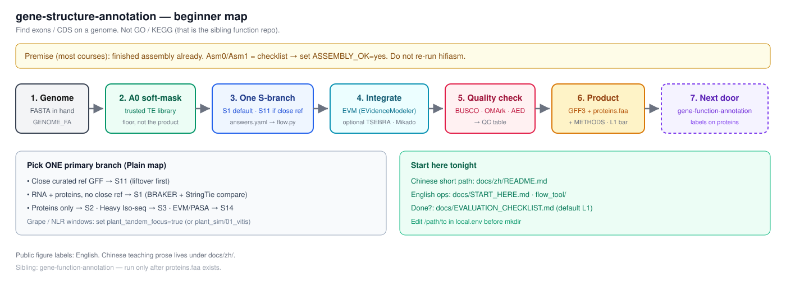
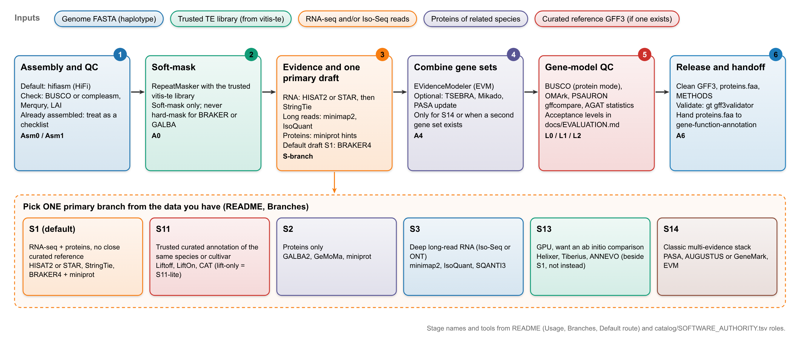
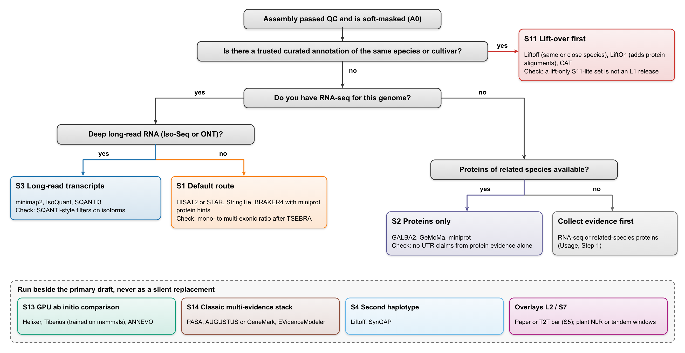

# gene-structure-annotation
[中文](README.zh.md)

A knowledge base on structural gene annotation of plant genomes: what a gene model is, which evidence, software and databases exist for each step, how to check a gene set, and one reference route with small example scripts. Grapevine (*Vitis*) is the running example; the material applies to other plant genomes.

## How this repository is organised

The layout follows [TE-Lib](https://github.com/Xuzhen-Li/TE-Lib): knowledge first, then software, then workflow. Every page is indexed by topic in [`docs/KNOWLEDGE_MAP.md`](docs/KNOWLEDGE_MAP.md).

| Part | Use it to | Where |
|---|---|---|
| Knowledge units | read one concept or one set of criteria, with a claim and source for each statement | [`docs/kb/`](docs/kb/README.md) |
| Book | learn the concepts and the choices at each step | [`book/`](book/README.md); contents below |
| Topics | find everything on one step in one place | [`docs/KNOWLEDGE_MAP.md`](docs/KNOWLEDGE_MAP.md#topics) |
| Software and databases | compare 207 tools, databases and ideas by step, with paper, lab and citation tier | [`catalog/METHODS_CATALOG.md`](catalog/METHODS_CATALOG.md); [`catalog/README.by-type.md`](catalog/README.by-type.md); [`catalog/SOFTWARE_AUTHORITY.tsv`](catalog/SOFTWARE_AUTHORITY.tsv) |
| Reference workflow | follow one route and choose a branch | [`docs/workflow/README.md`](docs/workflow/README.md); [Usage](#usage) |
| Checks | judge whether a gene set is good enough | [`docs/EVALUATION.md`](docs/EVALUATION.md); [`docs/EVALUATION_CHECKLIST.md`](docs/EVALUATION_CHECKLIST.md) |
| Example code and test data | read or run small scripts that show each step | [`pipeline/`](pipeline/00_overview.md); [`examples/`](examples/plant_sim/README.md); [`tests/`](tests/README.md) |
| Figures | see the schematics and charts used on these pages | [`docs/figures/guide/`](docs/figures/guide/README.md) |
| Chinese pages | read the same structure in Chinese | [`README.zh.md`](README.zh.md); [`docs/kb/README.zh.md`](docs/kb/README.zh.md); [`docs/zh/`](docs/zh/README.md) |
| Older pages | find earlier lists, checks and corrections that are kept for reference | [`docs/KNOWLEDGE_MAP.md`](docs/KNOWLEDGE_MAP.md#older-pages) |

The code in `pipeline/` is reference code for the steps described here. It is small and tested on toy data; it is not a maintained software package.

## Knowledge map

Start with the knowledge units, then the book chapter for the step you need:

- [Structural gene annotation: an overview](docs/kb/field-overview.md)
- [Gene models and the evidence behind them](docs/kb/gene-model-concepts.md)
- [Soft-masking with a trusted TE library](docs/kb/trusted-softmask.md)
- [Is the gene set good enough? (criteria)](docs/kb/model-qc-criteria.md)
- Labels used in these pages (sections, chapters, branches, grades, stages) and how earlier labels map to the current ones: [`docs/kb/NUMBERING.md`](docs/kb/NUMBERING.md)
- All topics, tools, step cards and example code: [`docs/KNOWLEDGE_MAP.md`](docs/KNOWLEDGE_MAP.md)

## Book contents

The book, *Plant gene structure annotation: a study guide with grapevine as the example*, is in English and Chinese. Start from [`book/README.md`](book/README.md); the whole text is in [`book/BOOK_full.md`](book/BOOK_full.md).

- [Preface](book/chapters/00-preface.md)
- [Chapter 1. Concepts and principles](book/chapters/01-concepts.md)
- [Chapter 2. Assembly and assembly QC](book/chapters/02-assembly-and-assembly-qc.md)
- [Chapter 3. Soft-mask with a trusted library](book/chapters/03-soft-mask-with-a-trusted-library.md)
- [Chapter 4. RNA and Iso-Seq evidence](book/chapters/04-rna-and-iso-seq-evidence.md)
- [Chapter 5. Protein evidence](book/chapters/05-protein-evidence.md)
- [Chapter 6. Ab initio gene finders](book/chapters/06-ab-initio-gene-finders.md)
- [Chapter 7. DNA language-model predictors](book/chapters/07-dna-language-model-predictors.md)
- [Chapter 8. Lift-over and annotation transfer](book/chapters/08-lift-over-and-annotation-transfer.md)
- [Chapter 9. Combiners and annotation pipelines](book/chapters/09-combiners-and-annotation-pipelines.md)
- [Chapter 10. Non-coding RNA and pseudogene loci](book/chapters/10-non-coding-rna-and-pseudogene-loci.md)
- [Chapter 11. Gene-model QC](book/chapters/11-gene-model-qc.md)
- [Chapter 12. Curation and browsers](book/chapters/12-curation-and-browsers.md)
- [Chapter 13. GFF3 cleanup and release](book/chapters/13-gff3-cleanup-and-release.md)
- [Chapter 14. Reference databases](book/chapters/14-reference-databases.md)
- [Chapter 15. Standards and overview papers](book/chapters/15-standards-and-overview-papers.md)
- [Chapter 16. Ideas not yet tied to one tool](book/chapters/16-ideas-not-yet-tied-to-one-tool.md)
- [Chapter 17. Visualization tools](book/chapters/17-visualization-tools.md)
- [Chapter 18. Choosing tools](book/chapters/18-choosing-tools.md)
- [Chapter 19. Pitfalls and quality control](book/chapters/19-pitfalls-and-qc.md)
- [Chapter 20. Worked example: a grapevine genome on route S1](book/chapters/20-worked-example.md)
- [Appendix A. Glossary](book/chapters/appendix-a-glossary.md)

## Overview

Structural annotation is the primary layer. It finds genes on a genome and provides coordinates, GFF3, and proteins.





*Figure. The structural annotation route of this repository: six stages from assembly QC to the release handed to gene-function-annotation, with the default tool at each stage and the six primary branches (S1, S11, S2, S3, S13, S14). Pick one primary branch from the data you have. Schematic drawn for this repository from README (Usage, Branches, Default route); editable SVG: [`structure_route_map_v2.svg`](docs/figures/guide/structure_route_map_v2.svg).*

TE soft-mask is a prerequisite. TE library construction is a separate job in [TE-Lib](https://github.com/Xuzhen-Li/TE-Lib) and [`docs/TE_LIBRARY.md`](docs/TE_LIBRARY.md).
GO, KEGG, and readable names are in the sibling repository [`gene-function-annotation`](https://github.com/Xuzhen-Li/gene-function-annotation). This repository does not generate functional annotation tables.

Three layers:
1. Structure: This repository.
2. Function: [`gene-function-annotation`](https://github.com/Xuzhen-Li/gene-function-annotation).
3. TE library build: [TE-Lib](https://github.com/Xuzhen-Li/TE-Lib) and [`TE_LIBRARY.md`](docs/TE_LIBRARY.md).

Boundary definitions are in [`docs/BOUNDARY.md`](docs/BOUNDARY.md).

Start: [`docs/START_HERE.md`](docs/START_HERE.md) in English, or [`docs/zh/README.md`](docs/zh/README.md) in Chinese. Older quick-start pages, the classroom page and the project board are listed under [older pages](docs/KNOWLEDGE_MAP.md#older-pages).


The full methods catalogue is in [`catalog/METHODS_CATALOG.md`](catalog/METHODS_CATALOG.md); a summary is under [Methods catalog](#methods-catalog) below.

## Usage

The commands below are reference code for the steps explained in the book. They are tested on toy data and are not a maintained software package. Which page is authoritative for the step order is stated in [`docs/workflow/README.md`](docs/workflow/README.md).

Chinese teaching entry is [`docs/zh/`](docs/zh/).
If the genome is already assembled, use the assembly and assembly-QC steps (Asm0/Asm1) as a checklist and set `ASSEMBLY_OK=yes`. Edit every `/path/to` in `local.env` before any `mkdir`.
For a close curated reference GFF, set `close_curated_ref: true` in your answers (see `examples/plant_sim/03_solanum_s11`). The default `false` selects branch S1 (RNA and protein evidence, no close reference); an unfinished Liftoff run keeps it `false`.

Step 1: Provide evidence.
```bash
git clone https://github.com/Xuzhen-Li/gene-structure-annotation.git
cd gene-structure-annotation
cp pipeline/flow_tool/answers.example.yaml my_answers.yaml
# edit yes/no: RNA? proteins? close reference? paper bar?
python3 pipeline/flow_tool/flow.py --answers my_answers.yaml -o my_plan.md
```
Open `my_plan.md` to see the selected branch and stage explanations.

Step 2: Configure paths.
```bash
cp config/example.env config/local.env
# set GENOME_FA, BUSCO_LINEAGE, RNA_BAM / PROTEIN_DB, TE lib, WORK_DIR, THREADS
```

Step 3: Execution.
Finish `my_plan.md`. Read [Wiki Concepts](https://github.com/Xuzhen-Li/gene-structure-annotation/wiki/Concepts) or [`docs/zh/05_softmask与A0.md`](docs/zh/05_softmask与A0.md). Write `grade=` and `status=` as separate fields: `grade` is L0, L1 or L2, and `status` is provisional or qualified (see [`docs/EVALUATION.md`](docs/EVALUATION.md)). Do not write `status=L1`.
Run on cluster only after [Done when](https://github.com/Xuzhen-Li/gene-structure-annotation/wiki/Start-tonight#done-when) is ticked and `python3 pipeline/print_qc_commands.py` exits 0 with no `[STOP]`. Otherwise no `RUN=1`. Browsing with `--env config/example.env` will show `[STOP]`; this is expected.
Follow stages in `my_plan.md` and check [`docs/EVALUATION_CHECKLIST.md`](docs/EVALUATION_CHECKLIST.md). Read full rules in [`docs/EVALUATION.md`](docs/EVALUATION.md).
Provisional results are not L1. Read [`docs/EVALUATION.md`](docs/EVALUATION.md) for L0 vs L1.
The default branch is S1 for RNA and proteins with no close reference.
Handoff to function uses [`docs/HANDOFF_STRUCTURE_TO_FUNCTION.md`](docs/HANDOFF_STRUCTURE_TO_FUNCTION.md) with `RELEASE_TAG` and `PROTEINS_FA=…/release/<TAG>/proteins.faa`.

## Branches

Choose a branch based on evidence.
S11: Close curated reference GFF (Liftoff, LiftOn, CAT). Lift-only is S11-lite.
S1: RNA and proteins (BRAKER, StringTie).
S2: Proteins only (GALBA, GeMoMa).
S3: Heavy Iso-seq (IsoQuant, SQANTI).
S13: GPU ab initio comparison (Helixer, Tiberius, ANNEVO).
S14: Full classic PASA plus EVM route (`docs/steps/dclab/`). The Integrate step (EVM) runs only for S14 or when a second gene set exists (dual-track).

Overlays:
L2: Acceptance level L1 plus S5 overlay for Paper/T2T bar.
S7: Plant NLR or tandem windows overlay when `plant_tandem_focus: true`.

Full map is at [`docs/ROADMAP.md`](docs/ROADMAP.md).
Workflow chart with tool choices and decision points: [`docs/ROADMAP.md`, workflow chart](docs/ROADMAP.md#workflow-2026-11-14).



*Figure. Choosing the primary branch from the data at hand, with the first tools and the main check for each branch (the same choice as the table in book chapter 18 and README, Branches). S13, S14, S4 and the overlays run beside the primary draft. Schematic drawn for this repository; editable SVG: [`structure_branch_decision_v2.svg`](docs/figures/guide/structure_branch_decision_v2.svg).*

## Documentation

Knowledge map: [`docs/KNOWLEDGE_MAP.md`](docs/KNOWLEDGE_MAP.md). Knowledge units: [`docs/kb/`](docs/kb/README.md). Workflow index: [`docs/workflow/README.md`](docs/workflow/README.md). Changes by date: [`CHANGELOG.md`](CHANGELOG.md).

Chinese teaching and start is [`docs/zh/`](docs/zh/) and [`docs/START_HERE.md`](docs/START_HERE.md).

Narrated auto-plan: [`pipeline/flow_tool/`](pipeline/flow_tool/)
Stage I/O and evaluation: [`docs/STAGE_IO.md`](docs/STAGE_IO.md), [`docs/EVALUATION_CHECKLIST.md`](docs/EVALUATION_CHECKLIST.md), [`docs/EVALUATION.md`](docs/EVALUATION.md)
TE soft-mask: [`docs/TE_LIBRARY.md`](docs/TE_LIBRARY.md), [`docs/TRUSTED_TE_PATH.md`](docs/TRUSTED_TE_PATH.md)
Branch map and walkthrough: [`docs/ROADMAP.md`](docs/ROADMAP.md), [`docs/QUICKSTART.md`](docs/QUICKSTART.md)
Three-layer boundary: [`docs/BOUNDARY.md`](docs/BOUNDARY.md)
Post-assembly notes: [`docs/POST_ASSEMBLY.md`](docs/POST_ASSEMBLY.md)
QC sources: [`docs/QUALITY_SOURCES.md`](docs/QUALITY_SOURCES.md)
EDTA manual: [`docs/tools/edta.md`](docs/tools/edta.md)
BUSCO lineages: [`docs/LINEAGES.md`](docs/LINEAGES.md)
S11 gap-fill: [`pipeline/A2e_s11_gapfill.md`](pipeline/A2e_s11_gapfill.md), [`pipeline/A2c_liftoff.md`](pipeline/A2c_liftoff.md)
Golden pack checklist: [`examples/golden_pack/`](examples/golden_pack/)
Protein database: [`pipeline/A2_protein_db.md`](pipeline/A2_protein_db.md)
Helixer vs BRAKER: [`docs/COMPARE_HELIXER_BRAKER.md`](docs/COMPARE_HELIXER_BRAKER.md)
Merge and entry modes: [`docs/MERGE_AND_ENTRIES.md`](docs/MERGE_AND_ENTRIES.md)
Multi-source aggregation (EVM, optional TSEBRA / Mikado / PASA update): [`pipeline/A4_aggregation.md`](pipeline/A4_aggregation.md) Step A4 combines several gene sets and evidence into one final gene set with EVidenceModeler (EVM).
EGAPx compare: [`docs/EGAPX_COMPARE.md`](docs/EGAPX_COMPARE.md)
Scenarios and tools: [`docs/SCENARIOS.md`](docs/SCENARIOS.md), [`docs/TOOLS.md`](docs/TOOLS.md), [`docs/cases/vitis-t2t-s1-s5.md`](docs/cases/vitis-t2t-s1-s5.md), [`docs/TUTORIALS_AND_MEETINGS.md`](docs/TUTORIALS_AND_MEETINGS.md), [`docs/PLAYBOOK.md`](docs/PLAYBOOK.md)

## Scope

This is not functional annotation. Use [`gene-function-annotation`](https://github.com/Xuzhen-Li/gene-function-annotation) for GO/KEGG.
This is not a standalone TE library build. Use [TE-Lib](https://github.com/Xuzhen-Li/TE-Lib) and `docs/TE_LIBRARY.md`.
This is not for pangenome graphs. Use [vitis-pangenome](https://github.com/Xuzhen-Li/vitis-pangenome).
Do not commit private FASTQ/BAM files.

Author: Xuzhen Li, [ORCID](https://orcid.org/0000-0003-3670-6657).

## Methods catalog

The full catalogue, with the section notes, tool tables, tier rule, pipeline coverage, data needs and figure credits, is in [`catalog/METHODS_CATALOG.md`](catalog/METHODS_CATALOG.md). The same tables without the section notes are in [`docs/software/README.md`](docs/software/README.md); an index by type is in [`catalog/README.by-type.md`](catalog/README.by-type.md); one row per entry is in [`catalog/SOFTWARE_AUTHORITY.tsv`](catalog/SOFTWARE_AUTHORITY.tsv). The catalogue has **207 entries**, recounted from the TSV on 2026-11-26 (command and breakdown in [`catalog/COUNTS.md`](catalog/COUNTS.md)). It is a reading list; the default route below does not change with it.

<a id="default-route"></a>
### Default route

The default branch is S1 (RNA and proteins, no close reference). Soft-mask with the TE-Lib library run through RepeatMasker (A0); align RNA with HISAT2 or STAR and assemble with StringTie; for long reads use minimap2 and IsoQuant; then run BRAKER4 with protein evidence (miniprot hints, or GeMoMa). The other branches are S11 (Liftoff, LiftOn, CAT), S2 (GALBA2, GeMoMa), S3 (IsoQuant, SQANTI3), S13 (Helixer, Tiberius, ANNEVO) and S14 (PASA plus EVM). This is the route stated in Usage, Branches and the Clusters lists on this page and in `docs/ROADMAP.md`; the tables below mark these tools as default or branch tools and every other entry as an alternative.

<a id="tier-rule"></a><a id="pipelines"></a><a id="section-1"></a><a id="section-2"></a><a id="section-3"></a><a id="section-4"></a><a id="section-5"></a><a id="section-6"></a><a id="section-7"></a><a id="section-8"></a><a id="section-9"></a><a id="section-10"></a><a id="section-11"></a><a id="section-12"></a><a id="section-13"></a><a id="section-14"></a><a id="section-15"></a><a id="visualization"></a><a id="data-needs"></a><a id="1-assembly-and-assembly-qc"></a><a id="10-gene-model-qc"></a><a id="11-curation-and-browsers"></a><a id="12-gff3-cleanup-and-release"></a><a id="13-reference-databases"></a><a id="14-standards-and-reviews"></a><a id="15-ideas-not-yet-tied-to-one-tool"></a><a id="2-soft-mask-with-a-trusted-library"></a><a id="3-rna-and-iso-seq-evidence"></a><a id="4-protein-evidence"></a><a id="5-ab-initio-gene-finders"></a><a id="6-dna-language-model-predictors"></a><a id="7-lift-over-and-annotation-transfer"></a><a id="8-combiners-and-annotation-pipelines"></a><a id="9-non-coding-rna-and-pseudogene-loci"></a><a id="contents"></a><a id="cross-cutting-pitfalls"></a><a id="data-needed-alongside-the-genome"></a><a id="gene-structure-and-isoform-diagrams"></a><a id="genome-browsers-and-editors"></a><a id="pipelines-and-the-steps-they-cover"></a><a id="synteny-and-dot-plots"></a><a id="track-and-chromosome-plots"></a><a id="visualization-tools"></a><a id="viz-1"></a><a id="viz-2"></a><a id="viz-3"></a><a id="viz-4"></a>
### Sections of the catalogue

| Section | Entries | Full table |
|---|---|---|
| 1. Assembly and assembly QC | 22 | [section 1](catalog/METHODS_CATALOG.md#section-1) |
| 2. Soft-mask with a trusted library | 11 | [section 2](catalog/METHODS_CATALOG.md#section-2) |
| 3. RNA and Iso-Seq evidence | 31 | [section 3](catalog/METHODS_CATALOG.md#section-3) |
| 4. Protein evidence | 8 | [section 4](catalog/METHODS_CATALOG.md#section-4) |
| 5. Ab initio gene finders | 12 | [section 5](catalog/METHODS_CATALOG.md#section-5) |
| 6. DNA language-model predictors | 11 | [section 6](catalog/METHODS_CATALOG.md#section-6) |
| 7. Lift-over and annotation transfer | 10 | [section 7](catalog/METHODS_CATALOG.md#section-7) |
| 8. Combiners and annotation pipelines | 15 | [section 8](catalog/METHODS_CATALOG.md#section-8) |
| 9. Non-coding RNA and pseudogene loci | 17 | [section 9](catalog/METHODS_CATALOG.md#section-9) |
| 10. Gene-model QC | 7 | [section 10](catalog/METHODS_CATALOG.md#section-10) |
| 11. Curation and browsers | 8 | [section 11](catalog/METHODS_CATALOG.md#section-11) |
| 12. GFF3 cleanup and release | 11 | [section 12](catalog/METHODS_CATALOG.md#section-12) |
| 13. Reference databases | 11 | [section 13](catalog/METHODS_CATALOG.md#section-13) |
| 14. Standards and reviews | 13 | [section 14](catalog/METHODS_CATALOG.md#section-14) |
| 15. Ideas not yet tied to one tool | 8 | [section 15](catalog/METHODS_CATALOG.md#section-15) |
| Visualization tools | 12 | [visualization](catalog/METHODS_CATALOG.md#visualization) |
| Tier rule | — | [Tier rule](catalog/METHODS_CATALOG.md#tier-rule) |
| Pipelines and the steps they cover | — | [Pipelines and the steps they cover](catalog/METHODS_CATALOG.md#pipelines) |
| Data needed alongside the genome | — | [Data needed alongside the genome](catalog/METHODS_CATALOG.md#data-needs) |
| Figure credits | — | [Figure credits](catalog/METHODS_CATALOG.md#figure-credits) |

## Licence

Code in this repository (scripts, pipeline files, configuration examples and tests) is under the [MIT License](LICENSE). Text, tables and figures made for this repository are under [CC BY 4.0](https://creativecommons.org/licenses/by/4.0/). Figures reproduced from published papers keep the licence of their source, as given in each caption. Details are in [`NOTICE.md`](NOTICE.md).

<a id="figure-credits"></a>
## Figure credits

Self-drawn overview figures in `docs/figures/` belong to this repository. Catalog figures below are unaltered JPEGs from CC BY papers (Europe PMC license field `cc by`, checked 2026-11-13). No NC/ND material is used.

| File | Credit |
|---|---|
| [`docs/figures/catalog/08_compleasm_vs_busco.jpg`](docs/figures/catalog/08_compleasm_vs_busco.jpg) | compleasm compared with BUSCO on the same assemblies (Fig. 1). Huang and Li 2023, Bioinformatics, Fig. 1, doi:10.1093/bioinformatics/btad595, PMC10558035, CC BY. |
| [`docs/figures/catalog/03_stringtie2_plant_rnaseq.jpg`](docs/figures/catalog/03_stringtie2_plant_rnaseq.jpg) | StringTie2 transcript assembly on plant RNA-seq (Fig. 2). Kovaka et al. 2019, Genome Biol., Fig. 2, doi:10.1186/s13059-019-1910-1, PMC6912988, CC BY. |
| [`docs/figures/catalog/07_isoquant_real_reads.jpg`](docs/figures/catalog/07_isoquant_real_reads.jpg) | IsoQuant on real long RNA reads (Fig. 2). The source panel is short (719×189). Prjibelski et al. 2023, Nat. Biotechnol., Fig. 2, doi:10.1038/s41587-022-01565-y, PMC10344776, CC BY. |
| [`docs/figures/catalog/04_galba_f1_plants.jpg`](docs/figures/catalog/04_galba_f1_plants.jpg) | GALBA protein-to-genome gene prediction on plant data (Fig. 5). Brůna et al. 2023, BMC Bioinformatics, Fig. 5, doi:10.1186/s12859-023-05449-z, PMC10472564, CC BY. |
| [`docs/figures/catalog/05_helixer_cassava_locus.jpg`](docs/figures/catalog/05_helixer_cassava_locus.jpg) | Helixer gene models at a cassava locus (Fig. 3). Stiehler et al. 2021, Bioinformatics, Fig. 3, doi:10.1093/bioinformatics/btaa1044, PMC8016489, CC BY. |
| [`docs/figures/catalog/12_tiberius_pr_vs_peers.jpg`](docs/figures/catalog/12_tiberius_pr_vs_peers.jpg) | Tiberius precision-recall compared with peer gene finders (Fig. 3). Gabriel, Becker, Hoff and Stanke 2024, Bioinformatics, Fig. 3, doi:10.1093/bioinformatics/btae685, PMC11645249, CC BY. |
| [`docs/figures/catalog/06_helixer_2026_exon_pr.jpg`](docs/figures/catalog/06_helixer_2026_exon_pr.jpg) | Helixer exon-level precision-recall in the 2026 methods paper (Fig. 1). Holst et al. 2026, Nat. Methods, Fig. 1, doi:10.1038/s41592-025-02939-1, PMC13076211, CC BY. |
| [`docs/figures/catalog/09_tsebra_sn_sp_arabidopsis.jpg`](docs/figures/catalog/09_tsebra_sn_sp_arabidopsis.jpg) | TSEBRA sensitivity and specificity on Arabidopsis (Fig. 3). Gabriel et al. 2021, BMC Bioinformatics, Fig. 3, doi:10.1186/s12859-021-04482-0, PMC8620231, CC BY. |
| [`docs/figures/catalog/10_mikado_arabidopsis_locus.jpg`](docs/figures/catalog/10_mikado_arabidopsis_locus.jpg) | Mikado transcript selection at an Arabidopsis locus (Fig. 1). Venturini et al. 2018, GigaScience, Fig. 1, doi:10.1093/gigascience/giy093, PMC6105091, CC BY. |
| [`docs/figures/catalog/13_evm_rice_locus.jpg`](docs/figures/catalog/13_evm_rice_locus.jpg) | EVidenceModeler gene-model consensus at a rice locus (Fig. 5). Haas et al. 2008, Genome Biol., Fig. 5, doi:10.1186/gb-2008-9-1-r7, PMC2395244, CC BY. |
| [`docs/figures/catalog/01_busco_v5_eukaryote_workflows.jpg`](docs/figures/catalog/01_busco_v5_eukaryote_workflows.jpg) | BUSCO v5 workflows for eukaryotic assessments (Fig. 2). Manni et al. 2021, Mol. Biol. Evol., Fig. 2, doi:10.1093/molbev/msab199, PMC8476166, CC BY. |
| [`docs/figures/catalog/02_omark_uniprot_proteomes.jpg`](docs/figures/catalog/02_omark_uniprot_proteomes.jpg) | OMArk consistency on UniProt reference proteomes (Fig. 4). Nevers et al. 2025, Nat. Biotechnol. 43(1):124-133, Fig. 4, doi:10.1038/s41587-024-02147-w (online 2024-02-21), PMC11738984, CC BY. |
| [`docs/figures/catalog/11_psauron_tair10_cds.jpg`](docs/figures/catalog/11_psauron_tair10_cds.jpg) | PSAURON scores on TAIR10 CDS (Fig. 5). Sommer, Zimin and Salzberg 2025, NAR Genom. Bioinform., Fig. 5, doi:10.1093/nargab/lqae189, PMC11704789, CC BY. |

