# gene-structure-annotation
[English](README.md)

本项目提供基因组结构注释的分析流程。
中文教学位于 [`docs/zh/`](docs/zh/)。
可运行的文档保持英文格式 [`docs/BILINGUAL.md`](docs/BILINGUAL.md)。
植物模拟数据位于 [`examples/plant_sim/`](examples/plant_sim/)。

## 概述

结构注释是核心层。它用于在基因组上寻找基因位置并提供坐标、GFF3 和蛋白质序列。

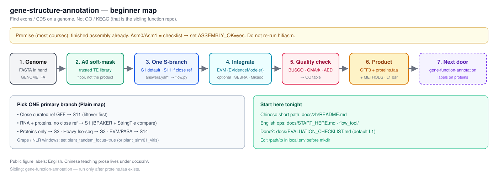

TE soft-mask 是必需的前置步骤。构建 TE 库是一项独立任务，请参考 [vitis-te](https://github.com/Xuzhen-Li/vitis-te) 和 [`docs/TE_LIBRARY.md`](docs/TE_LIBRARY.md)。
GO、KEGG 和易读名称位于相邻仓库 [`gene-function-annotation`](https://github.com/Xuzhen-Li/gene-function-annotation) 中。本仓库不生成功能注释表格。

三个层级：
1. 结构层：本仓库。
2. 功能层：[`gene-function-annotation`](https://github.com/Xuzhen-Li/gene-function-annotation)。
3. TE 库构建：[vitis-te](https://github.com/Xuzhen-Li/vitis-te) 和 [`TE_LIBRARY.md`](docs/TE_LIBRARY.md)。

边界定义详见 [`docs/BOUNDARY.md`](docs/BOUNDARY.md)。

中文最短路径位于 [`docs/zh/README.md`](docs/zh/README.md)。英文入口位于 [`docs/START_HERE.md`](docs/START_HERE.md)。
快速开始指南位于 [Wiki Start-tonight](https://github.com/Xuzhen-Li/gene-structure-annotation/wiki/Start-tonight)。离线版本位于 [`docs/CLASSROOM_TONIGHT.md`](docs/CLASSROOM_TONIGHT.md)。
任务看板位于 [Annotation board (Project #2)](https://github.com/users/Xuzhen-Li/projects/2)。


本页同时也是 2026-11 方法目录：15 个类型分节，共 135 条工具、数据库和想法。默认路径不变（见「使用方法」和 `docs/ROADMAP.md`）。阶段顺序仍在路线图和 `catalog/` 中。

## 使用方法

中文教学入口为 [`docs/zh/`](docs/zh/)。
如果已完成组装，请将 Asm0/Asm1 视为检查清单，并设置 `ASSEMBLY_OK=yes`。在运行任何 `mkdir` 之前，修改 `local.env` 中的每一个 `/path/to`。
如果使用高质量的参考 GFF，请在问答中设置 `close_curated_ref: true`（参考 `examples/plant_sim/03_solanum_s11`）。默认 `false` 指向 S1；半成品的 Liftoff 保持 `false`。

第一步：提供证据文件。
```bash
git clone https://github.com/Xuzhen-Li/gene-structure-annotation.git
cd gene-structure-annotation
cp pipeline/flow_tool/answers.example.yaml my_answers.yaml
# edit yes/no: RNA? proteins? close reference? paper bar?
python3 pipeline/flow_tool/flow.py --answers my_answers.yaml -o my_plan.md
```
打开 `my_plan.md`，其中包含所选分支及各个阶段的说明。

第二步：配置路径。
```bash
cp config/example.env config/local.env
# set GENOME_FA, BUSCO_LINEAGE, RNA_BAM / PROTEIN_DB, TE lib, WORK_DIR, THREADS
```

第三步：执行分析。
完成 `my_plan.md`。阅读 [Wiki Concepts](https://github.com/Xuzhen-Li/gene-structure-annotation/wiki/Concepts) 或 [`docs/zh/05_softmask与A0.md`](docs/zh/05_softmask与A0.md)。单独填写 `grade=` 和 `status=`。不要填写 `status=L1`。
仅在勾选完 [Done when](https://github.com/Xuzhen-Li/gene-structure-annotation/wiki/Start-tonight#done-when) 且 `python3 pipeline/print_qc_commands.py` 退出码为 0 并无 `[STOP]` 提示后，在集群上运行。否则不要设置 `RUN=1`。使用 `--env config/example.env` 浏览时会显示 `[STOP]`；这是正常现象。
按照 `my_plan.md` 的阶段操作并对照 [`docs/EVALUATION_CHECKLIST.md`](docs/EVALUATION_CHECKLIST.md)。完整规则见 [`docs/EVALUATION.md`](docs/EVALUATION.md)。
临时结果不等于 L1。L0 与 L1 的区别请看 [`docs/EVALUATION.md`](docs/EVALUATION.md)。
包含 RNA 和蛋白质且无近缘参考序列的默认分支为 S1。
移交至功能注释请参考 [`docs/HANDOFF_STRUCTURE_TO_FUNCTION.md`](docs/HANDOFF_STRUCTURE_TO_FUNCTION.md)，需包含 `RELEASE_TAG` 和 `PROTEINS_FA=…/release/<TAG>/proteins.faa`。

## 分支路线

根据已有证据选择分支。
S11: 高质量参考 GFF (Liftoff, LiftOn, CAT)。仅 Lift 为 S11-lite。
S1: RNA 和蛋白质 (BRAKER, StringTie)。
S2: 仅蛋白质 (GALBA, GeMoMa)。
S3: 大量 Iso-seq 数据 (IsoQuant, SQANTI)。
S13: GPU 从头预测比冲 (Helixer, Tiberius, ANNEVO)。
S14: 完整经典 PASA 加 EVM 路线 (`docs/steps/dclab/`)。Integrate 步骤 (EVM) 仅在 S14 路线或存在第二套基因集（双轨，即两套基因预测结果）时运行。

叠加层：
L2: L1 接受标准叠加 S5 层，达到论文或 T2T 标准。
S7: 设置 `plant_tandem_focus: true` 时叠加植物 NLR 或串联重复区域分析。

完整路线图位于 [`docs/ROADMAP.md`](docs/ROADMAP.md)。

## 文档目录

中文教学和起点位于 [`docs/zh/`](docs/zh/) 和 [`docs/START_HERE.md`](docs/START_HERE.md)。

自动计划生成：[`pipeline/flow_tool/`](pipeline/flow_tool/)
阶段输入输出与评估：[`docs/STAGE_IO.md`](docs/STAGE_IO.md)、[`docs/EVALUATION_CHECKLIST.md`](docs/EVALUATION_CHECKLIST.md)、[`docs/EVALUATION.md`](docs/EVALUATION.md)
TE soft-mask：[`docs/TE_LIBRARY.md`](docs/TE_LIBRARY.md)、[`docs/TRUSTED_TE_PATH.md`](docs/TRUSTED_TE_PATH.md)
分支路线图与流程：[`docs/ROADMAP.md`](docs/ROADMAP.md)、[`docs/QUICKSTART.md`](docs/QUICKSTART.md)
三层边界定义：[`docs/BOUNDARY.md`](docs/BOUNDARY.md)
组装后说明单页：[`docs/POST_ASSEMBLY.md`](docs/POST_ASSEMBLY.md)
质控资源：[`docs/QUALITY_SOURCES.md`](docs/QUALITY_SOURCES.md)
EDTA 使用方法：[`docs/tools/edta.md`](docs/tools/edta.md)
BUSCO 参考库：[`docs/LINEAGES.md`](docs/LINEAGES.md)
S11 间隙填充：[`pipeline/A2e_s11_gapfill.md`](pipeline/A2e_s11_gapfill.md)、[`pipeline/A2c_liftoff.md`](pipeline/A2c_liftoff.md)
黄金数据集检查清单：[`examples/golden_pack/`](examples/golden_pack/)
蛋白质数据库：[`pipeline/A2_protein_db.md`](pipeline/A2_protein_db.md)
Helixer 与 BRAKER 对比：[`docs/COMPARE_HELIXER_BRAKER.md`](docs/COMPARE_HELIXER_BRAKER.md)
合并与输入模式：[`docs/MERGE_AND_ENTRIES.md`](docs/MERGE_AND_ENTRIES.md)
EGAPx 对比：[`docs/EGAPX_COMPARE.md`](docs/EGAPX_COMPARE.md)
场景与工具：[`docs/SCENARIOS.md`](docs/SCENARIOS.md)、[`docs/TOOLS.md`](docs/TOOLS.md)、[`docs/cases/vitis-t2t-s1-s5.md`](docs/cases/vitis-t2t-s1-s5.md)、[`docs/TUTORIALS_AND_MEETINGS.md`](docs/TUTORIALS_AND_MEETINGS.md)、[`docs/PLAYBOOK.md`](docs/PLAYBOOK.md)

## 适用范围

本项目不包含功能注释。GO/KEGG 注释请使用 [`gene-function-annotation`](https://github.com/Xuzhen-Li/gene-function-annotation)。
本项目不是独立的 TE 库构建工具。请参考 [vitis-te](https://github.com/Xuzhen-Li/vitis-te) 和 `docs/TE_LIBRARY.md`。
本项目不支持泛基因组图谱。请参考 [vitis-pangenome](https://github.com/Xuzhen-Li/vitis-pangenome)。
请勿上传私有 FASTQ/BAM 文件。

作者：Xuzhen Li，[ORCID](https://orcid.org/0000-0003-3670-6657)。

## 方法目录

本页按类型列出 2026-11 调查中的 135 条方法、工具、数据库和想法（类型目录 78 条，`catalog/` 中第一轮卡片 57 条）。默认路径仍以「使用方法」和 `docs/ROADMAP.md` 为准，本目录不改变该路径。阶段顺序仍在路线图和 `catalog/` 中。完整表格和勘误见 `docs/CATALOG_BY_TYPE_2026-11.md` 与 `docs/CATALOG_NEW_TOOLS_2026-11.md`。

## 目录

1. [组装与组装质控](#section-1) (17)
2. [用可信库做 soft-mask](#section-2) (5)
3. [RNA 与 Iso-Seq 证据](#section-3) (22)
4. [蛋白证据](#section-4) (4)
5. [从头基因预测](#section-5) (9)
6. [DNA 语言模型预测](#section-6) (6)
7. [注释转移（lift-over）](#section-7) (8)
8. [合并器与注释流程](#section-8) (11)
9. [非编码 RNA 与假基因位点](#section-9) (15)
10. [基因模型质控](#section-10) (5)
11. [人工校对与浏览器](#section-11) (6)
12. [GFF3 清理与发布](#section-12) (8)
13. [参考数据库](#section-13) (5)
14. [标准与综述](#section-14) (8)
15. [尚未落到单一工具的想法](#section-15) (6)

- [基因组之外还需要的数据](#data-needs)
- [图注与许可](#figure-credits)

与本库阶段的对应：组装与质控（Asm0/Asm1）→ soft-mask（A0）→ 证据与一条草案分支（S11/S1/S2/S3/S13/S14）→ 合并器（A4）→ 模型质控与 last-mile → 发布与移交（A6）。阶段编号仍在 `docs/ROADMAP.md` 和 `catalog/`。

<a id="section-1"></a>
## 1. 组装与组装质控

决定组装是否可以进入注释、或产出单倍型 FASTA 的工具（Asm0、Asm1）。

**需要：** 组装 FASTA；若要做 k-mer 或碱基质量检查，再准备组装所用的测序数据。BUSCO 需要与类群匹配的 lineage（见 `docs/LINEAGES.md`）。[按场景列出的数据需求](#data-needs)

各条目的一句介绍目前保持英文原句，供后续中文润色。

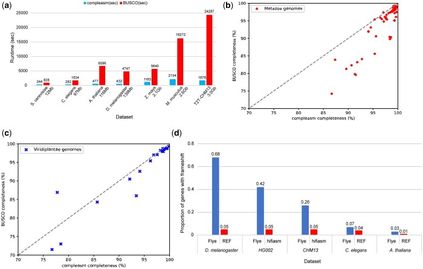

*同一套组装上 compleasm 与 BUSCO 的比较（图 1）。 Huang 与 Li 2023，《Bioinformatics》图 1，doi:10.1093/bioinformatics/btad595，PMC10558035，CC BY。*

- **hifiasm** (tool) — Haplotype-resolved de novo assembler for PacBio HiFi reads (trio, Hi-C or ultra-long phasing modes). [doi:10.1038/s41592-020-01056-5](https://doi.org/10.1038/s41592-020-01056-5) · [link](https://github.com/chhylp123/hifiasm)
- **Verkko** (tool) — Telomere-to-telomere diploid assembly combining HiFi and ultra-long ONT reads in a graph. [doi:10.1038/s41587-023-01662-6](https://doi.org/10.1038/s41587-023-01662-6) · [link](https://github.com/marbl/verkko)
- **YaHS** (tool) — Hi-C scaffolder producing chromosome-scale scaffolds from contigs. [doi:10.1093/bioinformatics/btac808](https://doi.org/10.1093/bioinformatics/btac808) · [link](https://github.com/c-zhou/yahs)
- **RagTag** (tool) — Reference-guided correction, scaffolding and patching of draft assemblies. [doi:10.1186/s13059-022-02823-7](https://doi.org/10.1186/s13059-022-02823-7) · [link](https://github.com/malonge/RagTag)
- **GenomeScope 2.0 / Smudgeplot** (tool) — k-mer profiling of genome size, heterozygosity and ploidy from reads. [doi:10.1038/s41467-020-14998-3](https://doi.org/10.1038/s41467-020-14998-3) · [link](https://github.com/tbenavi1/genomescope2.0)
- **Merqury** (tool) — Reference-free k-mer QV, completeness and phasing assessment of assemblies. [doi:10.1186/s13059-020-02134-9](https://doi.org/10.1186/s13059-020-02134-9) · [link](https://github.com/marbl/merqury)
- **QUAST** (tool) — Assembly contiguity and misassembly statistics, optionally against a reference. [doi:10.1093/bioinformatics/btt086](https://doi.org/10.1093/bioinformatics/btt086) · [link](https://github.com/ablab/quast)
- **Inspector** (tool) — Reference-free assembly evaluation and error correction using long reads. [doi:10.1186/s13059-021-02527-4](https://doi.org/10.1186/s13059-021-02527-4) · [link](https://github.com/Maggi-Chen/Inspector)
- **KAT (K-mer Analysis Toolkit)** (tool) — k-mer spectra comparison of reads vs assembly (copy-number plots). [doi:10.1093/bioinformatics/btw663](https://doi.org/10.1093/bioinformatics/btw663) · [link](https://github.com/EarlhamInst/KAT)
- **BlobToolKit** (tool) — Interactive GC/coverage/taxonomy plots to spot contaminant contigs. [doi:10.1534/g3.119.400908](https://doi.org/10.1534/g3.119.400908) · [link](https://github.com/genomehubs/blobtoolkit)
- **Tiara** (tool) — Deep-learning classification of contigs into nuclear, organellar and prokaryotic origin. [doi:10.1093/bioinformatics/btab672](https://doi.org/10.1093/bioinformatics/btab672) · [link](https://github.com/ibe-uw/tiara)
- **tidk** (tool) — Finds and plots telomeric repeats along an assembly. [doi:10.1093/bioinformatics/btaf049](https://doi.org/10.1093/bioinformatics/btaf049) · [link](https://github.com/tolkit/telomeric-identifier)
- **quarTeT** (tool) — Telomere-to-telomere toolkit: reference-guided assembly, gap filling, telomere and centromere identification. [doi:10.1093/hr/uhad127](https://doi.org/10.1093/hr/uhad127) · [link](https://github.com/aaranyue/quarTeT)
- **GCI** (tool) — Genome Continuity Inspector: read-mapping based continuity score for near-complete assemblies. [doi:10.1093/bioinformatics/btae633](https://doi.org/10.1093/bioinformatics/btae633) · [link](https://github.com/yeeus/GCI)
- **gfastats** (tool) — Fast summary statistics and manipulation of FASTA/GFA assemblies. [doi:10.1093/bioinformatics/btac460](https://doi.org/10.1093/bioinformatics/btac460) · [link](https://github.com/vgl-hub/gfastats)
- **CRAQ** (tool) — Reference-free assembly assessment from clipped-read alignments (regional and structural errors). [link](https://github.com/JiaoLaboratory/CRAQ) [待确认]
- **NCBI FCS-GX** (tool) — Detects and removes foreign-organism contamination in assemblies before submission/annotation. [doi:10.1186/s13059-024-03198-7](https://doi.org/10.1186/s13059-024-03198-7) · [link](https://github.com/ncbi/fcs)

<a id="section-2"></a>
## 2. 用可信库做 soft-mask

用可信 TE 库做重复序列屏蔽，或做低复杂度屏蔽。本库不建 TE 库。

**需要：** 一份可信的 TE 库（来自 vitis-te 或其它已审定的库）。本节只做 soft-mask，不建 TE 库。[按场景列出的数据需求](#data-needs)


- **RepeatMasker** (tool) — Masks repeats with a supplied library (Dfam or a curated species library); -xsmall gives soft-masking. [link](https://github.com/Dfam-consortium/RepeatMasker)
- **Dfam** (resource) — Open database of TE families and profile HMMs used by RepeatMasker. [doi:10.1186/s13100-020-00230-y](https://doi.org/10.1186/s13100-020-00230-y) · [link](https://www.dfam.org/)
- **Tandem Repeats Finder (TRF)** (tool) — Detects tandem repeats. [doi:10.1093/nar/27.2.573](https://doi.org/10.1093/nar/27.2.573) · [link](https://github.com/Benson-Genomics-Lab/TRF)
- **WindowMasker** (tool) — Library-free masking of over-represented k-mers (NCBI). [doi:10.1093/bioinformatics/bti774](https://doi.org/10.1093/bioinformatics/bti774) · [link](https://www.ncbi.nlm.nih.gov/IEB/ToolBox/CPP_DOC/lxr/source/src/app/winmasker/)
- **ULTRA** (tool) — Probabilistic labeling of tandem / low-complexity repeats; output can feed soft-masking alongside a trusted TE library. [doi:10.1093/bioadv/vbae149](https://doi.org/10.1093/bioadv/vbae149) · [link](https://github.com/TravisWheelerLab/ULTRA)

<a id="section-3"></a>
## 3. RNA 与 Iso-Seq 证据

作为基因模型证据的短读长、长读长 RNA 比对、转录本组装和 ORF 预测（A1b）。

**需要：** 尽可能用同一基因型的短读长 RNA-seq（FASTQ 或已有的 `RNA_BAM`）；S3 分支再加深度 Iso-Seq / 长读长转录组。[按场景列出的数据需求](#data-needs)

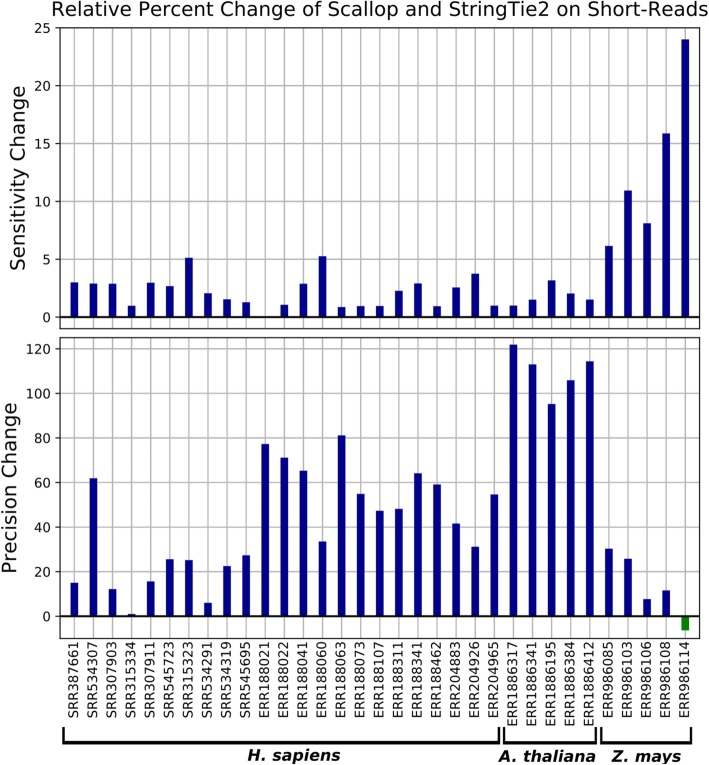

*StringTie2 在植物 RNA-seq 上的转录本组装（图 2）。 Kovaka 等 2019，《Genome Biology》图 2，doi:10.1186/s13059-019-1910-1，PMC6912988，CC BY。*

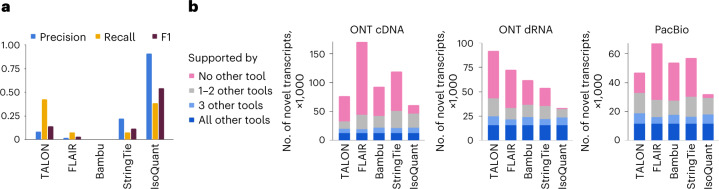

*IsoQuant 在真实长读长 RNA 上的结果（图 2）。原图较扁（719×189）。 Prjibelski 等 2023，《Nature Biotechnology》图 2，doi:10.1038/s41587-022-01565-y，PMC10344776，CC BY。*

- **HISAT2** (tool) — Spliced aligner for short RNA-seq reads (graph-based index). [doi:10.1038/s41587-019-0201-4](https://doi.org/10.1038/s41587-019-0201-4) · [link](https://github.com/DaehwanKimLab/hisat2)
- **STAR** (tool) — Ultrafast spliced short-read aligner with two-pass junction discovery. [doi:10.1093/bioinformatics/bts635](https://doi.org/10.1093/bioinformatics/bts635) · [link](https://github.com/alexdobin/STAR)
- **minimap2** (tool) — Long-read and cDNA/Iso-Seq spliced aligner (-ax splice). [doi:10.1093/bioinformatics/bty191](https://doi.org/10.1093/bioinformatics/bty191) · [link](https://github.com/lh3/minimap2)
- **fastp** (tool) — All-in-one FASTQ QC and adapter trimming. [doi:10.1093/bioinformatics/bty560](https://doi.org/10.1093/bioinformatics/bty560) · [link](https://github.com/OpenGene/fastp)
- **Trinity** (tool) — De novo and genome-guided transcriptome assembly from RNA-seq. [doi:10.1038/nbt.1883](https://doi.org/10.1038/nbt.1883) · [link](https://github.com/trinityrnaseq/trinityrnaseq)
- **PASA** (tool) — Aligns and assembles transcripts into gene structures; also updates models with UTRs and isoforms. [doi:10.1093/nar/gkg770](https://doi.org/10.1093/nar/gkg770) · [link](https://github.com/PASApipeline/PASApipeline)
- **TransDecoder** (tool) — Finds candidate coding regions in transcripts (ORFs with homology/Pfam support). [link](https://github.com/TransDecoder/TransDecoder)
- **IsoQuant** (tool) — Long-read transcript discovery and quantification against a genome. [doi:10.1038/s41587-022-01565-y](https://doi.org/10.1038/s41587-022-01565-y) · [link](https://github.com/ablab/IsoQuant)
- **Bambu** (tool) — Context-aware long-read transcript discovery and quantification (R/Bioconductor). [doi:10.1038/s41592-023-01908-w](https://doi.org/10.1038/s41592-023-01908-w) · [link](https://github.com/GoekeLab/bambu)
- **SQANTI3** (tool) — Classifies and filters long-read isoforms against a reference annotation. [doi:10.1038/s41592-024-02229-2](https://doi.org/10.1038/s41592-024-02229-2) · [link](https://github.com/ConesaLab/SQANTI3)
- **TAMA** (tool) — Collapses and merges long-read transcript models; annotation tools for Iso-Seq. [doi:10.1186/s12864-020-07123-7](https://doi.org/10.1186/s12864-020-07123-7) · [link](https://github.com/GenomeRIK/tama)
- **IsoSeq (PacBio)** (tool) — Official PacBio Iso-Seq processing (refine, cluster, collapse). [link](https://github.com/PacificBiosciences/IsoSeq)
- **StringTie (v3 line)** (tool) — Reference-guided / de novo transcript assembly from short and long RNA reads; used as transcript evidence and as the compare track. [doi:10.1186/s13059-019-1910-1](https://doi.org/10.1186/s13059-019-1910-1) · [link](https://github.com/gpertea/stringtie)
- **FLIC (Full-length isoform constructor)** (tool) — Builds full-length isoforms from long reads using replicate concordance and TSS/polyA peak calling. [doi:10.1093/bioinformatics/btaf551](https://doi.org/10.1093/bioinformatics/btaf551) · [link](https://github.com/albidgy/FLIC)
- **Isocall** (tool) — Joint calling of known and novel isoforms across many PacBio Iso-Seq samples (alternative to isoseq cluster/collapse). [link](https://github.com/PacificBiosciences/isocall)
- **ESPRESSO** (tool) — Discovery and quantification of isoforms from error-prone long-read RNA-seq. [doi:10.1126/sciadv.abq5072](https://doi.org/10.1126/sciadv.abq5072) · [link](https://github.com/Xinglab/espresso)
- **TAGET** (tool) — Iso-Seq toolkit: alignment with CNN splice-site correction, isoform classification, expression. [doi:10.1038/s41467-023-41649-0](https://doi.org/10.1038/s41467-023-41649-0) [待确认]
- **RiboCode** (tool) — Identifies actively translated ORFs from ribosome-profiling data. [doi:10.1093/nar/gky179](https://doi.org/10.1093/nar/gky179) · [link](https://github.com/xryanglab/RiboCode)
- **Ribo-TISH** (tool) — Translation initiation sites and ORFs from (QTI-seq / regular) Ribo-seq. [doi:10.1038/s41467-017-01981-8](https://doi.org/10.1038/s41467-017-01981-8) · [link](https://github.com/zhpn1024/ribotish)
- **PhyloCSF++** (tool) — Fast PhyloCSF: codon-substitution evidence of protein-coding potential from multi-species alignments. [doi:10.1093/bioinformatics/btab756](https://doi.org/10.1093/bioinformatics/btab756) · [link](https://github.com/cpockrandt/PhyloCSFpp)
- **KuPID** (tool) — k-mer-based upstream preprocessing of long reads for isoform discovery (preprint). [doi:10.64898/2025.12.05.692400](https://doi.org/10.64898/2025.12.05.692400) [待确认]
- **RiboBA** (tool) — Bias-aware probabilistic ORF identification across Ribo-seq protocols (preprint). [doi:10.64898/2026.03.17.712439](https://doi.org/10.64898/2026.03.17.712439) [待确认]

<a id="section-4"></a>
## 4. 蛋白证据

为基因模型提供 hint 或同源草案的蛋白到基因组比对（A2 输入）。

**需要：** 近缘物种或已整理数据库中的蛋白集（`PROTEIN_DB`），用于比对到基因组（miniprot、GeneMark-EP、GALBA / GeMoMa）。[按场景列出的数据需求](#data-needs)

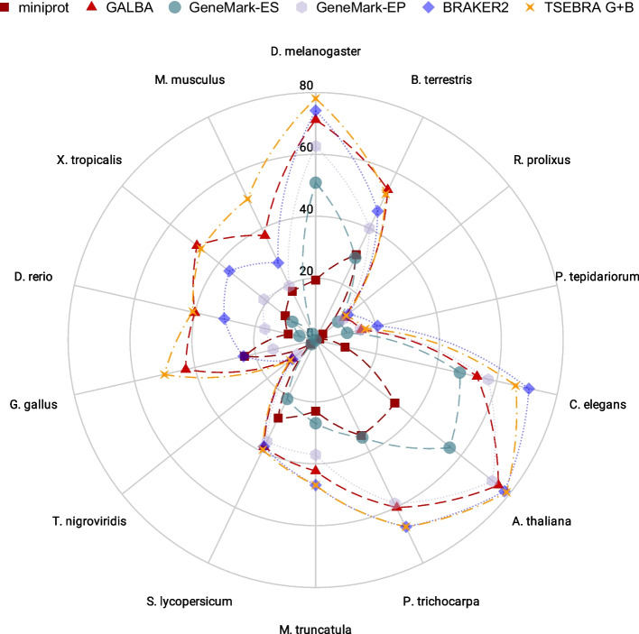

*GALBA 在植物数据上的蛋白到基因组基因预测（图 5）。 Brůna 等 2023，《BMC Bioinformatics》图 5，doi:10.1186/s12859-023-05449-z，PMC10472564，CC BY。*

- **miniprot** (tool) — Fast protein-to-genome spliced alignment. [doi:10.1093/bioinformatics/btad014](https://doi.org/10.1093/bioinformatics/btad014) · [link](https://github.com/lh3/miniprot)
- **GenomeThreader** (tool) — Spliced alignment of proteins/cDNA to genomes. [doi:10.1016/j.infsof.2005.09.005](https://doi.org/10.1016/j.infsof.2005.09.005) · [link](https://genomethreader.org/)
- **Exonerate** (tool) — Generic sequence alignment including protein2genome spliced models. [doi:10.1186/1471-2105-6-31](https://doi.org/10.1186/1471-2105-6-31)
- **Spaln** (tool) — Spliced alignment of cDNA/protein to genome with species-specific parameters. [doi:10.1093/bioinformatics/btn460](https://doi.org/10.1093/bioinformatics/btn460) · [link](https://github.com/ogotoh/spaln)

<a id="section-5"></a>
## 5. 从头基因预测

在已屏蔽基因组上提出基因模型的从头预测或证据提示预测工具（A2）。

**需要：** 已 soft-mask 的基因组；若引擎能利用证据（BRAKER），再加 RNA 和/或蛋白。Helixer / Tiberius 可以只靠基因组，但不应在有 RNA 时悄悄代替基于证据的 S1 草案。[按场景列出的数据需求](#data-needs)

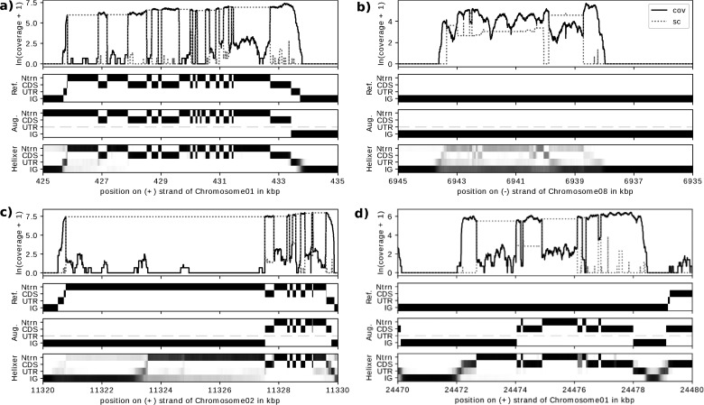

*Helixer 在木薯一个位点上的基因模型（图 3）。 Stiehler 等 2021，《Bioinformatics》图 3，doi:10.1093/bioinformatics/btaa1044，PMC8016489，CC BY。*

- **AUGUSTUS** (tool) — HMM gene finder with hints from RNA/protein evidence. [doi:10.1093/bioinformatics/btn013](https://doi.org/10.1093/bioinformatics/btn013) · [link](https://github.com/Gaius-Augustus/Augustus)
- **BRAKER3** (tool) — Fully automated pipeline combining GeneMark-ETP and AUGUSTUS with RNA-seq and protein evidence. [doi:10.1101/gr.278090.123](https://doi.org/10.1101/gr.278090.123) · [link](https://github.com/Gaius-Augustus/BRAKER)
- **BRAKER2** (tool) — Protein-evidence mode of BRAKER (GeneMark-EP+/AUGUSTUS). [doi:10.1093/nargab/lqaa108](https://doi.org/10.1093/nargab/lqaa108) · [link](https://github.com/Gaius-Augustus/BRAKER)
- **GALBA** (tool) — Trains AUGUSTUS from miniprot protein alignments of a related species. [doi:10.1186/s12859-023-05449-z](https://doi.org/10.1186/s12859-023-05449-z) · [link](https://github.com/Gaius-Augustus/GALBA)
- **SNAP** (tool) — Semi-HMM ab initio gene finder trainable on new genomes. [doi:10.1186/1471-2105-5-59](https://doi.org/10.1186/1471-2105-5-59) · [link](https://github.com/KorfLab/SNAP)
- **GlimmerHMM** (tool) — Generalized HMM eukaryotic gene finder. [doi:10.1093/bioinformatics/bth315](https://doi.org/10.1093/bioinformatics/bth315) · [link](https://ccb.jhu.edu/software/glimmerhmm/)
- **Tiberius** (tool) — End-to-end deep learning plus HMM ab initio gene prediction. [doi:10.1093/bioinformatics/btae685](https://doi.org/10.1093/bioinformatics/btae685) · [link](https://github.com/Gaius-Augustus/Tiberius)
- **GeneMark-ETP** (tool) — Gene finder integrating transcript and protein evidence with self-training (core of BRAKER3). [doi:10.1101/gr.278373.123](https://doi.org/10.1101/gr.278373.123) · [link](https://github.com/gatech-genemark/GeneMark-ETP)
- **ANNEVO (paper)** (tool) — Deep-learning ab initio annotation modelling evolutionary context (preprint version of the tool already noted in this repo). [doi:10.21203/rs.3.rs-6402260/v1](https://doi.org/10.21203/rs.3.rs-6402260/v1) · [link](https://github.com/xjtu-omics/ANNEVO)

<a id="section-6"></a>
## 6. DNA 语言模型预测

DNA 语言模型基因预测，在本库中作为 S13 对照轨道，除非另有书面例外。

**需要：** 已 soft-mask 的基因组，以及跑常规 S13 对照所需的 GPU。除非另有书面例外，输出只作为对照轨道。[按场景列出的数据需求](#data-needs)

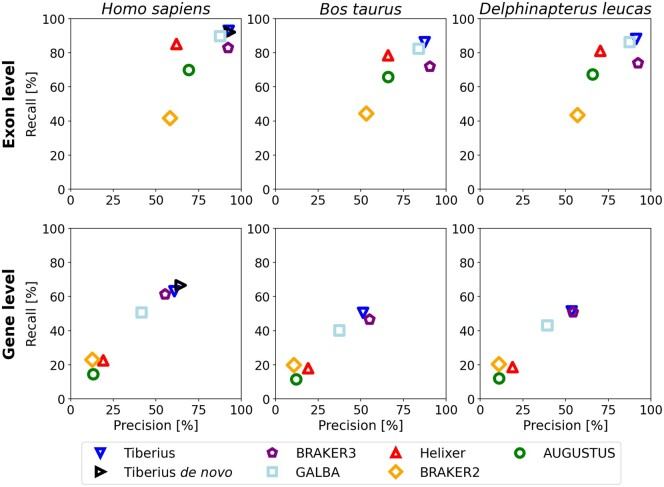

*Tiberius 与其他基因预测工具的精确率-召回率比较（图 3）。 Gabriel、Becker、Hoff 与 Stanke 2024，《Bioinformatics》图 3，doi:10.1093/bioinformatics/btae685，PMC11645249，CC BY。*

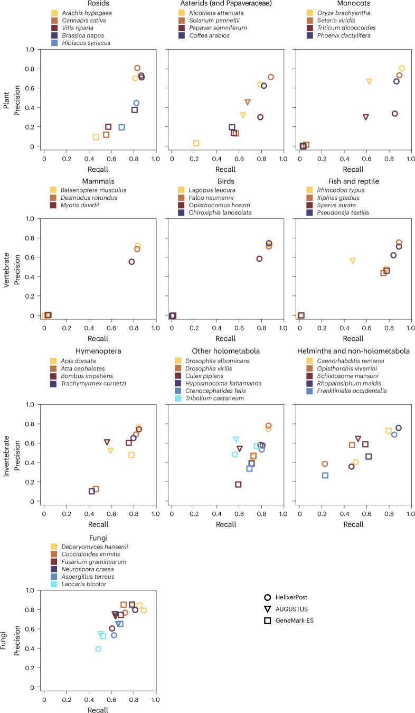

*Helixer 2026 方法论文中的外显子水平精确率-召回率（图 1）。 Holst 等 2026，《Nature Methods》图 1，doi:10.1038/s41592-025-02939-1，PMC13076211，CC BY。*

- **Carbon-A + Carbon Annotation Database (CADB)** (tool / resource) — 1.2B-parameter encoder predicting protein-coding genes from DNA across eukaryotes with per-gene confidence; CADB applies it to GenBank assemblies (566M loci). [doi:10.64898/2026.10.20.760448](https://doi.org/10.64898/2026.10.20.760448) · [link](https://huggingface.co/HuggingFaceBio/Carbon-A-1.2B)
- **Nucleotide Transformer v3 (NTv3)** (tool) — Long-context cross-kingdom DNA foundation model; reports gene-annotation performance above ab initio predictors in mammals, plants, insects. [doi:10.64898/2025.12.22.695963](https://doi.org/10.64898/2025.12.22.695963) · [link](https://github.com/instadeepai/nucleotide-transformer) [待确认]
- **GENATATORs** (tool) — Ab initio gene annotation with DNA language models (preprint 2026). [doi:10.64898/2026.06.17.732686](https://doi.org/10.64898/2026.06.17.732686) [待确认]
- **AgroNT** (tool) — DNA language model trained on 48 edible-plant genomes; downstream tasks include regulatory and splice-site style predictions. [doi:10.1038/s42003-024-06465-2](https://doi.org/10.1038/s42003-024-06465-2) · [link](https://huggingface.co/InstaDeepAI/agro-nucleotide-transformer-1b)
- **PlantCaduceus** (tool) — Cross-species plant DNA language model at single-nucleotide resolution (splice/TIS/TTS annotation tasks). [doi:10.1073/pnas.2421738122](https://doi.org/10.1073/pnas.2421738122) · [link](https://github.com/kuleshov-group/PlantCaduceus)
- **Evo 2** (tool) — Genome language model across domains of life; zero-shot features for exon/intron and variant effect. [doi:10.1101/2025.02.18.638918](https://doi.org/10.1101/2025.02.18.638918) · [link](https://github.com/ArcInstitute/evo2)

<a id="section-7"></a>
## 7. 注释转移（lift-over）

把近缘、已整理的注释转到新组装上（A2b / S11 / S4）。

**需要：** 近缘且已整理的参考 GFF（同种或可信单倍型）以及目标基因组；若要报完整 S11 而不是 S11-lite，还要准备补洞用的证据。[按场景列出的数据需求](#data-needs)


- **GeMoMa** (tool) — Homology-based gene prediction using intron-position conservation and optional RNA-seq. [doi:10.1007/978-1-4939-9173-0_9](https://doi.org/10.1007/978-1-4939-9173-0_9) · [link](https://www.jstacs.de/index.php/GeMoMa)
- **Liftoff** (tool) — Maps gene annotation from a reference to a target assembly of the same/close species. [doi:10.1093/bioinformatics/btaa1016](https://doi.org/10.1093/bioinformatics/btaa1016) · [link](https://github.com/agshumate/Liftoff)
- **LiftOn** (tool) — Combines DNA (Liftoff) and protein (miniprot) alignments to improve lift-over. [doi:10.1101/gr.279620.124](https://doi.org/10.1101/gr.279620.124) · [link](https://github.com/Kuanhao-Chao/LiftOn)
- **Comparative Annotation Toolkit (CAT)** (tool) — Projects annotation through a Cactus whole-genome alignment and merges with ab initio. [doi:10.1101/gr.233460.117](https://doi.org/10.1101/gr.233460.117) · [link](https://github.com/ComparativeGenomicsToolkit/Comparative-Annotation-Toolkit)
- **GrAnnoT** (tool) — Transfers GFF3 annotation through a pangenome graph (GFA) to embedded genomes; outputs graph annotation (GAF) and per-genome GFF3. [doi:10.24072/pcjournal.651](https://doi.org/10.24072/pcjournal.651) · [link](https://forge.ird.fr/diade/dynadiv/grannot)
- **TOGA (paper)** (tool) — Annotation projection integrated with orthology inference from whole-genome alignments. [doi:10.1126/science.abn3107](https://doi.org/10.1126/science.abn3107) · [link](https://github.com/hillerlab/TOGA)
- **LiftoffTools** (tool) — Compares annotations mapped between assemblies: sequence variants in genes, synteny, copy-number changes. [doi:10.12688/f1000research.124059.2](https://doi.org/10.12688/f1000research.124059.2) · [link](https://github.com/agshumate/LiftoffTools)
- **GENESPACE** (tool) — Synteny-constrained orthology across genomes; finds missing/extra genes in syntenic context. [doi:10.7554/eLife.78526](https://doi.org/10.7554/eLife.78526) · [link](https://github.com/jtlovell/GENESPACE)

<a id="section-8"></a>
## 8. 合并器与注释流程

合并多套草案基因集、或包装整套注释流程的工具（A4）。

**需要：** 两套或以上草案基因集和/或转录本组装，以及打分所用的证据（RNA、蛋白、剪接位点）。EVM 用于 S14 或真正的双轨合并，不是每个基因组的必做步骤。[按场景列出的数据需求](#data-needs)

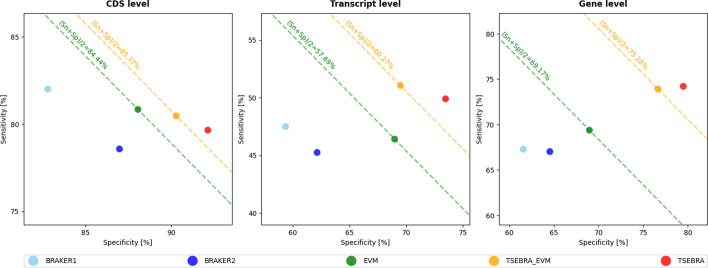

*TSEBRA 在拟南芥上的敏感度与特异度（图 3）。 Gabriel 等 2021，《BMC Bioinformatics》图 3，doi:10.1186/s12859-021-04482-0，PMC8620231，CC BY。*

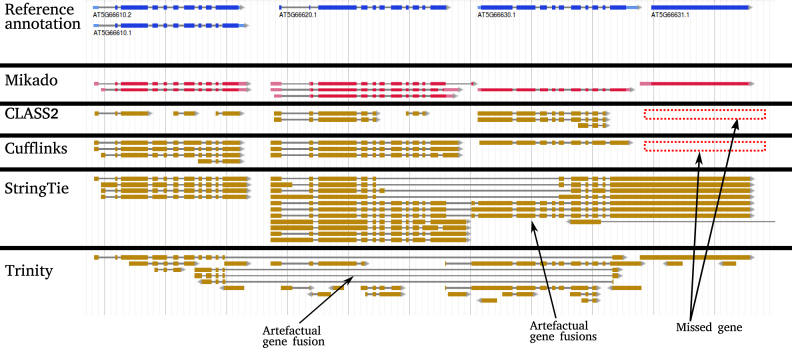

*Mikado 在拟南芥一个位点上的转录本选择（图 1）。 Venturini 等 2018，《GigaScience》图 1，doi:10.1093/gigascience/giy093，PMC6105091，CC BY。*

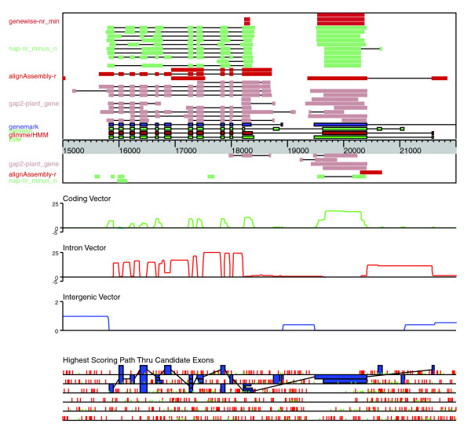

*EVidenceModeler 在水稻一个位点上的基因模型共识（图 5）。 Haas 等 2008，《Genome Biology》图 5，doi:10.1186/gb-2008-9-1-r7，PMC2395244，CC BY。*

- **EVidenceModeler (EVM)** (tool) — Weighted consensus of predictions and alignments into gene models. [doi:10.1186/gb-2008-9-1-r7](https://doi.org/10.1186/gb-2008-9-1-r7) · [link](https://github.com/EVidenceModeler/EVidenceModeler)
- **TSEBRA** (tool) — Transcript selector combining BRAKER predictions using extrinsic evidence. [doi:10.1186/s12859-021-04482-0](https://doi.org/10.1186/s12859-021-04482-0) · [link](https://github.com/Gaius-Augustus/TSEBRA)
- **Mikado** (tool) — Picks best transcript models at each locus from multiple assemblies/predictions. [doi:10.1093/gigascience/giy093](https://doi.org/10.1093/gigascience/giy093) · [link](https://github.com/EI-CoreBioinformatics/mikado)
- **MAKER2** (tool) — Annotation pipeline combining evidence alignment and ab initio predictors with AED scores. [doi:10.1186/1471-2105-12-491](https://doi.org/10.1186/1471-2105-12-491)
- **funannotate** (tool) — Eukaryotic annotation pipeline (predict, update, annotate) built on EVM/PASA. [doi:10.5281/zenodo.1134477](https://doi.org/10.5281/zenodo.1134477) · [link](https://github.com/nextgenusfs/funannotate)
- **EGAPx** (tool) — Public release of NCBI's Eukaryotic Genome Annotation Pipeline. [link](https://github.com/ncbi/egapx)
- **GETA** (tool) — Genome-wide Electronic Transcript Annotation pipeline (transcripts, homology, AUGUSTUS). [link](https://github.com/chenlianfu/geta)
- **REAT** (tool) — Robust Eukaryotic Annotation Toolkit (transcriptome, homology and prediction workflows, Mikado-based). [link](https://github.com/EI-CoreBioinformatics/reat)
- **EASEL** (tool) — Nextflow pipeline: StringTie2/PsiCLASS transcripts, TransDecoder, AUGUSTUS trained on transcript and OrthoDB protein hints, random-forest filtering using RNA-folding and other features. [link](https://gitlab.com/PlantGenomicsLab/easel)
- **Sylvan** (tool) — Snakemake pipeline combining EVM/PASA, GETA, Helixer, Liftoff and miniprot evidence, then semi-supervised random-forest filtering and boundary refinement. [link](https://github.com/plantgenomicslab/Sylvan) [待确认]
- **Ensembl automatic annotation pipeline (ensembl-anno)** (tool) — Public code of Ensembl's automatic gene annotation pipeline. [link](https://github.com/Ensembl/ensembl-anno) [待确认]

<a id="section-9"></a>
## 9. 非编码 RNA 与假基因位点

蛋白编码草案以外的位点：tRNA、rRNA、miRNA、lncRNA 和假基因。

**需要：** 基因组；许多 ncRNA 工具还要协方差模型或参考 RNA 集。除非另有书面合并规则，蛋白编码草案与 ncRNA 位点分开作为产物。[按场景列出的数据需求](#data-needs)


- **ARAGORN** (tool) — Detects tRNA and tmRNA genes. [doi:10.1093/nar/gkh152](https://doi.org/10.1093/nar/gkh152)
- **RNAmmer** (tool) — HMM-based rRNA gene prediction. [doi:10.1093/nar/gkm160](https://doi.org/10.1093/nar/gkm160) · [link](https://services.healthtech.dtu.dk/services/RNAmmer-1.2/)
- **CPAT** (tool) — Alignment-free coding-potential assessment of transcripts. [doi:10.1093/nar/gkt006](https://doi.org/10.1093/nar/gkt006) · [link](https://github.com/liguowang/cpat)
- **LncFinder** (tool) — lncRNA identification with heterologous features and machine learning (R package). [doi:10.1093/bib/bby065](https://doi.org/10.1093/bib/bby065)
- **PseudoPipe** (tool) — Homology-based pseudogene identification pipeline. [doi:10.1093/bioinformatics/btl116](https://doi.org/10.1093/bioinformatics/btl116)
- **Infernal 1.1** (tool) — Covariance-model RNA homology search (engine for Rfam). [doi:10.1093/bioinformatics/btt509](https://doi.org/10.1093/bioinformatics/btt509) · [link](https://github.com/EddyRivasLab/infernal)
- **tRNAscan-SE 2.0** (tool) — tRNA gene detection with isotype classification and pseudo-tRNA flags. [doi:10.1093/nar/gkab688](https://doi.org/10.1093/nar/gkab688) · [link](https://github.com/UCSC-LoweLab/tRNAscan-SE)
- **barrnap** (tool) — Fast rRNA locus prediction (includes eukaryotic models). [link](https://github.com/tseemann/barrnap)
- **ShortStack 4** (tool) — Small-RNA locus annotation and MIRNA calling from sRNA-seq. [doi:10.1261/rna.035279.112](https://doi.org/10.1261/rna.035279.112) · [link](https://github.com/MikeAxtell/ShortStack)
- **PlantLncBoost** (tool) — Gradient-boosting plant lncRNA identification from sequence features. [doi:10.1111/nph.70211](https://doi.org/10.1111/nph.70211) · [link](https://github.com/xuechantian/PlantLncBoost) [待确认]
- **FEELnc** (tool) — lncRNA annotation from transcript assemblies (filter, coding potential, classifier). [doi:10.1093/nar/gkw1306](https://doi.org/10.1093/nar/gkw1306) · [link](https://github.com/tderrien/FEELnc)
- **CPC2** (tool) — Fast coding-potential calculator for transcripts. [doi:10.1093/nar/gkx428](https://doi.org/10.1093/nar/gkx428) · [link](https://cpc2.gao-lab.org/)
- **P-GRe** (tool) — Pseudogene prediction: finds loci from parent proteins, rebuilds pseudo-CDS, reports frameshifts/stops, outputs GFF. [doi:10.1016/j.ygeno.2026.111216](https://doi.org/10.1016/j.ygeno.2026.111216)
- **Shiu lab PseudogenePipeline** (tool) — Classic plant pseudogene pipeline with repeat filtering and GFF output. [link](https://github.com/ShiuLab/PseudogenePipeline)
- **miRDeep-P2** (tool) — Fast plant miRNA locus discovery from sRNA-seq with updated plant criteria. [doi:10.1093/bioinformatics/bty972](https://doi.org/10.1093/bioinformatics/bty972)

<a id="section-10"></a>
## 10. 基因模型质控

对基因模型及其翻译蛋白的检查（A3、A5、last-mile 01–02）。

**需要：** 从 GFF 翻译出的蛋白（`PROTEINS_FA`）和 BUSCO lineage；PSAURON 与 OMArk 用同一套蛋白。RNA BAM 不是硬性输入，但对支持率检查有用。[按场景列出的数据需求](#data-needs)

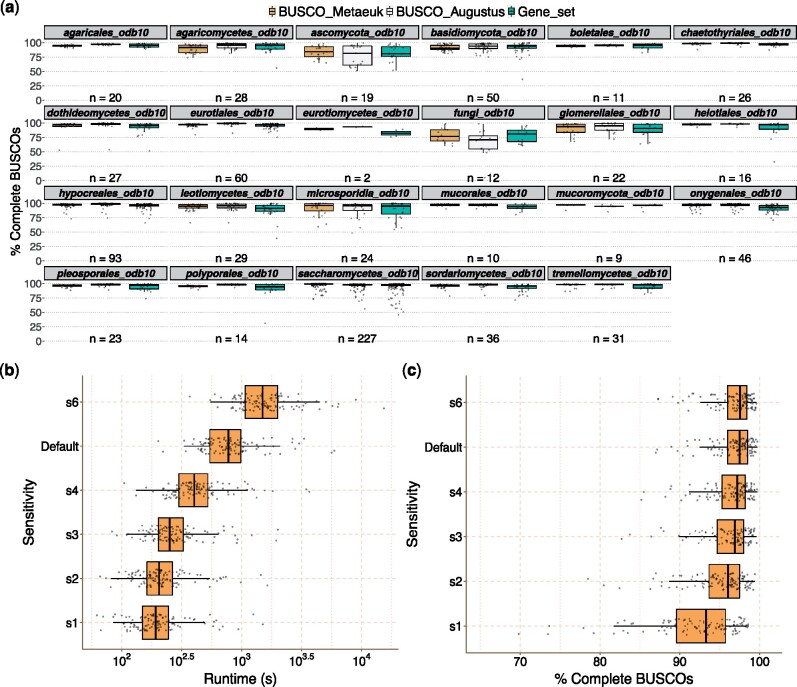

*BUSCO v5 用于真核评估的工作流（图 2）。 Manni 等 2021，《Molecular Biology and Evolution》图 2，doi:10.1093/molbev/msab199，PMC8476166，CC BY。*

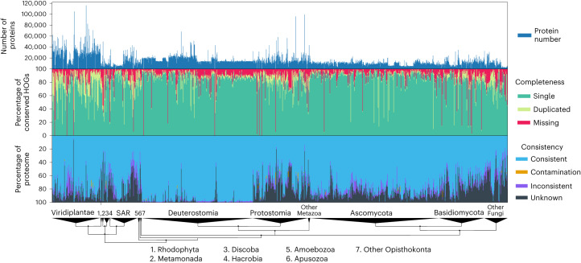

*OMArk 在 UniProt 参考蛋白组上的一致性评估（图 4）。 Nevers 等 2025，《Nature Biotechnology》43(1):124-133，图 4，doi:10.1038/s41587-024-02147-w（线上 2024-02-21），PMC11738984，CC BY。*

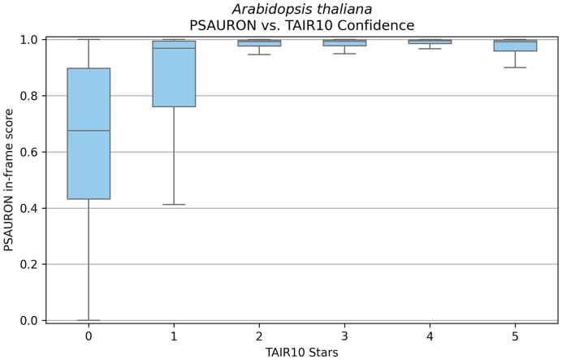

*PSAURON 在 TAIR10 CDS 上的评分（图 5）。 Sommer、Zimin 与 Salzberg 2025，《NAR Genomics and Bioinformatics》图 5，doi:10.1093/nargab/lqae189，PMC11704789，CC BY。*

- **gffread / gffcompare** (tool) — Extract CDS/proteins from GFF (gffread) and compare two annotations at base/exon/locus level (gffcompare). [doi:10.12688/f1000research.23297.2](https://doi.org/10.12688/f1000research.23297.2) · [link](https://github.com/gpertea/gffread)
- **AGAT** (tool) — GFF/GTF toolkit: statistics, fixing, longest-isoform selection, ID management, format conversion. [doi:10.5281/zenodo.3552717](https://doi.org/10.5281/zenodo.3552717) · [link](https://github.com/NBISweden/AGAT)
- **BUSCO** (tool) — Completeness of a gene set against lineage single-copy orthologs (protein mode). [doi:10.1093/molbev/msab199](https://doi.org/10.1093/molbev/msab199)
- **ABAQS** (tool) — Accuracy-Based Annotation Quality Score combining completeness, gene-model validity and protein-profile checks. [link](https://github.com/mycocosm-lbl/abaqs) [待确认]
- **GeneValidator** (tool) — Flags problem gene models by comparing each protein with database homologs (length, coverage, duplication, merged genes). [doi:10.1093/bioinformatics/btw015](https://doi.org/10.1093/bioinformatics/btw015) · [link](https://github.com/wurmlab/genevalidator)

<a id="section-11"></a>
## 11. 人工校对与浏览器

last-mile 校对用的证据包、浏览器和编辑器（LM03–LM04）。

**需要：** 草案 GFF、基因组，以及进入 GSAman 或浏览器之前的证据包（BAM、蛋白比对、RNA 覆盖）。[按场景列出的数据需求](#data-needs)


- **IGV** (tool) — Desktop genome viewer for alignments and annotations. [doi:10.1038/nbt.1754](https://doi.org/10.1038/nbt.1754) · [link](https://github.com/igvteam/igv)
- **igv.js / igv-reports** (tool) — Embeddable IGV; igv-reports builds self-contained HTML pages of loci with tracks. [doi:10.1093/bioinformatics/btac830](https://doi.org/10.1093/bioinformatics/btac830) · [link](https://github.com/igvteam/igv-reports)
- **Apollo (2019 paper)** (tool) — Collaborative web gene-model editor (Apollo 2). [doi:10.1371/journal.pcbi.1006790](https://doi.org/10.1371/journal.pcbi.1006790) · [link](https://github.com/GMOD/Apollo)
- **Artemis / ACT** (tool) — Genome browser/annotation editor and comparison tool. [doi:10.1093/bioinformatics/btr703](https://doi.org/10.1093/bioinformatics/btr703) · [link](https://github.com/sanger-pathogens/Artemis)
- **Apollo 3** (tool) — JBrowse 2-based collaborative gene-model editor (local or server). [doi:10.64898/2026.06.08.730970](https://doi.org/10.64898/2026.06.08.730970) · [link](https://github.com/GMOD/Apollo3)
- **JBrowse 2** (tool) — Genome browser with synteny and SV views; host evidence tracks for curation. [doi:10.1186/s13059-023-02914-z](https://doi.org/10.1186/s13059-023-02914-z) · [link](https://github.com/GMOD/jbrowse-components)

<a id="section-12"></a>
## 12. GFF3 清理与发布

GFF3 清理、校验和提交（last-mile 06、A6）。

**需要：** 审定后的 GFF 和基因组，以及 `docs/PLAYBOOK.md` 里已列的 METHODS / 清单字段。[按场景列出的数据需求](#data-needs)


- **SeqKit 2** (tool) — FASTA/Q toolkit (stats, grep, translate, dedup). [doi:10.1002/imt2.191](https://doi.org/10.1002/imt2.191) · [link](https://github.com/shenwei356/seqkit)
- **Genome Annotation Generator (GAG)** (tool) — Generates and corrects NCBI .tbl annotation tables from GFF3. [doi:10.1093/gigascience/giy018](https://doi.org/10.1093/gigascience/giy018) · [link](https://github.com/genomeannotation/GAG)
- **GenomeTools (gt gff3validator)** (tool) — GFF3 validation, sorting, tidy. [doi:10.1109/TCBB.2013.68](https://doi.org/10.1109/TCBB.2013.68) · [link](https://github.com/genometools/genometools)
- **EMBLmyGFF3** (tool) — Converts GFF3 + FASTA to EMBL flat file for ENA submission. [doi:10.1186/s13104-018-3686-x](https://doi.org/10.1186/s13104-018-3686-x) · [link](https://github.com/NBISweden/EMBLmyGFF3)
- **table2asn** (tool) — NCBI tool converting GFF3/FASTA to ASN.1 submission with validation report. [link](https://www.ncbi.nlm.nih.gov/genbank/table2asn/)
- **GFF3toolkit** (tool) — GFF3 QC/fix/merge utilities from the i5k Workspace@NAL. [link](https://github.com/NAL-i5K/GFF3toolkit)
- **noodles** (tool) — Rust I/O libraries including GFF3/GTF readers and writers. [link](https://github.com/zaeleus/noodles)
- **gxfkit** (tool) — Rust GFF3/GTF conversion aiming at AGAT-compatible output with large speedups. [link](https://github.com/benngaihk/gxfkit)

<a id="section-13"></a>
## 13. 参考数据库

作为证据或近缘 GFF 使用的参考基因组和注释。

**需要：** 不必再测序。这里是作为证据或近缘 GFF 使用的参考基因组和注释。核对版本与 METHODS 中写明的一致。[按场景列出的数据需求](#data-needs)


- **RNAcentral** (resource) — Integrated non-coding RNA sequence database. [doi:10.1093/nar/gkaa921](https://doi.org/10.1093/nar/gkaa921) · [link](https://rnacentral.org/)
- **Phytozome** (resource) — Plant genome and annotation portal (JGI). [doi:10.1093/nar/gkr944](https://doi.org/10.1093/nar/gkr944) · [link](https://phytozome-next.jgi.doe.gov/)
- **Ensembl Plants (Ensembl Genomes 2022)** (resource) — Plant genomes, gene models and comparative data. [doi:10.1093/nar/gkab1007](https://doi.org/10.1093/nar/gkab1007) · [link](https://plants.ensembl.org/)
- **Araport11** (resource) — Re-annotation of the Arabidopsis Col-0 genome. [doi:10.1111/tpj.13415](https://doi.org/10.1111/tpj.13415) · [link](https://www.arabidopsis.org/)
- **Rfam 15** (resource) — RNA family covariance models; scan with Infernal cmscan for rRNA, snoRNA, riboswitch-like loci. [doi:10.1093/nar/gkae1023](https://doi.org/10.1093/nar/gkae1023) · [link](https://rfam.org)

<a id="section-14"></a>
## 14. 标准与综述

标准、格式和综述。不是一份数据配方。

**需要：** 不是一份数据配方。这里是标准、格式和综述。[按场景列出的数据需求](#data-needs)


- **Sequence Ontology** (idea) — Ontology of feature types used in GFF3 column 3. [doi:10.1186/gb-2005-6-5-r44](https://doi.org/10.1186/gb-2005-6-5-r44) · [link](https://github.com/The-Sequence-Ontology/SO-Ontologies)
- **GFF3 specification** (idea) — Formal GFF3 format specification. [link](https://github.com/The-Sequence-Ontology/Specifications)
- **The grapevine gene nomenclature system** (idea) — Proposed naming rules for grapevine genes and loci. [doi:10.1186/1471-2164-15-1077](https://doi.org/10.1186/1471-2164-15-1077)
- **A beginner's guide to eukaryotic genome annotation** (idea) — Review of evidence types, pipelines and quality metrics (AED). [doi:10.1038/nrg3174](https://doi.org/10.1038/nrg3174)
- **Ten steps to get started in genome assembly and annotation** (idea) — Practical guide covering assembly through annotation. [doi:10.12688/f1000research.13598.1](https://doi.org/10.12688/f1000research.13598.1)
- **LRGASP benchmark** (idea) — Community benchmark of long-read RNA-seq methods for transcript identification and quantification; shows trade-offs between read depth, length and accuracy. [doi:10.1038/s41592-024-02298-3](https://doi.org/10.1038/s41592-024-02298-3) · [link](https://github.com/LRGASP/lrgasp-submissions)
- **Tips for improving genome annotation quality** (idea) — Practical checklist: evidence choice, masking level, manual review, metrics. [doi:10.48130/gcomm-0025-0006](https://doi.org/10.48130/gcomm-0025-0006)
- **EBP annotation standards report** (idea) — Earth BioGenome Project report on minimum annotation standards and metadata. [link](https://www.earthbiogenome.org/report-on-annotation-standards)

<a id="section-15"></a>
## 15. 尚未落到单一工具的想法

2026-11 调查里记下的想法。未实测前不改变默认路径。

**需要：** 视具体想法而定；未实测前不改变默认路径。[按场景列出的数据需求](#data-needs)


- **Soft-mask hand-off rule (idea)** (idea) — Structure consumes a curated TE library produced elsewhere; record library name, version and sha256 in METHODS, and keep NLR/gene families out of the library (see existing ProtExcluder note). [link](https://github.com/Xuzhen-Li/gene-structure-annotation/blob/main/docs/BOUNDARY.md)
- **Chimeric mis-annotation survey** (idea) — Shows fused (chimeric) gene models remain common in non-model eukaryote annotations; gives detection heuristics. [doi:10.1186/s12864-025-11765-w](https://doi.org/10.1186/s12864-025-11765-w)
- **Annotation affects orthology (idea)** (idea) — Structural annotation choices change orthology inference; compare annotations before cross-species claims. [doi:10.1093/bioinformatics/btaf365](https://doi.org/10.1093/bioinformatics/btaf365)
- **GeneWhisperer** (idea) — LLM assistant with task tools for manual gene annotation (preprint). [doi:10.1101/2025.03.30.646211](https://doi.org/10.1101/2025.03.30.646211)
- **Human-AI collaborative annotation framework** (idea) — Conceptual framework for dividing genome-annotation work between AI and curators. [doi:10.1093/bib/bbaf377](https://doi.org/10.1093/bib/bbaf377)
- **Family-window review using function results (idea)** (idea) — Scenario S7 can take an NLR/TF window list produced in gene-function-annotation and re-check gene models in those windows; the classifiers themselves stay in the function catalog. [link](https://github.com/Xuzhen-Li/gene-function-annotation)

<a id="data-needs"></a>
## 基因组之外还需要的数据

主输入是基因组 FASTA（`GENOME_FA`）。下表说明各场景通常还要什么。未实测前不改变默认 S1 路径。

| 场景 | 最低要求 | 建议再加 | 本库常用工具 | 常见陷阱 |
|---|---|---|---|---|
| 组装已完成（Asm0/Asm1 作检查清单） | `GENOME_FA`，`ASSEMBLY_OK=yes` | 组装所用测序数据，用于 k-mer / QV 检查；匹配的 BUSCO lineage | BUSCO（基因组模式）、compleasm（可选） | 用了错误类群的 lineage，或混用 odb10 与 odb12 名称却未写明（`docs/LINEAGES.md`） |
| Soft-mask（A0） | 可信 TE 库 | 在 METHODS 中写明库版本与来源 | RepeatMasker / EDTA `make_masked.pl`（只做屏蔽） | 在本库里新建 TE 库 — 那是 vitis-te 的任务 |
| 默认 S1（有 RNA 和蛋白，无近缘 GFF） | RNA-seq（或 `RNA_BAM`）和 `PROTEIN_DB` | 同一基因型、多组织 RNA | HISAT2/STAR、StringTie、BRAKER3/4、GeMoMa 或 miniprot | 把另一品种的 RNA 当作目标基因型来用 |
| 仅有蛋白（S2） | `PROTEIN_DB` | 更近缘的蛋白组，而不是一套泛用集 | GALBA / GALBA2、GeMoMa、miniprot | 仅凭蛋白证据声称完整 UTR |
| 深度 Iso-Seq（S3） | 长读长 RNA + 比对工具（minimap2） | 同时有短读长 RNA；SQANTI 一类过滤 | IsoQuant、SQANTI、EviAnn，孤儿基因再用 BRAKER | 跳过 SQANTI（或等效）过滤 |
| 近缘已整理 GFF（S11） | 可信的近缘 GFF | 补洞用的证据（RNA / 蛋白） | Liftoff、LiftOn、CAT；然后走主干质控 | 把只做 lift 的 S11-lite 当成 L1 发布 |
| GPU 从头预测对照（S13） | 已 soft-mask 的基因组 + GPU | 旁边保留一套证据草案 | Helixer、Tiberius、ANNEVO | 在已有 RNA 时悄悄代替 S1 |
| 经典 EVM 流程（S14） | 用于训练和加权的 RNA 和/或蛋白 | 写明的 EVM 权重 | PASA、AUGUSTUS/GeneMark、EVM | 把 EVM 当成每个基因组的必做步骤 |
| 论文 / T2T 标准（S5 叠加） | S1 或 S14 草案，外加更深入的质控 | OMArk、更深入的 GSAman、证据包 | OMArk、PSAURON、BUSCO 蛋白模式、GSAman | 把临时合并结果当成 L1 |
| 多单倍型（S4 / LM05） | 第二条单倍型组装 | 转移之后跑 SynGAP | Liftoff、SynGAP | 因为 BUSCO Duplicated 偏高就丢掉单倍型（见 S9） |
| 移交功能注释（A6） | 发布标签和 `proteins.faa`（每个基因一条代表序列） | 若功能库要用坐标，再加已审定 GFF | AGAT / gffread | 在没有 `RELEASE_TAG` 的情况下送出未冻结的草案 |

### 跨切陷阱

- 建 TE 库是 vitis-te 的任务。本库只用可信库做 soft-mask。
- GO / KEGG / 结构域 / 可读名称 / NLR 与 TF 分类器（含 HRP）在 gene-function-annotation。蛋白工具里的 “structure” 多指三维结构，不是基因模型。
- `grade=` 与 `status=` 分开写，不要写 `status=L1`。临时结果不等于 L1（`docs/EVALUATION.md`）。
- 「近缘参考」指同种 / 同一品种或近乎相同的单倍型，且 GFF 可信，而不是「同科有一个 GFF」。
- BUSCO lineage 必须匹配类群，并写明 odb10 还是 odb12（`docs/LINEAGES.md`）。Compleasm 可对照，不自动代替 BUSCO。
- BUSCO Duplicated 偏高可能是真实单倍型（S9），不要只为降低 D 就丢掉单倍型。
- TSEBRA 后基因数塌缩时，先做 A5d 单拷贝/多拷贝检查（Copetti），再接受合并结果。

目录里仍标 `[待确认]` 的条目（例如 CRAQ）保持原标记，直到有人打开原始出处。

更详细的说明（含英文表）见 [`docs/SCENARIOS.md#data-needs-zh`](docs/SCENARIOS.md#data-needs-zh)。


<a id="figure-credits"></a>
## 图注与许可

`docs/figures/` 中的自绘总图属于本仓库。下面目录配图是 CC BY 论文中的原始 JPEG（Europe PMC 许可字段为 `cc by`，2026-11-13 核实）。未使用 NC/ND 材料。

| 文件 | 图注与出处 |
|---|---|
| [`docs/figures/catalog/08_compleasm_vs_busco.jpg`](docs/figures/catalog/08_compleasm_vs_busco.jpg) | 同一套组装上 compleasm 与 BUSCO 的比较（图 1）。 Huang 与 Li 2023，《Bioinformatics》图 1，doi:10.1093/bioinformatics/btad595，PMC10558035，CC BY。 |
| [`docs/figures/catalog/03_stringtie2_plant_rnaseq.jpg`](docs/figures/catalog/03_stringtie2_plant_rnaseq.jpg) | StringTie2 在植物 RNA-seq 上的转录本组装（图 2）。 Kovaka 等 2019，《Genome Biology》图 2，doi:10.1186/s13059-019-1910-1，PMC6912988，CC BY。 |
| [`docs/figures/catalog/07_isoquant_real_reads.jpg`](docs/figures/catalog/07_isoquant_real_reads.jpg) | IsoQuant 在真实长读长 RNA 上的结果（图 2）。原图较扁（719×189）。 Prjibelski 等 2023，《Nature Biotechnology》图 2，doi:10.1038/s41587-022-01565-y，PMC10344776，CC BY。 |
| [`docs/figures/catalog/04_galba_f1_plants.jpg`](docs/figures/catalog/04_galba_f1_plants.jpg) | GALBA 在植物数据上的蛋白到基因组基因预测（图 5）。 Brůna 等 2023，《BMC Bioinformatics》图 5，doi:10.1186/s12859-023-05449-z，PMC10472564，CC BY。 |
| [`docs/figures/catalog/05_helixer_cassava_locus.jpg`](docs/figures/catalog/05_helixer_cassava_locus.jpg) | Helixer 在木薯一个位点上的基因模型（图 3）。 Stiehler 等 2021，《Bioinformatics》图 3，doi:10.1093/bioinformatics/btaa1044，PMC8016489，CC BY。 |
| [`docs/figures/catalog/12_tiberius_pr_vs_peers.jpg`](docs/figures/catalog/12_tiberius_pr_vs_peers.jpg) | Tiberius 与其他基因预测工具的精确率-召回率比较（图 3）。 Gabriel、Becker、Hoff 与 Stanke 2024，《Bioinformatics》图 3，doi:10.1093/bioinformatics/btae685，PMC11645249，CC BY。 |
| [`docs/figures/catalog/06_helixer_2026_exon_pr.jpg`](docs/figures/catalog/06_helixer_2026_exon_pr.jpg) | Helixer 2026 方法论文中的外显子水平精确率-召回率（图 1）。 Holst 等 2026，《Nature Methods》图 1，doi:10.1038/s41592-025-02939-1，PMC13076211，CC BY。 |
| [`docs/figures/catalog/09_tsebra_sn_sp_arabidopsis.jpg`](docs/figures/catalog/09_tsebra_sn_sp_arabidopsis.jpg) | TSEBRA 在拟南芥上的敏感度与特异度（图 3）。 Gabriel 等 2021，《BMC Bioinformatics》图 3，doi:10.1186/s12859-021-04482-0，PMC8620231，CC BY。 |
| [`docs/figures/catalog/10_mikado_arabidopsis_locus.jpg`](docs/figures/catalog/10_mikado_arabidopsis_locus.jpg) | Mikado 在拟南芥一个位点上的转录本选择（图 1）。 Venturini 等 2018，《GigaScience》图 1，doi:10.1093/gigascience/giy093，PMC6105091，CC BY。 |
| [`docs/figures/catalog/13_evm_rice_locus.jpg`](docs/figures/catalog/13_evm_rice_locus.jpg) | EVidenceModeler 在水稻一个位点上的基因模型共识（图 5）。 Haas 等 2008，《Genome Biology》图 5，doi:10.1186/gb-2008-9-1-r7，PMC2395244，CC BY。 |
| [`docs/figures/catalog/01_busco_v5_eukaryote_workflows.jpg`](docs/figures/catalog/01_busco_v5_eukaryote_workflows.jpg) | BUSCO v5 用于真核评估的工作流（图 2）。 Manni 等 2021，《Molecular Biology and Evolution》图 2，doi:10.1093/molbev/msab199，PMC8476166，CC BY。 |
| [`docs/figures/catalog/02_omark_uniprot_proteomes.jpg`](docs/figures/catalog/02_omark_uniprot_proteomes.jpg) | OMArk 在 UniProt 参考蛋白组上的一致性评估（图 4）。 Nevers 等 2025，《Nature Biotechnology》43(1):124-133，图 4，doi:10.1038/s41587-024-02147-w（线上 2024-02-21），PMC11738984，CC BY。 |
| [`docs/figures/catalog/11_psauron_tair10_cds.jpg`](docs/figures/catalog/11_psauron_tair10_cds.jpg) | PSAURON 在 TAIR10 CDS 上的评分（图 5）。 Sommer、Zimin 与 Salzberg 2025，《NAR Genomics and Bioinformatics》图 5，doi:10.1093/nargab/lqae189，PMC11704789，CC BY。 |

