# gene-structure-annotation
[English](README.md)

本项目提供基因组结构注释的分析流程。
中文教学位于 [`docs/zh/`](docs/zh/)。
可运行的文档保持英文格式 [`docs/BILINGUAL.md`](docs/BILINGUAL.md)。
植物模拟数据位于 [`examples/plant_sim/`](examples/plant_sim/)。

## 概述

结构注释是核心层。它用于在基因组上寻找基因位置并提供坐标、GFF3 和蛋白质序列。

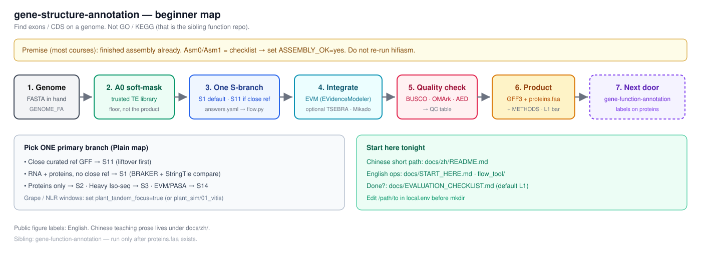

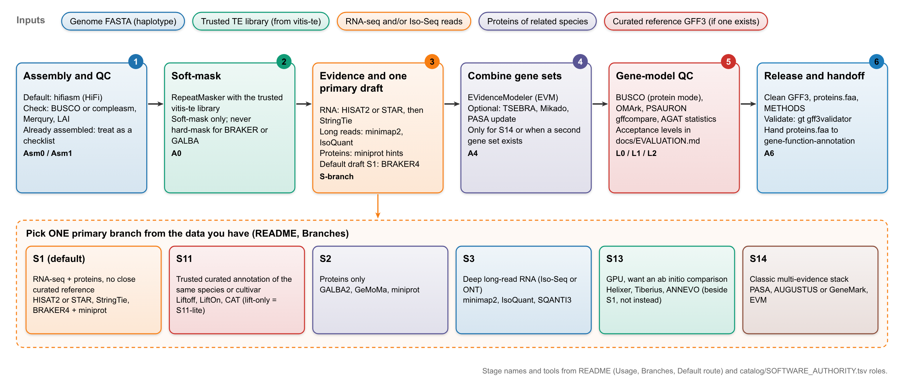

*图：本仓库的结构注释路线。从组装质控到交给 gene-function-annotation 的发布共六个阶段，标出每个阶段的默认工具和六条主分支（S1、S11、S2、S3、S13、S14）。按手头数据只选一条主分支。示意图，据 README（使用方法、分支路线、默认路线）为本仓库绘制；可编辑 SVG：[`structure_route_map_v2.svg`](docs/figures/guide/structure_route_map_v2.svg)。*

TE soft-mask 是必需的前置步骤。构建 TE 库是一项独立任务，请参考 [vitis-te](https://github.com/Xuzhen-Li/vitis-te) 和 [`docs/TE_LIBRARY.md`](docs/TE_LIBRARY.md)。
GO、KEGG 和易读名称位于相邻仓库 [`gene-function-annotation`](https://github.com/Xuzhen-Li/gene-function-annotation) 中。本仓库不生成功能注释表格。

三个层级：
1. 结构层：本仓库。
2. 功能层：[`gene-function-annotation`](https://github.com/Xuzhen-Li/gene-function-annotation)。
3. TE 库构建：[vitis-te](https://github.com/Xuzhen-Li/vitis-te) 和 [`TE_LIBRARY.md`](docs/TE_LIBRARY.md)。

边界定义详见 [`docs/BOUNDARY.md`](docs/BOUNDARY.md)。

中文最短路径位于 [`docs/zh/README.md`](docs/zh/README.md)。英文入口位于 [`docs/START_HERE.md`](docs/START_HERE.md)。
快速开始指南位于 [Wiki Start-tonight](https://github.com/Xuzhen-Li/gene-structure-annotation/wiki/Start-tonight)。离线版本位于 [`docs/CLASSROOM_TONIGHT.md`](docs/CLASSROOM_TONIGHT.md)。
任务看板位于 [Annotation board (Project #2)](https://github.com/users/Xuzhen-Li/projects/2)。


本页也是 2026-11 方法目录，按类型分为 15 节，共收录 207 条工具、数据库与思路（2026-11-14 更新）。默认路径不变（见「使用方法」和 `docs/ROADMAP.md`）。阶段顺序仍以路线图和 `catalog/` 为准。

## 使用方法

中文教学入口为 [`docs/zh/`](docs/zh/)。
如果已完成组装，请将 Asm0/Asm1 视为检查清单，并设置 `ASSEMBLY_OK=yes`。在运行任何 `mkdir` 之前，修改 `local.env` 中的每一个 `/path/to`。
如果使用高质量的参考 GFF，请在问答中设置 `close_curated_ref: true`（参考 `examples/plant_sim/03_solanum_s11`）。默认 `false` 指向 S1；半成品的 Liftoff 保持 `false`。

第一步：提供证据文件。
```bash
git clone https://github.com/Xuzhen-Li/gene-structure-annotation.git
cd gene-structure-annotation
cp pipeline/flow_tool/answers.example.yaml my_answers.yaml
# edit yes/no: RNA? proteins? close reference? paper bar?
python3 pipeline/flow_tool/flow.py --answers my_answers.yaml -o my_plan.md
```
打开 `my_plan.md`，其中包含所选分支及各个阶段的说明。

第二步：配置路径。
```bash
cp config/example.env config/local.env
# set GENOME_FA, BUSCO_LINEAGE, RNA_BAM / PROTEIN_DB, TE lib, WORK_DIR, THREADS
```

第三步：执行分析。
完成 `my_plan.md`。阅读 [Wiki Concepts](https://github.com/Xuzhen-Li/gene-structure-annotation/wiki/Concepts) 或 [`docs/zh/05_softmask与A0.md`](docs/zh/05_softmask与A0.md)。单独填写 `grade=` 和 `status=`。不要填写 `status=L1`。
仅在勾选完 [Done when](https://github.com/Xuzhen-Li/gene-structure-annotation/wiki/Start-tonight#done-when) 且 `python3 pipeline/print_qc_commands.py` 退出码为 0 并无 `[STOP]` 提示后，在集群上运行。否则不要设置 `RUN=1`。使用 `--env config/example.env` 浏览时会显示 `[STOP]`；这是正常现象。
按照 `my_plan.md` 的阶段操作并对照 [`docs/EVALUATION_CHECKLIST.md`](docs/EVALUATION_CHECKLIST.md)。完整规则见 [`docs/EVALUATION.md`](docs/EVALUATION.md)。
临时结果不等于 L1。L0 与 L1 的区别请看 [`docs/EVALUATION.md`](docs/EVALUATION.md)。
包含 RNA 和蛋白质且无近缘参考序列的默认分支为 S1。
移交至功能注释请参考 [`docs/HANDOFF_STRUCTURE_TO_FUNCTION.md`](docs/HANDOFF_STRUCTURE_TO_FUNCTION.md)，需包含 `RELEASE_TAG` 和 `PROTEINS_FA=…/release/<TAG>/proteins.faa`。

## 分支路线

根据已有证据选择分支。
S11: 高质量参考 GFF (Liftoff, LiftOn, CAT)。仅 Lift 为 S11-lite。
S1: RNA 和蛋白质 (BRAKER, StringTie)。
S2: 仅蛋白质 (GALBA, GeMoMa)。
S3: 大量 Iso-seq 数据 (IsoQuant, SQANTI)。
S13: GPU 从头预测比冲 (Helixer, Tiberius, ANNEVO)。
S14: 完整经典 PASA 加 EVM 路线 (`docs/steps/dclab/`)。Integrate 步骤 (EVM) 仅在 S14 路线或存在第二套基因集（双轨，即两套基因预测结果）时运行。

叠加层：
L2: L1 接受标准叠加 S5 层，达到论文或 T2T 标准。
S7: 设置 `plant_tandem_focus: true` 时叠加植物 NLR 或串联重复区域分析。

完整路线图位于 [`docs/ROADMAP.md`](docs/ROADMAP.md)。
含工具选择与判断节点的流程图（2026-11-14）：[`docs/ROADMAP.md#workflow-2026-11-14`](docs/ROADMAP.md#workflow-2026-11-14)。

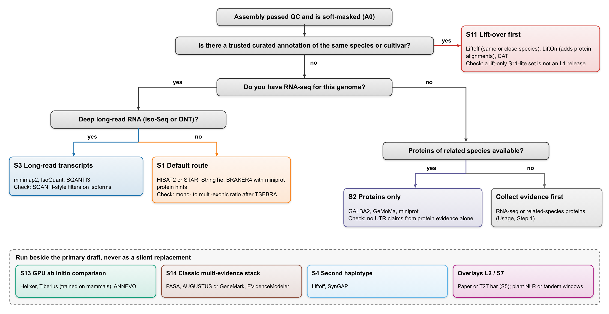

*图：按手头数据选主分支，并列出每条分支的首选工具和主要检查项（与第 18 章表格及 README 分支路线一致）。S13、S14、S4 和叠加项只在主草案旁边并行运行。示意图，为本仓库绘制；可编辑 SVG：[`structure_branch_decision_v2.svg`](docs/figures/guide/structure_branch_decision_v2.svg)。*

## 文档目录

中文教学和起点位于 [`docs/zh/`](docs/zh/) 和 [`docs/START_HERE.md`](docs/START_HERE.md)。

自动计划生成：[`pipeline/flow_tool/`](pipeline/flow_tool/)
阶段输入输出与评估：[`docs/STAGE_IO.md`](docs/STAGE_IO.md)、[`docs/EVALUATION_CHECKLIST.md`](docs/EVALUATION_CHECKLIST.md)、[`docs/EVALUATION.md`](docs/EVALUATION.md)
TE soft-mask：[`docs/TE_LIBRARY.md`](docs/TE_LIBRARY.md)、[`docs/TRUSTED_TE_PATH.md`](docs/TRUSTED_TE_PATH.md)
分支路线图与流程：[`docs/ROADMAP.md`](docs/ROADMAP.md)、[`docs/QUICKSTART.md`](docs/QUICKSTART.md)
三层边界定义：[`docs/BOUNDARY.md`](docs/BOUNDARY.md)
组装后说明单页：[`docs/POST_ASSEMBLY.md`](docs/POST_ASSEMBLY.md)
质控资源：[`docs/QUALITY_SOURCES.md`](docs/QUALITY_SOURCES.md)
EDTA 使用方法：[`docs/tools/edta.md`](docs/tools/edta.md)
BUSCO 参考库：[`docs/LINEAGES.md`](docs/LINEAGES.md)
S11 间隙填充：[`pipeline/A2e_s11_gapfill.md`](pipeline/A2e_s11_gapfill.md)、[`pipeline/A2c_liftoff.md`](pipeline/A2c_liftoff.md)
黄金数据集检查清单：[`examples/golden_pack/`](examples/golden_pack/)
蛋白质数据库：[`pipeline/A2_protein_db.md`](pipeline/A2_protein_db.md)
Helixer 与 BRAKER 对比：[`docs/COMPARE_HELIXER_BRAKER.md`](docs/COMPARE_HELIXER_BRAKER.md)
合并与输入模式：[`docs/MERGE_AND_ENTRIES.md`](docs/MERGE_AND_ENTRIES.md)
EGAPx 对比：[`docs/EGAPX_COMPARE.md`](docs/EGAPX_COMPARE.md)
场景与工具：[`docs/SCENARIOS.md`](docs/SCENARIOS.md)、[`docs/TOOLS.md`](docs/TOOLS.md)、[`docs/cases/vitis-t2t-s1-s5.md`](docs/cases/vitis-t2t-s1-s5.md)、[`docs/TUTORIALS_AND_MEETINGS.md`](docs/TUTORIALS_AND_MEETINGS.md)、[`docs/PLAYBOOK.md`](docs/PLAYBOOK.md)

## 适用范围

本项目不包含功能注释。GO/KEGG 注释请使用 [`gene-function-annotation`](https://github.com/Xuzhen-Li/gene-function-annotation)。
本项目不是独立的 TE 库构建工具。请参考 [vitis-te](https://github.com/Xuzhen-Li/vitis-te) 和 `docs/TE_LIBRARY.md`。
本项目不支持泛基因组图谱。请参考 [vitis-pangenome](https://github.com/Xuzhen-Li/vitis-pangenome)。
请勿上传私有 FASTQ/BAM 文件。

作者：Xuzhen Li，[ORCID](https://orcid.org/0000-0003-3670-6657)。

## 方法目录

本页按类型列出 2026-11 调研及 2026-11-14 更新后的 207 条方法、工具、数据库与思路（类型目录 78 条，`catalog/` 首轮卡片 57 条；2026-11-14 合并旧版本条目 2 条，新增 41 条）。默认路径仍以「使用方法」和 `docs/ROADMAP.md` 为准，本目录不作改动。阶段顺序仍见路线图和 `catalog/`。完整表格与勘误见 `docs/CATALOG_BY_TYPE_2026-11.md` 和 `docs/CATALOG_NEW_TOOLS_2026-11.md`。

**2026-11-14 更新。** 每节开头新增 **分组：** 列表，把本节条目分为可替代（选一个）、互补（一起用）或按顺序（依次运行），并说明什么情况下选哪个。列表中的「A 或 B」表示二选一，「A → B」表示一条固定路线。同一软件的不同版本现在合并为一条，以最新版本命名；旧版本只在该条的说明里提及。带工具选择和判断节点的流程图见 [`docs/ROADMAP.md`](docs/ROADMAP.md#workflow-2026-11-14)。

**2026-11-25 更新。** 每个类型小节的条目改为一张表：工具链接、角色（按本页写明的默认、分支工具或备选）、用途与何时用、原始论文、实验室、权威度与 OpenAlex 被引次数，以及一句引自论文摘要、评测论文或 GitHub 仓库的评价。经过三轮检索（一份起草的候选清单、OpenAlex 关键词检索、公开工具清单与评测论文）新增 33 条；每条新增条目的 DOI 都能解析到题名一致的论文，链接都实际打开核对过。目录现有 207 条，含新加的可视化一节；下面目录中的数字为当前数字。逐条数据见 `catalog/SOFTWARE_AUTHORITY.tsv`，同样的表格（不含各节说明）见 [`docs/software/README.zh.md`](docs/software/README.zh.md)。书籍形式的学习笔记见 [`book/`](book/README.zh.md)。

## 目录

- [默认路线](#default-route)
- [权威度规则](#tier-rule)
- [整套流程覆盖哪些步骤](#pipelines) (16)
- [1. 组装与组装质控](#section-1) (22)
- [2. 用可信库做 soft-mask](#section-2) (11)
- [3. RNA 与 Iso-Seq 证据](#section-3) (31)
- [4. 蛋白证据](#section-4) (8)
- [5. 从头基因预测](#section-5) (12)
- [6. DNA 语言模型预测](#section-6) (11)
- [7. 注释转移（lift-over）](#section-7) (10)
- [8. 合并器与注释流程](#section-8) (15)
- [9. 非编码 RNA 与假基因位点](#section-9) (17)
- [10. 基因模型质控](#section-10) (7)
- [11. 人工校对与浏览器](#section-11) (8)
- [12. GFF3 清理与发布](#section-12) (11)
- [13. 参考数据库](#section-13) (11)
- [14. 标准与综述](#section-14) (13)
- [15. 尚未落到单一工具的想法](#section-15) (8)
- [可视化工具](#visualization) (新增 12 条，另有交叉列出的条目)
  - [基因组浏览器与编辑器](#viz-1) (5)
  - [基因结构与异构体图](#viz-2) (6)
  - [轨道图与染色体图](#viz-3) (5)
  - [共线性图与点图](#viz-4) (3)
- [基因组之外还需要的数据](#data-needs)
- [图注与许可](#figure-credits)

各节与本库阶段的对应关系：组装与质控（Asm0/Asm1）→ soft-mask（A0）→ 证据与一条草案分支（S11/S1/S2/S3/S13/S14）→ 合并器（A4）→ 模型质控与 last-mile → 发布与移交（A6）。阶段编号仍见 `docs/ROADMAP.md` 和 `catalog/`。

<a id="default-route"></a>
### 默认路线

默认分支是 S1（有 RNA 和蛋白、没有近缘参考）。先用 vitis-te 的库经 RepeatMasker 做 soft-mask（A0）；RNA 用 HISAT2 或 STAR 比对、StringTie 组装；长读长用 minimap2 和 IsoQuant；然后用 BRAKER4 加蛋白证据（miniprot 提示或 GeMoMa）。其他分支：S11（Liftoff、LiftOn、CAT），S2（GALBA2、GeMoMa），S3（IsoQuant、SQANTI3），S13（Helixer、Tiberius、ANNEVO），S14（PASA 加 EVM）。这条路线以本页“使用方法”“分支路线”和各节“分组”以及 `docs/ROADMAP.md` 为准；下表把这些工具标为默认或分支工具，其余条目标为备选。

<a id="tier-rule"></a>
### 权威度规则

> **权威度规则（只在此处说明一次）：** 权威度取 OpenAlex 的论文被引次数（2026-11-25 取数）。标准：500 次及以上；成熟：100–499 次；较新：少于 100 次且论文发表于 2023 年或之后；小众：少于 100 次且发表于 2023 年之前；无论文：没有题名匹配的论文。通用工具的引用数来自所有学科。实验室取论文元数据中的通讯作者及其第一机构（多个通讯作者时写第一位并以 +N 表示其余人数；没有标注时写末位作者）。评价引自论文摘要（“作者摘要原句”表示工具作者自己的说法）、带 DOI 的评测论文，或 GitHub 仓库（简介与最后提交日期）。本目录共 207 条：标准 81、成熟 57、较新 30、小众 16、无论文 23。

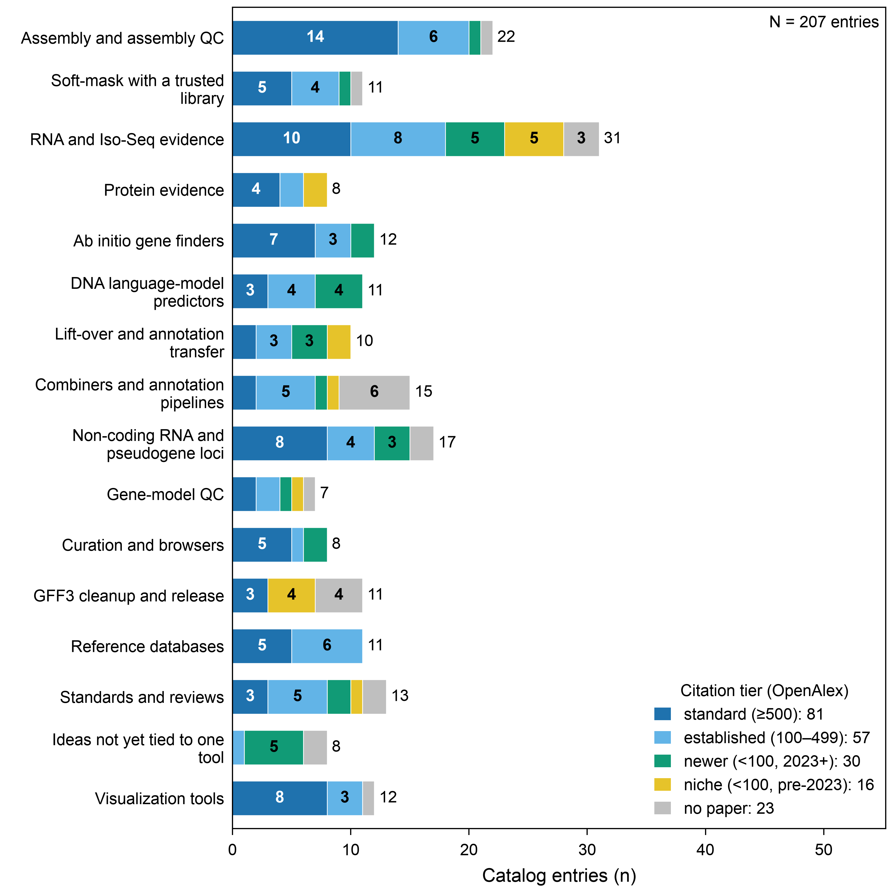

*图：各类型小节的目录条目数，按权威度着色（规则见上）。数字由 `docs/figures/guide/src/make_catalog_charts.py` 从 `catalog/SOFTWARE_AUTHORITY.tsv` 计算（207 条；OpenAlex 被引数于 2026-11-25 取得）。*

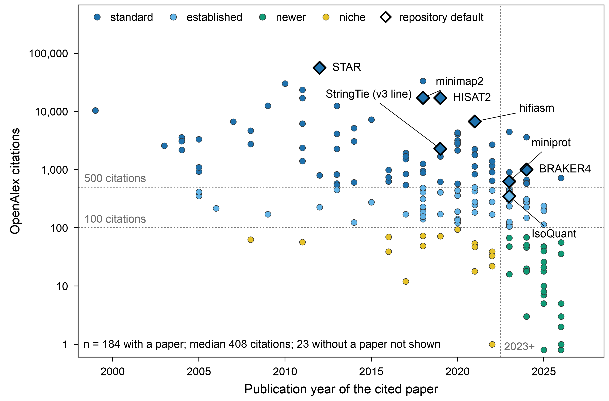

*图：184 条有论文的目录条目的发表年份与 OpenAlex 被引数；菱形为本仓库默认工具。被引数只说明论文被引用得多不多，不说明工具在你的基因组上准不准。数据：`catalog/SOFTWARE_AUTHORITY.tsv`；脚本 `docs/figures/guide/src/make_catalog_charts.py`。*

<a id="pipelines"></a>
### 整套流程覆盖哪些步骤

“有”表示论文摘要或目录说明写明了该步骤；“—”只表示其中没有写明。“依据”列给出来源。

| 流程 | soft-mask | RNA 证据 | 蛋白证据 | 从头训练 | 注释转移 | 合并/挑选 | ncRNA/假基因 | 模型质控 | 权威度 | 依据 |
|---|---|---|---|---|---|---|---|---|---|---|
| [BRAKER4](https://github.com/Gaius-Augustus/BRAKER4) · 默认（S1） | 输入已屏蔽基因组 | 有 | 有 | 有 | — | 有（TSEBRA） | — | — | 标准 · 1004 次 | doi:10.1101/gr.278090.123 （摘要） |
| [GALBA2](https://github.com/Gaius-Augustus/GALBA2) · 分支 S2 | 输入已屏蔽基因组 | — | 有（miniprot） | 有（AUGUSTUS） | — | — | — | — | 成熟 · 127 次 | doi:10.1186/s12859-023-05449-z （摘要） |
| MAKER2 | — | 有 | 有 | 有 | — | 有 | — | 有（AED） | 标准 · 2370 次 | 目录说明 |
| [MAKER-P](https://github.com/Yandell-Lab/maker) | — | 有 | 有 | 有 | — | 有 | 有 | — | 成熟 · 451 次 | doi:10.1104/pp.113.230144 （摘要） |
| [funannotate](https://github.com/nextgenusfs/funannotate) | — | 有（PASA） | 有 | 有 | — | 有（EVM） | — | — | 成熟 · 407 次 | 目录说明 |
| [EVidenceModeler (EVM)](https://github.com/EVidenceModeler/EVidenceModeler) · 分支 S14（A4） | — | 经 PASA | 作为输入 | 作为输入 | — | 有 | — | — | 标准 · 4661 次 | doi:10.1186/gb-2008-9-1-r7 （摘要） |
| [EASEL](https://gitlab.com/PlantGenomicsLab/easel) | — | 有（StringTie2/PsiCLASS） | 有（OrthoDB 提示） | 有（AUGUSTUS） | — | 有（随机森林过滤） | — | — | 无论文 | 目录说明 |
| [Sylvan](https://github.com/plantgenomicslab/Sylvan) | — | 有（EVM/PASA） | 有（miniprot） | 有（Helixer、GETA） | 有（Liftoff） | 有（EVM + 过滤） | — | — | 无论文 | 目录说明 |
| [REAT](https://github.com/EI-CoreBioinformatics/reat) | — | 有 | 有 | 有 | — | 有（Mikado） | — | — | 无论文 | 目录说明 |
| [GETA](https://github.com/chenlianfu/geta) | — | 有 | 有 | 有（AUGUSTUS） | — | — | — | — | 无论文 | 目录说明 |
| [EviAnn](https://github.com/alekseyzimin/EviAnn_release) | — | 有 | 有 | 不训练 | — | 有 | — | — | 较新 · 36 次 | 目录说明 |
| [FINDER](https://github.com/sagnikbanerjee15/Finder) | — | 有 | 有 | — | — | — | — | — | 小众 · 47 次 | doi:10.1186/s12859-021-04120-9 （题名） |
| [GenSAS](https://www.gensas.org/) | — | 有 | 有 | — | — | — | — | 人工校对（JBrowse、Apollo） | 成熟 · 173 次 | doi:10.1007/978-1-4939-9173-0_3 （摘要） |
| [Comparative Annotation Toolkit (CAT)](https://github.com/ComparativeGenomicsToolkit/Comparative-Annotation-Toolkit) · 分支 S11 | — | — | — | — | 有 | — | — | — | 成熟 · 141 次 | doi:10.1101/gr.233460.117 （摘要） |
| [Liftoff](https://github.com/agshumate/Liftoff) · 分支 S11 | — | — | — | — | 有 | — | — | — | 标准 · 1144 次 | doi:10.1093/bioinformatics/btaa1016 （摘要） |
| [LiftOn](https://github.com/Kuanhao-Chao/LiftOn) · 分支 S11 | — | — | 有（蛋白比对） | — | 有 | — | — | — | 较新 · 51 次 | doi:10.1101/gr.279620.124 （摘要） |

<a id="section-1"></a>
## 1. 组装与组装质控

用于判断组装能否进入注释，或直接生成单倍型 FASTA 的工具（Asm0、Asm1）。

**需要：** 组装 FASTA；若需检查 k-mer 或碱基准确度，还需附上组装所用的测序读长。BUSCO 需选用与类群匹配的 lineage（见 `docs/LINEAGES.md`）。[按场景列出的数据需求](#data-needs)

**分组：**
- *组装与挂载*（可替代）：hifiasm、Verkko、YaHS、RagTag。HiFi（+Hi-C）默认用 hifiasm；有超长 ONT 且要做 T2T 时选 Verkko。有 Hi-C 时用 YaHS 挂载；仅有近缘参考时才用 RagTag。
- *准确度与完整性*（互补）：Merqury、CRAQ、Inspector、GCI、compleasm、LTR Assembly Index (LAI)、QUAST、gfastats。配合使用：Merqury 算 QV，compleasm 评基因空间，LAI 评重复序列区；CRAQ 和 Inspector 定位组装错误；gfastats 和 QUAST 生成汇总表。
- *污染与染色体末端*（互补）：NCBI FCS-GX、BlobToolKit、Tiara、tidk、quarTeT。提交 NCBI 前必须运行 FCS-GX；BlobToolKit 和 Tiara 用于判定被标记 contig 的来源。tidk 和 quarTeT 用于确认 T2T 染色体两端的端粒。
- *读长 k-mer 概况*（互补）：GenomeScope 2.0 / Smudgeplot、KAT (K-mer Analysis Toolkit)。在组装前或组装刚完成时运行，根据读长估计基因组大小、杂合度和倍性。

各条目的单句简介译自英文目录，英文原句见英文版 README。

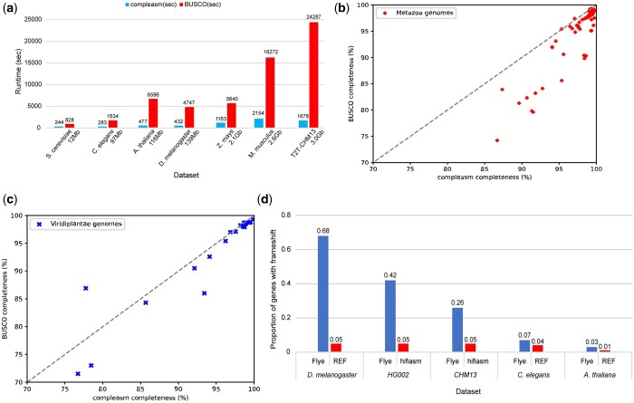

*同一批组装上 compleasm 与 BUSCO 的表现对比（图 1）。 Huang 与 Li 2023，《Bioinformatics》图 1，doi:10.1093/bioinformatics/btad595，PMC10558035，CC BY。*

| 工具 | 角色 | 用途 / 何时用 | 原始论文 | 实验室（通讯作者，机构） | 权威度（档位 · 被引） | 评价（出处） |
|---|---|---|---|---|---|---|
| [hifiasm](https://github.com/chhylp123/hifiasm) | 默认（HiFi） | 面向 PacBio HiFi 读长的单倍型分型从头组装工具（支持 trio、Hi-C 或超长读长分型模式）。 | [Nature Methods 2021](https://doi.org/10.1038/s41592-020-01056-5) | Heng Li (Harvard University) | 标准 · 6724 次 | GitHub 最后提交 2026-05 |
| [Verkko](https://github.com/marbl/verkko) | 备选 | 在组装图中结合 HiFi 与超长 ONT 读长的端粒到端粒（T2T）二倍体组装工具。 | [Nature Biotechnology 2023](https://doi.org/10.1038/s41587-023-01662-6) | Adam M. Phillippy (National Institutes of Health) +1 | 成熟 · 464 次 | GitHub 最后提交 2026-11 |
| [YaHS](https://github.com/c-zhou/yahs) | 备选 | 利用 Hi-C 数据将 contig 挂载为染色体级别 scaffold 的组装工具。 | [Bioinformatics 2022](https://doi.org/10.1093/bioinformatics/btac808) | Richard Michael Durbin (University of Cambridge) | 标准 · 2689 次 | 作者摘要原句：“It can be run with a single-line command, requires minimal input from users (an assembly file and an alignment file) which is compatible with similar tools and provides assembly results in multiple formats, thereby enabling rapid, robust and scalable …”；GitHub 最后提交 2024-11 |
| [RagTag](https://github.com/malonge/RagTag) | 备选 | 基于参考基因组对草案组装做纠错、挂载（scaffolding）与补洞（patching）的工具。 | [Genome biology 2022](https://doi.org/10.1186/s13059-022-02823-7) | Michael C. Schatz (Johns Hopkins University) +1 | 标准 · 1166 次 | 论文摘要：“Here, we introduce RagTag, a toolset for automating assembly scaffolding and patching, and we establish chromosome-scale reference genomes for the widely used tomato genotype M82 along with Sweet-100, a new rapid-cycling genotype that we developed to …”；GitHub 最后提交 2026-10 |
| [GenomeScope 2.0 / Smudgeplot](https://github.com/tbenavi1/genomescope2.0) | 备选 | 根据测序读长的 k-mer 分布估算基因组大小、杂合度与倍性。 | [Nature Communications 2020](https://doi.org/10.1038/s41467-020-14998-3) | T. Rhyker Ranallo-Benavidez (Johns Hopkins University) | 标准 · 3192 次 | 作者摘要原句：“We describe and evaluate a practical implementation of the polyploid-aware mixture model that quickly and accurately infers genome properties across thousands of simulated and several real datasets spanning a broad range of complexity.”；GitHub 最后提交 2025-10 |
| [Merqury](https://github.com/marbl/merqury) | 备选 | 无需参考基因组，基于 k-mer 评估组装的碱基质量值（QV）、完整性与分型质量。 | [Genome biology 2020](https://doi.org/10.1186/s13059-020-02134-9) | Arang Rhie (National Institutes of Health) | 标准 · 4080 次 | 作者摘要原句：“By comparing k-mers in a de novo assembly to those found in unassembled high-accuracy reads, Merqury estimates base-level accuracy and completeness.”；GitHub 最后提交 2026-07 |
| [QUAST](https://github.com/ablab/quast) | 备选 | 统计组装连续性与错误组装指标，可选用参考基因组作比对。 | [Bioinformatics 2013](https://doi.org/10.1093/bioinformatics/btt086) | Glenn Tesler (Saint Petersburg Academic University) | 标准 · 12516 次 | 作者摘要原句：“This tool improves on leading assembly comparison software with new ideas and quality metrics.”；GitHub 最后提交 2026-11 |
| [Inspector](https://github.com/Maggi-Chen/Inspector) | 备选 | 利用长读长数据做无参考组装评估与碱基纠错。 | [Genome biology 2021](https://doi.org/10.1186/s13059-021-02527-4) | Zechen Chong (University of Alabama at Birmingham) | 成熟 · 249 次 | 作者摘要原句：“Based on in silico and long-read assembly results from multiple long-read data and assemblers, we demonstrate that in addition to providing generic metrics, Inspector can accurately identify both large-scale and small-scale assembly errors.”；GitHub 最后提交 2024-08 |
| [KAT (K-mer Analysis Toolkit)](https://github.com/EarlhamInst/KAT) | 备选 | 比较测序读长与组装结果的 k-mer 频谱（绘制拷贝数分布图）。 | [Bioinformatics 2016](https://doi.org/10.1093/bioinformatics/btw663) | Bernardo Clavijo (Earlham Institute) | 标准 · 630 次 | 论文摘要：“We present the K-mer Analysis Toolkit (KAT): a multi-purpose software toolkit for reference-free quality control (QC) of WGS reads and de novo genome assemblies, primarily via their k-mer frequencies and GC composition.”；GitHub 最后提交 2022-11 |
| [BlobToolKit](https://github.com/genomehubs/blobtoolkit) | 备选 | 通过交互式 GC 含量、覆盖度与物种分类图识别污染 contig。 | [G3 Genes Genomes Genetics 2020](https://doi.org/10.1534/g3.119.400908) | RICHARD J. CHALLIS (Wellcome Sanger Institute) | 标准 · 2759 次 | 论文摘要：“We present BlobToolKit, a software suite to aid researchers in identifying and isolating non-target data in draft and publicly available genome assemblies.”；GitHub 最后提交 2026-11 |
| [Tiara](https://github.com/ibe-uw/tiara) | 备选 | 利用深度学习将 contig 划分为核基因组、细胞器基因组或原核生物来源。 | [Bioinformatics 2021](https://doi.org/10.1093/bioinformatics/btab672) | Anna Karnkowska (University of Warsaw) | 成熟 · 185 次 | 作者摘要原句：“Using the test dataset, we have shown that Tiara performed similarly to EukRep for prokaryotes classification and outperformed it for eukaryotes classification with lower calculation time.”；GitHub 最后提交 2024-03 |
| [tidk](https://github.com/tolkit/telomeric-identifier) | 备选 | 在组装序列上检索端粒重复序列并绘图。 | [Bioinformatics 2025](https://doi.org/10.1093/bioinformatics/btaf049) | Max R. Brown (Anglia Ruskin University) | 成熟 · 204 次 | 作者摘要原句：“Our algorithm is shown to be accurate in genomes for which the telomeric repeat unit is known and is tested across a wide variety of newly assembled genomes to uncover new telomeric repeat units.”；GitHub 最后提交 2026-11 |
| [quarTeT](https://github.com/aaranyue/quarTeT) | 备选 | 端粒到端粒（T2T）分析工具包：涵盖基于参考的组装、补洞以及端粒与着丝粒识别。 | [Horticulture Research 2023](https://doi.org/10.1093/hr/uhad127) | Yi Yue (Anhui Agricultural University) +2 | 成熟 · 426 次 | 作者摘要原句：“As a case study, by adopting the entire modular functions of quarTeT, we have achieved the Actinidia chinensis genome assembly that is of a quality comparable to the reported genome Hongyang v4.0, which was assembled with the addition of manual handling.”；GitHub 最后提交 2026-06 |
| [GCI](https://github.com/yeeus/GCI) | 备选 | Genome Continuity Inspector：基于读长回贴计算近完整组装的连续性得分。 | [Bioinformatics 2024](https://doi.org/10.1093/bioinformatics/btae633) | Guojie Zhang (Women's Hospital, School of Medicine, Zhejiang University) +1 | 较新 · 46 次 | 论文摘要：“Here, we present a tool called Genome Continuity Inspector (GCI), designed to assess genome assembly continuity at single-base resolution, and evaluate how close an assembly is to the T2T level.”；GitHub 最后提交 2026-11 |
| [gfastats](https://github.com/vgl-hub/gfastats) | 备选 | 对 FASTA/GFA 格式组装文件做快速统计与处理的工具。 | [Bioinformatics 2022](https://doi.org/10.1093/bioinformatics/btac460) | Giulio Formenti (Rockefeller University) | 标准 · 1400 次 | GitHub 最后提交 2026-11 |
| [CRAQ](https://github.com/JiaoLaboratory/CRAQ) | 备选 | 根据软剪切（clipped）读长比对结果做无参考组装评估，检测局部与结构组装错误。 | 无文章 | — | 无论文 | 仓库简介：“Identification of errors in draft genome assemblies with single-base pair resolution for quality assessment and improvement”；GitHub 最后提交 2025-12 |
| [NCBI FCS-GX](https://github.com/ncbi/fcs) | 备选 | 在提交或注释前检测并剔除组装中的外源物种污染。 | [Genome biology 2024](https://doi.org/10.1186/s13059-024-03198-7) | Terence D. Murphy (National Institutes of Health) | 标准 · 605 次 | 作者摘要原句：“Testing FCS-GX on artificially fragmented genomes demonstrates high sensitivity and specificity for diverse contaminant species.”；GitHub 最后提交 2025-03 |
| [compleasm](https://github.com/huangnengCSU/compleasm) | 备选 | 基于 miniprot 重新实现 BUSCO，沿用同一套谱系数据集；在大型植物组装上评估基因空间完整性速度更快，结果往往也更准。 | [Bioinformatics 2023](https://doi.org/10.1093/bioinformatics/btad595) | Heng Li (Harvard University) | 成熟 · 423 次 | 作者摘要原句：“It is 14 times faster than BUSCO for human assemblies and reports a more accurate completeness of 99.6% than BUSCO’s 95.7%, which is in close agreement with the annotation completeness of 99.5% for T2T-CHM13.”；GitHub 最后提交 2026-10 |
| [LTR Assembly Index (LAI)](https://github.com/oushujun/LTR_retriever) | 备选 | 根据组装中保留的完整 LTR 反转录转座子比例打分；用于在注释前检查重复序列区连续性，与 BUSCO 互补。 | [Nucleic Acids Research 2018](https://doi.org/10.1093/nar/gky730) | Shujun Ou (Michigan State University) | 标准 · 947 次 | 作者摘要原句：“Moreover, LAI can facilitate iterative assembly improvement with assembler selection and identify low-quality genomic regions.”；GitHub 最后提交 2026-11 |
| [purge_dups](https://github.com/dfguan/purge_dups) | 备选 | 按读段深度去除主组装中的单倍型重复和重叠片段；杂合基因组注释前先跑。 | [Bioinformatics 2020](https://doi.org/10.1093/bioinformatics/btaa025) | Yadong Wang (Harbin Institute of Technology) +1 | 标准 · 2887 次 | 作者摘要原句：“In comparison with current tools, we demonstrate that purge_dups can reduce heterozygous duplication and increase assembly continuity while maintaining completeness of the primary assembly.”；GitHub 最后提交 2025-10 |
| [Purge Haplotigs](https://bitbucket.org/mroachawri/purge_haplotigs) | 备选 | 用覆盖度把等位 contig 移出二倍体主组装；purge_dups 之前的替代工具。 | [BMC Bioinformatics 2018](https://doi.org/10.1186/s12859-018-2485-7) | Michael J. Roach (Australian Wine Research Institute) | 标准 · 1263 次 | 作者摘要原句：“Purge Haplotigs improves the haploid and diploid representations of third-gen sequencing based genome assemblies by identifying and reassigning allelic contigs.” |
| [LTR_retriever](https://github.com/oushujun/LTR_retriever) | 备选 | 把 LTR 反转录转座子候选过滤成高可信集合；LAI 由它计算。 | [PLANT PHYSIOLOGY 2017](https://doi.org/10.1104/pp.17.01310) | Ning Jiang (Michigan State University) | 标准 · 1703 次 | 作者摘要原句：“LTR_retriever demonstrated significant improvements by achieving high levels of sensitivity (91%), specificity (97%), accuracy (96%), and precision (90%) in rice (Oryza sativa).”；GitHub 最后提交 2026-11 |

<a id="section-2"></a>
## 2. 用可信库做 soft-mask

利用可信 TE 库屏蔽重复序列，或屏蔽低复杂度序列。本库不负责构建 TE 库。

**需要：** 一份可信的 TE 库（来自 vitis-te 或其他审定库）。本节仅做 soft-mask，不构建 TE 库。[按场景列出的数据需求](#data-needs)

**分组：**
- *库与屏蔽程序*（互补）：Dfam、RepeatMasker。默认 A0：用 RepeatMasker 跑 vitis-te 的库（已知家族由 Dfam 补充）。
- *串联与卫星重复*（互补）：Tandem Repeats Finder (TRF)、ULTRA、TRASH。存在着丝粒或长卫星重复时并入屏蔽结果；TRASH 还能对着丝粒阵列进行分类。
- *无库屏蔽与建库（仅作对照）*（可替代）：WindowMasker、Red、Earl Grey。WindowMasker 和 Red 不用库直接屏蔽；Earl Grey 会自建库再屏蔽。三者都只用于和 A0 的屏蔽结果比较，在默认路径上不能替代 vitis-te 的库。


| 工具 | 角色 | 用途 / 何时用 | 原始论文 | 实验室（通讯作者，机构） | 权威度（档位 · 被引） | 评价（出处） |
|---|---|---|---|---|---|---|
| [RepeatMasker](https://github.com/Dfam-consortium/RepeatMasker) | 默认（A0） | 利用给定的重复序列库（Dfam 或经审定的物种专有库）屏蔽重复序列；`-xsmall` 参数输出 soft-masking 结果。 | 无文章 | — | 无论文 | 仓库简介：“RepeatMasker is a program that screens DNA sequences for interspersed repeats and low complexity DNA sequences.”；GitHub 最后提交 2026-10 |
| [Dfam](https://www.dfam.org/) | 资源 | RepeatMasker 所用的转座子（TE）家族与隐马尔可夫模型（profile HMM）公开数据库。 | [Mobile DNA 2021](https://doi.org/10.1186/s13100-020-00230-y) | Jessica M. Storer (Institute for Systems Biology) +2 | 标准 · 838 次 | 作者摘要原句：“This expansion demonstrates the utility of many of Dfam's new features and provides insight into the long term challenges ahead for improving de novo generated transposable element datasets.” |
| [Tandem Repeats Finder (TRF)](https://github.com/Benson-Genomics-Lab/TRF) | 备选 | 检测串联重复序列。 | [Nucleic Acids Research 1999](https://doi.org/10.1093/nar/27.2.573) | Gary Benson (Icahn School of Medicine at Mount Sinai) | 标准 · 10371 次 | 论文摘要：“In this paper, we present a new algorithm for finding tandem repeats which works without the need to specify either the pattern or pattern size.”；GitHub 最后提交 2023-01 |
| [WindowMasker](https://www.ncbi.nlm.nih.gov/IEB/ToolBox/CPP_DOC/lxr/source/src/app/winmasker/) | 备选 | 无需重复序列库，直接基于高频 k-mer 做序列屏蔽的工具（NCBI）。 | [Bioinformatics 2005](https://doi.org/10.1093/bioinformatics/bti774) | Richa Agarwala (National Institutes of Health) | 成熟 · 354 次 | 无摘要或仓库说明可引；见原文 |
| [ULTRA](https://github.com/TravisWheelerLab/ULTRA) | 备选 | 对串联重复与低复杂度重复做概率标注；输出结果可配合可信 TE 库用于 soft-masking。 | [Bioinformatics Advances 2024](https://doi.org/10.1093/bioadv/vbae149) | Daniel R. Olson (University of Montana) | 较新 · 20 次 | 作者摘要原句：“Tools that annotate repetitive sequence are now more important than ever, so that we can better understand newly uncovered repetitive sequences, and also so that we can mitigate errors in bioinformatic software caused by those repetitive sequences.”；GitHub 最后提交 2026-11 |
| Red | 备选 | 不依赖重复库的从头重复序列检测工具，尚无可信 TE 库时可快速生成 soft-mask。仅作为对照轨道与 vitis-te 库比较。 | [BMC Bioinformatics 2015](https://doi.org/10.1186/s12859-015-0654-5) | Hani Z. Girgis (National Institutes of Health) | 成熟 · 275 次 | 作者摘要原句：“It is sensitive to both transposons and simple repeats; in contrast, available tools such as RepeatScout and ReCon are sensitive to transposons, and WindowMasker to simple repeats.” |
| [TRASH](https://github.com/vlothec/TRASH) | 备选 | 识别并分类串联重复与卫星重复阵列（如着丝粒重复）；可在基因预测前用来屏蔽或标记 T2T 组装的着丝粒。 | [Bioinformatics 2023](https://doi.org/10.1093/bioinformatics/btad308) | Ian R. Henderson (University of Cambridge) | 成熟 · 115 次 | 作者摘要原句：“TRASH analyses a fasta assembly file, identifies regions occupied by repeats and then precisely maps them and their higher order structures.”；GitHub 最后提交 2025-03 |
| [Earl Grey](https://github.com/TobyBaril/EarlGrey) | 备选 | 封装 RepeatModeler2 和 RepeatMasker 的自动化 TE 注释流程。建库工作归属 vitis-te，此处收录仅用于对比屏蔽结果。 | [Molecular Biology and Evolution 2024](https://doi.org/10.1093/molbev/msae068) | Tobias Baril (University of Exeter) +1 | 成熟 · 292 次 | 作者摘要原句：“Using nine simulated genomes and an annotation of Drosophila melanogaster, we show that Earl Grey outperforms current widely used TE annotation methodologies in ameliorating the issues mentioned above while scoring highly in benchmarking for TE annotation and …”；GitHub 最后提交 2026-11 |
| [RepeatModeler2](https://github.com/Dfam-consortium/RepeatModeler) | 备选 | 为新基因组从头构建重复序列库；RepeatMasker 所用的库通常来自它。 | [Proceedings of the National Academy of Sciences 2020](https://doi.org/10.1073/pnas.1921046117) | Arian F. A. Smit (Institute for Systems Biology) | 标准 · 4333 次 | 作者摘要原句：“This program brings substantial improvements over the original version of RepeatModeler, one of the most widely used tools for TE discovery.”；GitHub 最后提交 2026-11 |
| [EDTA](https://github.com/oushujun/EDTA) | 备选 | 整合 LTR、TIR、Helitron 等检测器并过滤去冗余，得到 TE 库；植物基因组 soft-mask 常用的库来源。 | [Genome biology 2019](https://doi.org/10.1186/s13059-019-1905-y) | Ning Jiang (Michigan State University) +2 | 标准 · 1683 次 | GitHub 最后提交 2026-11 |
| [BEDTools (maskfasta)](https://github.com/arq5x/bedtools2) | 备选，通用工具 | 通用区间工具集；maskfasta -soft 可把重复 BED/GFF 转成 soft-mask 的 FASTA。 | [Bioinformatics 2010](https://doi.org/10.1093/bioinformatics/btq033) | Aaron R. Quinlan (University of Virginia) +1 | 标准 · 30267 次 | GitHub 最后提交 2026-06 |

<a id="section-3"></a>
## 3. RNA 与 Iso-Seq 证据

提供基因模型证据的短读长与长读长 RNA 比对、转录本组装及 ORF 预测（A1b）。

**需要：** 尽可能使用同一基因型的短读长 RNA-seq（FASTQ 或现成的 `RNA_BAM`）；若走 S3 分支，需补充高深度 Iso-Seq / 长读长转录组。[按场景列出的数据需求](#data-needs)

**分组：**
- *短读长路线*（按顺序）：fastp、HISAT2 或 STAR、Portcullis、StringTie (v3 line) 或 Scallop2 或 Aletsch。先修剪、再比对，组装前用 Portcullis 过滤剪接位点，然后组装：默认用 StringTie；样本多但每个都浅时用 Scallop2 或 Aletsch。之后可用 TransDecoder 在组装出的转录本上识别 ORF。
- *Trinity 路线*（按顺序）：Trinity、PASA、TransDecoder。只在需要不依赖基因组的转录本组装时使用：PASA 比对并更新 Trinity 的组装结果，再用 TransDecoder 识别 ORF。
- *长读长转录本*（按顺序）：IsoSeq (PacBio)、IsoQuant 或 Bambu 或 FLAIR 或 Mandalorion 或 ESPRESSO 或 TAMA 或 FLIC (Full-length isoform constructor) 或 Isocall 或 TAGET、SQANTI3。IsoSeq 预处理只用于 PacBio 读长。转录本构建工具选一个：默认用 IsoQuant；ONT 数据适合 FLAIR，高准确度读长适合 Mandalorion。转录本作为证据之前一定要先过 SQANTI3 质控。
- *长读长比对*（可替代）：minimap2、uLTRA、deSALT。默认用 minimap2 剪接模式；已有注释时，uLTRA 对小外显子的比对效果更好。
- *翻译证据*（互补）：RiboCode、Ribo-TISH、RiboBA、PhyloCSF++、KuPID。仅用于分析小 ORF、uORF 或存疑起始位点；需要 Ribo-seq 或保守性轨道。

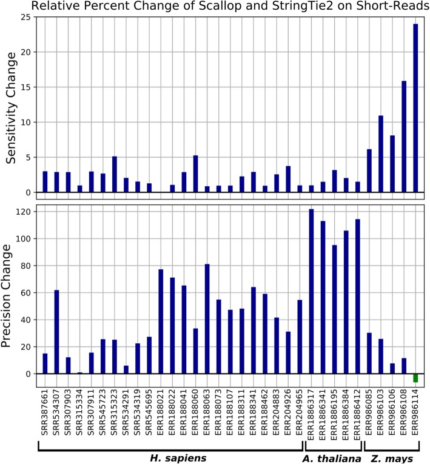

*StringTie2 在植物 RNA-seq 数据上的转录本组装效果（图 2）。 Kovaka 等 2019，《Genome Biology》图 2，doi:10.1186/s13059-019-1910-1，PMC6912988，CC BY。*

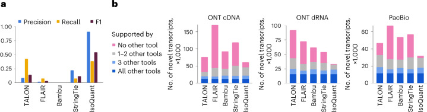

*IsoQuant 在真实长读长 RNA 数据上的表现（图 2）。原图尺寸较扁（719×189）。 Prjibelski 等 2023，《Nature Biotechnology》图 2，doi:10.1038/s41587-022-01565-y，PMC10344776，CC BY。*

| 工具 | 角色 | 用途 / 何时用 | 原始论文 | 实验室（通讯作者，机构） | 权威度（档位 · 被引） | 评价（出处） |
|---|---|---|---|---|---|---|
| [HISAT2](https://github.com/DaehwanKimLab/hisat2) | 默认路线（HISAT2 或 STAR） | 面向短读长 RNA-seq 的剪接比对工具（基于图索引）。 | [Nature Biotechnology 2019](https://doi.org/10.1038/s41587-019-0201-4) | Daehwan Kim (The University of Texas Southwestern Medical Center) | 标准 · 17059 次 | GitHub 最后提交 2026-07 |
| [STAR](https://github.com/alexdobin/STAR) | 默认路线（HISAT2 或 STAR） | 超快速短读长剪接比对工具，支持两轮（two-pass）剪接位点发现。 | [Bioinformatics 2012](https://doi.org/10.1093/bioinformatics/bts635) | Alexander Dobin (Cold Spring Harbor Laboratory) | 标准 · 56248 次 | 作者摘要原句：“STAR outperforms other aligners by a factor of >50 in mapping speed, aligning to the human genome 550 million 2 × 76 bp paired-end reads per hour on a modest 12-core server, while at the same time improving alignment sensitivity and precision.”；GitHub 最后提交 2025-03 |
| [minimap2](https://github.com/lh3/minimap2) | 默认（长读长比对） | 面向长读长及 cDNA/Iso-Seq 数据的剪接比对工具（`-ax splice`）。 | [Bioinformatics 2018](https://doi.org/10.1093/bioinformatics/bty191) | Heng Li (Broad Institute) | 标准 · 17121 次 | 作者摘要原句：“It works with accurate short reads of ≥100 bp in length, ≥1 kb genomic reads at error rate ∼15%, full-length noisy Direct RNA or cDNA reads and assembly contigs or closely related full chromosomes of hundreds of megabases in length.”；GitHub 最后提交 2026-05 |
| [fastp](https://github.com/OpenGene/fastp) | 备选 | 一体化 FASTQ 质控与接头切除工具。 | [Bioinformatics 2018](https://doi.org/10.1093/bioinformatics/bty560) | Shifu Chen (Chinese Academy of Sciences) | 标准 · 33355 次 | 作者摘要原句：“Based on our evaluation, fastp is 2–5 times faster than other FASTQ preprocessing tools such as Trimmomatic or Cutadapt despite performing far more operations than similar tools.”；GitHub 最后提交 2026-10 |
| [Trinity](https://github.com/trinityrnaseq/trinityrnaseq) | 备选 | 利用 RNA-seq 数据做从头或基因组引导的转录本组装。 | [Nature Biotechnology 2011](https://doi.org/10.1038/nbt.1883) | Nir Friedman (Hebrew University of Jerusalem) +1 | 标准 · 23513 次 | GitHub 最后提交 2026-11 |
| [PASA](https://github.com/PASApipeline/PASApipeline) | 分支 S14 | 将转录本比对并组装为基因结构，同时利用此信息更新基因模型的 UTR 与可变剪接异构体。 | [Nucleic Acids Research 2003](https://doi.org/10.1093/nar/gkg770) | Brian J. Haas | 标准 · 2576 次 | 作者摘要原句：“Complete and partial gene structures identified by this method were used to improve The Institute for Genomic Research Arabidopsis genome annotation (TIGR release v.4.0).”；GitHub 最后提交 2026-11 |
| [TransDecoder](https://github.com/TransDecoder/TransDecoder) | 备选 | 在转录本中识别候选编码区（结合同源比对或 Pfam 支持的 ORF）。 | 无文章 | — | 无论文 | 仓库简介：“TransDecoder source”；GitHub 最后提交 2026-11 |
| [IsoQuant](https://github.com/ablab/IsoQuant) | 默认（长读长，S3） | 基于参考基因组做长读长转录本发现与定量。 | [Nature Biotechnology 2023](https://doi.org/10.1038/s41587-022-01565-y) | Andrey D. Prjibelski (University of Helsinki) +1 | 成熟 · 349 次 | 作者摘要原句：“Here we present IsoQuant-a computational tool using intron graphs that accurately reconstructs transcripts both with and without reference genome annotation.”；GitHub 最后提交 2026-11 |
| [Bambu](https://github.com/GoekeLab/bambu) | 备选 | 结合上下文信息的长读长转录本发现与定量工具（R/Bioconductor 包）。 | [Nature Methods 2023](https://doi.org/10.1038/s41592-023-01908-w) | Jonathan Göke (Agency for Science, Technology and Research) | 成熟 · 236 次 | GitHub 最后提交 2026-10 |
| [SQANTI3](https://github.com/ConesaLab/SQANTI3) | 分支 S3 | 对照参考注释对长读长转录本异构体做分类与过滤。 | [Nature Methods 2024](https://doi.org/10.1038/s41592-024-02229-2) | Ana Conesa (Consejo Superior de Investigaciones Científicas) | 成熟 · 267 次 | GitHub 最后提交 2026-11 |
| [TAMA](https://github.com/GenomeRIK/tama) | 备选 | 归并冗余的长读长转录本模型并提供 Iso-Seq 注释辅助功能。 | [BMC Genomics 2020](https://doi.org/10.1186/s12864-020-07123-7) | Richard I Kuo (Roslin Institute) | 成熟 · 191 次 | 作者摘要原句：“TAMA achieved high sensitivity and precision for gene and transcript model predictions in both reference guided and unguided approaches in our benchmark tests using simulated Pacific Biosciences (PacBio) and Nanopore sequencing data and real PacBio datasets.”；GitHub 最后提交 2023-04 |
| [IsoSeq (PacBio)](https://github.com/PacificBiosciences/IsoSeq) | 备选 | PacBio 官方 Iso-Seq 数据处理流程（含 refine、cluster、collapse 步骤）。 | 无文章 | — | 无论文 | 仓库简介：“Iso-Seq - Scalable De Novo Isoform Discovery from Single-Molecule PacBio Reads”；GitHub 最后提交 2026-06 |
| [StringTie (v3 line)](https://github.com/gpertea/stringtie) | 默认 | 利用短读长与长读长 RNA 数据做参考引导或从头转录本组装；在本库中用作转录本证据与对照轨道。 | [Genome biology 2019](https://doi.org/10.1186/s13059-019-1910-1) | Mihaela Pertea (Johns Hopkins University) | 标准 · 2287 次 | 作者摘要原句：“The ability to assemble these long reads can greatly improve the sensitivity of long-read analyses.”；GitHub 最后提交 2026-11 |
| [FLIC (Full-length isoform constructor)](https://github.com/albidgy/FLIC) | 备选 | 综合生物学重复一致性及 TSS/polyA 峰识别结果，由长读长数据构建全长转录本异构体。 | [Bioinformatics 2022](https://doi.org/10.1093/bioinformatics/btaf551) | Aleksey A. Penin (Russian Academy of Sciences) | 小众 · 1 次 | 作者摘要原句：“demonstrate that FLIC accurately reconstructs known and novel isoforms, outperforming existing tools, especially in the absence of reference annotations.”；GitHub 最后提交 2026-09 |
| [Isocall](https://github.com/PacificBiosciences/isocall) | 备选 | 跨多个 PacBio Iso-Seq 样本联合识别已知与新转录本异构体（可替代 isoseq cluster/collapse）。 | 无文章 | — | 无论文 | 仓库简介：“A method to joint-call RNA isoforms across many IsoSeq samples”；GitHub 最后提交 2026-08 |
| [ESPRESSO](https://github.com/Xinglab/espresso) | 备选 | 从含测序错误的长读长 RNA-seq 数据中发现并定量转录本异构体。 | [Science Advances 2023](https://doi.org/10.1126/sciadv.abq5072) | Yuan Gao (Children's Hospital of Philadelphia) +3 | 成熟 · 106 次 | 作者摘要原句：“ESPRESSO jointly considers alignments of all long reads aligned to a gene and uses error profiles of individual reads to improve the identification of splice junctions and the discovery of their corresponding transcript isoforms.”；GitHub 最后提交 2026-03 |
| TAGET | 备选 | Iso-Seq 分析工具包：涵盖基于 CNN 剪接位点校正的比对、异构体分类与表达定量。 | [Nature Communications 2023](https://doi.org/10.1038/s41467-023-41649-0) | Susheng Miao (Harbin Medical University) +1 | 较新 · 16 次 | 作者摘要原句：“TAGET gives significantly more precise novel splice site prediction and enables more accurate novel isoform and gene fusion discoveries, as validated by experimental validations and comparisons with RNA-seq data.” |
| [RiboCode](https://github.com/xryanglab/RiboCode) | 备选 | 根据核糖体印迹（Ribo-seq）数据识别处于活跃翻译状态的 ORF。 | [Nucleic Acids Research 2018](https://doi.org/10.1093/nar/gky179) | Xuerui Yang (Tsinghua University) | 成熟 · 193 次 | 作者摘要原句：“Being tested with simulated and real ribosome profiling data, and validated with cell type-specific QTI-seq and mass spectrometry data, RiboCode exhibits superior efficiency, sensitivity, and accuracy for de novo annotation of the translatome, which covers …”；GitHub 最后提交 2022-07 |
| [Ribo-TISH](https://github.com/zhpn1024/ribotish) | 备选 | 利用常规 Ribo-seq 或 QTI-seq 数据识别翻译起始位点与 ORF。 | [Nature Communications 2017](https://doi.org/10.1038/s41467-017-01981-8) | Yiwen Chen (The University of Texas MD Anderson Cancer Center) | 成熟 · 172 次 | 作者摘要原句：“Ribo-TISH can also predict novel open reading frames (ORFs) from regular ribosome profiling (rRibo-seq) data and outperform several established methods in both computational efficiency and prediction accuracy.”；GitHub 最后提交 2025-10 |
| [PhyloCSF++](https://github.com/cpockrandt/PhyloCSFpp) | 备选 | PhyloCSF 加速版：基于多物种序列比对的密码子替换模式评估蛋白编码潜能。 | [Bioinformatics 2021](https://doi.org/10.1093/bioinformatics/btab756) | Christopher Pockrandt (Johns Hopkins University) +1 | 小众 · 18 次 | GitHub 最后提交 2022-01 |
| KuPID | 备选 | 基于 k-mer 的长读长上游预处理工具，用于辅助下游转录本异构体发现（预印本）。 | [bioRxiv (Cold Spring Harbor Laboratory) 2025](https://doi.org/10.64898/2025.12.05.692400) | Molly Borowiak (Carnegie Mellon University) | 较新 · 0 次 | 作者摘要原句：“This manuscript introduces KuPID, a method for preprocessing long RNAseq reads with the goal of better identifying novel isoform transcripts.” |
| RiboBA | 备选 | 兼容多种 Ribo-seq 实验方案、可校正偏好性的概率型 ORF 识别工具（预印本）。 | [Nucleic Acids Research 2026](https://doi.org/10.64898/2026.03.17.712439) | Ruolin Yang (Northwest A&F University) | 较新 · 2 次 | 作者摘要原句：“In simulations with known P-site positions, RiboBA improved exact nucleotide- and codon-level P-site assignment relative to a conventional fixed-offset approach.” |
| [FLAIR](https://github.com/BrooksLabUCSC/flair) | 备选 | 结合参考基因组对 nanopore 或 PacBio 全长读长做校正、归并和定量，构建全长转录本。该工具首次发表于所引用的 CLL 研究。 | [Nature Communications 2020](https://doi.org/10.1038/s41467-020-15171-6) | Angela Norie Brooks (University of California, Santa Cruz) | 标准 · 568 次 | 论文摘要：“We report nanopore sequencing of full-length cDNA from CLL samples with and without SF3B1 mutation, as well as normal B cell samples, giving a total of 149 million pass reads.”；GitHub 最后提交 2026-11 |
| [Mandalorion](https://github.com/christopher-vollmers/Mandalorion) | 备选 | 从高准确度全长读长（PacBio Iso-Seq 或 R2C2）中识别并定量高可信度转录本。 | [Genome biology 2023](https://doi.org/10.1186/s13059-023-02999-6) | Christopher Vollmers (University of California, Santa Cruz) | 较新 · 48 次 | 作者摘要原句：“It further improves upon the already strong performance of Mandalorion v3.6 used in the LRGASP consortium challenge.”；GitHub 最后提交 2026-11 |
| [uLTRA](https://github.com/ksahlin/ultra) | 备选 | 利用已有注释引导长 RNA 读长比对到基因组，在小外显子上的表现优于普通 minimap2 剪接模式。注意与第 2 节的重复序列标注工具 ULTRA 区分。 | [Bioinformatics 2021](https://doi.org/10.1093/bioinformatics/btab540) | Kristoffer Sahlin (Stockholm University) | 小众 · 54 次 | 作者摘要原句：“We show that uLTRA produces higher accuracy over state-of-the-art aligners with substantially higher accuracy for small exons on simulated and synthetic data.”；GitHub 最后提交 2026-10 |
| [deSALT](https://github.com/ydLiu-HIT/deSALT) | 备选 | 基于 de Bruijn 图索引的快速剪接比对工具，适用于高错误率的长 RNA 读长。 | [Genome biology 2019](https://doi.org/10.1186/s13059-019-1895-9) | Yadong Wang (Harbin Institute of Technology) | 小众 · 72 次 | GitHub 最后提交 2022-09 |
| [Scallop2](https://github.com/Shao-Group/scallop2) | 备选 | 基于参考基因组的转录本组装工具，支持双端和多端短读长；可在 S1 证据步骤中替代 StringTie。 | [Nature Computational Science 2022](https://doi.org/10.1038/s43588-022-00216-1) | Mingfu Shao (Pennsylvania State University) | 小众 · 39 次 | GitHub 最后提交 2026-10 |
| [Aletsch](https://github.com/Shao-Group/aletsch) | 备选 | 跨多个 RNA-seq 样本联合组装转录本，适合单个组织文库测序较浅的场景。 | [Bioinformatics 2024](https://doi.org/10.1093/bioinformatics/btae215) | Mingfu Shao (Pennsylvania State University) | 较新 · 3 次 | 作者摘要原句：“Our experiments, conducted on RNA-seq data from several protocols, firmly demonstrate Aletsch's significant outperformance over existing meta-assemblers.”；GitHub 最后提交 2025-04 |
| [Portcullis](https://github.com/EI-CoreBioinformatics/portcullis) | 备选 | 在输入基因预测器前过滤 RNA-seq 比对中的假剪接位点；用于 REAT 和 Mikado 流程。 [preprint] | [GigaScience 2018](https://doi.org/10.1101/217620) | Daniel Mapleson (Norwich Research Park) +1 | 成熟 · 154 次 | 作者摘要原句：“Key to this is the accurate identification of exon-exon junctions from RNA sequenced (RNA-seq) reads.”；GitHub 最后提交 2022-03 |
| Sorghum Iso-Seq transcriptome survey | 备选 | 早期植物全长转录组研究，展示了单分子全长读长如何修正基因模型并检出遗漏的异构体。 | [Nature Communications 2016](https://doi.org/10.1038/ncomms11706) | Anireddy S. N. Reddy (Colorado State University) | 标准 · 744 次 | 论文摘要：“Here we sequenced the sorghum transcriptome using Pacific Biosciences single-molecule real-time long-read isoform sequencing and developed a pipeline called TAPIS (Transcriptome Analysis Pipeline for Isoform Sequencing) to identify full-length splice isoforms …” |
| [rMATS](https://github.com/Xinglab/rmats-turbo) | 备选 | 在有重复的条件间检测差异可变剪接事件；在注释完成之后使用。 | [Proceedings of the National Academy of Sciences 2014](https://doi.org/10.1073/pnas.1419161111) | Yi Xing | 标准 · 3063 次 | 作者摘要原句：“The performance of rMATS is evaluated by the analysis of simulated and real RNA-Seq data. rMATS outperformed two existing methods for replicate RNA-Seq data in all simulation settings, and RT-PCR yielded a high validation rate (94%) in an RNA-Seq dataset of …”；GitHub 最后提交 2026-08 |

> 评测要点： RGASP 评测：多数工具能找准外显子和剪接位点，但组装完整异构体仍是主要难点（doi:10.1038/nmeth.2714）。LRGASP：读长更长、更准的数据比增加深度更能提高转录本准确度；在注释完善的基因组中，基于参考的工具表现最好（doi:10.1038/s41592-024-02298-3）。

<a id="section-4"></a>
## 4. 蛋白证据

将蛋白比对到基因组，为基因模型提供提示（hint）或同源草案（A2 输入）。

**需要：** 来自近缘物种或审定数据库的蛋白集（`PROTEIN_DB`），用于比对到基因组（miniprot、GeneMark-EP、GALBA / GeMoMa）。[按场景列出的数据需求](#data-needs)

**分组：**
- *全基因组蛋白提示*（可替代）：miniprot、ProtHint、MetaEuk、Spaln、GenomeThreader。默认用 miniprot，GALBA2 用的也是它；ProtHint 是 BRAKER（GeneMark-EP+/ETP 模式）中处理蛋白证据的步骤。MetaEuk 输出的是基因模型，不是提示：只作只用蛋白的快速旁证。
- *单位点精确比对*（可替代）：Exonerate、Scipio、GeneWise。速度较慢；仅在人工校对时用于少数位点，不用于全基因组。

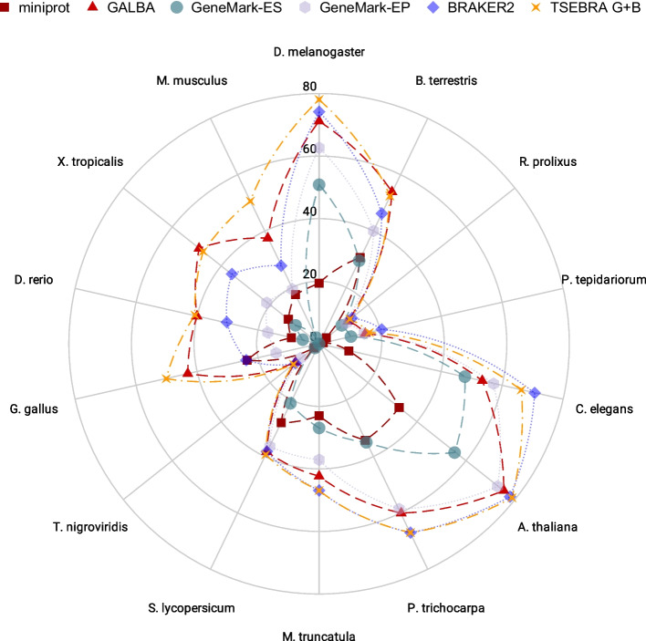

*GALBA 在植物数据上的蛋白比对基因预测表现（图 5）。 Brůna 等 2023，《BMC Bioinformatics》图 5，doi:10.1186/s12859-023-05449-z，PMC10472564，CC BY。*

| 工具 | 角色 | 用途 / 何时用 | 原始论文 | 实验室（通讯作者，机构） | 权威度（档位 · 被引） | 评价（出处） |
|---|---|---|---|---|---|---|
| [miniprot](https://github.com/lh3/miniprot) | 默认（蛋白提示） | 快速的蛋白到基因组剪接比对工具。 | [Bioinformatics 2023](https://doi.org/10.1093/bioinformatics/btad014) | Heng Li (Harvard University) | 标准 · 627 次 | 作者摘要原句：“It is tens of times faster than existing tools while achieving comparable accuracy on real data.”；GitHub 最后提交 2026-01 |
| [GenomeThreader](https://genomethreader.org/) | 备选 | 将蛋白或 cDNA 序列剪接比对到基因组的工具。 | [Information and Software Technology 2005](https://doi.org/10.1016/j.infsof.2005.09.005) | Stefan Kurtz (Universität Hamburg) | 成熟 · 416 次 | 无摘要或仓库说明可引；见原文 |
| Exonerate | 备选 | 通用序列比对工具，支持 protein2genome 剪接比对模式。 | [BMC Bioinformatics 2005](https://doi.org/10.1186/1471-2105-6-31) | Guy Slater (European Bioinformatics Institute) | 标准 · 3332 次 | 作者摘要原句：“The speed and accuracy of this approach compares favourably with existing methods.” |
| [Spaln](https://github.com/ogotoh/spaln) | 备选 | 带物种特异参数的 cDNA/蛋白到基因组剪接比对工具。 | [Bioinformatics 2008](https://doi.org/10.1093/bioinformatics/btn460) | Osamu Gotoh (Kyoto University) | 小众 · 63 次 | 作者摘要原句：“When the query and the target sequences are reasonably similar, e.g. between mammalian orthologs, Spaln runs one to two orders of magnitude faster than conventional approaches that rely on Blast search followed by dynamic-programming-based spliced alignment.”；GitHub 最后提交 2026-07 |
| [ProtHint](https://github.com/gatech-genemark/ProtHint) | 备选 | 把跨物种蛋白的剪接比对转成内含子和起始/终止位点提示；是 BRAKER2/BRAKER3（GeneMark-EP+/ETP 模式）中处理蛋白证据的步骤。GALBA 用的是 miniprot。 | [NAR Genomics and Bioinformatics 2021](https://doi.org/10.1093/nargab/lqaa108) | Mark Yu. Borodovsky (Georgia Institute of Technology) | 标准 · 1815 次 | GitHub 最后提交 2023-10 |
| [MetaEuk](https://github.com/soedinglab/metaeuk) | 备选 | 基于 MMseqs2，利用蛋白引导快速识别真核基因模型；可作为仅依赖蛋白证据的快速旁证。 | [Microbiome 2020](https://doi.org/10.1186/s40168-020-00808-x) | Eli Levy Karin (Max Planck Institute for Biophysical Chemistry) +1 | 成熟 · 360 次 | 作者摘要原句：“We used a benchmark of seven diverse, annotated genomes to show that MetaEuk is highly sensitive even under conditions of low sequence similarity to the reference database.”；GitHub 最后提交 2026-09 |
| [Scipio](https://www.webscipio.org/) | 备选 | 将已知蛋白映射回基因组以还原精确的外显子-内含子结构；适合人工校对少量基因家族成员。 | [BMC Research Notes 2011](https://doi.org/10.1186/1756-0500-4-265) | Martin Kollmar (Max Planck Institute for Biophysical Chemistry) | 小众 · 57 次 | 作者摘要原句：“Scipio and WebScipio have fundamentally been extended to better reconstruct very short exons and intron splice sites and to be better suited for cross-species gene structure predictions.” |
| GeneWise | 备选 | 经典的容忍移码蛋白-基因组比对工具；在疑难位点上仍可作为核对 miniprot 和 Spaln 结果的参照。 | [Genome Research 2004](https://doi.org/10.1101/gr.1865504) | Ewan Birney (European Bioinformatics Institute) | 标准 · 3142 次 | 论文摘要：“We present two algorithms in this paper: GeneWise, which predicts gene structure using similar protein sequences, and Genomewise, which provides a gene structure final parse across cDNA- and EST-defined spliced structure.” |

<a id="section-5"></a>
## 5. 从头基因预测

在屏蔽后的基因组上预测基因模型的从头预测或证据引导预测工具（A2）。

**需要：** 已做 soft-mask 的基因组；若预测工具支持引入证据提示（BRAKER），再附上 RNA 和/或蛋白。Helixer / Tiberius 可仅凭基因组运行，但在有 RNA 数据时，不应悄悄替代基于证据的 S1 草案。[按场景列出的数据需求](#data-needs)

**分组：**
- *证据训练的流程*（可替代）：BRAKER4、GALBA2。S1（RNA-seq + 蛋白，即 BRAKER3 方法）用 BRAKER4；只有蛋白时 BRAKER4 运行 BRAKER2 模式；有近缘物种蛋白的 S2 用 GALBA2。
- *流程内部的引擎*（互补）：GeneMark-ETP、AUGUSTUS。GeneMark-ETP 用证据训练，AUGUSTUS 再用它的预测结果训练；单独运行只用于调试或对照。
- *深度学习预测器（无需训练）*（可替代）：Helixer、Tiberius、ANNEVO。S13 对照轨道；Helixer 有植物模型，Tiberius 在训练类群相符时最强。
- *传统 HMM 预测器*（互补）：SNAP、GlimmerHMM。仅在 MAKER2 或 EVM 对比中作为补充输入。

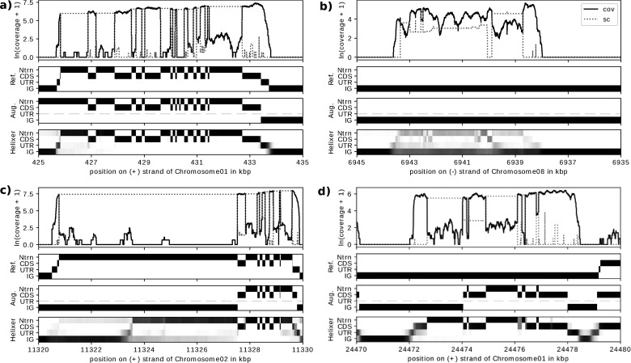

*Helixer 在木薯某一位点预测的基因模型（图 3）。 Stiehler 等 2021，《Bioinformatics》图 3，doi:10.1093/bioinformatics/btaa1044，PMC8016489，CC BY。*

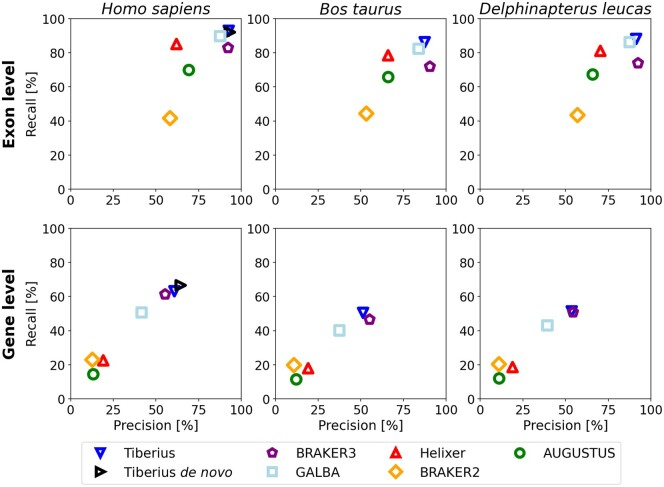

*Tiberius 与同类基因预测工具的精确率-召回率对比（图 3）。 Gabriel、Becker、Hoff 与 Stanke 2024，《Bioinformatics》图 3，doi:10.1093/bioinformatics/btae685，PMC11645249，CC BY。*

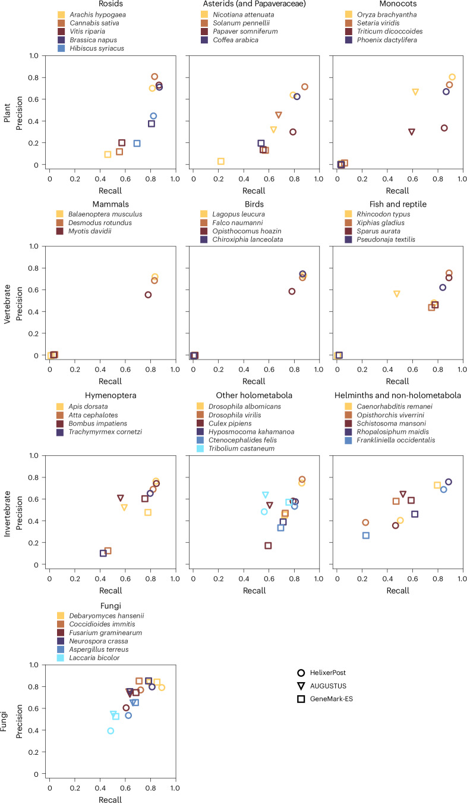

*Helixer 2026 方法论文中的外显子级别精确率-召回率（图 1）。 Holst 等 2026，《Nature Methods》图 1，doi:10.1038/s41592-025-02939-1，PMC13076211，CC BY。*

| 工具 | 角色 | 用途 / 何时用 | 原始论文 | 实验室（通讯作者，机构） | 权威度（档位 · 被引） | 评价（出处） |
|---|---|---|---|---|---|---|
| [AUGUSTUS](https://github.com/Gaius-Augustus/Augustus) | 备选 | 结合 RNA 与蛋白证据提示（hints）的 HMM 基因预测工具。 | [Bioinformatics 2008](https://doi.org/10.1093/bioinformatics/btn013) | Mario Stanke (University of California, Santa Cruz) | 标准 · 2763 次 | GitHub 最后提交 2026-11 |
| [BRAKER4](https://github.com/Gaius-Augustus/BRAKER4) | 默认（S1） | BRAKER4 是 BRAKER3 的 Snakemake 重构版：结合 RNA-seq 和蛋白证据运行 GeneMark-ETP 与 AUGUSTUS，并由 TSEBRA 合并结果。方法论文仍引 BRAKER3（见下）；无法使用容器时回退至基于 braker.pl 的 BRAKER3。仅输入蛋白时，运行的是最早作为 BRAKER2 发表的模式（GeneMark-EP+，doi:10.1093/nargab/lqaa108）。 | [Genome Research 2024](https://doi.org/10.1101/gr.278090.123) | Katharina J. Hoff (Universität Greifswald) | 标准 · 1004 次 | 所引 BRAKER3 论文：在 11 个基因组上优于 BRAKER1、BRAKER2、MAKER2、Funannotate 和 FINDER，转录本 F1 比 BRAKER1/2 平均高约 20 个百分点（doi:10.1101/gr.278090.123）。；GitHub 最后提交 2026-11 |
| [GALBA2](https://github.com/Gaius-Augustus/GALBA2) | 分支 S2 | GALBA2 是 GALBA 的 Snakemake 移植版，利用近缘物种蛋白的 miniprot 比对结果训练 AUGUSTUS（S2）。方法论文仍引 GALBA（见下）；原版 GALBA 作为回退方案。 | [BMC Bioinformatics 2023](https://doi.org/10.1186/s12859-023-05449-z) | Katharina J. Hoff (Universität Greifswald) | 成熟 · 127 次 | GitHub 最后提交 2026-11 |
| [SNAP](https://github.com/KorfLab/SNAP) | 备选 | 可在新基因组上重新训练的半隐马尔可夫（semi-HMM）从头基因预测工具。 | [BMC Bioinformatics 2004](https://doi.org/10.1186/1471-2105-5-59) | Ian F. Korf (Wellcome Sanger Institute) | 标准 · 3585 次 | GitHub 最后提交 2022-10 |
| [GlimmerHMM](https://ccb.jhu.edu/software/glimmerhmm/) | 备选 | 基于广义隐马尔可夫模型（GHMM）的真核从头基因预测工具。 | [Bioinformatics 2004](https://doi.org/10.1093/bioinformatics/bth315) | William H. Majoros | 标准 · 2180 次 | 无摘要或仓库说明可引；见原文 |
| [Tiberius](https://github.com/Gaius-Augustus/Tiberius) | 分支 S13 | 结合端到端深度学习与 HMM 的从头基因预测工具。 | [Bioinformatics 2024](https://doi.org/10.1093/bioinformatics/btae685) | Lars Gabriel (Universität Greifswald) +1 | 较新 · 69 次 | 作者：在哺乳动物基因组上训练和测试；人类基因层面 F1 为 62%，次优从头工具为 21%，从头精度可与 BRAKER3 相当（doi:10.1093/bioinformatics/btae685）。用于植物需有植物训练的模型。；作者摘要原句：“It significantly outperforms existing ab initio methods, achieving F1 scores of 62% at gene level for the human genome, compared to 21% for the next best ab initio method.”；GitHub 最后提交 2026-11 |
| [GeneMark-ETP](https://github.com/gatech-genemark/GeneMark-ETP) | 备选 | 整合转录本与蛋白证据并支持自训练的基因预测工具（BRAKER3 的核心组件）。 | [Genome Research 2024](https://doi.org/10.1101/gr.278373.123) | Mark Yu. Borodovsky (Georgia Institute of Technology) | 成熟 · 276 次 | 作者摘要原句：“GeneMark-ETP outperforms gene finders using a single type of extrinsic evidence.”；GitHub 最后提交 2025-04 |
| [ANNEVO](https://github.com/xjtu-omics/ANNEVO) | 分支 S13 | 对演化上下文建模的深度学习从头基因注释工具。 [preprint] | [Nature Methods 2026](https://doi.org/10.21203/rs.3.rs-6402260/v1) | Kai Ye (First Affiliated Hospital of Xi'an Jiaotong University) | 较新 · 56 次 | 作者摘要原句：“Through extensive benchmarking on 566 species, we demonstrate that ANNEVO significantly outperforms existing ab initio methods and achieves performance comparable to state-of-the-art annotation pipelines.”；GitHub 最后提交 2026-08 |
| [Helixer](https://github.com/weberlab-hhu/Helixer) | 分支 S13 | 结合深度学习与 HMM 的从头基因预测工具，仅凭基因组序列即可运行，自带预训练植物模型；作为 S13 对照轨道。2020 年论文（doi:10.1093/bioinformatics/btaa1044）描述的是早期逐碱基预测版本。 | [Nature Methods 2025](https://doi.org/10.1038/s41592-025-02939-1) | Marie Bolger (Forschungszentrum Jülich) | 成熟 · 239 次 | 作者摘要原句：“The accurate identification of genes is vital for understanding biological function, yet this remains challenging across many newly sequenced or less-studied species.”；GitHub 最后提交 2026-11 |
| [GeneMark-ES](https://github.com/gatech-genemark/GeneMark-E-Docs) | 备选 | 无需外部证据的自训练从头基因预测；GeneMark-ET/EP+/ETP 的基础。 | [Nucleic Acids Research 2005](https://doi.org/10.1093/nar/gki937) | Alexandre Lomsadze (Georgia Institute of Technology) | 标准 · 1098 次 | GitHub 最后提交 2020-10 |
| [GeneMark-ET](https://github.com/gatech-genemark/GeneMark-E-Docs) | 备选 | 以 RNA-seq 内含子提示引导的 GeneMark 自训练；BRAKER1 内部使用。 | [Nucleic Acids Research 2014](https://doi.org/10.1093/nar/gku557) | Mark Yu. Borodovsky (Georgia Institute of Technology) | 标准 · 607 次 | 作者摘要原句：“We demonstrated in computational experiments that the proposed method of incorporation of 'unassembled' RNA-Seq reads improves the accuracy of gene prediction; particularly, for the 1.3 GB genome of Aedes aegypti the mean value of prediction Sensitivity and …”；GitHub 最后提交 2020-10 |
| [BRAKER2](https://github.com/Gaius-Augustus/BRAKER) | 备选 | 缺少 RNA-seq 时用蛋白提示训练的 BRAKER 模式（GeneMark-EP+ 与 AUGUSTUS）。 | [NAR Genomics and Bioinformatics 2021](https://doi.org/10.1093/nargab/lqaa108) | Mark Yu. Borodovsky (Georgia Institute of Technology) | 标准 · 1815 次 | GitHub 最后提交 2026-11 |

> 评测要点： G3PO 用 147 个物种的人工核对基因独立评测常用从头预测工具，结论是在草图组装上从头预测结构非常困难（doi:10.1186/s12864-020-6707-9）。在五个植物基因组上比较 BRAKER 与 MAKER 的研究建议把证据预测与从头预测结合（doi:10.1002/aps3.11533）。

<a id="section-6"></a>
## 6. DNA 语言模型预测

基于 DNA 语言模型的基因预测工具；除非另有书面说明，在本库中仅作 S13 对照轨道。

**需要：** 已做 soft-mask 的基因组，以及运行常规 S13 对照所需的 GPU。除非另有书面说明，输出结果仅作对照轨道。[按场景列出的数据需求](#data-needs)

**分组：**
- *基于语言模型的基因预测*（可替代）：Carbon-A + Carbon Annotation Database (CADB)、GENATATORs。仅作对照轨道；采信前先用 BUSCO 和 PSAURON 核对。
- *碱基级切分模型*（可替代）：SegmentNT、Nucleotide Transformer v3 (NTv3)、GENA-LM。逐碱基输出外显子/内含子/剪接位点概率；适合作为提示，不能直接用作最终模型。
- *基础模型（只提供特征）*（互补）：AgroNT、PlantCaduceus、Evo 2。基于植物训练的 AgroNT、PlantCaduceus 以及跨物种的 Evo 2：提供序列嵌入与变异效应，不直接输出基因模型。

| 工具 | 角色 | 用途 / 何时用 | 原始论文 | 实验室（通讯作者，机构） | 权威度（档位 · 被引） | 评价（出处） |
|---|---|---|---|---|---|---|
| [Carbon-A + Carbon Annotation Database (CADB)](https://huggingface.co/HuggingFaceBio/Carbon-A-1.2B) | 备选 | 含 1.2B 参数的编码器模型，直接从真核生物 DNA 预测蛋白编码基因并给出单基因置信度；配套 CADB 库已将其用于注释 GenBank 组装（共 566M 个位点）。 | [bioRxiv (Cold Spring Harbor Laboratory) 2026](https://doi.org/10.64898/2026.10.20.760448) | Qiuyi Li (Beijing Academy of Artificial Intelligence) | 较新 · 0 次 | 作者摘要原句：“Across 42 benchmark genomes, Carbon-A achieves the highest overall nucleotide-, exon-, and gene-level F1 scores among the evaluated models.” |
| [Nucleotide Transformer v3 (NTv3)](https://github.com/instadeepai/nucleotide-transformer) | 备选 | 长上下文跨界 DNA 基础模型；文中报告其在哺乳动物、植物与昆虫上的基因注释表现优于传统从头预测工具。 | [bioRxiv (Cold Spring Harbor Laboratory) 2025](https://doi.org/10.64898/2025.12.22.695963) | Thomas Pierrot | 较新 · 48 次 | 作者摘要原句：“Leveraging these learned functional representations, NTv3 outperforms leading ab initio gene predictors across mammals, plants and insects, with fewer spurious gene models and improved recovery and reduced fragmentation of long genes.”；GitHub 最后提交 2026-11 |
| GENATATORs | 备选 | 基于 DNA 语言模型的从头基因注释工具（2026 预印本）。 | [Lecture notes in computer science 2026](https://doi.org/10.64898/2026.06.17.732686) | Aleksei Shmelev (National Research University Higher School of Economics) | 较新 · 1 次 | 无摘要或仓库说明可引；见原文 |
| [AgroNT](https://huggingface.co/InstaDeepAI/agro-nucleotide-transformer-1b) | 备选 | 在 48 个食用植物基因组上训练的 DNA 语言模型，下游可用于调控元件与剪接位点等预测任务。 | [Communications Biology 2024](https://doi.org/10.1038/s42003-024-06465-2) | Thomas Pierrot +1 | 成熟 · 148 次 | 论文摘要：“We present AgroNT, a foundational large language model trained on genomes from 48 plant species with a predominant focus on crop species.” |
| [PlantCaduceus](https://github.com/kuleshov-group/PlantCaduceus) | 备选 | 单碱基分辨率的跨物种植物 DNA 语言模型，支持剪接位点、TIS 与 TTS 等注释任务。 | [Proceedings of the National Academy of Sciences 2025](https://doi.org/10.1073/pnas.2421738122) | Jingjing Zhai (Cornell University) +3 | 成熟 · 114 次 | 论文摘要：“We introduce PlantCaduceus, a plant DNA LM that learns evolutionary conservation patterns in 16 angiosperm genomes by modeling both DNA strands simultaneously.”；GitHub 最后提交 2026-11 |
| [Evo 2](https://github.com/ArcInstitute/evo2) | 备选 | 跨生命域的基因组语言模型，提供外显子/内含子边界识别与变异效应预测的零样本（zero-shot）特征。 | [Nature 2026](https://doi.org/10.1101/2025.02.18.638918) | Patrick D. Hsu (Arc Research Institute) +1 | 标准 · 722 次 | 作者摘要原句：“Evo 2 learns to accurately predict the functional impacts of genetic variation—from noncoding pathogenic mutations to clinically significant BRCA1 variants—without task-specific fine-tuning.”；GitHub 最后提交 2026-06 |
| [SegmentNT](https://github.com/instadeepai/nucleotide-transformer) | 备选 | 以 Nucleotide Transformer 为主干，在单碱基分辨率上将 DNA 切分为外显子、内含子、剪接位点和调控元件。 | [Nature Methods 2025](https://doi.org/10.1038/s41592-025-02881-2) | Thomas Pierrot | 较新 · 47 次 | 论文摘要：“Here we frame the genome annotation problem as multilabel semantic segmentation and introduce a methodology for fine-tuning pretrained DNA foundation models to segment 14 different genic and regulatory elements at single-nucleotide resolution.”；GitHub 最后提交 2026-11 |
| [GENA-LM](https://github.com/AIRI-Institute/GENA_LM) | 备选 | 面向长序列输入的开源 DNA 语言模型，含剪接位点和注释微调任务；仅作研究对照轨道，并非基因预测器。 | [Nucleic Acids Research 2025](https://doi.org/10.1093/nar/gkae1310) | Veniamin Fishman (Institute of Cytology and Genetics) +2 | 成熟 · 196 次 | 论文摘要：“To address this need, we introduce GENA language model (GENA-LM), a suite of transformer-based foundational DNA language models capable of handling input lengths up to 36 000 base pairs.”；GitHub 最后提交 2026-11 |
| [DNABERT](https://github.com/jerryji1993/DNABERT) | 备选 | 较早的 BERT 式 DNA 语言模型；需按任务微调的基础模型，不是基因预测器。 | [Bioinformatics 2021](https://doi.org/10.1093/bioinformatics/btab083) | Han Liu (Northwestern University) +1 | 标准 · 1789 次 | 作者摘要原句：“We compared DNABERT to the most widely used programs for genome-wide regulatory elements prediction and demonstrate its ease of use, accuracy and efficiency.”；GitHub 最后提交 2026-01 |
| [Nucleotide Transformer](https://github.com/instadeepai/nucleotide-transformer) | 备选 | 多物种 DNA 基础模型（NTv3 之前的 v1/v2）；可微调或探针用于剪接位点等任务。 | [Nature Methods 2024](https://doi.org/10.1038/s41592-024-02523-z) | M. Lopez +1 | 标准 · 1083 次 | 作者摘要原句：“Here, we present an extensive study of foundation models pre-trained on DNA sequences, named Nucleotide Transformer, ranging from 50 million up to 2.5 billion parameters and integrating information from 3,202 human genomes and 850 genomes from diverse species.”；GitHub 最后提交 2026-11 |
| [HyenaDNA](https://github.com/HazyResearch/hyena-dna) | 备选 | 单碱基分辨率的长上下文 DNA 模型（预印本）；研究用途。 | [arXiv 2023](https://doi.org/10.48550/arxiv.2306.15794) | Chris Ré | 成熟 · 385 次 | 作者摘要原句：“HyenaDNA scales sub-quadratically in sequence length (training up to 160x faster than Transformer), uses single nucleotide tokens, and has full global context at each layer.”；GitHub 最后提交 2025-04 |

<a id="section-7"></a>
## 7. 注释转移（lift-over）

将近缘、已审定的注释转移到新组装上（A2b / S11 / S4）。

**需要：** 近缘且已审定的参考 GFF（同种或可信单倍型）及目标基因组；若要申报完整 S11 而非 S11-lite，还需准备补缺（gap-fill）证据。[按场景列出的数据需求](#data-needs)

**分组：**
- *坐标转移*（可替代）：Liftoff、LiftOn、Comparative Annotation Toolkit (CAT)、GrAnnoT。有近缘且经人工审校的参考（S11）时，优先选用兼顾蛋白的 LiftOn 而非 Liftoff；多基因组经 HAL 比对时用 CAT；跨泛基因组图谱时用 GrAnnoT。
- *基于同源的预测*（可替代）：GeMoMa、TOGA2。GeMoMa 根据参考蛋白和内含子位置预测新模型；TOGA2 经全基因组比对链投射基因并推断直系同源。两者都比坐标转移更适合较远的参考。
- *转移后的检查与打磨*（互补）：LiftoffTools、GENESPACE、SynGAP。LiftoffTools 报告有变化的基因，GENESPACE 显示共线性缺口（用于检查）；然后用 SynGAP 修正缺失或拆分的模型。


| 工具 | 角色 | 用途 / 何时用 | 原始论文 | 实验室（通讯作者，机构） | 权威度（档位 · 被引） | 评价（出处） |
|---|---|---|---|---|---|---|
| [GeMoMa](https://www.jstacs.de/index.php/GeMoMa) | 分支 S2 | 利用内含子位置保守性及可选 RNA-seq 数据的同源基因预测工具。 | [Methods in molecular biology 2019](https://doi.org/10.1007/978-1-4939-9173-0_9) | Jens Keilwagen (Julius Kühn-Institut) | 标准 · 617 次 | 无摘要或仓库说明可引；见原文 |
| [Liftoff](https://github.com/agshumate/Liftoff) | 分支 S11 | 将参考基因组注释投射到同种或近缘物种目标组装上的工具。 | [Bioinformatics 2021](https://doi.org/10.1093/bioinformatics/btaa1016) | Alaina Shumate (Johns Hopkins University) | 标准 · 1144 次 | 作者摘要原句：“We show that Liftoff can accurately map 99.9% of genes between two versions of the human reference genome with an average sequence identity >99.9%.”；GitHub 最后提交 2023-08 |
| [LiftOn](https://github.com/Kuanhao-Chao/LiftOn) | 分支 S11 | 结合 DNA（Liftoff）与蛋白（miniprot）比对结果以改进注释转移质量。 | [Genome Research 2024](https://doi.org/10.1101/gr.279620.124) | Kuan-Hao Chao (Johns Hopkins University) | 较新 · 51 次 | 作者摘要原句：“Here we introduce LiftOn, a homology-based software tool that integrates DNA and protein alignments to enhance the accuracy of genome-scale annotation and to allow mapping between relatively distant species.”；GitHub 最后提交 2026-10 |
| [Comparative Annotation Toolkit (CAT)](https://github.com/ComparativeGenomicsToolkit/Comparative-Annotation-Toolkit) | 分支 S11 | 通过 Cactus 全基因组比对投射基因注释，并与从头预测结果合并。 | [Genome Research 2018](https://doi.org/10.1101/gr.233460.117) | Benedict Paten (Howard Hughes Medical Institute) | 成熟 · 141 次 | 作者摘要原句：“We show that CAT can be used to improve annotations on the rat genome, annotate the great apes, annotate a diverse set of mammals, and annotate personal, diploid human genomes.”；GitHub 最后提交 2025-05 |
| [GrAnnoT](https://forge.ird.fr/diade/dynadiv/grannot) | 备选 | 通过泛基因组图（GFA）将 GFF3 注释转移至图内嵌合的各个基因组，输出图注释（GAF）与单基因组 GFF3。 | [Peer Community Journal 2025](https://doi.org/10.24072/pcjournal.651) | François Sabot (Institut de Recherche pour le Développement) | 较新 · 10 次 | 论文摘要：“We introduce here GrAnnoT, a tool designed for an efficient and reliable integration of annotation information in such variation graphs.” |
| [TOGA2](https://github.com/hillerlab/TOGA2) | 备选 | TOGA2 是 TOGA 的快速升级版，基于全基因组比对将注释投射与直系同源推断整合在一起。方法论文仍引 TOGA（见下）。 | [Science 2023](https://doi.org/10.1126/science.abn3107) | Michael Hiller (Goethe University Frankfurt) +1 | 成熟 · 237 次 | GitHub 最后提交 2026-11 |
| [LiftoffTools](https://github.com/agshumate/LiftoffTools) | 备选 | 比较不同组装间的转移注释结果，分析基因序列变异、共线性与拷贝数变化。 | [F1000Research 2022](https://doi.org/10.12688/f1000research.124059.2) | Alaina Shumate (Johns Hopkins University) | 小众 · 22 次 | 论文摘要：“Here we present LiftoffTools, a toolkit to automate the detection and analysis of gene sequence variants, synteny, and gene copy number changes.”；GitHub 最后提交 2023-08 |
| [GENESPACE](https://github.com/jtlovell/GENESPACE) | 备选 | 基于共线性约束做跨基因组直系同源分析，并在共线性背景下定位缺失或新增基因。 | [eLife 2022](https://doi.org/10.7554/eLife.78526) | John T. Lovell (Lawrence Berkeley National Laboratory) | 成熟 · 439 次 | 论文摘要：“Here, we present GENESPACE, which addresses these challenges by integrating conserved gene order and orthology to define the expected physical position of all genes across multiple genomes.”；GitHub 最后提交 2025-01 |
| [SynGAP](https://github.com/yanyew/SynGAP) | 备选 | 利用与近缘已注释基因组的共线性关系，检出并修正缺失、拆分或错误合并的基因模型；对应跨单倍型的 LM05 打磨步骤。 | [Genome biology 2024](https://doi.org/10.1186/s13059-024-03359-8) | Chengjie Chen (South China Agricultural University) +1 | 较新 · 18 次 | 作者摘要原句：“SynGAP offers exceptional capabilities in the improvement of gene structure annotation quality and the profiling of integrative gene synteny between species.”；GitHub 最后提交 2025-12 |
| [AugustusCGP](https://github.com/Gaius-Augustus/Augustus) | 备选 | AUGUSTUS 的比较模式，在多基因组比对上同时预测基因；CAT 使用它。 | [Bioinformatics 2016](https://doi.org/10.1093/bioinformatics/btw494) | Stefanie König (Universität Greifswald) +1 | 小众 · 70 次 | GitHub 最后提交 2026-11 |

<a id="section-8"></a>
## 8. 合并器与注释流程

合并多套草案基因集，或封装整套注释流程的工具（A4）。

**需要：** 两套及以上的草案基因集和/或转录本组装结果，以及用于打分的证据（RNA、蛋白、剪接位点）。EVM 仅用于 S14 或真正的双轨合并，并非每个基因组都要跑。[按场景列出的数据需求](#data-needs)

**分组：**
- *合并器（按输入选）*（可替代）：TSEBRA、Mikado、EVidenceModeler (EVM)。BRAKER 输出用 TSEBRA，多套转录本用 Mikado，多来源加权合并用 EVM（S14）。
- *端到端流程*（可替代）：MAKER2、funannotate、EGAPx、GETA、REAT、EASEL、Sylvan、Ensembl automatic annotation pipeline (ensembl-anno)、EviAnn。EGAPx 用于 S8 平行运行；EviAnn 可快速完成纯证据核对。其余工具均为 BRAKER3 主干的替代方案，而非附加步骤。

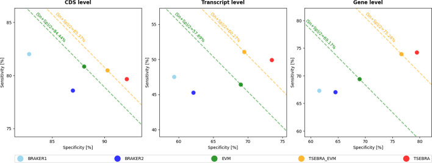

*TSEBRA 在拟南芥上的敏感度与特异度表现（图 3）。 Gabriel 等 2021，《BMC Bioinformatics》图 3，doi:10.1186/s12859-021-04482-0，PMC8620231，CC BY。*

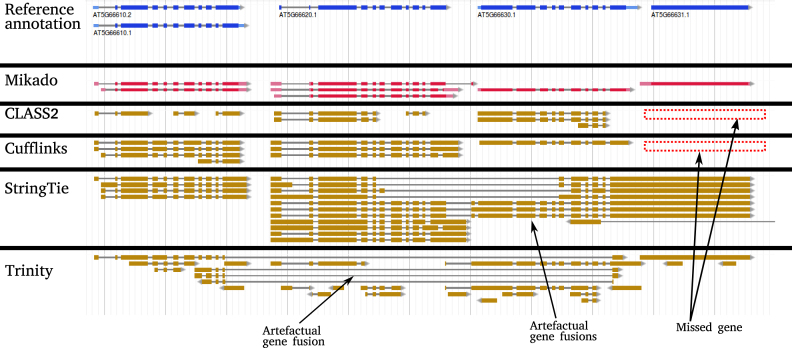

*Mikado 在拟南芥某一位点的转录本筛选过程（图 1）。 Venturini 等 2018，《GigaScience》图 1，doi:10.1093/gigascience/giy093，PMC6105091，CC BY。*

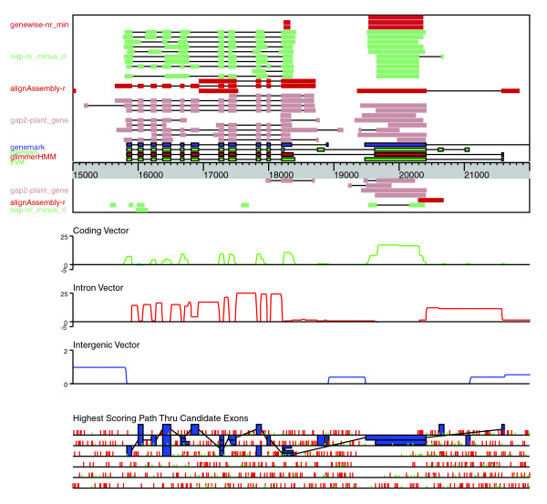

*EVidenceModeler 在水稻某一位点生成的共识基因模型（图 5）。 Haas 等 2008，《Genome Biology》图 5，doi:10.1186/gb-2008-9-1-r7，PMC2395244，CC BY。*

| 工具 | 角色 | 用途 / 何时用 | 原始论文 | 实验室（通讯作者，机构） | 权威度（档位 · 被引） | 评价（出处） |
|---|---|---|---|---|---|---|
| [EVidenceModeler (EVM)](https://github.com/EVidenceModeler/EVidenceModeler) | 分支 S14（A4） | 对多套基因预测与序列比对结果做加权整合，生成共识基因模型。 | [Genome biology 2008](https://doi.org/10.1186/gb-2008-9-1-r7) | Brian J. Haas (Broad Institute) | 标准 · 4661 次 | GitHub 最后提交 2026-09 |
| [TSEBRA](https://github.com/Gaius-Augustus/TSEBRA) | 备选 | 利用外部证据对多套 BRAKER 预测结果做筛选合并的转录本选择器。 | [BMC Bioinformatics 2021](https://doi.org/10.1186/s12859-021-04482-0) | Mario Stanke (Universität Greifswald) | 成熟 · 426 次 | 作者摘要原句：“We show in computational experiments on genomes of 11 species that TSEBRA achieves higher accuracy than either BRAKER1 or BRAKER2 running alone and that TSEBRA compares favorably with the combiner tool EVidenceModeler.”；GitHub 最后提交 2026-11 |
| [Mikado](https://github.com/EI-CoreBioinformatics/mikado) | 备选 | 在每个基因位点上从多套转录本组装或预测结果中筛选最优转录本模型。 | [GigaScience 2018](https://doi.org/10.1093/gigascience/giy093) | David Swarbreck (Norwich Research Park) | 成熟 · 231 次 | 作者摘要原句：“Here, we show that the accuracy of transcript reconstruction can be boosted by combining multiple methods, and we present a novel algorithm to integrate multiple RNA-seq assemblies into a coherent transcript annotation.”；GitHub 最后提交 2026-01 |
| MAKER2 | 备选 | 整合序列比对证据与从头预测工具、并给出 AED 质量评分的注释流程。 | [BMC Bioinformatics 2011](https://doi.org/10.1186/1471-2105-12-491) | Mark D. Yandell (University of Utah) | 标准 · 2370 次 | 在 BRAKER3 的 11 个基因组评测中得分低于 BRAKER3（doi:10.1101/gr.278090.123）。；作者摘要原句：“We show that MAKER2 can produce accurate annotations for novel genomes where training-data are limited, of low quality or even non-existent.” |
| [funannotate](https://github.com/nextgenusfs/funannotate) | 备选 | 基于 EVM/PASA 构建的真核基因组注释流程（含 predict、update、annotate 模块）。 | [Zenodo (CERN European Organization for Nuclear Research) 2018](https://doi.org/10.5281/zenodo.1134477) | Winter, David | 成熟 · 407 次 | 在 BRAKER3 的 11 个基因组评测中得分低于 BRAKER3（doi:10.1101/gr.278090.123）。；GitHub 最后提交 2026-11 |
| [EGAPx](https://github.com/ncbi/egapx) | 备选 | NCBI 真核基因组注释流程（EGAP）的公开版本。 | 无文章 | — | 无论文 | 仓库简介：“Eukaryotic Genome Annotation Pipeline-External caller scripts and documentation”；GitHub 最后提交 2026-09 |
| [GETA](https://github.com/chenlianfu/geta) | 备选 | 全基因组电子转录本注释流程，串联转录本、同源比对与 AUGUSTUS 预测。 | 无文章 | — | 无论文 | GitHub 最后提交 2026-10 |
| [REAT](https://github.com/EI-CoreBioinformatics/reat) | 备选 | 基于 Mikado 整合转录组、同源证据与基因预测工作流的真核注释工具包。 | 无文章 | — | 无论文 | 仓库简介：“Robust Eukaryotic Annotation Toolkit”；GitHub 最后提交 2025-02 |
| [EASEL](https://gitlab.com/PlantGenomicsLab/easel) | 备选 | Nextflow 注释流程：串联 StringTie2/PsiCLASS 转录本组装、TransDecoder、基于转录本与 OrthoDB 蛋白提示训练的 AUGUSTUS，并利用 RNA 二级结构等特征做随机森林过滤。 | 无文章 | — | 无论文 | 无摘要或仓库说明可引；见原文 |
| [Sylvan](https://github.com/plantgenomicslab/Sylvan) | 备选 | Snakemake 注释流程：整合 EVM/PASA、GETA、Helixer、Liftoff 与 miniprot 证据，再经半监督随机森林过滤与边界校正。 | 无文章 | — | 无论文 | 仓库简介：“Comprehensive genome annotation pipeline for plant combining EVM/PASA, GETA, AUGUSTUS and Helixer with semi-supervised filtering for high-quality gene models.”；GitHub 最后提交 2026-11 |
| [Ensembl automatic annotation pipeline (ensembl-anno)](https://github.com/Ensembl/ensembl-anno) | 备选 | Ensembl 自动基因注释流程的公开代码库。 | 无文章 | — | 无论文 | 仓库简介：“Ensembl Automatic annotation pipeline”；GitHub 最后提交 2026-11 |
| [EviAnn](https://github.com/alekseyzimin/EviAnn_release) | 备选 | 不经从头训练，直接用 RNA 和蛋白证据构建基因模型；速度快，可用来和 BRAKER4 结果互相核对。 | [Nature Methods 2026](https://doi.org/10.1038/s41592-026-03156-0) | Aleksey V. Zimin (Johns Hopkins University) | 较新 · 36 次 | GitHub 最后提交 2026-11 |
| [MAKER-P](https://github.com/Yandell-Lab/maker) | 备选 | 面向大型植物基因组调整过的 MAKER，含重复和非编码 RNA 处理。 | [PLANT PHYSIOLOGY 2013](https://doi.org/10.1104/pp.113.230144) | Mark D. Yandell | 成熟 · 451 次 | 作者摘要原句：“We have optimized and extended the widely used annotation engine MAKER in order to better support plant genome annotation efforts.”；GitHub 最后提交 2024-08 |
| [FINDER](https://github.com/sagnikbanerjee15/Finder) | 备选 | 利用 RNA-seq 数据及相关蛋白序列做自动真核基因注释。 | [BMC Bioinformatics 2021](https://doi.org/10.1186/s12859-021-04120-9) | Carson M. Andorf (Agricultural Research Service) | 小众 · 47 次 | 在 BRAKER3 的 11 个基因组评测中得分低于 BRAKER3（doi:10.1101/gr.278090.123）。；作者摘要原句：“This hinders the creation of an accurate and holistic representation of the transcriptomic landscape across multiple tissue types and experimental conditions.”；GitHub 最后提交 2023-07 |
| [GenSAS](https://www.gensas.org/) | 备选 | 网页平台，免本地安装即可做重复屏蔽、基因预测与证据合并。 | [Methods in molecular biology 2019](https://doi.org/10.1007/978-1-4939-9173-0_3) | Jodi L. Humann (Washington State University) | 成熟 · 173 次 | 无摘要或仓库说明可引；见原文 |

> 评测要点： 比较 BRAKER 与 MAKER 流程的植物评测发现，仅靠 RNA 比对得到的转录本不够；证据预测与从头预测结合、短读长加长读长可提高注释质量（doi:10.1002/aps3.11533）。

<a id="section-9"></a>
## 9. 非编码 RNA 与假基因位点

蛋白编码草案之外的位点：tRNA、rRNA、miRNA、lncRNA 与假基因。

**需要：** 基因组序列；许多 ncRNA 工具还需协方差模型或参考 RNA 集。除非另有书面的合并规则，蛋白编码草案与 ncRNA 位点应作为独立产物分别保存。[按场景列出的数据需求](#data-needs)

**分组：**
- *结构型 ncRNA*（互补）：Infernal 1.1、tRNAscan-SE 2.0、ARAGORN、barrnap、RNAmmer。Infernal 配合 Rfam 可覆盖大多数家族；tRNA 用 tRNAscan-SE，rRNA 用 barrnap。
- *小 RNA 位点*（可替代）：ShortStack 4、miRDeep-P2。需要小 RNA 测序数据；按第 14 节的植物标准判定 miRNA。
- *编码潜力（投票）*（互补）：CPC2、CPAT、LncFinder、FEELnc、PlantLncBoost、RNAsamba、PLEKv2。选两到三个，取一致的结果；PlantLncBoost 是用植物数据训练的。
- *假基因*（可替代）：PseudoPipe、P-GRe、Shiu lab PseudogenePipeline。在蛋白编码基因集定稿后运行。


| 工具 | 角色 | 用途 / 何时用 | 原始论文 | 实验室（通讯作者，机构） | 权威度（档位 · 被引） | 评价（出处） |
|---|---|---|---|---|---|---|
| ARAGORN | 备选 | 检测 tRNA 与 tmRNA 基因。 | [Nucleic Acids Research 2004](https://doi.org/10.1093/nar/gkh152) | Dean Laslett (Murdoch University) | 标准 · 3084 次 | 作者摘要原句：“ARAGORN achieves a detection sensitivity of 99% from a set of 1290 eubacterial, eukaryotic and archaeal tRNA genes and detects all complete tmRNA sequences in the tmRNA database, improving on the performance of the BRUCE program.” |
| [RNAmmer](https://services.healthtech.dtu.dk/services/RNAmmer-1.2/) | 备选 | 基于 HMM 预测 rRNA 基因。 | [Nucleic Acids Research 2007](https://doi.org/10.1093/nar/gkm160) | Karin Lagesen (University of Oslo) | 标准 · 6678 次 | 作者摘要原句：“from running RNAmmer on a large set of genomes indicate that the location of rRNAs can be predicted with a very high level of accuracy.” |
| [CPAT](https://github.com/liguowang/cpat) | 备选 | 无需序列比对的转录本编码潜能评估工具。 | [Nucleic Acids Research 2013](https://doi.org/10.1093/nar/gkt006) | Jean‐Pierre Kocher (Mayo Clinic) +1 | 标准 · 2278 次 | 作者摘要原句：“CPAT software outperformed (sensitivity: 0.96, specificity: 0.97) other state-of-the-art alignment-based software such as Coding-Potential Calculator (sensitivity: 0.99, specificity: 0.74) and Phylo Codon Substitution Frequencies (sensitivity: 0.90, …”；GitHub 最后提交 2024-02 |
| LncFinder | 备选 | 结合多源序列特征与机器学习方法识别 lncRNA 的 R 包。 | [Briefings in Bioinformatics 2018](https://doi.org/10.1093/bib/bby065) | Ying Li (Jilin University) | 成熟 · 184 次 | 作者摘要原句：“Experimental results show that our method outperforms several state-of-the-art tools on multiple species with more robust and satisfactory results.” |
| PseudoPipe | 备选 | 基于同源比对的假基因识别流程。 | [Bioinformatics 2006](https://doi.org/10.1093/bioinformatics/btl116) | Mark Gerstein (Yale University) | 成熟 · 217 次 | 无摘要或仓库说明可引；见原文 |
| [Infernal 1.1](https://github.com/EddyRivasLab/infernal) | 备选 | 基于协方差模型（covariance-model）的 RNA 同源搜索工具（Rfam 的底层引擎）。 | [Bioinformatics 2013](https://doi.org/10.1093/bioinformatics/btt509) | Eric P. Nawrocki (Howard Hughes Medical Institute) | 标准 · 4145 次 | GitHub 最后提交 2026-11 |
| [tRNAscan-SE 2.0](https://github.com/UCSC-LoweLab/tRNAscan-SE) | 备选 | 检测 tRNA 基因，给出反密码子分型（isotype）并标记假 tRNA。 | [Nucleic Acids Research 2021](https://doi.org/10.1093/nar/gkab688) | Todd M. Lowe (University of California, Santa Cruz) | 标准 · 2252 次 | 作者摘要原句：“Utilizing a vastly larger training set, we created nearly one hundred specialized isotype- and clade-specific models, greatly improving tRNAscan-SE’s ability to identify and classify both typical and atypical tRNAs.”；GitHub 最后提交 2026-07 |
| [barrnap](https://github.com/tseemann/barrnap) | 备选 | 快速预测 rRNA 位点的工具（内置真核模型）。 | 无文章 | — | 无论文 | 仓库简介：“:microscope: :leo: Microbial RNA annotation”；GitHub 最后提交 2026-04 |
| [ShortStack 4](https://github.com/MikeAxtell/ShortStack) | 备选 | 利用 sRNA-seq 数据注释小 RNA 位点并识别 MIRNA。 | [RNA 2013](https://doi.org/10.1261/rna.035279.112) | Michael J. Axtell (Pennsylvania State University) | 标准 · 579 次 | 作者摘要原句：“In this study, ShortStack is demonstrated to perform accurate annotations and useful descriptions of diverse small RNA genes from four plants (Arabidopsis, tomato, rice, and maize) and three animals (Drosophila, mice, and humans).”；GitHub 最后提交 2025-10 |
| [PlantLncBoost](https://github.com/xuechantian/PlantLncBoost) | 备选 | 基于序列特征与梯度提升算法识别植物 lncRNA。 | [New Phytologist 2025](https://doi.org/10.1111/nph.70211) | Libo Jiang (Shandong University of Technology) +1 | 较新 · 18 次 | 作者摘要原句：“Here, we present PlantLncBoost, a novel computational tool designed to improve the generalization in plant lncRNA identification.”；GitHub 最后提交 2025-03 |
| [FEELnc](https://github.com/tderrien/FEELnc) | 备选 | 从转录本组装结果中注释 lncRNA（含过滤、编码潜能计算与分类模块）。 | [Nucleic Acids Research 2017](https://doi.org/10.1093/nar/gkw1306) | Thomas Derrien (Centre National de la Recherche Scientifique) | 标准 · 544 次 | 作者摘要原句：“Here, we present FEELnc (FlExible Extraction of LncRNAs), an alignment-free program that accurately annotates lncRNAs based on a Random Forest model trained with general features such as multi k-mer frequencies and relaxed open reading frames.”；GitHub 最后提交 2025-07 |
| [CPC2](https://cpc2.gao-lab.org/) | 备选 | 快速计算转录本编码潜能的工具。 | [Nucleic Acids Research 2017](https://doi.org/10.1093/nar/gkx428) | Yu-Jian Kang (Peking University) +2 | 标准 · 1931 次 | 作者摘要原句：“CPC2 runs ∼1000 times faster than CPC1 and exhibits superior accuracy compared with CPC1, especially for long non-coding transcripts.” |
| P-GRe | 备选 | 假基因预测工具：根据母本蛋白定位基因组位点、重建假 CDS、报告移码与提前终止密码子并输出 GFF。 | [Genomics 2026](https://doi.org/10.1016/j.ygeno.2026.111216) | Christophe Dunand (Centre National de la Recherche Scientifique) +1 | 较新 · 3 次 | 作者摘要原句：“The aligner miniprot has been integrated in our pipeline, because of its high speed and sensitivity.” |
| [Shiu lab PseudogenePipeline](https://github.com/ShiuLab/PseudogenePipeline) | 备选 | 经典的植物假基因识别流程，包含重复序列过滤与 GFF 输出。 | 无文章 | — | 无论文 | GitHub 最后提交 2023-06 |
| miRDeep-P2 | 备选 | 采用更新版植物注释标准、从 sRNA-seq 数据中快速发现植物 miRNA 位点。 | [Bioinformatics 2018](https://doi.org/10.1093/bioinformatics/bty972) | Xiaozeng Yang (Beijing Academy of Agriculture and Forestry Sciences) | 成熟 · 153 次 | 作者摘要原句：“Taken together, our results demonstrate miRDP2 as a fast and accurate tool for analyzing the miRNA transcriptome in plants.” |
| [RNAsamba](https://github.com/apcamargo/RNAsamba) | 备选 | 利用神经网络根据完整转录本及其 ORF 评估蛋白编码潜力；可作为 lncRNA 与 mRNA 判定的补充投票项。 | [NAR Genomics and Bioinformatics 2020](https://doi.org/10.1093/nargab/lqz024) | Marcelo Falsarella Carazzolle (Universidade Estadual de Campinas (UNICAMP)) | 成熟 · 142 次 | 作者摘要原句：“We evaluated RNAsamba's classification performance using transcripts coming from humans and several other model organisms and show that it recurrently outperforms other state-of-the-art methods.”；GitHub 最后提交 2022-10 |
| [PLEKv2](https://sourceforge.net/projects/plek/) | 备选 | 基于序列特征和 coding-net 模型的无比对 lncRNA/mRNA 分类器；v2 取代了 2014 年基于 k-mer 的 PLEK（doi:10.1186/1471-2105-15-311）。缺乏近缘蛋白库时很实用。 | [BMC Genomics 2024](https://doi.org/10.1186/s12864-024-10662-y) | Aimin Li (Xi'an University of Technology) +1 | 较新 · 18 次 | 作者摘要原句：“To distinguish between lncRNA and mRNA transcripts quickly and accurately, we upgraded the PLEK alignment-free tool to its next version, PLEKv2, and constructed models tailored for both animals and plants.” |

<a id="section-10"></a>
## 10. 基因模型质控

检查基因模型及其翻译所得蛋白序列（A3、A5、last-mile 01–02）。

**需要：** 由 GFF 翻译出的蛋白序列（`PROTEINS_FA`）与 BUSCO lineage；PSAURON 和 OMArk 使用同一套蛋白。RNA BAM 非必需，但有助于检查证据支持率。[按场景列出的数据需求](#data-needs)

**分组：**
- *完整性*（互补）：BUSCO、OMArk。BUSCO 给出标准完整度指标；OMArk 补充污染与片段化检查。
- *逐模型评分*（互补）：PSAURON、GeneValidator、ABAQS。按得分排序，优先复查得分最低的模型。
- *格式与比较*（互补）：gffread / gffcompare、AGAT。用 gffcompare 与旧版对比；用 AGAT 做统计与修正。

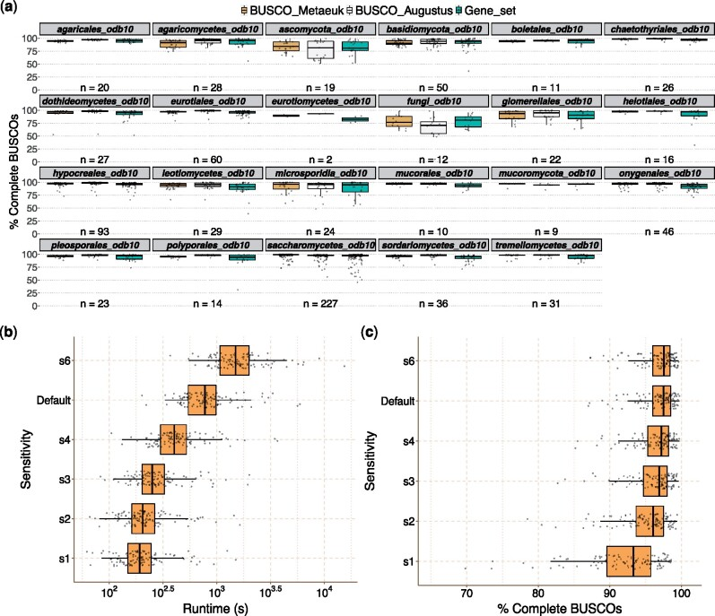

*BUSCO v5 的真核基因组评估流程（图 2）。 Manni 等 2021，《Molecular Biology and Evolution》图 2，doi:10.1093/molbev/msab199，PMC8476166，CC BY。*

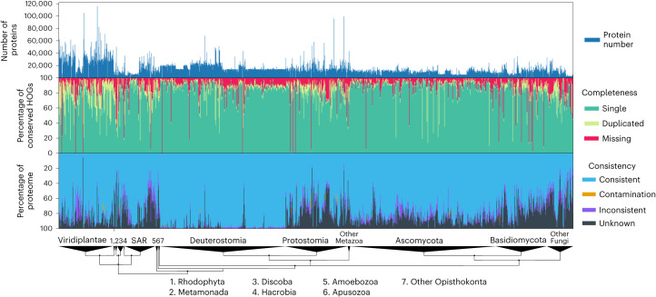

*OMArk 在 UniProt 参考蛋白组上的一致性评估（图 4）。 Nevers 等 2025，《Nature Biotechnology》43(1):124-133，图 4，doi:10.1038/s41587-024-02147-w（线上发表于 2024-02-21），PMC11738984，CC BY。*

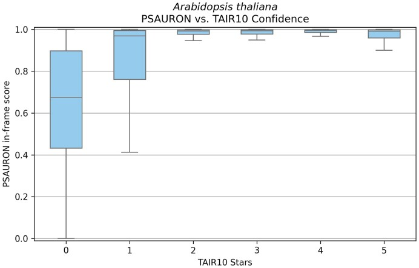

*PSAURON 在 TAIR10 CDS 上的打分分布（图 5）。 Sommer、Zimin 与 Salzberg 2025，《NAR Genomics and Bioinformatics》图 5，doi:10.1093/nargab/lqae189，PMC11704789，CC BY。*

| 工具 | 角色 | 用途 / 何时用 | 原始论文 | 实验室（通讯作者，机构） | 权威度（档位 · 被引） | 评价（出处） |
|---|---|---|---|---|---|---|
| [gffread / gffcompare](https://github.com/gpertea/gffread) | 备选 | 从 GFF 提取 CDS 或蛋白序列（gffread），并在碱基、外显子与位点水平比对两套注释（gffcompare）。 | [F1000Research 2020](https://doi.org/10.12688/f1000research.23297.2) | Mihaela Pertea (Johns Hopkins University) | 标准 · 2151 次 | GitHub 最后提交 2026-11 |
| [AGAT](https://github.com/NBISweden/AGAT) | 备选 | GFF/GTF 处理工具包：提供统计、结构修复、最长转录本提取、ID 管理与格式转换功能。 | [Zenodo (CERN European Organization for Nuclear Research) 2019](https://doi.org/10.5281/zenodo.3552717) | tayyrov | 成熟 · 409 次 | GitHub 最后提交 2026-09 |
| BUSCO | 备选 | 基于谱系单拷贝直系同源基因集评估基因集完整性（蛋白模式）。谱系数据集现由 OrthoDB v12 提供（2024 年更新，doi:10.1093/nar/gkae987）；compleasm（第 1 节）使用同一套谱系但运行更快。 | [Molecular Biology and Evolution 2021](https://doi.org/10.1093/molbev/msab199) | Evgeny M. Zdobnov (University of Geneva) | 标准 · 6853 次 | compleasm 论文：在人类组装上比 BUSCO 快 14 倍，T2T-CHM13 完整度 99.6% 对 BUSCO 的 95.7%（doi:10.1093/bioinformatics/btad595）。；作者摘要原句：“Here, we present new functionalities and major improvements of the BUSCO software, as well as the renewal and expansion of the underlying data sets in sync with the OrthoDB v10 release.” |
| [ABAQS](https://github.com/mycocosm-lbl/abaqs) | 备选 | 综合完整性、基因模型合法性与蛋白结构域特征检查的注释质量评分工具（ABAQS）。 | 无文章 | — | 无论文 | 仓库简介：“Accuracy-Based Annotation Quality Score (ABAQS)”；GitHub 最后提交 2026-11 |
| [GeneValidator](https://github.com/wurmlab/genevalidator) | 备选 | 将每个预测蛋白与数据库同源序列做比对（检查长度、覆盖度、重复与融合基因），标记存疑基因模型。 | [Bioinformatics 2016](https://doi.org/10.1093/bioinformatics/btw015) | Yannick Wurm (Queen Mary University of London) | 小众 · 39 次 | 论文摘要：“We developed GeneValidator (GV) to automatically identify problematic gene predictions and to aid manual curation.”；GitHub 最后提交 2024-03 |
| [OMArk](https://github.com/DessimozLab/OMArk) | 备选 | 对照 OMA 基因家族，检查预测蛋白组的完整性、谱系一致性和污染；能标出 BUSCO 发现不了的片段化基因和可疑（虚假）基因模型。 | [Nature Biotechnology 2024](https://doi.org/10.1038/s41587-024-02147-w) | Yannis Nevers (SIB Swiss Institute of Bioinformatics) | 成熟 · 228 次 | 作者：还检查一致性与污染，这是 BUSCO 这类完整度指标看不到的（doi:10.1038/s41587-024-02147-w）。；论文摘要：“We introduce OMArk, a software package that relies on fast, alignment-free sequence comparisons between a query proteome and precomputed gene families across the tree of life.”；GitHub 最后提交 2026-10 |
| [PSAURON](https://github.com/salzberg-lab/PSAURON) | 备选 | 利用机器学习模型为每个预测的蛋白编码基因打分；低分项提示可能为假阳性基因，需重点复查。 | [NAR Genomics and Bioinformatics 2025](https://doi.org/10.1093/nargab/lqae189) | Markus J. Sommer (Johns Hopkins University) | 较新 · 40 次 | 作者摘要原句：“Validation against established benchmarks demonstrates PSAURON's effectiveness and correlation with recognized measures of protein quality, highlighting its potential use as a widely applicable method to evaluate precision in gene annotation.”；GitHub 最后提交 2026-05 |

> 评测要点： 单一质控数字不够：BUSCO/compleasm 衡量完整度，OMArk 增加一致性和污染检查（doi:10.1038/s41587-024-02147-w），PSAURON 为每个蛋白打分判断其是否像真实编码序列（doi:10.1093/nargab/lqae189）。

<a id="section-11"></a>
## 11. 人工校对与浏览器

用于 last-mile 校对的证据包、基因组浏览器与编辑器（LM03–LM04）。

**需要：** 在打开 GSAman 或浏览器前，备好草案 GFF、基因组及证据包（BAM、蛋白比对、RNA 覆盖度）。[按场景列出的数据需求](#data-needs)

**分组：**
- *协作式网页校对*（互补）：Apollo 3、JBrowse 2。Apollo 3 是 JBrowse 2 上的插件，团队校对时两者一起用。
- *桌面与人工校对工具*（可替代）：IGV、Artemis / ACT、GSAman、TBtools-II。用于本地检查少量位点；LM04 的模型编辑使用 GSAman。


| 工具 | 角色 | 用途 / 何时用 | 原始论文 | 实验室（通讯作者，机构） | 权威度（档位 · 被引） | 评价（出处） |
|---|---|---|---|---|---|---|
| [IGV](https://github.com/igvteam/igv) | 备选，通用工具 | 用于查看序列比对与基因注释的桌面端基因组浏览器。 | [Nature Biotechnology 2011](https://doi.org/10.1038/nbt.1754) | James T Robinson (Broad Institute) +1 | 标准 · 16992 次 | GitHub 最后提交 2026-11 |
| [igv.js / igv-reports](https://github.com/igvteam/igv-reports) | 备选，通用工具 | 可嵌入网页的 IGV 组件；igv-reports 可将指定位点及其证据轨道打包为独立的 HTML 页面。 | [Bioinformatics 2022](https://doi.org/10.1093/bioinformatics/btac830) | James T Robinson (University of California San Diego) | 标准 · 648 次 | GitHub 最后提交 2026-11 |
| [Artemis / ACT](https://github.com/sanger-pathogens/Artemis) | 备选，通用工具 | 基因组浏览器、注释编辑器与序列比较工具。 | [Bioinformatics 2011](https://doi.org/10.1093/bioinformatics/btr703) | Tim J. Carver (Wellcome Sanger Institute) | 标准 · 1410 次 | 论文摘要：“We present Artemis as a tool for integrated visualization and computational analysis of different types of HTS datasets in the context of a reference genome and its corresponding annotation.”；GitHub 最后提交 2025-12 |
| [Apollo 3](https://github.com/GMOD/Apollo3) | 备选 | 基于 JBrowse 2 的多人协作基因模型编辑器（支持本地或服务端部署）。Apollo 2（2019 年论文，doi:10.1371/journal.pcbi.1006790）为旧版服务端程序，仅在社区门户仍运行该版本时沿用。 | [bioRxiv (Cold Spring Harbor Laboratory) 2026](https://doi.org/10.64898/2026.06.08.730970) | Ian H Holmes (University of California, Berkeley) | 较新 · 1 次 | 作者摘要原句：“Its functionality is inspired by existing manual genome annotation tools such as Apollo, Artemis, and Otter, combining features from those tools with an updated and more scalable architecture and technology stack.”；GitHub 最后提交 2026-11 |
| [JBrowse 2](https://github.com/GMOD/jbrowse-components) | 备选，通用工具 | 支持共线性与结构变异视图的基因组浏览器，可挂载各类证据轨道供人工校对使用。 | [Genome biology 2023](https://doi.org/10.1186/s13059-023-02914-z) | Ian H Holmes (University of California, Berkeley) | 标准 · 907 次 | 作者摘要原句：“These improvements are enabled by a ground-up redesign using modern web technology.”；GitHub 最后提交 2026-11 |
| GSAman | 备选 | 结合比对证据人工编辑基因结构模型的桌面工具；对应 LM04 人工校对步骤。 | [The Innovation 2026](https://doi.org/10.1016/j.xinn.2026.101471) | Chengjie Chen (South China Agricultural University) +2 | 较新 · 5 次 | 作者摘要原句：“In contrast to web-based platforms such as Apollo2, which generally require server deployment and do not provide full offline functionality, GSAman delivers a fully local, responsive interface for real-time annotation refinement, thereby improving …” |
| [TBtools-II](https://github.com/CJ-Chen/TBtools-II) | 备选，通用工具 | 面向植物研究的桌面工具集，支持查看 GFF、提取序列与绘制基因结构图；便于快速抽查少量位点。 | [Molecular Plant 2023](https://doi.org/10.1016/j.molp.2023.09.010) | Chengjie Chen (South China Agricultural University) +1 | 标准 · 4462 次 | GitHub 最后提交 2026-10 |
| ORCAE | 备选 | 维基式网页平台，供社区人工校对基因模型。 | [Nature Methods 2012](https://doi.org/10.1038/nmeth.2242) | Lieven Sterck (Ghent University) | 成熟 · 226 次 | 无摘要或仓库说明可引；见原文 |

<a id="section-12"></a>
## 12. GFF3 清理与发布

GFF3 清理、格式校验与提交（last-mile 06、A6）。

**需要：** 审定后的 GFF 与基因组，外加 `docs/PLAYBOOK.md` 中列出的 METHODS 与核对表字段。[按场景列出的数据需求](#data-needs)

**分组：**
- *校验*（互补）：GenomeTools (gt gff3validator)、GFF3toolkit、gxfkit、noodles。每次发布前均需运行校验。
- *提交格式转换*（可替代）：table2asn、EMBLmyGFF3、Genome Annotation Generator (GAG)。提交 NCBI 用 table2asn，提交 ENA 用 EMBLmyGFF3。
- *辅助工具*（互补）：SeqKit 2、GTFtools、CrossMap。用于序列提取、汇总统计以及不同组装版本间的坐标转换。


| 工具 | 角色 | 用途 / 何时用 | 原始论文 | 实验室（通讯作者，机构） | 权威度（档位 · 被引） | 评价（出处） |
|---|---|---|---|---|---|---|
| [SeqKit 2](https://github.com/shenwei356/seqkit) | 备选 | FASTA/Q 序列处理工具包（统计、检索、翻译、去冗余等）。 | [iMeta 2024](https://doi.org/10.1002/imt2.191) | Wei Shen (Second Affiliated Hospital of Chongqing Medical University) | 标准 · 667 次 | 作者摘要原句：“SeqKit2 consistently outperforms its predecessor, albeit with marginally higher memory usage, while maintaining competitive runtimes against other tools.”；GitHub 最后提交 2026-11 |
| [Genome Annotation Generator (GAG)](https://github.com/genomeannotation/GAG) | 备选 | 由 GFF3 生成并校正 NCBI 提交所需的 `.tbl` 注释表。 | [GigaScience 2018](https://doi.org/10.1093/gigascience/giy018) | Scott M. Geib (Daniel K. Inouye U.S. Pacific Basin Agricultural Research Center) | 小众 · 73 次 | 作者摘要原句：“With WGS becoming commonplace, genome sequencing projects are moving away from the genome centers and into the ecology or biology lab, where fewer resources are present to support the process of genome assembly curation.”；GitHub 最后提交 2018-03 |
| [GenomeTools (gt gff3validator)](https://github.com/genometools/genometools) | 备选 | GFF3 格式校验、排序与规范化整理工具。 | [IEEE Transactions on Computational Biology and Bioinformatics 2013](https://doi.org/10.1109/TCBB.2013.68) | Stefan Kurtz (Universität Hamburg) | 标准 · 547 次 | 论文摘要：“In this paper, we present the GenomeTools, a convenient and efficient software library and associated software tools for developing bioinformatics software intended to create, process or convert annotation graphs.”；GitHub 最后提交 2026-11 |
| [EMBLmyGFF3](https://github.com/NBISweden/EMBLmyGFF3) | 备选 | 将 GFF3 与 FASTA 转换为用于 ENA 提交的 EMBL 平面文件格式。 | [BMC Research Notes 2018](https://doi.org/10.1186/s13104-018-3686-x) | Jacques Dainat (Uppsala University) | 小众 · 49 次 | 论文摘要：“Here we present EMBLmyGFF3, a robust universal converter from GFF3 format to EMBL format compatible with genome annotation submission to the European Nucleotide Archive.”；GitHub 最后提交 2025-07 |
| [table2asn](https://www.ncbi.nlm.nih.gov/genbank/table2asn/) | 备选 | NCBI 官方工具，将 GFF3/FASTA 转换为提交用的 ASN.1 格式并生成校验报告。 | 无文章 | — | 无论文 | 无摘要或仓库说明可引；见原文 |
| [GFF3toolkit](https://github.com/NAL-i5K/GFF3toolkit) | 备选 | i5k Workspace@NAL 开发的 GFF3 质控、修复与合并工具集。 | 无文章 | — | 无论文 | 仓库简介：“Python programs for processing GFF3 files”；GitHub 最后提交 2026-11 |
| [noodles](https://github.com/zaeleus/noodles) | 备选 | Rust 编写的生物信息学格式 I/O 库，包含 GFF3/GTF 读写模块。 | 无文章 | — | 无论文 | 仓库简介：“Bioinformatics I/O libraries in Rust”；GitHub 最后提交 2026-11 |
| [gxfkit](https://github.com/benngaihk/gxfkit) | 备选 | Rust 编写的 GFF3/GTF 转换工具，力求输出格式兼容 AGAT 且运行速度大幅提升。 | 无文章 | — | 无论文 | GitHub 最后提交 2026-07 |
| GTFtools | 备选 | 基于 GTF 计算基因模型特征（长度、内含子与 UTR 集合、异构体统计），用于生成发布汇总表。 | [Bioinformatics 2022](https://doi.org/10.1093/bioinformatics/btac561) | Hong‐Dong Li (Central South University) | 小众 · 33 次 | 论文摘要：“We introduce GTFtools, a stand-alone command-line software that provides a set of functions to calculate various gene features, including splice sites, independent introns, transcription start sites (TSS)-flanking regions, UTRs, isoform coordination and …” |
| [CrossMap](https://github.com/liguowang/CrossMap) | 备选 | 通过 chain 文件在不同组装版本间转换 GFF、BED、VCF 和 BAM 坐标，例如将坐标从 PN40024 v4 转换至 T2T。 | [Bioinformatics 2013](https://doi.org/10.1093/bioinformatics/btt730) | Jean‐Pierre Kocher (Mayo Clinic) +1 | 标准 · 829 次 | 论文摘要：“Here we developed CrossMap, a versatile and efficient tool for converting genome coordinates between assemblies.”；GitHub 最后提交 2026-07 |
| [GFF3sort](https://github.com/billzt/gff3sort) | 备选 | 对 GFF3 排序使父特征在子特征之前，便于 tabix 索引后上浏览器。 | [BMC Bioinformatics 2017](https://doi.org/10.1186/s12859-017-1930-3) | Sandui Guo (Chinese Academy of Agricultural Sciences) +1 | 小众 · 12 次 | 作者摘要原句：“Based on our test datasets from seven species, GFF3sort produced accurate sorting results with acceptable efficiency compared with currently available tools.”；GitHub 最后提交 2020-06 |

<a id="section-13"></a>
## 13. 参考数据库

用作证据或近缘 GFF 的参考基因组与注释库。

**需要：** 无需额外测序——这里收录的是用作证据或近缘 GFF 的参考基因组与注释。请核对所用版本是否与 METHODS 中记录的一致。[按场景列出的数据需求](#data-needs)

**分组：**
- *蛋白证据集*（互补）：OrthoDB v12、UniProt 2025。BRAKER3/BRAKER4 的标准蛋白集是 OrthoDB 的绿色植物分区；GALBA2 则要用一到数个近缘物种的蛋白组；需要小而干净的集合时加 Swiss-Prot。
- *比较用基因集*（互补）：Phytozome、Ensembl Plants (Ensembl Genomes 2022)、PLAZA 5.0、NCBI RefSeq、Araport11、PN40024 reference annotation (PN_T2T / v5)。用于同近缘物种及葡萄参考基因组对比基因数量与结构。
- *ncRNA 参考*（互补）：Rfam 15、RNAcentral。Infernal 搜索使用 Rfam 模型；命中结果的命名使用 RNAcentral。


| 工具 | 角色 | 用途 / 何时用 | 原始论文 | 实验室（通讯作者，机构） | 权威度（档位 · 被引） | 评价（出处） |
|---|---|---|---|---|---|---|
| [RNAcentral](https://rnacentral.org/) | 资源 | 综合性的非编码 RNA 序列数据库。 | [Nucleic Acids Research 2020](https://doi.org/10.1093/nar/gkaa921) | Zasha Weinberg | 成熟 · 441 次 | 无摘要或仓库说明可引；见原文 |
| [Phytozome](https://phytozome-next.jgi.doe.gov/) | 资源 | JGI 维护的植物基因组与注释门户数据库。 | [Nucleic Acids Research 2011](https://doi.org/10.1093/nar/gkr944) | David M. Goodstein (Joint Genome Institute) | 标准 · 6177 次 | 无摘要或仓库说明可引；见原文 |
| [Ensembl Plants (Ensembl Genomes 2022)](https://plants.ensembl.org/) | 资源 | 收录植物基因组、基因模型与比较基因组学数据的综合数据库。 | [Nucleic Acids Research 2021](https://doi.org/10.1093/nar/gkab1007) | Andrew D. Yates (European Bioinformatics Institute) | 成熟 · 498 次 | 作者摘要原句：“Here, we present our largest increase in plant, metazoan and fungal genomes since the project's inception creating one of the world's most comprehensive genomic resources and describe our efforts to reduce genome redundancy in our Bacteria portal.” |
| [Araport11](https://www.arabidopsis.org/) | 资源 | 拟南芥 Col-0 基因组的重注释参考版本。 | [The Plant Journal 2017](https://doi.org/10.1111/tpj.13415) | Christopher D. Town (J. Craig Venter Institute) | 标准 · 1521 次 | 无摘要或仓库说明可引；见原文 |
| [Rfam 15](https://rfam.org) | 资源 | RNA 家族协方差模型数据库；可配合 Infernal cmscan 扫描 rRNA、snoRNA 与核糖体开关（riboswitch）等位点。 | [Nucleic Acids Research 2024](https://doi.org/10.1093/nar/gkae1023) | Blake Sweeney (European Bioinformatics Institute) | 成熟 · 279 次 | 作者摘要原句：“This paper introduces major improvements, including the expansion of Rfamseq to 26 106 genomes, a 76% increase, incorporating the latest UniProt reference proteomes and additional viral genomes.” |
| [OrthoDB v12](https://www.orthodb.org/) | 资源 | 直系同源目录，其绿色植物蛋白分区是 BRAKER3/BRAKER4 的标准蛋白证据（GALBA/GALBA2 则应使用一到数个近缘物种的蛋白组）；同一次更新也刷新了 BUSCO 谱系。 | [Nucleic Acids Research 2024](https://doi.org/10.1093/nar/gkae987) | Evgeny M. Zdobnov (University of Geneva) +1 | 标准 · 592 次 | 无摘要或仓库说明可引；见原文 |
| [UniProt 2025](https://www.uniprot.org/) | 资源 | 经人工审校的 Swiss-Prot 植物蛋白集，可为蛋白提示和 GeneValidator 质控提供精简干净的证据。 | [Nucleic Acids Research 2024](https://doi.org/10.1093/nar/gkae1010) | Jian Zhang | 标准 · 3617 次 | 论文摘要：“In this publication, we describe ongoing changes to our production pipeline to limit the sequences available in UniProtKB to high-quality, non-redundant reference proteomes.” |
| [PLAZA 5.0](https://bioinformatics.psb.ugent.be/plaza/) | 资源 | 植物比较基因组学平台，提供基因家族与共线性信息；适合跨物种核对基因数量及错误拆分或合并的模型。 | [Nucleic Acids Research 2021](https://doi.org/10.1093/nar/gkab1024) | Klaas Vandepoele (Ghent University) | 成熟 · 281 次 | 作者摘要原句：“This latest release also comes with a set of new and updated features: a new BED import functionality for the workbench, improved interactive visualizations for functional enrichments and genome-wide mapping of gene sets, and a fully redesigned and extended …” |
| [NCBI RefSeq](https://www.ncbi.nlm.nih.gov/refseq/) | 资源 | 经审校的转录本与蛋白集及 Gnomon 预测结果；运行 S8 EGAPx 路线时作为对照数据集。 | [Nucleic Acids Research 2015](https://doi.org/10.1093/nar/gkv1189) | Kim D. Pruitt (National Institutes of Health) | 标准 · 7254 次 | 作者摘要原句：“This paper summarizes the current status of the viral, prokaryotic, and eukaryotic branches of the RefSeq project, reports on improvements to data access and details efforts to further expand the taxonomic representation of the collection.” |
| [PN40024 reference annotation (PN_T2T / v5)](https://grapedia.org/) | 资源 | 葡萄 PN_T2T（v5）现行参考基因集，并含早期 v4（doi:10.1093/g3journal/jkad067）及 12X.v2 上的 VCost.v3（doi:10.1016/j.gdata.2017.09.002）；是所有新葡萄属注释的对照集。 | [Horticulture Research 2023](https://doi.org/10.1093/hr/uhad061) | Camille Rustenholz (Institut National de Recherche pour l'Agriculture, l'Alimentation et l'Environnement) +3 | 成熟 · 294 次 | 作者摘要原句：“Even though PN40024 derives from nine generations of selfing, we still found nine genomic hotspots of heterozygous sites associated with biological processes, such as the oxidation-reduction process and protein phosphorylation.” |
| [Gramene 2021](https://www.gramene.org/) | 备选 | 与 Ensembl Plants 整合的植物比较基因组与通路门户。 | [Nucleic Acids Research 2020](https://doi.org/10.1093/nar/gkaa979) | Doreen Ware (Agricultural Research Service) | 成熟 · 136 次 | 无摘要或仓库说明可引；见原文 |

<a id="section-14"></a>
## 14. 标准与综述

相关标准、文件格式与综述文献，并非数据配方。

**需要：** 并非数据配方。本节收录的是标准、格式与综述。[按场景列出的数据需求](#data-needs)

**分组：**
- *格式与命名*（互补）：Sequence Ontology、GFF3 specification、The grapevine gene nomenclature system。每次发布均须遵循的规范。
- *指南与基准*（互补）：A beginner's guide to eukaryotic genome annotation、Ten steps to get started in genome assembly and annotation、Twelve quick steps for genome assembly and annotation、Tips for improving genome annotation quality、Welcome to the big leaves (plant annotation best practice)、Ab initio gene predictor benchmark、LRGASP benchmark、EBP annotation standards report、Plant microRNA annotation criteria。建议先读植物最佳实践论文；各基准测试则指出了不同工具的常见失效场景。


| 工具 | 角色 | 用途 / 何时用 | 原始论文 | 实验室（通讯作者，机构） | 权威度（档位 · 被引） | 评价（出处） |
|---|---|---|---|---|---|---|
| [Sequence Ontology](https://github.com/The-Sequence-Ontology/SO-Ontologies) | 参考 | 定义 GFF3 第三列特征类型（feature type）的标准本体。 | [Genome biology 2005](https://doi.org/10.1186/gb-2005-6-5-r44) | Michael Ashburner (University of Cambridge) | 标准 · 929 次 | GitHub 最后提交 2026-08 |
| [GFF3 specification](https://github.com/The-Sequence-Ontology/Specifications) | 参考 | GFF3 文件格式的正式规范文档。 | 无文章 | — | 无论文 | 仓库简介：“GFF and GVF specification documents”；GitHub 最后提交 2024-06 |
| The grapevine gene nomenclature system | 参考 | 葡萄基因与基因组位点的命名规则建议。 | [BMC Genomics 2014](https://doi.org/10.1186/1471-2164-15-1077) | Jérôme Grimplet (Consejo Superior de Investigaciones Científicas) | 成熟 · 124 次 | 作者摘要原句：“To better exploit the results obtained by the international community, we think that a coordinated nomenclature for gene naming in species with sequenced genomes is essential.” |
| A beginner's guide to eukaryotic genome annotation | 参考 | 真核基因组注释入门综述，涵盖证据类型、常用流程与质量评估指标（如 AED）。 | [Nature Reviews Genetics 2012](https://doi.org/10.1038/nrg3174) | Mark D. Yandell (University of Utah) | 标准 · 797 次 | 无摘要或仓库说明可引；见原文 |
| Ten steps to get started in genome assembly and annotation | 参考 | 从基因组组装到注释的十步实操指南。 | [F1000Research 2018](https://doi.org/10.12688/f1000research.13598.1) | Henrik Lantz (Uppsala University) | 成熟 · 157 次 | 论文摘要：“As a part of the ELIXIR-EXCELERATE efforts in capacity building, we present here 10 steps to facilitate researchers getting started in genome assembly and genome annotation.” |
| [LRGASP benchmark](https://github.com/LRGASP/lrgasp-submissions) | 参考 | 长读长 RNA-seq 转录本识别与定量方法的社区基准评测，展示了测序深度、读长与准确度之间的权衡关系。 | [Nature Methods 2024](https://doi.org/10.1038/s41592-024-02298-3) | Christopher Vollmers (University of California, Santa Cruz) +6 | 成熟 · 312 次 | GitHub 最后提交 2023-12 |
| Tips for improving genome annotation quality | 参考 | 提升基因组注释质量的实操核对清单，涵盖证据选择、重复序列屏蔽强度、人工校对与评估指标。 | [Genomics Communications 2025](https://doi.org/10.48130/gcomm-0025-0006) | Lan Lan (Murdoch University) | 较新 · 21 次 | 作者摘要原句：“To reduce the annotation errors, we briefly list six tips during the annotation process, and the noteworthy details in different widely used annotation tools/pipelines such as MAKER and EvidenceModeler, to improve annotation quality.” |
| [EBP annotation standards report](https://www.earthbiogenome.org/report-on-annotation-standards) | 参考 | 地球生物基因组计划（EBP）关于注释最低标准与元数据的规范报告。 | 无文章 | — | 无论文 | 无摘要或仓库说明可引；见原文 |
| Welcome to the big leaves (plant annotation best practice) | 参考 | 评测植物注释流程，并针对非模式植物的证据准备、重复序列屏蔽和 BUSCO 评估给出实操建议。 | [Applications in Plant Sciences 2023](https://doi.org/10.1002/aps3.11533) | Jill Wegrzyn (University of Connecticut) | 较新 · 67 次 | 无摘要或仓库说明可引；见原文 |
| Ab initio gene predictor benchmark | 参考 | 在多种真核生物上对从头基因预测工具做基准测试；解释了为什么在长且内含子多的基因上外显子水平准确率会下降。 | [BMC Genomics 2020](https://doi.org/10.1186/s12864-020-6707-9) | Julie Thompson (Centre National de la Recherche Scientifique) | 成熟 · 122 次 | 作者摘要原句：“New benchmark methods are needed to evaluate the accuracy of gene prediction methods in the face of incomplete genome assemblies, low genome coverage and quality, complex gene structures, or a lack of suitable sequences for evidence-based annotations.” |
| Twelve quick steps for genome assembly and annotation | 参考 | 面向教学体量的组装、屏蔽、注释与质控简明演练；可作为前述入门指南的简短补充。 | [PLoS Computational Biology 2020](https://doi.org/10.1371/journal.pcbi.1008325) | Hyungtaek Jung (Queensland University of Technology) +1 | 小众 · 94 次 | 作者摘要原句：“In genomics, generating a high-quality genome assembly/annotation has become an indispensable tool for better understanding the biology of any species.” |
| Plant microRNA annotation criteria | 参考 | 基于小 RNA 数据认定植物 miRNA 位点的社区标准；是发布集中所有 miRNA 注释的准入门槛。 | [The Plant Cell 2018](https://doi.org/10.1105/tpc.17.00851) | Blake C. Meyers (Donald Danforth Plant Science Center) | 成熟 · 486 次 | 作者摘要原句：“We argue that improved annotation systems are needed for miRNAs and all other classes of plant small RNAs.” |
| RGASP transcript reconstruction assessment | 参考 | RNA-seq 转录本重建方法基准评测；选组装工具时参考。 | [Nature Methods 2013](https://doi.org/10.1038/nmeth.2714) | Paul Bertone (European Bioinformatics Institute) | 标准 · 827 次 | 作者摘要原句：“Consequently, the complexity of higher eukaryotic genomes imposes severe limitations on transcript recall and splice product discrimination that are likely to remain limiting factors for the analysis of current-generation RNA-seq data.” |

<a id="section-15"></a>
## 15. 尚未落到单一工具的想法

2026-11 调研记录的思路。在完成实测前，不改变默认路径。

**需要：** 视具体思路而定；在完成实测前，不改变默认路径。[按场景列出的数据需求](#data-needs)

**分组：**
- *流程规则*（互补）：Soft-mask hand-off rule (idea)、Family-window review using function results (idea)、Track annotation edit distance (AED) per model、Harmonise models across haplotypes before pangenome PAV。经测试验证后将纳入本仓库流程的规则。
- *已知错误类型*（互补）：Chimeric mis-annotation survey、Annotation affects orthology (idea)。阐述基因模型错误如何传导至直系同源推断与功能分析。
- *AI 辅助校对*（可替代）：GeneWhisperer、Human-AI collaborative annotation framework。目前仅停留在方案阶段；采用时必须保留人工签字确认。


| 工具 | 角色 | 用途 / 何时用 | 原始论文 | 实验室（通讯作者，机构） | 权威度（档位 · 被引） | 评价（出处） |
|---|---|---|---|---|---|---|
| [Soft-mask hand-off rule (idea)](https://github.com/Xuzhen-Li/gene-structure-annotation/blob/main/docs/BOUNDARY.md) | 思路 | 结构注释直接消费外部产出的审定版 TE 库；需在 METHODS 中记录库名称、版本与 sha256 校验值，并确保库中已剔除 NLR 等基因家族序列（见现有的 ProtExcluder 说明）。 | 无文章 | — | 无论文 | 仓库简介：“Pipelines for structural genome annotation, providing gene models and GFF3 outputs from FASTA and evidence.”；GitHub 最后提交 2026-11 |
| Chimeric mis-annotation survey | 思路 | 指出融合（嵌合）基因模型在非模式真核生物注释中依然普遍存在，并给出相应的检测启发式规则。 | [BMC Genomics 2025](https://doi.org/10.1186/s12864-025-11765-w) | Andreas Bachler (Commonwealth Scientific and Industrial Research Organisation) | 较新 · 7 次 | 作者摘要原句：“By addressing these annotation errors, we improve genomic data reliability and facilitate a deeper understanding of non-model organisms.” |
| Annotation affects orthology (idea) | 思路 | 基因结构注释策略的选择会影响下游直系同源推断；在得出跨物种结论前应先比对注释方案。 | [Bioinformatics 2025](https://doi.org/10.1093/bioinformatics/btaf365) | Silvia Prieto-Baños (SIB Swiss Institute of Bioinformatics) +1 | 较新 · 26 次 | 作者摘要原句：“We observe significant discrepancies between sources, namely in the proportion of orthologous genes per genome, the completeness of Hierarchical Orthologous Groups, and the accuracy and recall of the predicted orthologs on a standard orthology benchmark.” |
| GeneWhisperer | 思路 | 配备专用任务工具、辅助人工基因注释的大语言模型助手（预印本）。 | [bioRxiv (Cold Spring Harbor Laboratory) 2025](https://doi.org/10.1101/2025.03.30.646211) | Xiaomei Li (Commonwealth Scientific and Industrial Research Organisation) | 较新 · 5 次 | 论文摘要：“In response to these challenges, we present GeneWhisperer, an innovative assistant system designed to facilitate the manual gene functional annotation process.” |
| Human-AI collaborative annotation framework | 思路 | 在 AI 工具与人工校对员之间划分基因组注释任务的概念框架。 | [Briefings in Bioinformatics 2025](https://doi.org/10.1093/bib/bbaf377) | Xiaomei Li (Commonwealth Scientific and Industrial Research Organisation) +1 | 较新 · 8 次 | 作者摘要原句：“These combined outcomes from automated tools and manual curation highlight the importance of integrating human expertise with artificial intelligence (AI) capabilities to improve both the accuracy and efficiency of genome annotation.” |
| [Family-window review using function results (idea)](https://github.com/Xuzhen-Li/gene-function-annotation) | 思路 | 场景 S7 可读取 gene-function-annotation 产出的 NLR/TF 基因家族窗口列表，并回头复核这些窗口内的基因模型；家族分类器本身仍保留在功能注释目录中。 | 无文章 | — | 无论文 | 仓库简介：“Assigns functional labels like GO, KEGG, and domains to protein sequences after structure annotation.”；GitHub 最后提交 2026-11 |
| Track annotation edit distance (AED) per model | 思路 | 把每个模型与证据的一致程度（AED，由 Eilbeck 等 2009 年提出，MAKER2 会输出）作为发布中的一列保存，方便校对人员先看证据弱的模型。 | [BMC Bioinformatics 2009](https://doi.org/10.1186/1471-2105-10-67) | Mark D. Yandell (University of Utah) | 成熟 · 171 次 | 无摘要或仓库说明可引；见原文 |
| [Harmonise models across haplotypes before pangenome PAV](https://github.com/Xuzhen-Li/vitis-pangenome) | 思路 | 将蛋白序列交由 vitis-pangenome 分析前，先利用共线性（SynGAP 方式）让两套单倍型互相对照打磨，确保基因 PAV 反映真实生物学差异而非注释噪声。 | [Genome biology 2024](https://doi.org/10.1186/s13059-024-03359-8) | Chengjie Chen (South China Agricultural University) +1 | 较新 · 18 次 | GitHub 最后提交 2026-11 |

<a id="visualization"></a>
## 可视化工具

用于查看基因模型和作图的工具。标为“通用工具”的不专属于注释。已在前面类型小节出现的条目在这里再次列出并注明所在小节，不重复计数。

<a id="viz-1"></a>
### 基因组浏览器与编辑器

| 工具 | 角色 | 用途 / 何时用 | 原始论文 | 实验室（通讯作者，机构） | 权威度（档位 · 被引） | 评价（出处） |
|---|---|---|---|---|---|---|
| [IGV](https://github.com/igvteam/igv) | 备选，通用工具 | 用于查看序列比对与基因注释的桌面端基因组浏览器。（见第 11 节） | [Nature Biotechnology 2011](https://doi.org/10.1038/nbt.1754) | James T Robinson (Broad Institute) +1 | 标准 · 16992 次 | GitHub 最后提交 2026-11 |
| [igv.js / igv-reports](https://github.com/igvteam/igv-reports) | 备选，通用工具 | 可嵌入网页的 IGV 组件；igv-reports 可将指定位点及其证据轨道打包为独立的 HTML 页面。（见第 11 节） | [Bioinformatics 2022](https://doi.org/10.1093/bioinformatics/btac830) | James T Robinson (University of California San Diego) | 标准 · 648 次 | GitHub 最后提交 2026-11 |
| [JBrowse 2](https://github.com/GMOD/jbrowse-components) | 备选，通用工具 | 支持共线性与结构变异视图的基因组浏览器，可挂载各类证据轨道供人工校对使用。（见第 11 节） | [Genome biology 2023](https://doi.org/10.1186/s13059-023-02914-z) | Ian H Holmes (University of California, Berkeley) | 标准 · 907 次 | 作者摘要原句：“These improvements are enabled by a ground-up redesign using modern web technology.”；GitHub 最后提交 2026-11 |
| [Apollo 3](https://github.com/GMOD/Apollo3) | 备选 | 基于 JBrowse 2 的多人协作基因模型编辑器（支持本地或服务端部署）。Apollo 2（2019 年论文，doi:10.1371/journal.pcbi.1006790）为旧版服务端程序，仅在社区门户仍运行该版本时沿用。（见第 11 节） | [bioRxiv (Cold Spring Harbor Laboratory) 2026](https://doi.org/10.64898/2026.06.08.730970) | Ian H Holmes (University of California, Berkeley) | 较新 · 1 次 | 作者摘要原句：“Its functionality is inspired by existing manual genome annotation tools such as Apollo, Artemis, and Otter, combining features from those tools with an updated and more scalable architecture and technology stack.”；GitHub 最后提交 2026-11 |
| [Artemis / ACT](https://github.com/sanger-pathogens/Artemis) | 备选，通用工具 | 基因组浏览器、注释编辑器与序列比较工具。（见第 11 节） | [Bioinformatics 2011](https://doi.org/10.1093/bioinformatics/btr703) | Tim J. Carver (Wellcome Sanger Institute) | 标准 · 1410 次 | 论文摘要：“We present Artemis as a tool for integrated visualization and computational analysis of different types of HTS datasets in the context of a reference genome and its corresponding annotation.”；GitHub 最后提交 2025-12 |

<a id="viz-2"></a>
### 基因结构与异构体图

| 工具 | 角色 | 用途 / 何时用 | 原始论文 | 实验室（通讯作者，机构） | 权威度（档位 · 被引） | 评价（出处） |
|---|---|---|---|---|---|---|
| [GSDS 2.0](https://gsds.gao-lab.org/) | 备选 | 根据 GFF/BED 画外显子-内含子结构图的网页服务；基因家族文章常用。 | [Bioinformatics 2014](https://doi.org/10.1093/bioinformatics/btu817) | Ge Gao (Peking University) | 标准 · 5152 次 | 论文摘要：“Here, we reported the upgraded GSDS 2.0 with a newly designed interface, supports for more types of annotation features and formats, as well as an integrated visual editor for editing the generated figure.” |
| [IBS 2.0](https://ibs.renlab.org/) | 备选，通用工具 | 绘制基因结构和蛋白结构域示意图。 | [Nucleic Acids Research 2022](https://doi.org/10.1093/nar/gkac373) | Jian Min Ren (Sun Yat-sen University) | 成熟 · 279 次 | 论文摘要：“Here, we present a professional tool called IBS 2.0 for illustrating the organization of both protein and nucleotide sequences.” |
| [gggenes](https://github.com/wilkox/gggenes) | 备选 | ggplot2 扩展，为小片段或基因簇画基因箭头图（无论文）。 | 无文章 | — | 无论文 | 仓库简介：“➡️️➡️️⬅️️➡️️ Draw gene arrow maps in ggplot2”；GitHub 最后提交 2026-07 |
| [ggtranscript](https://github.com/dzhang32/ggtranscript) | 备选 | ggplot2 扩展，画转录本异构体结构；适合与参考注释对比异构体。 | [Bioinformatics 2022](https://doi.org/10.1093/bioinformatics/btac409) | David Zhang (Aligning Science Across Parkinson's) | 标准 · 911 次 | 论文摘要：“Here, we introduce ggtranscript, an R package that provides a fast and flexible method to visualize and compare transcripts.”；GitHub 最后提交 2024-08 |
| [ggsashimi](https://github.com/guigolab/ggsashimi) | 备选，通用工具 | 从 BAM 画剪接位点覆盖的 sashimi 图（命令行）。 | [PLoS Computational Biology 2018](https://doi.org/10.1371/journal.pcbi.1006360) | Alessandra Breschi (Universitat Pompeu Fabra) | 成熟 · 314 次 | 论文摘要：“We present ggsashimi, a command-line tool for the visualization of splicing events across multiple samples.”；GitHub 最后提交 2024-06 |
| [TBtools-II](https://github.com/CJ-Chen/TBtools-II) | 备选，通用工具 | 面向植物研究的桌面工具集，支持查看 GFF、提取序列与绘制基因结构图；便于快速抽查少量位点。（见第 11 节） | [Molecular Plant 2023](https://doi.org/10.1016/j.molp.2023.09.010) | Chengjie Chen (South China Agricultural University) +1 | 标准 · 4462 次 | GitHub 最后提交 2026-10 |

<a id="viz-3"></a>
### 轨道图与染色体图

| 工具 | 角色 | 用途 / 何时用 | 原始论文 | 实验室（通讯作者，机构） | 权威度（档位 · 被引） | 评价（出处） |
|---|---|---|---|---|---|---|
| [pyGenomeTracks](https://github.com/deeptools/pyGenomeTracks) | 备选，通用工具 | 脚本化、可复现的浏览器式轨道图（基因、覆盖度、Hi-C）。 | [Bioinformatics 2020](https://doi.org/10.1093/bioinformatics/btaa692) | Fidel Ramírez (Max Planck Institute of Immunobiology and Epigenetics) | 标准 · 575 次 | GitHub 最后提交 2026-11 |
| [Gviz](https://bioconductor.org/packages/Gviz/) | 备选，通用工具 | R/Bioconductor 区域轨道图，展示基因模型与数据。 | [Methods in molecular biology 2016](https://doi.org/10.1007/978-1-4939-3578-9_16) | Florian Hahne (Novartis (Switzerland)) | 标准 · 988 次 | 无摘要或仓库说明可引；见原文 |
| [karyoploteR](https://bioconductor.org/packages/karyoploteR/) | 备选，通用工具 | R/Bioconductor 包，沿整条染色体作图，如基因密度。 | [Bioinformatics 2017](https://doi.org/10.1093/bioinformatics/btx346) | Bernat Gel (Institut d'Investigació en Ciències de la Salut Germans Trias i Pujol) | 标准 · 845 次 | 无摘要或仓库说明可引；见原文 |
| [plotgardener](https://github.com/PhanstielLab/plotgardener) | 备选，通用工具 | R 包，精确排版多面板基因组图。 | [Bioinformatics 2022](https://doi.org/10.1093/bioinformatics/btac057) | Douglas H. Phanstiel (University of North Carolina at Chapel Hill) | 成熟 · 170 次 | 论文摘要：“We present plotgardener, a coordinate-based genomic data visualization package that offers a new paradigm for multi-plot figure generation in R.”；GitHub 最后提交 2026-07 |
| Circos | 备选，通用工具 | 环形基因组图，展示密度、连线与共线性。 | [Genome Research 2009](https://doi.org/10.1101/gr.092759.109) | Martin I. Krzywinski (Canada's Michael Smith Genome Sciences Centre) | 标准 · 12544 次 | 无摘要或仓库说明可引；见原文 |

<a id="viz-4"></a>
### 共线性图与点图

| 工具 | 角色 | 用途 / 何时用 | 原始论文 | 实验室（通讯作者，机构） | 权威度（档位 · 被引） | 评价（出处） |
|---|---|---|---|---|---|---|
| [JCVI (MCscan)](https://github.com/tanghaibao/jcvi) | 备选，通用工具 | Python 工具包，做注释基因组间共线性、宏/微共线性图和点图。 | [iMeta 2024](https://doi.org/10.1002/imt2.211) | Haibao Tang (Fujian Agriculture and Forestry University) +1 | 标准 · 576 次 | GitHub 最后提交 2026-11 |
| [D-GENIES](https://github.com/genotoul-bioinfo/dgenies) | 备选，通用工具 | 全基因组比对的交互式点图。 | [PeerJ 2018](https://doi.org/10.7717/peerj.4958) | Christophe Klopp (Institut National de Recherche pour l'Agriculture, l'Alimentation et l'Environnement) | 标准 · 892 次 | GitHub 最后提交 2026-09 |
| [GENESPACE](https://github.com/jtlovell/GENESPACE) | 备选 | 基于共线性约束做跨基因组直系同源分析，并在共线性背景下定位缺失或新增基因。（见第 7 节） | [eLife 2022](https://doi.org/10.7554/eLife.78526) | John T. Lovell (Lawrence Berkeley National Laboratory) | 成熟 · 439 次 | 论文摘要：“Here, we present GENESPACE, which addresses these challenges by integrating conserved gene order and orthology to define the expected physical position of all genes across multiple genomes.”；GitHub 最后提交 2025-01 |

<a id="data-needs"></a>
## 基因组之外还需要的数据

主要输入是基因组 FASTA（`GENOME_FA`）。下文说明不同场景通常还需补充哪些数据。在改动经过实测验证前，默认 S1 路径保持不变。

| 场景 | 最低要求 | 建议再加 | 本库常用工具 | 常见陷阱 |
|---|---|---|---|---|
| 组装已完成（Asm0/Asm1 作检查清单） | `GENOME_FA`，`ASSEMBLY_OK=yes` | 组装所用的测序读长（用于 k-mer / QV 检查）；匹配的 BUSCO lineage | BUSCO（基因组模式）、compleasm（可选） | 选错类群的 lineage，或混用 odb10 与 odb12 名称却未注明（`docs/LINEAGES.md`） |
| Soft-mask（A0） | 可信 TE 库 | 在 METHODS 中注明库的版本与来源 | RepeatMasker / EDTA `make_masked.pl`（仅做屏蔽） | 在本库中构建新 TE 库 — 那是 vitis-te 的工作 |
| 默认 S1（有 RNA 和蛋白，无近缘 GFF） | RNA-seq（或 `RNA_BAM`）与 `PROTEIN_DB` | 同一基因型、多组织的 RNA | HISAT2/STAR、StringTie、BRAKER3/4、GeMoMa 或 miniprot | 将其他品种的 RNA 当作目标基因型使用 |
| 仅有蛋白（S2） | `PROTEIN_DB` | 亲缘关系更近的蛋白组，而非泛用数据集 | GALBA / GALBA2、GeMoMa、miniprot | 仅凭蛋白证据就声称有完整的 UTR |
| 深度 Iso-Seq（S3） | 长读长 RNA + 比对工具（minimap2） | 补充短读长 RNA；采用 SQANTI 类过滤 | IsoQuant、SQANTI、EviAnn，孤儿基因再用 BRAKER | 跳过 SQANTI（或同等级）过滤步骤 |
| 近缘已整理 GFF（S11） | 可信的近缘 GFF | 用于补缺的证据（RNA / 蛋白） | Liftoff、LiftOn、CAT；随后进入主干质控 | 将仅做坐标转移的 S11-lite 当作 L1 发布 |
| GPU 从头预测对照（S13） | 已做 soft-mask 的基因组 + GPU | 同时保留一套基于证据的草案作对照 | Helixer、Tiberius、ANNEVO | 在有 RNA 数据的情况下悄悄替代 S1 |
| 经典 EVM 流程（S14） | 用于训练和赋权的 RNA 和/或蛋白 | 记录明确的 EVM 权重 | PASA、AUGUSTUS/GeneMark、EVM | 把 EVM 当成所有基因组的必跑步骤 |
| 论文 / T2T 标准（S5 叠加） | S1 或 S14 草案，外加深层质控 | OMArk、更细致的 GSAman 校对、证据包 | OMArk、PSAURON、BUSCO 蛋白模式、GSAman | 将临时的合并结果直接当作 L1 |
| 多单倍型（S4 / LM05） | 第二套单倍型组装 | 注释转移后运行 SynGAP | Liftoff、SynGAP | 因 BUSCO Duplicated 偏高就丢掉单倍型（见 S9） |
| 移交功能注释（A6） | 发布标签与 `proteins.faa`（每个基因一条代表序列） | 若下游功能库需要坐标，附上审定后的 GFF | AGAT / gffread | 未打 `RELEASE_TAG` 就交出尚未冻结的草案 |

### 跨切陷阱

- 构建 TE 库属于独立任务（归 vitis-te）。本库仅使用可信库做 soft-mask。
- GO / KEGG / 结构域 / 可读基因名 / NLR 与 TF 分类器（含 HRP）归属 gene-function-annotation。蛋白工具中提到的 “structure” 多指三维结构，而非基因模型。
- `grade=` 与 `status=` 是两个独立字段，切勿写成 `status=L1`。临时结果不等于 L1（`docs/EVALUATION.md`）。
- 「近缘参考」是指同种 / 同一品种或近乎一致的单倍型，且 GFF 可信，而不是「同科里刚好有个 GFF」。
- BUSCO lineage 必须与物种所属类群匹配，并注明使用的是 odb10 还是 odb12（`docs/LINEAGES.md`）。Compleasm 适合用作对照，不能自动替代 BUSCO。
- BUSCO Duplicated 偏高可能源于真实的单倍型（S9），切勿单纯为了压低 D 值而丢掉单倍型。
- 若运行 TSEBRA 后基因数量大幅缩水，需先执行 A5d 单外显子/多外显子基因比值检查（Copetti），再决定是否采纳合并结果。

目录中仍标有 `[待确认]` 的条目（如 CRAQ）保留原标记，直至核对原始出处后再作更新。

更详细的说明（含英文表格）见 [`docs/SCENARIOS.md#data-needs-zh`](docs/SCENARIOS.md#data-needs-zh)。


<a id="figure-credits"></a>
## 图注与许可

`docs/figures/` 中的自绘概览图归本仓库所有。下方的目录配图均为取自 CC BY 论文的原始未修改 JPEG（Europe PMC 许可字段为 `cc by`，于 2026-11-13 核实），未包含任何 NC/ND 限制素材。

| 文件 | 图注与出处 |
|---|---|
| [`docs/figures/catalog/08_compleasm_vs_busco.jpg`](docs/figures/catalog/08_compleasm_vs_busco.jpg) | 同一批组装上 compleasm 与 BUSCO 的表现对比（图 1）。 Huang 与 Li 2023，《Bioinformatics》图 1，doi:10.1093/bioinformatics/btad595，PMC10558035，CC BY。 |
| [`docs/figures/catalog/03_stringtie2_plant_rnaseq.jpg`](docs/figures/catalog/03_stringtie2_plant_rnaseq.jpg) | StringTie2 在植物 RNA-seq 数据上的转录本组装效果（图 2）。 Kovaka 等 2019，《Genome Biology》图 2，doi:10.1186/s13059-019-1910-1，PMC6912988，CC BY。 |
| [`docs/figures/catalog/07_isoquant_real_reads.jpg`](docs/figures/catalog/07_isoquant_real_reads.jpg) | IsoQuant 在真实长读长 RNA 数据上的表现（图 2）。原图尺寸较扁（719×189）。 Prjibelski 等 2023，《Nature Biotechnology》图 2，doi:10.1038/s41587-022-01565-y，PMC10344776，CC BY。 |
| [`docs/figures/catalog/04_galba_f1_plants.jpg`](docs/figures/catalog/04_galba_f1_plants.jpg) | GALBA 在植物数据上的蛋白比对基因预测表现（图 5）。 Brůna 等 2023，《BMC Bioinformatics》图 5，doi:10.1186/s12859-023-05449-z，PMC10472564，CC BY。 |
| [`docs/figures/catalog/05_helixer_cassava_locus.jpg`](docs/figures/catalog/05_helixer_cassava_locus.jpg) | Helixer 在木薯某一位点预测的基因模型（图 3）。 Stiehler 等 2021，《Bioinformatics》图 3，doi:10.1093/bioinformatics/btaa1044，PMC8016489，CC BY。 |
| [`docs/figures/catalog/12_tiberius_pr_vs_peers.jpg`](docs/figures/catalog/12_tiberius_pr_vs_peers.jpg) | Tiberius 与同类基因预测工具的精确率-召回率对比（图 3）。 Gabriel、Becker、Hoff 与 Stanke 2024，《Bioinformatics》图 3，doi:10.1093/bioinformatics/btae685，PMC11645249，CC BY。 |
| [`docs/figures/catalog/06_helixer_2026_exon_pr.jpg`](docs/figures/catalog/06_helixer_2026_exon_pr.jpg) | Helixer 2026 方法论文中的外显子级别精确率-召回率（图 1）。 Holst 等 2026，《Nature Methods》图 1，doi:10.1038/s41592-025-02939-1，PMC13076211，CC BY。 |
| [`docs/figures/catalog/09_tsebra_sn_sp_arabidopsis.jpg`](docs/figures/catalog/09_tsebra_sn_sp_arabidopsis.jpg) | TSEBRA 在拟南芥上的敏感度与特异度表现（图 3）。 Gabriel 等 2021，《BMC Bioinformatics》图 3，doi:10.1186/s12859-021-04482-0，PMC8620231，CC BY。 |
| [`docs/figures/catalog/10_mikado_arabidopsis_locus.jpg`](docs/figures/catalog/10_mikado_arabidopsis_locus.jpg) | Mikado 在拟南芥某一位点的转录本筛选过程（图 1）。 Venturini 等 2018，《GigaScience》图 1，doi:10.1093/gigascience/giy093，PMC6105091，CC BY。 |
| [`docs/figures/catalog/13_evm_rice_locus.jpg`](docs/figures/catalog/13_evm_rice_locus.jpg) | EVidenceModeler 在水稻某一位点生成的共识基因模型（图 5）。 Haas 等 2008，《Genome Biology》图 5，doi:10.1186/gb-2008-9-1-r7，PMC2395244，CC BY。 |
| [`docs/figures/catalog/01_busco_v5_eukaryote_workflows.jpg`](docs/figures/catalog/01_busco_v5_eukaryote_workflows.jpg) | BUSCO v5 的真核基因组评估流程（图 2）。 Manni 等 2021，《Molecular Biology and Evolution》图 2，doi:10.1093/molbev/msab199，PMC8476166，CC BY。 |
| [`docs/figures/catalog/02_omark_uniprot_proteomes.jpg`](docs/figures/catalog/02_omark_uniprot_proteomes.jpg) | OMArk 在 UniProt 参考蛋白组上的一致性评估（图 4）。 Nevers 等 2025，《Nature Biotechnology》43(1):124-133，图 4，doi:10.1038/s41587-024-02147-w（线上发表于 2024-02-21），PMC11738984，CC BY。 |
| [`docs/figures/catalog/11_psauron_tair10_cds.jpg`](docs/figures/catalog/11_psauron_tair10_cds.jpg) | PSAURON 在 TAIR10 CDS 上的打分分布（图 5）。 Sommer、Zimin 与 Salzberg 2025，《NAR Genomics and Bioinformatics》图 5，doi:10.1093/nargab/lqae189，PMC11704789，CC BY。 |

