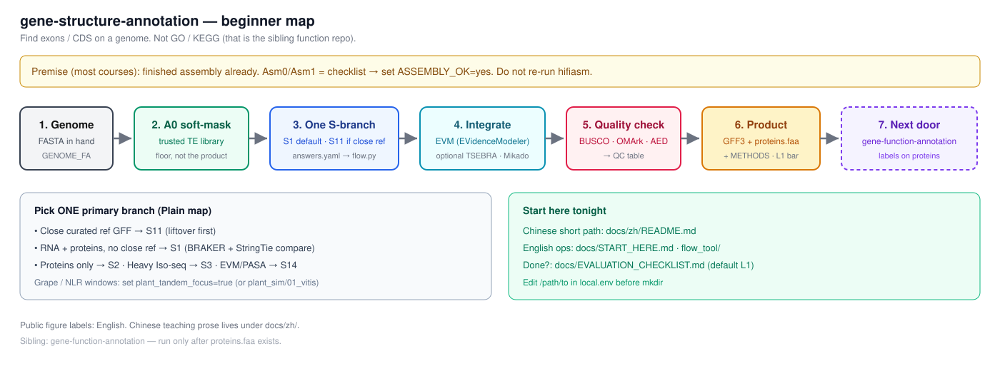

# gene-structure-annotation
[English](README.md)

本项目提供基因组结构注释的分析流程。
中文教学位于 [`docs/zh/`](docs/zh/)。
可运行的文档保持英文格式 [`docs/BILINGUAL.md`](docs/BILINGUAL.md)。
植物模拟数据位于 [`examples/plant_sim/`](examples/plant_sim/)。

## 概述

结构注释是核心层。它用于在基因组上寻找基因位置并提供坐标、GFF3 和蛋白质序列。



TE soft-mask 是必需的前置步骤。构建 TE 库是一项独立任务，请参考 [vitis-te](https://github.com/Xuzhen-Li/vitis-te) 和 [`docs/TE_LIBRARY.md`](docs/TE_LIBRARY.md)。
GO、KEGG 和易读名称位于相邻仓库 [`gene-function-annotation`](https://github.com/Xuzhen-Li/gene-function-annotation) 中。本仓库不生成功能注释表格。

三个层级：
1. 结构层：本仓库。
2. 功能层：[`gene-function-annotation`](https://github.com/Xuzhen-Li/gene-function-annotation)。
3. TE 库构建：[vitis-te](https://github.com/Xuzhen-Li/vitis-te) 和 [`TE_LIBRARY.md`](docs/TE_LIBRARY.md)。

边界定义详见 [`docs/BOUNDARY.md`](docs/BOUNDARY.md)。

中文最短路径位于 [`docs/zh/README.md`](docs/zh/README.md)。英文入口位于 [`docs/START_HERE.md`](docs/START_HERE.md)。
快速开始指南位于 [Wiki Start-tonight](https://github.com/Xuzhen-Li/gene-structure-annotation/wiki/Start-tonight)。离线版本位于 [`docs/CLASSROOM_TONIGHT.md`](docs/CLASSROOM_TONIGHT.md)。
任务看板位于 [Annotation board (Project #2)](https://github.com/users/Xuzhen-Li/projects/2)。

## 使用方法

中文教学入口为 [`docs/zh/`](docs/zh/)。
如果已完成组装，请将 Asm0/Asm1 视为检查清单，并设置 `ASSEMBLY_OK=yes`。在运行任何 `mkdir` 之前，修改 `local.env` 中的每一个 `/path/to`。
如果使用高质量的参考 GFF，请在问答中设置 `close_curated_ref: true`（参考 `examples/plant_sim/03_solanum_s11`）。默认 `false` 指向 S1；半成品的 Liftoff 保持 `false`。

第一步：提供证据文件。
```bash
git clone https://github.com/Xuzhen-Li/gene-structure-annotation.git
cd gene-structure-annotation
cp pipeline/flow_tool/answers.example.yaml my_answers.yaml
# edit yes/no: RNA? proteins? close reference? paper bar?
python3 pipeline/flow_tool/flow.py --answers my_answers.yaml -o my_plan.md
```
打开 `my_plan.md`，其中包含所选分支及各个阶段的说明。

第二步：配置路径。
```bash
cp config/example.env config/local.env
# set GENOME_FA, BUSCO_LINEAGE, RNA_BAM / PROTEIN_DB, TE lib, WORK_DIR, THREADS
```

第三步：执行分析。
完成 `my_plan.md`。阅读 [Wiki Concepts](https://github.com/Xuzhen-Li/gene-structure-annotation/wiki/Concepts) 或 [`docs/zh/05_softmask与A0.md`](docs/zh/05_softmask与A0.md)。单独填写 `grade=` 和 `status=`。不要填写 `status=L1`。
仅在勾选完 [Done when](https://github.com/Xuzhen-Li/gene-structure-annotation/wiki/Start-tonight#done-when) 且 `python3 pipeline/print_qc_commands.py` 退出码为 0 并无 `[STOP]` 提示后，在集群上运行。否则不要设置 `RUN=1`。使用 `--env config/example.env` 浏览时会显示 `[STOP]`；这是正常现象。
按照 `my_plan.md` 的阶段操作并对照 [`docs/EVALUATION_CHECKLIST.md`](docs/EVALUATION_CHECKLIST.md)。完整规则见 [`docs/EVALUATION.md`](docs/EVALUATION.md)。
临时结果不等于 L1。L0 与 L1 的区别请看 [`docs/EVALUATION.md`](docs/EVALUATION.md)。
包含 RNA 和蛋白质且无近缘参考序列的默认分支为 S1。
移交至功能注释请参考 [`docs/HANDOFF_STRUCTURE_TO_FUNCTION.md`](docs/HANDOFF_STRUCTURE_TO_FUNCTION.md)，需包含 `RELEASE_TAG` 和 `PROTEINS_FA=…/release/<TAG>/proteins.faa`。

## 分支路线

根据已有证据选择分支。
S11: 高质量参考 GFF (Liftoff, LiftOn, CAT)。仅 Lift 为 S11-lite。
S1: RNA 和蛋白质 (BRAKER, StringTie)。
S2: 仅蛋白质 (GALBA, GeMoMa)。
S3: 大量 Iso-seq 数据 (IsoQuant, SQANTI)。
S13: GPU 从头预测比冲 (Helixer, Tiberius, ANNEVO)。
S14: 完整经典 PASA 加 EVM 路线 (`docs/steps/dclab/`)。Integrate 步骤 (EVM) 仅在 S14 路线或存在第二套基因集（双轨，即两套基因预测结果）时运行。

叠加层：
L2: L1 接受标准叠加 S5 层，达到论文或 T2T 标准。
S7: 设置 `plant_tandem_focus: true` 时叠加植物 NLR 或串联重复区域分析。

完整路线图位于 [`docs/ROADMAP.md`](docs/ROADMAP.md)。

## 文档目录

中文教学和起点位于 [`docs/zh/`](docs/zh/) 和 [`docs/START_HERE.md`](docs/START_HERE.md)。

自动计划生成：[`pipeline/flow_tool/`](pipeline/flow_tool/)
阶段输入输出与评估：[`docs/STAGE_IO.md`](docs/STAGE_IO.md)、[`docs/EVALUATION_CHECKLIST.md`](docs/EVALUATION_CHECKLIST.md)、[`docs/EVALUATION.md`](docs/EVALUATION.md)
TE soft-mask：[`docs/TE_LIBRARY.md`](docs/TE_LIBRARY.md)、[`docs/TRUSTED_TE_PATH.md`](docs/TRUSTED_TE_PATH.md)
分支路线图与流程：[`docs/ROADMAP.md`](docs/ROADMAP.md)、[`docs/QUICKSTART.md`](docs/QUICKSTART.md)
三层边界定义：[`docs/BOUNDARY.md`](docs/BOUNDARY.md)
组装后说明单页：[`docs/POST_ASSEMBLY.md`](docs/POST_ASSEMBLY.md)
质控资源：[`docs/QUALITY_SOURCES.md`](docs/QUALITY_SOURCES.md)
EDTA 使用方法：[`docs/tools/edta.md`](docs/tools/edta.md)
BUSCO 参考库：[`docs/LINEAGES.md`](docs/LINEAGES.md)
S11 间隙填充：[`pipeline/A2e_s11_gapfill.md`](pipeline/A2e_s11_gapfill.md)、[`pipeline/A2c_liftoff.md`](pipeline/A2c_liftoff.md)
黄金数据集检查清单：[`examples/golden_pack/`](examples/golden_pack/)
蛋白质数据库：[`pipeline/A2_protein_db.md`](pipeline/A2_protein_db.md)
Helixer 与 BRAKER 对比：[`docs/COMPARE_HELIXER_BRAKER.md`](docs/COMPARE_HELIXER_BRAKER.md)
合并与输入模式：[`docs/MERGE_AND_ENTRIES.md`](docs/MERGE_AND_ENTRIES.md)
EGAPx 对比：[`docs/EGAPX_COMPARE.md`](docs/EGAPX_COMPARE.md)
场景与工具：[`docs/SCENARIOS.md`](docs/SCENARIOS.md)、[`docs/TOOLS.md`](docs/TOOLS.md)、[`docs/cases/vitis-t2t-s1-s5.md`](docs/cases/vitis-t2t-s1-s5.md)、[`docs/TUTORIALS_AND_MEETINGS.md`](docs/TUTORIALS_AND_MEETINGS.md)、[`docs/PLAYBOOK.md`](docs/PLAYBOOK.md)

## 适用范围

本项目不包含功能注释。GO/KEGG 注释请使用 [`gene-function-annotation`](https://github.com/Xuzhen-Li/gene-function-annotation)。
本项目不是独立的 TE 库构建工具。请参考 [vitis-te](https://github.com/Xuzhen-Li/vitis-te) 和 `docs/TE_LIBRARY.md`。
本项目不支持泛基因组图谱。请参考 [vitis-pangenome](https://github.com/Xuzhen-Li/vitis-pangenome)。
请勿上传私有 FASTQ/BAM 文件。

作者：Xuzhen Li，[ORCID](https://orcid.org/0000-0003-3670-6657)。