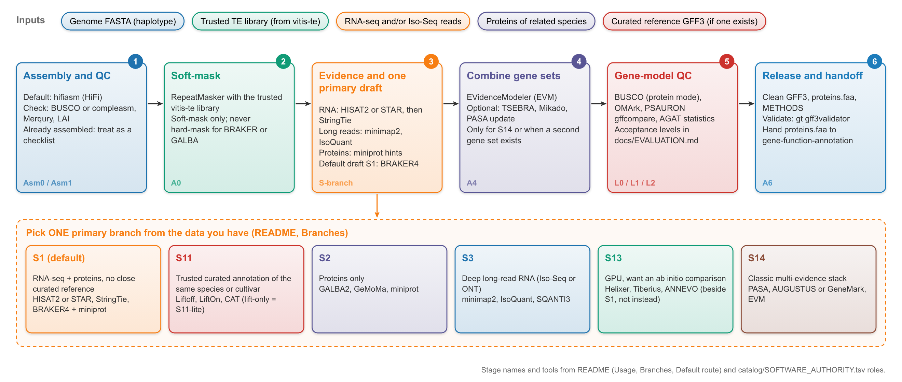

# Preface

This book is a study guide for structural annotation of plant genomes. It sits beside the gene-structure-annotation repository and explains what each step does, why it is there, which tools exist for it, and how to judge the result. The runnable workflow, stage IDs and acceptance levels stay in the repository ([`README.md`](../../README.md), [`docs/ROADMAP.md`](../../docs/ROADMAP.md), [`docs/EVALUATION.md`](../../docs/EVALUATION.md)); the book does not change the default route.

*Figure. The structural annotation route of this repository: six stages from assembly QC to the release handed to gene-function-annotation, with the default tool at each stage and the six primary branches (S1, S11, S2, S3, S13, S14). Pick one primary branch from the data you have. Schematic drawn for this repository from README (Usage, Branches, Default route); editable SVG: [`structure_route_map.svg`](../../docs/figures/guide/structure_route_map.svg).*

## How to read it

- Chapter 1 sets out the concepts: what a gene model is, the kinds of evidence, why repeats are soft-masked, and how quality is measured.
- Chapters 2 to 16 follow the fifteen type sections of the catalog in the README, one chapter per section. Each chapter repeats the section notes from the README, lists every tool with its paper, lab, tier and a short evaluation, and ends with the benchmark evidence for that step.
- Chapter 17 covers visualization. Chapter 18 explains how to choose tools for a data situation, Chapter 19 collects pitfalls and quality checks, and Chapter 20 walks through the grapevine teaching example in `examples/plant_sim/01_vitis_s1_s7/`.
- Appendix A is a glossary.

## Sources and how claims are marked

Every statement cites a paper by DOI or a file in this repository. A quote marked “Authors:” is a claim the tool authors make in their own abstract, not an independent result; independent results come from benchmark papers such as G3PO ([doi:10.1186/s12864-020-6707-9](https://doi.org/10.1186/s12864-020-6707-9)), RGASP ([doi:10.1038/nmeth.2714](https://doi.org/10.1038/nmeth.2714)) and LRGASP ([doi:10.1038/s41592-024-02298-3](https://doi.org/10.1038/s41592-024-02298-3)). Tiers and citation counts come from OpenAlex and were retrieved on 2026-11-25; a high count means a tool is widely used, not that it is the most accurate. Chinese teaching notes that go deeper into the repository workflow are in [`docs/zh/`](../../docs/zh/README.md).
