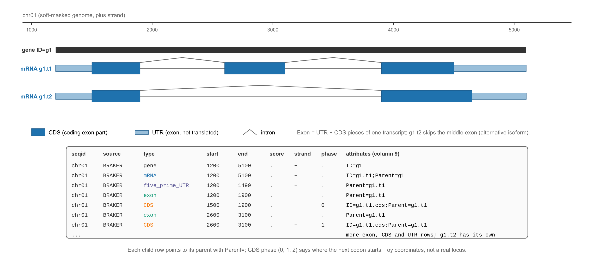

# 第 1 章 概念与原理

## 1.1 结构注释产出什么

结构注释在组装好的基因组上找出基因，把坐标写成 GFF3，并给出预测蛋白（主页“概述”）。基因模型是分层的：一个基因有一个或多个转录本（mRNA），每个转录本由外显子、编码区（CDS）和非翻译区（UTR）组成。这些部件的名称来自 Sequence Ontology，它是描述基因组注释各部分的受控词表，使数据交换和自动推理成为可能（[doi:10.1186/gb-2005-6-5-r44](https://doi.org/10.1186/gb-2005-6-5-r44)）。功能层（GO、KEGG、名称）在姊妹仓库 gene-function-annotation 中处理（主页“概述”）。

*图：基因模型是一个层级结构：一个基因，含一个或多个转录本（mRNA），外显子由 UTR 和 CDS 片段组成。下方表格把同一个模型写成 GFF3 行，用 `ID` 与 `Parent` 相连，并标出 CDS 的 phase。坐标为演示用，不是真实位点；示意图，为本仓库绘制。*

## 1.2 植物基因组为什么难

植物基因组大、转座子多、常为多倍体，而注释软件大多在模式生物上开发，缺乏广泛的评测（[doi:10.1002/aps3.11533](https://doi.org/10.1002/aps3.11533)）。错误会扩散：对 30 个新近注释基因组的调查确认了 605 个嵌合基因模型（相邻基因被错误合并成一个），多数出现在无脊椎动物和植物中（[doi:10.1186/s12864-025-11765-w](https://doi.org/10.1186/s12864-025-11765-w)）。注释来源也会改变下游分析：同一批基因组用四种注释来源，得到的直系同源推断明显不同（[doi:10.1093/bioinformatics/btaf365](https://doi.org/10.1093/bioinformatics/btaf365)）。

## 1.3 证据的种类

- **转录本证据。** 短读长 RNA-seq 比对后组装成转录本；长读长可直接给出全长异构体。RGASP 评测表明，多数工具能找准外显子，但组装完整异构体仍是主要难点（[doi:10.1038/nmeth.2714](https://doi.org/10.1038/nmeth.2714)）。
- **蛋白证据。** 把近缘物种的蛋白用剪接比对比到基因组上。miniprot 作者称其比旧工具快数十倍、准确度相当（[doi:10.1093/bioinformatics/btad014](https://doi.org/10.1093/bioinformatics/btad014)）。
- **从头预测。** AUGUSTUS 和 GeneMark 系列等统计模型从基因组本身学习基因结构。独立的 G3PO 评测发现，在草图组装上从头预测结构非常困难（[doi:10.1186/s12864-020-6707-9](https://doi.org/10.1186/s12864-020-6707-9)）。
- **深度学习。** Helixer 和 Tiberius 把神经网络与隐马尔可夫模型结合。Helixer 提供真菌、植物、脊椎和无脊椎动物的预训练模型，不需要 RNA-seq（[doi:10.1038/s41592-025-02939-1](https://doi.org/10.1038/s41592-025-02939-1)）；Tiberius 在哺乳动物上训练和测试（[doi:10.1093/bioinformatics/btae685](https://doi.org/10.1093/bioinformatics/btae685)）。
- **从近缘注释转移。** Liftoff 在同种或近缘物种的组装之间映射基因（[doi:10.1093/bioinformatics/btaa1016](https://doi.org/10.1093/bioinformatics/btaa1016)）；LiftOn 加入蛋白比对，可映射到更远的物种（[doi:10.1101/gr.279620.124](https://doi.org/10.1101/gr.279620.124)）。

## 1.4 重复序列的 soft-mask

不标记重复和转座子会产生假基因。soft-mask 把重复碱基写成小写，预测软件可以降低其权重而不删除序列。本仓库用 vitis-te 构建的可信 TE 库做屏蔽；这一步只做 soft-mask，BRAKER 和 GALBA 前绝不 hard-mask；soft-mask 比例衡量的是与该库的相似程度，不是基因组的 TE 百分比（`examples/plant_sim/01_vitis_s1_s7/plan.md` 与 `env.snippet`）。

## 1.5 合并证据

单一证据不够。在五个植物基因组上比较 BRAKER 与 MAKER 的研究发现，仅靠 RNA 比对得到的转录本不够，建议把证据预测与从头预测结合（[doi:10.1002/aps3.11533](https://doi.org/10.1002/aps3.11533)）。EVidenceModeler 对全部证据做加权共识，作者称在水稻和人类上接近人工校对的质量（[doi:10.1186/gb-2008-9-1-r7](https://doi.org/10.1186/gb-2008-9-1-r7)）。BRAKER3 同时使用 RNA-seq 和蛋白库，在 11 个基因组上优于 BRAKER1、BRAKER2、MAKER2、Funannotate 和 FINDER（[doi:10.1101/gr.278090.123](https://doi.org/10.1101/gr.278090.123)）。

## 1.6 质量怎么衡量

完整度工具（BUSCO、compleasm）统计保守单拷贝基因；compleasm 称在人类组装上比 BUSCO 快 14 倍（[doi:10.1093/bioinformatics/btad595](https://doi.org/10.1093/bioinformatics/btad595)）。OMArk 还检查与近缘物种的一致性并报告污染（[doi:10.1038/s41587-024-02147-w](https://doi.org/10.1038/s41587-024-02147-w)）。PSAURON 为每个蛋白打分，判断其是真实编码序列的可能性（[doi:10.1093/nargab/lqae189](https://doi.org/10.1093/nargab/lqae189)）。仓库的验收等级（L0、L1、L2）见 [`docs/EVALUATION.md`](../../docs/EVALUATION.md)。

## 1.7 命名

基因编号和名称遵循社区规则；葡萄由国际葡萄基因组计划建立了命名体系（[doi:10.1186/1471-2164-15-1077](https://doi.org/10.1186/1471-2164-15-1077)）。
