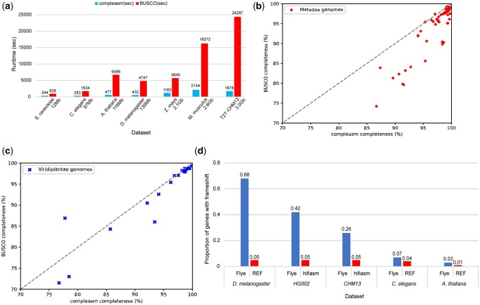

# Chapter 2. Assembly and assembly QC

*This chapter reproduces [README section 1](../../README.md#section-1): the section notes, the full tool table with paper, lab, tier and evaluation, and the benchmark notes. Links point back into the repository.*

Tools that decide whether an assembly is ready to annotate, or that produce the haplotype FASTA itself (Asm0, Asm1).

**Needs:** the assembly FASTA; add the assembly reads when checking k-mers or base accuracy. BUSCO needs a lineage that matches the clade (see `docs/LINEAGES.md`). [Data needs by scenario](../../README.md#data-needs)

**Clusters:**
- *Assemble and scaffold* (alternatives): hifiasm, Verkko, YaHS, RagTag. hifiasm is the default for HiFi (+Hi-C); pick Verkko when ultra-long ONT is available for T2T. Scaffold with YaHS when Hi-C is available; use RagTag only with a close reference.
- *Accuracy and completeness* (complementary): Merqury, CRAQ, Inspector, GCI, compleasm, LTR Assembly Index (LAI), QUAST, gfastats. Run together: Merqury for QV, compleasm for gene space, and LAI for repeat space; CRAQ and Inspector locate error sites; gfastats and QUAST generate summary tables.
- *Contamination and chromosome ends* (complementary): NCBI FCS-GX, BlobToolKit, Tiara, tidk, quarTeT. FCS-GX is required before NCBI submission; BlobToolKit and Tiara classify flagged contigs. tidk and quarTeT confirm telomeres on T2T chromosomes.
- *Read k-mer profiling* (complementary): GenomeScope 2.0 / Smudgeplot, KAT (K-mer Analysis Toolkit). Run before or right after assembly to estimate genome size, heterozygosity and ploidy from reads.

*compleasm compared with BUSCO on the same assemblies (Fig. 1). Huang and Li 2023, Bioinformatics, Fig. 1, doi:10.1093/bioinformatics/btad595, PMC10558035, CC BY.*

| Tool | Role | What it does / when to use | Paper | Lab (corresponding author, institution) | Tier · citations | Evaluation (source) |
|---|---|---|---|---|---|---|
| [hifiasm](https://github.com/chhylp123/hifiasm) | default (HiFi) | Haplotype-resolved de novo assembler for PacBio HiFi reads (trio, Hi-C or ultra-long phasing modes). | [Nature Methods 2021](https://doi.org/10.1038/s41592-020-01056-5) | Heng Li (Harvard University) | standard · 6724 | GitHub last push 2026-05 |
| [Verkko](https://github.com/marbl/verkko) | alternative | Telomere-to-telomere diploid assembly combining HiFi and ultra-long ONT reads in a graph. | [Nature Biotechnology 2023](https://doi.org/10.1038/s41587-023-01662-6) | Adam M. Phillippy (National Institutes of Health) +1 | established · 464 | GitHub last push 2026-11 |
| [YaHS](https://github.com/c-zhou/yahs) | alternative | Hi-C scaffolder producing chromosome-scale scaffolds from contigs. | [Bioinformatics 2022](https://doi.org/10.1093/bioinformatics/btac808) | Richard Michael Durbin (University of Cambridge) | standard · 2689 | Authors: “It can be run with a single-line command, requires minimal input from users (an assembly file and an alignment file) which is compatible with similar tools and provides assembly results in multiple formats, thereby enabling rapid, robust and scalable …”; GitHub last push 2024-11 |
| [RagTag](https://github.com/malonge/RagTag) | alternative | Reference-guided correction, scaffolding and patching of draft assemblies. | [Genome biology 2022](https://doi.org/10.1186/s13059-022-02823-7) | Michael C. Schatz (Johns Hopkins University) +1 | standard · 1166 | Paper: “Here, we introduce RagTag, a toolset for automating assembly scaffolding and patching, and we establish chromosome-scale reference genomes for the widely used tomato genotype M82 along with Sweet-100, a new rapid-cycling genotype that we developed to …”; GitHub last push 2026-10 |
| [GenomeScope 2.0 / Smudgeplot](https://github.com/tbenavi1/genomescope2.0) | alternative | k-mer profiling of genome size, heterozygosity and ploidy from reads. | [Nature Communications 2020](https://doi.org/10.1038/s41467-020-14998-3) | T. Rhyker Ranallo-Benavidez (Johns Hopkins University) | standard · 3192 | Authors: “We describe and evaluate a practical implementation of the polyploid-aware mixture model that quickly and accurately infers genome properties across thousands of simulated and several real datasets spanning a broad range of complexity.”; GitHub last push 2025-10 |
| [Merqury](https://github.com/marbl/merqury) | alternative | Reference-free k-mer QV, completeness and phasing assessment of assemblies. | [Genome biology 2020](https://doi.org/10.1186/s13059-020-02134-9) | Arang Rhie (National Institutes of Health) | standard · 4080 | Authors: “By comparing k-mers in a de novo assembly to those found in unassembled high-accuracy reads, Merqury estimates base-level accuracy and completeness.”; GitHub last push 2026-07 |
| [QUAST](https://github.com/ablab/quast) | alternative | Assembly contiguity and misassembly statistics, optionally against a reference. | [Bioinformatics 2013](https://doi.org/10.1093/bioinformatics/btt086) | Glenn Tesler (Saint Petersburg Academic University) | standard · 12516 | Authors: “This tool improves on leading assembly comparison software with new ideas and quality metrics.”; GitHub last push 2026-11 |
| [Inspector](https://github.com/Maggi-Chen/Inspector) | alternative | Reference-free assembly evaluation and error correction using long reads. | [Genome biology 2021](https://doi.org/10.1186/s13059-021-02527-4) | Zechen Chong (University of Alabama at Birmingham) | established · 249 | Authors: “Based on in silico and long-read assembly results from multiple long-read data and assemblers, we demonstrate that in addition to providing generic metrics, Inspector can accurately identify both large-scale and small-scale assembly errors.”; GitHub last push 2024-08 |
| [KAT (K-mer Analysis Toolkit)](https://github.com/EarlhamInst/KAT) | alternative | k-mer spectra comparison of reads vs assembly (copy-number plots). | [Bioinformatics 2016](https://doi.org/10.1093/bioinformatics/btw663) | Bernardo Clavijo (Earlham Institute) | standard · 630 | Paper: “We present the K-mer Analysis Toolkit (KAT): a multi-purpose software toolkit for reference-free quality control (QC) of WGS reads and de novo genome assemblies, primarily via their k-mer frequencies and GC composition.”; GitHub last push 2022-11 |
| [BlobToolKit](https://github.com/genomehubs/blobtoolkit) | alternative | Interactive GC/coverage/taxonomy plots to spot contaminant contigs. | [G3 Genes Genomes Genetics 2020](https://doi.org/10.1534/g3.119.400908) | RICHARD J. CHALLIS (Wellcome Sanger Institute) | standard · 2759 | Paper: “We present BlobToolKit, a software suite to aid researchers in identifying and isolating non-target data in draft and publicly available genome assemblies.”; GitHub last push 2026-11 |
| [Tiara](https://github.com/ibe-uw/tiara) | alternative | Deep-learning classification of contigs into nuclear, organellar and prokaryotic origin. | [Bioinformatics 2021](https://doi.org/10.1093/bioinformatics/btab672) | Anna Karnkowska (University of Warsaw) | established · 185 | Authors: “Using the test dataset, we have shown that Tiara performed similarly to EukRep for prokaryotes classification and outperformed it for eukaryotes classification with lower calculation time.”; GitHub last push 2024-03 |
| [tidk](https://github.com/tolkit/telomeric-identifier) | alternative | Finds and plots telomeric repeats along an assembly. | [Bioinformatics 2025](https://doi.org/10.1093/bioinformatics/btaf049) | Max R. Brown (Anglia Ruskin University) | established · 204 | Authors: “Our algorithm is shown to be accurate in genomes for which the telomeric repeat unit is known and is tested across a wide variety of newly assembled genomes to uncover new telomeric repeat units.”; GitHub last push 2026-11 |
| [quarTeT](https://github.com/aaranyue/quarTeT) | alternative | Telomere-to-telomere toolkit: reference-guided assembly, gap filling, telomere and centromere identification. | [Horticulture Research 2023](https://doi.org/10.1093/hr/uhad127) | Yi Yue (Anhui Agricultural University) +2 | established · 426 | Authors: “As a case study, by adopting the entire modular functions of quarTeT, we have achieved the Actinidia chinensis genome assembly that is of a quality comparable to the reported genome Hongyang v4.0, which was assembled with the addition of manual handling.”; GitHub last push 2026-06 |
| [GCI](https://github.com/yeeus/GCI) | alternative | Genome Continuity Inspector: read-mapping based continuity score for near-complete assemblies. | [Bioinformatics 2024](https://doi.org/10.1093/bioinformatics/btae633) | Guojie Zhang (Women's Hospital, School of Medicine, Zhejiang University) +1 | newer · 46 | Paper: “Here, we present a tool called Genome Continuity Inspector (GCI), designed to assess genome assembly continuity at single-base resolution, and evaluate how close an assembly is to the T2T level.”; GitHub last push 2026-11 |
| [gfastats](https://github.com/vgl-hub/gfastats) | alternative | Fast summary statistics and manipulation of FASTA/GFA assemblies. | [Bioinformatics 2022](https://doi.org/10.1093/bioinformatics/btac460) | Giulio Formenti (Rockefeller University) | standard · 1400 | GitHub last push 2026-11 |
| [CRAQ](https://github.com/JiaoLaboratory/CRAQ) | alternative | Reference-free assembly assessment from clipped-read alignments (regional and structural errors). | no paper | — | no paper | Repo description: “Identification of errors in draft genome assemblies with single-base pair resolution for quality assessment and improvement”; GitHub last push 2025-12 |
| [NCBI FCS-GX](https://github.com/ncbi/fcs) | alternative | Detects and removes foreign-organism contamination in assemblies before submission/annotation. | [Genome biology 2024](https://doi.org/10.1186/s13059-024-03198-7) | Terence D. Murphy (National Institutes of Health) | standard · 605 | Authors: “Testing FCS-GX on artificially fragmented genomes demonstrates high sensitivity and specificity for diverse contaminant species.”; GitHub last push 2025-03 |
| [compleasm](https://github.com/huangnengCSU/compleasm) | alternative | Reimplements BUSCO on top of miniprot using the same lineage sets; much faster and often more accurate for gene-space completeness in large plant assemblies. | [Bioinformatics 2023](https://doi.org/10.1093/bioinformatics/btad595) | Heng Li (Harvard University) | established · 423 | Authors: “It is 14 times faster than BUSCO for human assemblies and reports a more accurate completeness of 99.6% than BUSCO’s 95.7%, which is in close agreement with the annotation completeness of 99.5% for T2T-CHM13.”; GitHub last push 2026-10 |
| [LTR Assembly Index (LAI)](https://github.com/oushujun/LTR_retriever) | alternative | Scores the proportion of intact LTR retrotransposon (LTR-RT) length to total LTR-RT length in an assembly; a repeat-space check that complements BUSCO before annotation. | [Nucleic Acids Research 2018](https://doi.org/10.1093/nar/gky730) | Shujun Ou (Michigan State University) | standard · 947 | Authors: “Moreover, LAI can facilitate iterative assembly improvement with assembler selection and identify low-quality genomic regions.”; GitHub last push 2026-11 |
| [purge_dups](https://github.com/dfguan/purge_dups) | alternative | Removes haplotypic duplicates and overlaps from a primary assembly using read depth; run before annotation on heterozygous genomes. | [Bioinformatics 2020](https://doi.org/10.1093/bioinformatics/btaa025) | Yadong Wang (Harbin Institute of Technology) +1 | standard · 2887 | Authors: “In comparison with current tools, we demonstrate that purge_dups can reduce heterozygous duplication and increase assembly continuity while maintaining completeness of the primary assembly.”; GitHub last push 2025-10 |
| [Purge Haplotigs](https://bitbucket.org/mroachawri/purge_haplotigs) | alternative | Reassigns allelic contigs out of a diploid primary assembly using coverage; older alternative to purge_dups. | [BMC Bioinformatics 2018](https://doi.org/10.1186/s12859-018-2485-7) | Michael J. Roach (Australian Wine Research Institute) | standard · 1263 | Authors: “Purge Haplotigs improves the haploid and diploid representations of third-gen sequencing based genome assemblies by identifying and reassigning allelic contigs.” |
| [LTR_retriever](https://github.com/oushujun/LTR_retriever) | alternative | Filters LTR retrotransposon candidates to a high-confidence set; it is the program that computes LAI. | [PLANT PHYSIOLOGY 2017](https://doi.org/10.1104/pp.17.01310) | Ning Jiang (Michigan State University) | standard · 1703 | Authors: “LTR_retriever demonstrated significant improvements by achieving high levels of sensitivity (91%), specificity (97%), accuracy (96%), and precision (90%) in rice (Oryza sativa).”; GitHub last push 2026-11 |
