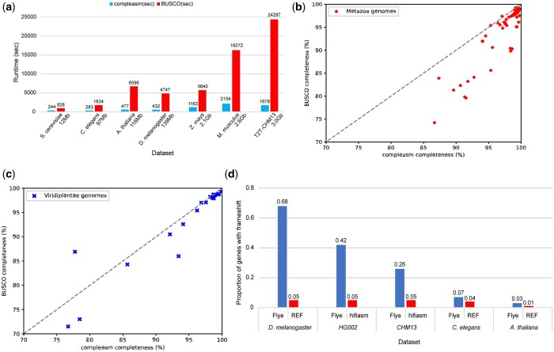

# 第 2 章 组装与组装质控

*本章收录[主页第 1 节](../../README.zh.md#section-1)：该节说明、含论文、实验室、权威度和评价的完整工具表，以及评测要点。链接指回仓库。*

用于判断组装能否进入注释，或直接生成单倍型 FASTA 的工具（Asm0、Asm1）。

**需要：** 组装 FASTA；若需检查 k-mer 或碱基准确度，还需附上组装所用的测序读长。BUSCO 需选用与类群匹配的 lineage（见 `docs/LINEAGES.md`）。[按场景列出的数据需求](../../README.zh.md#data-needs)

**分组：**
- *组装与挂载*（可替代）：hifiasm、Verkko、YaHS、RagTag。HiFi（+Hi-C）默认用 hifiasm；有超长 ONT 且要做 T2T 时选 Verkko。有 Hi-C 时用 YaHS 挂载；仅有近缘参考时才用 RagTag。
- *准确度与完整性*（互补）：Merqury、CRAQ、Inspector、GCI、compleasm、LTR Assembly Index (LAI)、QUAST、gfastats。配合使用：Merqury 算 QV，compleasm 评基因空间，LAI 评重复序列区；CRAQ 和 Inspector 定位组装错误；gfastats 和 QUAST 生成汇总表。
- *污染与染色体末端*（互补）：NCBI FCS-GX、BlobToolKit、Tiara、tidk、quarTeT。提交 NCBI 前必须运行 FCS-GX；BlobToolKit 和 Tiara 用于判定被标记 contig 的来源。tidk 和 quarTeT 用于确认 T2T 染色体两端的端粒。
- *读长 k-mer 概况*（互补）：GenomeScope 2.0 / Smudgeplot、KAT (K-mer Analysis Toolkit)。在组装前或组装刚完成时运行，根据读长估计基因组大小、杂合度和倍性。

各条目的单句简介译自英文目录，英文原句见英文版 README。

*同一批组装上 compleasm 与 BUSCO 的表现对比（图 1）。 Huang 与 Li 2023，《Bioinformatics》图 1，doi:10.1093/bioinformatics/btad595，PMC10558035，CC BY。*

| 工具 | 角色 | 用途 / 何时用 | 原始论文 | 实验室（通讯作者，机构） | 权威度（档位 · 被引） | 评价（出处） |
|---|---|---|---|---|---|---|
| [hifiasm](https://github.com/chhylp123/hifiasm) | 默认（HiFi） | 面向 PacBio HiFi 读长的单倍型分型从头组装工具（支持 trio、Hi-C 或超长读长分型模式）。 | [Nature Methods 2021](https://doi.org/10.1038/s41592-020-01056-5) | Heng Li (Harvard University) | 标准 · 6724 次 | GitHub 最后提交 2026-05 |
| [Verkko](https://github.com/marbl/verkko) | 备选 | 在组装图中结合 HiFi 与超长 ONT 读长的端粒到端粒（T2T）二倍体组装工具。 | [Nature Biotechnology 2023](https://doi.org/10.1038/s41587-023-01662-6) | Adam M. Phillippy (National Institutes of Health) +1 | 成熟 · 464 次 | GitHub 最后提交 2026-11 |
| [YaHS](https://github.com/c-zhou/yahs) | 备选 | 利用 Hi-C 数据将 contig 挂载为染色体级别 scaffold 的组装工具。 | [Bioinformatics 2022](https://doi.org/10.1093/bioinformatics/btac808) | Richard Michael Durbin (University of Cambridge) | 标准 · 2689 次 | 作者摘要原句：“It can be run with a single-line command, requires minimal input from users (an assembly file and an alignment file) which is compatible with similar tools and provides assembly results in multiple formats, thereby enabling rapid, robust and scalable …”；GitHub 最后提交 2024-11 |
| [RagTag](https://github.com/malonge/RagTag) | 备选 | 基于参考基因组对草案组装做纠错、挂载（scaffolding）与补洞（patching）的工具。 | [Genome biology 2022](https://doi.org/10.1186/s13059-022-02823-7) | Michael C. Schatz (Johns Hopkins University) +1 | 标准 · 1166 次 | 论文摘要：“Here, we introduce RagTag, a toolset for automating assembly scaffolding and patching, and we establish chromosome-scale reference genomes for the widely used tomato genotype M82 along with Sweet-100, a new rapid-cycling genotype that we developed to …”；GitHub 最后提交 2026-10 |
| [GenomeScope 2.0 / Smudgeplot](https://github.com/tbenavi1/genomescope2.0) | 备选 | 根据测序读长的 k-mer 分布估算基因组大小、杂合度与倍性。 | [Nature Communications 2020](https://doi.org/10.1038/s41467-020-14998-3) | T. Rhyker Ranallo-Benavidez (Johns Hopkins University) | 标准 · 3192 次 | 作者摘要原句：“We describe and evaluate a practical implementation of the polyploid-aware mixture model that quickly and accurately infers genome properties across thousands of simulated and several real datasets spanning a broad range of complexity.”；GitHub 最后提交 2025-10 |
| [Merqury](https://github.com/marbl/merqury) | 备选 | 无需参考基因组，基于 k-mer 评估组装的碱基质量值（QV）、完整性与分型质量。 | [Genome biology 2020](https://doi.org/10.1186/s13059-020-02134-9) | Arang Rhie (National Institutes of Health) | 标准 · 4080 次 | 作者摘要原句：“By comparing k-mers in a de novo assembly to those found in unassembled high-accuracy reads, Merqury estimates base-level accuracy and completeness.”；GitHub 最后提交 2026-07 |
| [QUAST](https://github.com/ablab/quast) | 备选 | 统计组装连续性与错误组装指标，可选用参考基因组作比对。 | [Bioinformatics 2013](https://doi.org/10.1093/bioinformatics/btt086) | Glenn Tesler (Saint Petersburg Academic University) | 标准 · 12516 次 | 作者摘要原句：“This tool improves on leading assembly comparison software with new ideas and quality metrics.”；GitHub 最后提交 2026-11 |
| [Inspector](https://github.com/Maggi-Chen/Inspector) | 备选 | 利用长读长数据做无参考组装评估与碱基纠错。 | [Genome biology 2021](https://doi.org/10.1186/s13059-021-02527-4) | Zechen Chong (University of Alabama at Birmingham) | 成熟 · 249 次 | 作者摘要原句：“Based on in silico and long-read assembly results from multiple long-read data and assemblers, we demonstrate that in addition to providing generic metrics, Inspector can accurately identify both large-scale and small-scale assembly errors.”；GitHub 最后提交 2024-08 |
| [KAT (K-mer Analysis Toolkit)](https://github.com/EarlhamInst/KAT) | 备选 | 比较测序读长与组装结果的 k-mer 频谱（绘制拷贝数分布图）。 | [Bioinformatics 2016](https://doi.org/10.1093/bioinformatics/btw663) | Bernardo Clavijo (Earlham Institute) | 标准 · 630 次 | 论文摘要：“We present the K-mer Analysis Toolkit (KAT): a multi-purpose software toolkit for reference-free quality control (QC) of WGS reads and de novo genome assemblies, primarily via their k-mer frequencies and GC composition.”；GitHub 最后提交 2022-11 |
| [BlobToolKit](https://github.com/genomehubs/blobtoolkit) | 备选 | 通过交互式 GC 含量、覆盖度与物种分类图识别污染 contig。 | [G3 Genes Genomes Genetics 2020](https://doi.org/10.1534/g3.119.400908) | RICHARD J. CHALLIS (Wellcome Sanger Institute) | 标准 · 2759 次 | 论文摘要：“We present BlobToolKit, a software suite to aid researchers in identifying and isolating non-target data in draft and publicly available genome assemblies.”；GitHub 最后提交 2026-11 |
| [Tiara](https://github.com/ibe-uw/tiara) | 备选 | 利用深度学习将 contig 划分为核基因组、细胞器基因组或原核生物来源。 | [Bioinformatics 2021](https://doi.org/10.1093/bioinformatics/btab672) | Anna Karnkowska (University of Warsaw) | 成熟 · 185 次 | 作者摘要原句：“Using the test dataset, we have shown that Tiara performed similarly to EukRep for prokaryotes classification and outperformed it for eukaryotes classification with lower calculation time.”；GitHub 最后提交 2024-03 |
| [tidk](https://github.com/tolkit/telomeric-identifier) | 备选 | 在组装序列上检索端粒重复序列并绘图。 | [Bioinformatics 2025](https://doi.org/10.1093/bioinformatics/btaf049) | Max R. Brown (Anglia Ruskin University) | 成熟 · 204 次 | 作者摘要原句：“Our algorithm is shown to be accurate in genomes for which the telomeric repeat unit is known and is tested across a wide variety of newly assembled genomes to uncover new telomeric repeat units.”；GitHub 最后提交 2026-11 |
| [quarTeT](https://github.com/aaranyue/quarTeT) | 备选 | 端粒到端粒（T2T）分析工具包：涵盖基于参考的组装、补洞以及端粒与着丝粒识别。 | [Horticulture Research 2023](https://doi.org/10.1093/hr/uhad127) | Yi Yue (Anhui Agricultural University) +2 | 成熟 · 426 次 | 作者摘要原句：“As a case study, by adopting the entire modular functions of quarTeT, we have achieved the Actinidia chinensis genome assembly that is of a quality comparable to the reported genome Hongyang v4.0, which was assembled with the addition of manual handling.”；GitHub 最后提交 2026-06 |
| [GCI](https://github.com/yeeus/GCI) | 备选 | Genome Continuity Inspector：基于读长回贴计算近完整组装的连续性得分。 | [Bioinformatics 2024](https://doi.org/10.1093/bioinformatics/btae633) | Guojie Zhang (Women's Hospital, School of Medicine, Zhejiang University) +1 | 较新 · 46 次 | 论文摘要：“Here, we present a tool called Genome Continuity Inspector (GCI), designed to assess genome assembly continuity at single-base resolution, and evaluate how close an assembly is to the T2T level.”；GitHub 最后提交 2026-11 |
| [gfastats](https://github.com/vgl-hub/gfastats) | 备选 | 对 FASTA/GFA 格式组装文件做快速统计与处理的工具。 | [Bioinformatics 2022](https://doi.org/10.1093/bioinformatics/btac460) | Giulio Formenti (Rockefeller University) | 标准 · 1400 次 | GitHub 最后提交 2026-11 |
| [CRAQ](https://github.com/JiaoLaboratory/CRAQ) | 备选 | 根据软剪切（clipped）读长比对结果做无参考组装评估，检测局部与结构组装错误。 | 无文章 | — | 无论文 | 仓库简介：“Identification of errors in draft genome assemblies with single-base pair resolution for quality assessment and improvement”；GitHub 最后提交 2025-12 |
| [NCBI FCS-GX](https://github.com/ncbi/fcs) | 备选 | 在提交或注释前检测并剔除组装中的外源物种污染。 | [Genome biology 2024](https://doi.org/10.1186/s13059-024-03198-7) | Terence D. Murphy (National Institutes of Health) | 标准 · 605 次 | 作者摘要原句：“Testing FCS-GX on artificially fragmented genomes demonstrates high sensitivity and specificity for diverse contaminant species.”；GitHub 最后提交 2025-03 |
| [compleasm](https://github.com/huangnengCSU/compleasm) | 备选 | 基于 miniprot 重新实现 BUSCO，沿用同一套谱系数据集；在大型植物组装上评估基因空间完整性速度更快，结果往往也更准。 | [Bioinformatics 2023](https://doi.org/10.1093/bioinformatics/btad595) | Heng Li (Harvard University) | 成熟 · 423 次 | 作者摘要原句：“It is 14 times faster than BUSCO for human assemblies and reports a more accurate completeness of 99.6% than BUSCO’s 95.7%, which is in close agreement with the annotation completeness of 99.5% for T2T-CHM13.”；GitHub 最后提交 2026-10 |
| [LTR Assembly Index (LAI)](https://github.com/oushujun/LTR_retriever) | 备选 | 根据组装中保留的完整 LTR 反转录转座子比例打分；用于在注释前检查重复序列区连续性，与 BUSCO 互补。 | [Nucleic Acids Research 2018](https://doi.org/10.1093/nar/gky730) | Shujun Ou (Michigan State University) | 标准 · 947 次 | 作者摘要原句：“Moreover, LAI can facilitate iterative assembly improvement with assembler selection and identify low-quality genomic regions.”；GitHub 最后提交 2026-11 |
| [purge_dups](https://github.com/dfguan/purge_dups) | 备选 | 按读段深度去除主组装中的单倍型重复和重叠片段；杂合基因组注释前先跑。 | [Bioinformatics 2020](https://doi.org/10.1093/bioinformatics/btaa025) | Yadong Wang (Harbin Institute of Technology) +1 | 标准 · 2887 次 | 作者摘要原句：“In comparison with current tools, we demonstrate that purge_dups can reduce heterozygous duplication and increase assembly continuity while maintaining completeness of the primary assembly.”；GitHub 最后提交 2025-10 |
| [Purge Haplotigs](https://bitbucket.org/mroachawri/purge_haplotigs) | 备选 | 用覆盖度把等位 contig 移出二倍体主组装；purge_dups 之前的替代工具。 | [BMC Bioinformatics 2018](https://doi.org/10.1186/s12859-018-2485-7) | Michael J. Roach (Australian Wine Research Institute) | 标准 · 1263 次 | 作者摘要原句：“Purge Haplotigs improves the haploid and diploid representations of third-gen sequencing based genome assemblies by identifying and reassigning allelic contigs.” |
| [LTR_retriever](https://github.com/oushujun/LTR_retriever) | 备选 | 把 LTR 反转录转座子候选过滤成高可信集合；LAI 由它计算。 | [PLANT PHYSIOLOGY 2017](https://doi.org/10.1104/pp.17.01310) | Ning Jiang (Michigan State University) | 标准 · 1703 次 | 作者摘要原句：“LTR_retriever demonstrated significant improvements by achieving high levels of sensitivity (91%), specificity (97%), accuracy (96%), and precision (90%) in rice (Oryza sativa).”；GitHub 最后提交 2026-11 |
