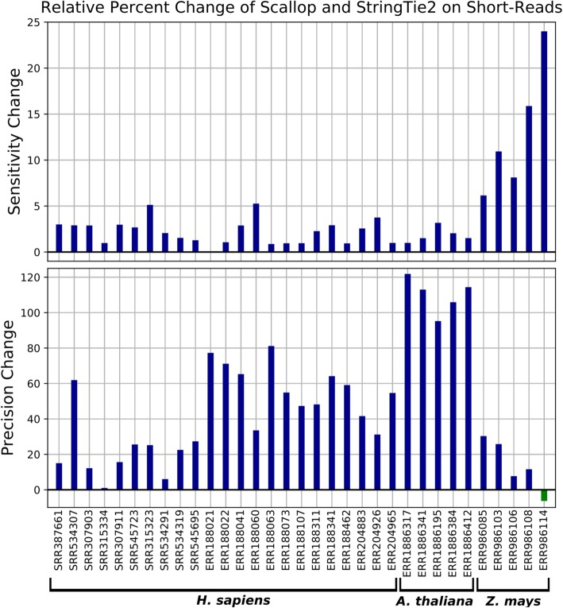
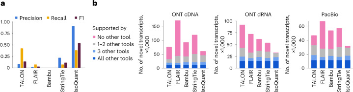

# Chapter 4. RNA and Iso-Seq evidence

*This chapter reproduces [README section 3](../../README.md#section-3): the section notes, the full tool table with paper, lab, tier and evaluation, and the benchmark notes. Links point back into the repository.*

Short-read and long-read RNA alignment, transcript assembly and ORF calling used as evidence for gene models (A1b).

**Needs:** short-read RNA-seq from the same genotype where possible (FASTQ or a ready `RNA_BAM`); for the S3 branch, add deep Iso-Seq / long-read RNA. [Data needs by scenario](../../README.md#data-needs)

**Clusters:**
- *Short-read path* (in order): fastp, HISAT2 or STAR, Portcullis, StringTie (v3 line) or Scallop2 or Aletsch. Trim, align, filter junctions with Portcullis before assembly, then assemble: StringTie is the default; Scallop2 or Aletsch for many shallow samples. TransDecoder can then call ORFs on the assembled transcripts.
- *Trinity route* (in order): Trinity, PASA, TransDecoder. Only when a genome-free transcript assembly is needed: PASA aligns and updates the Trinity assemblies, then TransDecoder calls ORFs.
- *Long-read isoforms* (in order): IsoSeq (PacBio), IsoQuant or Bambu or FLAIR or Mandalorion or ESPRESSO or TAMA or FLIC (Full-length isoform constructor) or Isocall or TAGET, SQANTI3. IsoSeq preprocessing applies to PacBio reads only. Pick one isoform builder: IsoQuant is the default, FLAIR suits ONT, Mandalorion accurate reads. Always finish with SQANTI3 QC before isoforms become evidence.
- *Long-read aligners* (alternatives): minimap2, uLTRA, deSALT. minimap2 splice mode is the default; uLTRA improves small-exon alignment when an annotation exists.
- *Translation evidence* (complementary): RiboCode, Ribo-TISH, RiboBA, PhyloCSF++, KuPID. Use only for small ORFs, uORFs or disputed start sites; requires Ribo-seq or conservation tracks.

*StringTie2 transcript assembly on plant RNA-seq (Fig. 2). Kovaka et al. 2019, Genome Biol., Fig. 2, doi:10.1186/s13059-019-1910-1, PMC6912988, CC BY.*

*IsoQuant on real long RNA reads (Fig. 2). The source panel is short (719×189). Prjibelski et al. 2023, Nat. Biotechnol., Fig. 2, doi:10.1038/s41587-022-01565-y, PMC10344776, CC BY.*

| Tool | Role | What it does / when to use | Paper | Lab (corresponding author, institution) | Tier · citations | Evaluation (source) |
|---|---|---|---|---|---|---|
| [HISAT2](https://github.com/DaehwanKimLab/hisat2) | default route (HISAT2 or STAR) | Spliced aligner for short RNA-seq reads (graph-based index). | [Nature Biotechnology 2019](https://doi.org/10.1038/s41587-019-0201-4) | Daehwan Kim (The University of Texas Southwestern Medical Center) | standard · 17059 | GitHub last push 2026-07 |
| [STAR](https://github.com/alexdobin/STAR) | default route (HISAT2 or STAR) | Ultrafast spliced short-read aligner with two-pass junction discovery. | [Bioinformatics 2012](https://doi.org/10.1093/bioinformatics/bts635) | Alexander Dobin (Cold Spring Harbor Laboratory) | standard · 56248 | Authors: “STAR outperforms other aligners by a factor of >50 in mapping speed, aligning to the human genome 550 million 2 × 76 bp paired-end reads per hour on a modest 12-core server, while at the same time improving alignment sensitivity and precision.”; GitHub last push 2025-03 |
| [minimap2](https://github.com/lh3/minimap2) | default (long-read aligner) | Long-read and cDNA/Iso-Seq spliced aligner (-ax splice). | [Bioinformatics 2018](https://doi.org/10.1093/bioinformatics/bty191) | Heng Li (Broad Institute) | standard · 17121 | Authors: “It works with accurate short reads of ≥100 bp in length, ≥1 kb genomic reads at error rate ∼15%, full-length noisy Direct RNA or cDNA reads and assembly contigs or closely related full chromosomes of hundreds of megabases in length.”; GitHub last push 2026-05 |
| [fastp](https://github.com/OpenGene/fastp) | alternative | All-in-one FASTQ QC and adapter trimming. | [Bioinformatics 2018](https://doi.org/10.1093/bioinformatics/bty560) | Shifu Chen (Chinese Academy of Sciences) | standard · 33355 | Authors: “Based on our evaluation, fastp is 2–5 times faster than other FASTQ preprocessing tools such as Trimmomatic or Cutadapt despite performing far more operations than similar tools.”; GitHub last push 2026-10 |
| [Trinity](https://github.com/trinityrnaseq/trinityrnaseq) | alternative | De novo and genome-guided transcriptome assembly from RNA-seq. | [Nature Biotechnology 2011](https://doi.org/10.1038/nbt.1883) | Nir Friedman (Hebrew University of Jerusalem) +1 | standard · 23513 | GitHub last push 2026-11 |
| [PASA](https://github.com/PASApipeline/PASApipeline) | branch S14 | Aligns and assembles transcripts into gene structures; also updates models with UTRs and isoforms. | [Nucleic Acids Research 2003](https://doi.org/10.1093/nar/gkg770) | Brian J. Haas | standard · 2576 | Authors: “Complete and partial gene structures identified by this method were used to improve The Institute for Genomic Research Arabidopsis genome annotation (TIGR release v.4.0).”; GitHub last push 2026-11 |
| [TransDecoder](https://github.com/TransDecoder/TransDecoder) | alternative | Finds candidate coding regions in transcripts (ORFs with homology/Pfam support). | no paper | — | no paper | Repo description: “TransDecoder source”; GitHub last push 2026-11 |
| [IsoQuant](https://github.com/ablab/IsoQuant) | default (long reads, S3) | Long-read transcript discovery and quantification against a genome. | [Nature Biotechnology 2023](https://doi.org/10.1038/s41587-022-01565-y) | Andrey D. Prjibelski (University of Helsinki) +1 | established · 349 | Authors: “Here we present IsoQuant-a computational tool using intron graphs that accurately reconstructs transcripts both with and without reference genome annotation.”; GitHub last push 2026-11 |
| [Bambu](https://github.com/GoekeLab/bambu) | alternative | Context-aware long-read transcript discovery and quantification (R/Bioconductor). | [Nature Methods 2023](https://doi.org/10.1038/s41592-023-01908-w) | Jonathan Göke (Agency for Science, Technology and Research) | established · 236 | GitHub last push 2026-10 |
| [SQANTI3](https://github.com/ConesaLab/SQANTI3) | branch S3 | Classifies and filters long-read isoforms against a reference annotation. | [Nature Methods 2024](https://doi.org/10.1038/s41592-024-02229-2) | Ana Conesa (Consejo Superior de Investigaciones Científicas) | established · 267 | GitHub last push 2026-11 |
| [TAMA](https://github.com/GenomeRIK/tama) | alternative | Collapses and merges long-read transcript models; annotation tools for Iso-Seq. | [BMC Genomics 2020](https://doi.org/10.1186/s12864-020-07123-7) | Richard I Kuo (Roslin Institute) | established · 191 | Authors: “TAMA achieved high sensitivity and precision for gene and transcript model predictions in both reference guided and unguided approaches in our benchmark tests using simulated Pacific Biosciences (PacBio) and Nanopore sequencing data and real PacBio datasets.”; GitHub last push 2023-04 |
| [IsoSeq (PacBio)](https://github.com/PacificBiosciences/IsoSeq) | alternative | Official PacBio Iso-Seq processing (refine, cluster, collapse). | no paper | — | no paper | Repo description: “Iso-Seq - Scalable De Novo Isoform Discovery from Single-Molecule PacBio Reads”; GitHub last push 2026-06 |
| [StringTie (v3 line)](https://github.com/gpertea/stringtie) | default | Reference-guided / de novo transcript assembly from short and long RNA reads; used as transcript evidence and as the compare track. | [Genome biology 2019](https://doi.org/10.1186/s13059-019-1910-1) | Mihaela Pertea (Johns Hopkins University) | standard · 2287 | Authors: “The ability to assemble these long reads can greatly improve the sensitivity of long-read analyses.”; GitHub last push 2026-11 |
| [FLIC (Full-length isoform constructor)](https://github.com/albidgy/FLIC) | alternative | Builds full-length isoforms from long reads using replicate concordance and TSS/polyA peak calling. | [Bioinformatics 2022](https://doi.org/10.1093/bioinformatics/btaf551) | Aleksey A. Penin (Russian Academy of Sciences) | niche · 1 | Authors: “demonstrate that FLIC accurately reconstructs known and novel isoforms, outperforming existing tools, especially in the absence of reference annotations.”; GitHub last push 2026-09 |
| [Isocall](https://github.com/PacificBiosciences/isocall) | alternative | Joint calling of known and novel isoforms across many PacBio Iso-Seq samples (alternative to isoseq cluster/collapse). | no paper | — | no paper | Repo description: “A method to joint-call RNA isoforms across many IsoSeq samples”; GitHub last push 2026-08 |
| [ESPRESSO](https://github.com/Xinglab/espresso) | alternative | Discovery and quantification of isoforms from error-prone long-read RNA-seq. | [Science Advances 2023](https://doi.org/10.1126/sciadv.abq5072) | Yuan Gao (Children's Hospital of Philadelphia) +3 | established · 106 | Authors: “ESPRESSO jointly considers alignments of all long reads aligned to a gene and uses error profiles of individual reads to improve the identification of splice junctions and the discovery of their corresponding transcript isoforms.”; GitHub last push 2026-03 |
| TAGET | alternative | Iso-Seq toolkit: alignment with CNN splice-site correction, isoform classification, expression. | [Nature Communications 2023](https://doi.org/10.1038/s41467-023-41649-0) | Susheng Miao (Harbin Medical University) +1 | newer · 16 | Authors: “TAGET gives significantly more precise novel splice site prediction and enables more accurate novel isoform and gene fusion discoveries, as validated by experimental validations and comparisons with RNA-seq data.” |
| [RiboCode](https://github.com/xryanglab/RiboCode) | alternative | Identifies actively translated ORFs from ribosome-profiling data. | [Nucleic Acids Research 2018](https://doi.org/10.1093/nar/gky179) | Xuerui Yang (Tsinghua University) | established · 193 | Authors: “Being tested with simulated and real ribosome profiling data, and validated with cell type-specific QTI-seq and mass spectrometry data, RiboCode exhibits superior efficiency, sensitivity, and accuracy for de novo annotation of the translatome, which covers …”; GitHub last push 2022-07 |
| [Ribo-TISH](https://github.com/zhpn1024/ribotish) | alternative | Translation initiation sites and ORFs from (QTI-seq / regular) Ribo-seq. | [Nature Communications 2017](https://doi.org/10.1038/s41467-017-01981-8) | Yiwen Chen (The University of Texas MD Anderson Cancer Center) | established · 172 | Authors: “Ribo-TISH can also predict novel open reading frames (ORFs) from regular ribosome profiling (rRibo-seq) data and outperform several established methods in both computational efficiency and prediction accuracy.”; GitHub last push 2025-10 |
| [PhyloCSF++](https://github.com/cpockrandt/PhyloCSFpp) | alternative | Fast PhyloCSF: codon-substitution evidence of protein-coding potential from multi-species alignments. | [Bioinformatics 2021](https://doi.org/10.1093/bioinformatics/btab756) | Christopher Pockrandt (Johns Hopkins University) +1 | niche · 18 | GitHub last push 2022-01 |
| KuPID | alternative | k-mer-based upstream preprocessing of long reads for isoform discovery (preprint). | [bioRxiv (Cold Spring Harbor Laboratory) 2025](https://doi.org/10.64898/2025.12.05.692400) | Molly Borowiak (Carnegie Mellon University) | newer · 0 | Authors: “This manuscript introduces KuPID, a method for preprocessing long RNAseq reads with the goal of better identifying novel isoform transcripts.” |
| RiboBA | alternative | Bias-aware probabilistic ORF identification across Ribo-seq protocols (preprint). | [Nucleic Acids Research 2026](https://doi.org/10.64898/2026.03.17.712439) | Ruolin Yang (Northwest A&F University) | newer · 2 | Authors: “In simulations with known P-site positions, RiboBA improved exact nucleotide- and codon-level P-site assignment relative to a conventional fixed-offset approach.” |
| [FLAIR](https://github.com/BrooksLabUCSC/flair) | alternative | Corrects, collapses and quantifies full-length isoforms from nanopore or PacBio reads aligned to a genome. Introduced in the cited CLL study. | [Nature Communications 2020](https://doi.org/10.1038/s41467-020-15171-6) | Angela Norie Brooks (University of California, Santa Cruz) | standard · 568 | Paper: “We report nanopore sequencing of full-length cDNA from CLL samples with and without SF3B1 mutation, as well as normal B cell samples, giving a total of 149 million pass reads.”; GitHub last push 2026-11 |
| [Mandalorion](https://github.com/christopher-vollmers/Mandalorion) | alternative | Identifies and quantifies high-confidence isoforms from accurate full-length reads (PacBio Iso-Seq or R2C2). | [Genome biology 2023](https://doi.org/10.1186/s13059-023-02999-6) | Christopher Vollmers (University of California, Santa Cruz) | newer · 48 | Authors: “It further improves upon the already strong performance of Mandalorion v3.6 used in the LRGASP consortium challenge.”; GitHub last push 2026-11 |
| [uLTRA](https://github.com/ksahlin/ultra) | alternative | Aligns long RNA reads to the genome using an existing annotation as a guide; more accurate on small exons than standard minimap2 splice mode. Distinct from the ULTRA repeat labeller in section 2. | [Bioinformatics 2021](https://doi.org/10.1093/bioinformatics/btab540) | Kristoffer Sahlin (Stockholm University) | niche · 54 | Authors: “We show that uLTRA produces higher accuracy over state-of-the-art aligners with substantially higher accuracy for small exons on simulated and synthetic data.”; GitHub last push 2026-10 |
| [deSALT](https://github.com/ydLiu-HIT/deSALT) | alternative | Fast spliced aligner for noisy long RNA reads based on a de Bruijn graph index. | [Genome biology 2019](https://doi.org/10.1186/s13059-019-1895-9) | Yadong Wang (Harbin Institute of Technology) | niche · 72 | GitHub last push 2022-09 |
| [Scallop2](https://github.com/Shao-Group/scallop2) | alternative | Reference-based transcript assembler for paired- and multi-end short reads; an alternative to StringTie for S1 evidence. | [Nature Computational Science 2022](https://doi.org/10.1038/s43588-022-00216-1) | Mingfu Shao (Pennsylvania State University) | niche · 39 | GitHub last push 2026-10 |
| [Aletsch](https://github.com/Shao-Group/aletsch) | alternative | Jointly assembles transcripts across many RNA-seq samples, which helps when individual tissue libraries are shallow. | [Bioinformatics 2024](https://doi.org/10.1093/bioinformatics/btae215) | Mingfu Shao (Pennsylvania State University) | newer · 3 | Authors: “Our experiments, conducted on RNA-seq data from several protocols, firmly demonstrate Aletsch's significant outperformance over existing meta-assemblers.”; GitHub last push 2025-04 |
| [Portcullis](https://github.com/EI-CoreBioinformatics/portcullis) | alternative | Filters false splice junctions from RNA-seq alignments before gene finding; used in the REAT and Mikado workflows. [preprint] | [GigaScience 2018](https://doi.org/10.1101/217620) | Daniel Mapleson (Norwich Research Park) +1 | established · 154 | Authors: “Key to this is the accurate identification of exon-exon junctions from RNA sequenced (RNA-seq) reads.”; GitHub last push 2022-03 |
| Sorghum Iso-Seq transcriptome survey | alternative | Early plant study showing how single-molecule full-length reads revise gene models and uncover missed isoforms. | [Nature Communications 2016](https://doi.org/10.1038/ncomms11706) | Anireddy S. N. Reddy (Colorado State University) | standard · 744 | Paper: “Here we sequenced the sorghum transcriptome using Pacific Biosciences single-molecule real-time long-read isoform sequencing and developed a pipeline called TAPIS (Transcriptome Analysis Pipeline for Isoform Sequencing) to identify full-length splice isoforms …” |
| [rMATS](https://github.com/Xinglab/rmats-turbo) | alternative | Detects differential alternative splicing events between conditions with replicates; downstream of a finished annotation. | [Proceedings of the National Academy of Sciences 2014](https://doi.org/10.1073/pnas.1419161111) | Yi Xing | standard · 3063 | Authors: “The performance of rMATS is evaluated by the analysis of simulated and real RNA-Seq data. rMATS outperformed two existing methods for replicate RNA-Seq data in all simulation settings, and RT-PCR yielded a high validation rate (94%) in an RNA-Seq dataset of …”; GitHub last push 2026-08 |

> Benchmark note: RGASP benchmark: most tools find exons and junctions well, but assembling complete isoforms stays a major challenge (doi:10.1038/nmeth.2714). LRGASP: longer, more accurate long reads gave more accurate transcripts than extra depth, and reference-based tools did best in well-annotated genomes (doi:10.1038/s41592-024-02298-3).
