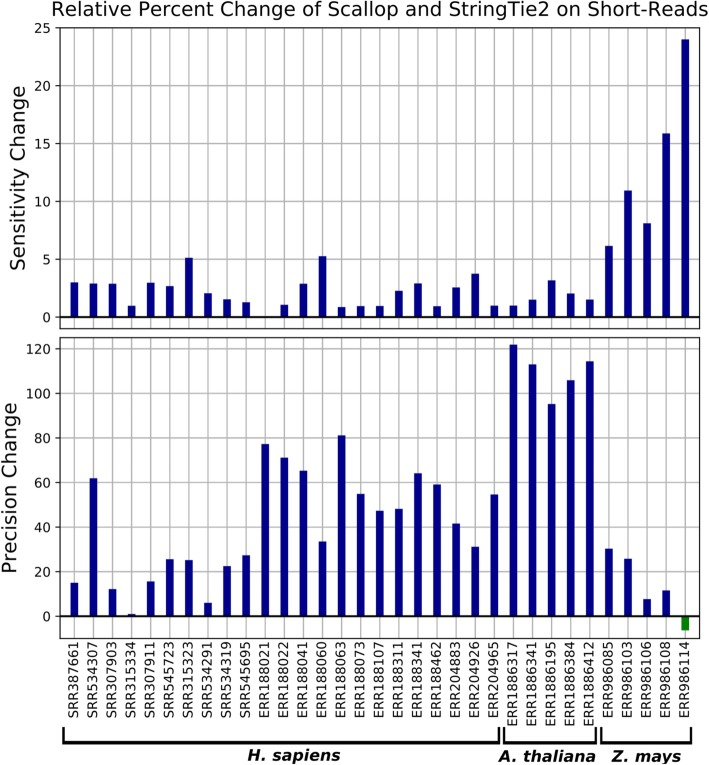
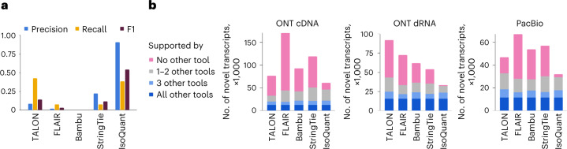

# 第 4 章 RNA 与 Iso-Seq 证据

*本章收录[主页第 3 节](../../README.zh.md#section-3)：该节说明、含论文、实验室、权威度和评价的完整工具表，以及评测要点。链接指回仓库。*

提供基因模型证据的短读长与长读长 RNA 比对、转录本组装及 ORF 预测（A1b）。

**需要：** 尽可能使用同一基因型的短读长 RNA-seq（FASTQ 或现成的 `RNA_BAM`）；若走 S3 分支，需补充高深度 Iso-Seq / 长读长转录组。[按场景列出的数据需求](../../README.zh.md#data-needs)

**分组：**
- *短读长路线*（按顺序）：fastp、HISAT2 或 STAR、Portcullis、StringTie (v3 line) 或 Scallop2 或 Aletsch。先修剪、再比对，组装前用 Portcullis 过滤剪接位点，然后组装：默认用 StringTie；样本多但每个都浅时用 Scallop2 或 Aletsch。之后可用 TransDecoder 在组装出的转录本上识别 ORF。
- *Trinity 路线*（按顺序）：Trinity、PASA、TransDecoder。只在需要不依赖基因组的转录本组装时使用：PASA 比对并更新 Trinity 的组装结果，再用 TransDecoder 识别 ORF。
- *长读长转录本*（按顺序）：IsoSeq (PacBio)、IsoQuant 或 Bambu 或 FLAIR 或 Mandalorion 或 ESPRESSO 或 TAMA 或 FLIC (Full-length isoform constructor) 或 Isocall 或 TAGET、SQANTI3。IsoSeq 预处理只用于 PacBio 读长。转录本构建工具选一个：默认用 IsoQuant；ONT 数据适合 FLAIR，高准确度读长适合 Mandalorion。转录本作为证据之前一定要先过 SQANTI3 质控。
- *长读长比对*（可替代）：minimap2、uLTRA、deSALT。默认用 minimap2 剪接模式；已有注释时，uLTRA 对小外显子的比对效果更好。
- *翻译证据*（互补）：RiboCode、Ribo-TISH、RiboBA、PhyloCSF++、KuPID。仅用于分析小 ORF、uORF 或存疑起始位点；需要 Ribo-seq 或保守性轨道。

*StringTie2 在植物 RNA-seq 数据上的转录本组装效果（图 2）。 Kovaka 等 2019，《Genome Biology》图 2，doi:10.1186/s13059-019-1910-1，PMC6912988，CC BY。*

*IsoQuant 在真实长读长 RNA 数据上的表现（图 2）。原图尺寸较扁（719×189）。 Prjibelski 等 2023，《Nature Biotechnology》图 2，doi:10.1038/s41587-022-01565-y，PMC10344776，CC BY。*

| 工具 | 角色 | 用途 / 何时用 | 原始论文 | 实验室（通讯作者，机构） | 权威度（档位 · 被引） | 评价（出处） |
|---|---|---|---|---|---|---|
| [HISAT2](https://github.com/DaehwanKimLab/hisat2) | 默认路线（HISAT2 或 STAR） | 面向短读长 RNA-seq 的剪接比对工具（基于图索引）。 | [Nature Biotechnology 2019](https://doi.org/10.1038/s41587-019-0201-4) | Daehwan Kim (The University of Texas Southwestern Medical Center) | 标准 · 17059 次 | GitHub 最后提交 2026-07 |
| [STAR](https://github.com/alexdobin/STAR) | 默认路线（HISAT2 或 STAR） | 超快速短读长剪接比对工具，支持两轮（two-pass）剪接位点发现。 | [Bioinformatics 2012](https://doi.org/10.1093/bioinformatics/bts635) | Alexander Dobin (Cold Spring Harbor Laboratory) | 标准 · 56248 次 | 作者摘要原句：“STAR outperforms other aligners by a factor of >50 in mapping speed, aligning to the human genome 550 million 2 × 76 bp paired-end reads per hour on a modest 12-core server, while at the same time improving alignment sensitivity and precision.”；GitHub 最后提交 2025-03 |
| [minimap2](https://github.com/lh3/minimap2) | 默认（长读长比对） | 面向长读长及 cDNA/Iso-Seq 数据的剪接比对工具（`-ax splice`）。 | [Bioinformatics 2018](https://doi.org/10.1093/bioinformatics/bty191) | Heng Li (Broad Institute) | 标准 · 17121 次 | 作者摘要原句：“It works with accurate short reads of ≥100 bp in length, ≥1 kb genomic reads at error rate ∼15%, full-length noisy Direct RNA or cDNA reads and assembly contigs or closely related full chromosomes of hundreds of megabases in length.”；GitHub 最后提交 2026-05 |
| [fastp](https://github.com/OpenGene/fastp) | 备选 | 一体化 FASTQ 质控与接头切除工具。 | [Bioinformatics 2018](https://doi.org/10.1093/bioinformatics/bty560) | Shifu Chen (Chinese Academy of Sciences) | 标准 · 33355 次 | 作者摘要原句：“Based on our evaluation, fastp is 2–5 times faster than other FASTQ preprocessing tools such as Trimmomatic or Cutadapt despite performing far more operations than similar tools.”；GitHub 最后提交 2026-10 |
| [Trinity](https://github.com/trinityrnaseq/trinityrnaseq) | 备选 | 利用 RNA-seq 数据做从头或基因组引导的转录本组装。 | [Nature Biotechnology 2011](https://doi.org/10.1038/nbt.1883) | Nir Friedman (Hebrew University of Jerusalem) +1 | 标准 · 23513 次 | GitHub 最后提交 2026-11 |
| [PASA](https://github.com/PASApipeline/PASApipeline) | 分支 S14 | 将转录本比对并组装为基因结构，同时利用此信息更新基因模型的 UTR 与可变剪接异构体。 | [Nucleic Acids Research 2003](https://doi.org/10.1093/nar/gkg770) | Brian J. Haas | 标准 · 2576 次 | 作者摘要原句：“Complete and partial gene structures identified by this method were used to improve The Institute for Genomic Research Arabidopsis genome annotation (TIGR release v.4.0).”；GitHub 最后提交 2026-11 |
| [TransDecoder](https://github.com/TransDecoder/TransDecoder) | 备选 | 在转录本中识别候选编码区（结合同源比对或 Pfam 支持的 ORF）。 | 无文章 | — | 无论文 | 仓库简介：“TransDecoder source”；GitHub 最后提交 2026-11 |
| [IsoQuant](https://github.com/ablab/IsoQuant) | 默认（长读长，S3） | 基于参考基因组做长读长转录本发现与定量。 | [Nature Biotechnology 2023](https://doi.org/10.1038/s41587-022-01565-y) | Andrey D. Prjibelski (University of Helsinki) +1 | 成熟 · 349 次 | 作者摘要原句：“Here we present IsoQuant-a computational tool using intron graphs that accurately reconstructs transcripts both with and without reference genome annotation.”；GitHub 最后提交 2026-11 |
| [Bambu](https://github.com/GoekeLab/bambu) | 备选 | 结合上下文信息的长读长转录本发现与定量工具（R/Bioconductor 包）。 | [Nature Methods 2023](https://doi.org/10.1038/s41592-023-01908-w) | Jonathan Göke (Agency for Science, Technology and Research) | 成熟 · 236 次 | GitHub 最后提交 2026-10 |
| [SQANTI3](https://github.com/ConesaLab/SQANTI3) | 分支 S3 | 对照参考注释对长读长转录本异构体做分类与过滤。 | [Nature Methods 2024](https://doi.org/10.1038/s41592-024-02229-2) | Ana Conesa (Consejo Superior de Investigaciones Científicas) | 成熟 · 267 次 | GitHub 最后提交 2026-11 |
| [TAMA](https://github.com/GenomeRIK/tama) | 备选 | 归并冗余的长读长转录本模型并提供 Iso-Seq 注释辅助功能。 | [BMC Genomics 2020](https://doi.org/10.1186/s12864-020-07123-7) | Richard I Kuo (Roslin Institute) | 成熟 · 191 次 | 作者摘要原句：“TAMA achieved high sensitivity and precision for gene and transcript model predictions in both reference guided and unguided approaches in our benchmark tests using simulated Pacific Biosciences (PacBio) and Nanopore sequencing data and real PacBio datasets.”；GitHub 最后提交 2023-04 |
| [IsoSeq (PacBio)](https://github.com/PacificBiosciences/IsoSeq) | 备选 | PacBio 官方 Iso-Seq 数据处理流程（含 refine、cluster、collapse 步骤）。 | 无文章 | — | 无论文 | 仓库简介：“Iso-Seq - Scalable De Novo Isoform Discovery from Single-Molecule PacBio Reads”；GitHub 最后提交 2026-06 |
| [StringTie (v3 line)](https://github.com/gpertea/stringtie) | 默认 | 利用短读长与长读长 RNA 数据做参考引导或从头转录本组装；在本库中用作转录本证据与对照轨道。 | [Genome biology 2019](https://doi.org/10.1186/s13059-019-1910-1) | Mihaela Pertea (Johns Hopkins University) | 标准 · 2287 次 | 作者摘要原句：“The ability to assemble these long reads can greatly improve the sensitivity of long-read analyses.”；GitHub 最后提交 2026-11 |
| [FLIC (Full-length isoform constructor)](https://github.com/albidgy/FLIC) | 备选 | 综合生物学重复一致性及 TSS/polyA 峰识别结果，由长读长数据构建全长转录本异构体。 | [Bioinformatics 2022](https://doi.org/10.1093/bioinformatics/btaf551) | Aleksey A. Penin (Russian Academy of Sciences) | 小众 · 1 次 | 作者摘要原句：“demonstrate that FLIC accurately reconstructs known and novel isoforms, outperforming existing tools, especially in the absence of reference annotations.”；GitHub 最后提交 2026-09 |
| [Isocall](https://github.com/PacificBiosciences/isocall) | 备选 | 跨多个 PacBio Iso-Seq 样本联合识别已知与新转录本异构体（可替代 isoseq cluster/collapse）。 | 无文章 | — | 无论文 | 仓库简介：“A method to joint-call RNA isoforms across many IsoSeq samples”；GitHub 最后提交 2026-08 |
| [ESPRESSO](https://github.com/Xinglab/espresso) | 备选 | 从含测序错误的长读长 RNA-seq 数据中发现并定量转录本异构体。 | [Science Advances 2023](https://doi.org/10.1126/sciadv.abq5072) | Yuan Gao (Children's Hospital of Philadelphia) +3 | 成熟 · 106 次 | 作者摘要原句：“ESPRESSO jointly considers alignments of all long reads aligned to a gene and uses error profiles of individual reads to improve the identification of splice junctions and the discovery of their corresponding transcript isoforms.”；GitHub 最后提交 2026-03 |
| TAGET | 备选 | Iso-Seq 分析工具包：涵盖基于 CNN 剪接位点校正的比对、异构体分类与表达定量。 | [Nature Communications 2023](https://doi.org/10.1038/s41467-023-41649-0) | Susheng Miao (Harbin Medical University) +1 | 较新 · 16 次 | 作者摘要原句：“TAGET gives significantly more precise novel splice site prediction and enables more accurate novel isoform and gene fusion discoveries, as validated by experimental validations and comparisons with RNA-seq data.” |
| [RiboCode](https://github.com/xryanglab/RiboCode) | 备选 | 根据核糖体印迹（Ribo-seq）数据识别处于活跃翻译状态的 ORF。 | [Nucleic Acids Research 2018](https://doi.org/10.1093/nar/gky179) | Xuerui Yang (Tsinghua University) | 成熟 · 193 次 | 作者摘要原句：“Being tested with simulated and real ribosome profiling data, and validated with cell type-specific QTI-seq and mass spectrometry data, RiboCode exhibits superior efficiency, sensitivity, and accuracy for de novo annotation of the translatome, which covers …”；GitHub 最后提交 2022-07 |
| [Ribo-TISH](https://github.com/zhpn1024/ribotish) | 备选 | 利用常规 Ribo-seq 或 QTI-seq 数据识别翻译起始位点与 ORF。 | [Nature Communications 2017](https://doi.org/10.1038/s41467-017-01981-8) | Yiwen Chen (The University of Texas MD Anderson Cancer Center) | 成熟 · 172 次 | 作者摘要原句：“Ribo-TISH can also predict novel open reading frames (ORFs) from regular ribosome profiling (rRibo-seq) data and outperform several established methods in both computational efficiency and prediction accuracy.”；GitHub 最后提交 2025-10 |
| [PhyloCSF++](https://github.com/cpockrandt/PhyloCSFpp) | 备选 | PhyloCSF 加速版：基于多物种序列比对的密码子替换模式评估蛋白编码潜能。 | [Bioinformatics 2021](https://doi.org/10.1093/bioinformatics/btab756) | Christopher Pockrandt (Johns Hopkins University) +1 | 小众 · 18 次 | GitHub 最后提交 2022-01 |
| KuPID | 备选 | 基于 k-mer 的长读长上游预处理工具，用于辅助下游转录本异构体发现（预印本）。 | [bioRxiv (Cold Spring Harbor Laboratory) 2025](https://doi.org/10.64898/2025.12.05.692400) | Molly Borowiak (Carnegie Mellon University) | 较新 · 0 次 | 作者摘要原句：“This manuscript introduces KuPID, a method for preprocessing long RNAseq reads with the goal of better identifying novel isoform transcripts.” |
| RiboBA | 备选 | 兼容多种 Ribo-seq 实验方案、可校正偏好性的概率型 ORF 识别工具（预印本）。 | [Nucleic Acids Research 2026](https://doi.org/10.64898/2026.03.17.712439) | Ruolin Yang (Northwest A&F University) | 较新 · 2 次 | 作者摘要原句：“In simulations with known P-site positions, RiboBA improved exact nucleotide- and codon-level P-site assignment relative to a conventional fixed-offset approach.” |
| [FLAIR](https://github.com/BrooksLabUCSC/flair) | 备选 | 结合参考基因组对 nanopore 或 PacBio 全长读长做校正、归并和定量，构建全长转录本。该工具首次发表于所引用的 CLL 研究。 | [Nature Communications 2020](https://doi.org/10.1038/s41467-020-15171-6) | Angela Norie Brooks (University of California, Santa Cruz) | 标准 · 568 次 | 论文摘要：“We report nanopore sequencing of full-length cDNA from CLL samples with and without SF3B1 mutation, as well as normal B cell samples, giving a total of 149 million pass reads.”；GitHub 最后提交 2026-11 |
| [Mandalorion](https://github.com/christopher-vollmers/Mandalorion) | 备选 | 从高准确度全长读长（PacBio Iso-Seq 或 R2C2）中识别并定量高可信度转录本。 | [Genome biology 2023](https://doi.org/10.1186/s13059-023-02999-6) | Christopher Vollmers (University of California, Santa Cruz) | 较新 · 48 次 | 作者摘要原句：“It further improves upon the already strong performance of Mandalorion v3.6 used in the LRGASP consortium challenge.”；GitHub 最后提交 2026-11 |
| [uLTRA](https://github.com/ksahlin/ultra) | 备选 | 利用已有注释引导长 RNA 读长比对到基因组，在小外显子上的表现优于普通 minimap2 剪接模式。注意与第 2 节的重复序列标注工具 ULTRA 区分。 | [Bioinformatics 2021](https://doi.org/10.1093/bioinformatics/btab540) | Kristoffer Sahlin (Stockholm University) | 小众 · 54 次 | 作者摘要原句：“We show that uLTRA produces higher accuracy over state-of-the-art aligners with substantially higher accuracy for small exons on simulated and synthetic data.”；GitHub 最后提交 2026-10 |
| [deSALT](https://github.com/ydLiu-HIT/deSALT) | 备选 | 基于 de Bruijn 图索引的快速剪接比对工具，适用于高错误率的长 RNA 读长。 | [Genome biology 2019](https://doi.org/10.1186/s13059-019-1895-9) | Yadong Wang (Harbin Institute of Technology) | 小众 · 72 次 | GitHub 最后提交 2022-09 |
| [Scallop2](https://github.com/Shao-Group/scallop2) | 备选 | 基于参考基因组的转录本组装工具，支持双端和多端短读长；可在 S1 证据步骤中替代 StringTie。 | [Nature Computational Science 2022](https://doi.org/10.1038/s43588-022-00216-1) | Mingfu Shao (Pennsylvania State University) | 小众 · 39 次 | GitHub 最后提交 2026-10 |
| [Aletsch](https://github.com/Shao-Group/aletsch) | 备选 | 跨多个 RNA-seq 样本联合组装转录本，适合单个组织文库测序较浅的场景。 | [Bioinformatics 2024](https://doi.org/10.1093/bioinformatics/btae215) | Mingfu Shao (Pennsylvania State University) | 较新 · 3 次 | 作者摘要原句：“Our experiments, conducted on RNA-seq data from several protocols, firmly demonstrate Aletsch's significant outperformance over existing meta-assemblers.”；GitHub 最后提交 2025-04 |
| [Portcullis](https://github.com/EI-CoreBioinformatics/portcullis) | 备选 | 在输入基因预测器前过滤 RNA-seq 比对中的假剪接位点；用于 REAT 和 Mikado 流程。 [preprint] | [GigaScience 2018](https://doi.org/10.1101/217620) | Daniel Mapleson (Norwich Research Park) +1 | 成熟 · 154 次 | 作者摘要原句：“Key to this is the accurate identification of exon-exon junctions from RNA sequenced (RNA-seq) reads.”；GitHub 最后提交 2022-03 |
| Sorghum Iso-Seq transcriptome survey | 备选 | 早期植物全长转录组研究，展示了单分子全长读长如何修正基因模型并检出遗漏的异构体。 | [Nature Communications 2016](https://doi.org/10.1038/ncomms11706) | Anireddy S. N. Reddy (Colorado State University) | 标准 · 744 次 | 论文摘要：“Here we sequenced the sorghum transcriptome using Pacific Biosciences single-molecule real-time long-read isoform sequencing and developed a pipeline called TAPIS (Transcriptome Analysis Pipeline for Isoform Sequencing) to identify full-length splice isoforms …” |
| [rMATS](https://github.com/Xinglab/rmats-turbo) | 备选 | 在有重复的条件间检测差异可变剪接事件；在注释完成之后使用。 | [Proceedings of the National Academy of Sciences 2014](https://doi.org/10.1073/pnas.1419161111) | Yi Xing | 标准 · 3063 次 | 作者摘要原句：“The performance of rMATS is evaluated by the analysis of simulated and real RNA-Seq data. rMATS outperformed two existing methods for replicate RNA-Seq data in all simulation settings, and RT-PCR yielded a high validation rate (94%) in an RNA-Seq dataset of …”；GitHub 最后提交 2026-08 |

> 评测要点： RGASP 评测：多数工具能找准外显子和剪接位点，但组装完整异构体仍是主要难点（doi:10.1038/nmeth.2714）。LRGASP：读长更长、更准的数据比增加深度更能提高转录本准确度；在注释完善的基因组中，基于参考的工具表现最好（doi:10.1038/s41592-024-02298-3）。
