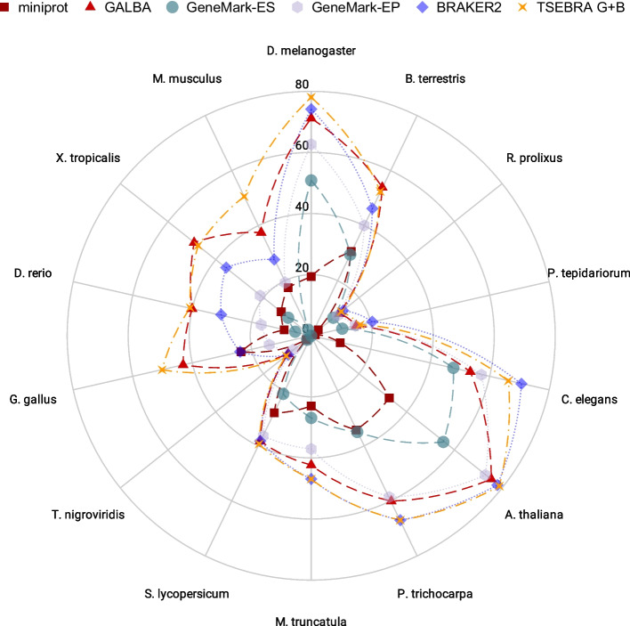

# Chapter 5. Protein evidence

*This chapter reproduces [README section 4](../../README.md#section-4): the section notes, the full tool table with paper, lab, tier and evaluation, and the benchmark notes. Links point back into the repository.*

Protein-to-genome alignment that supplies hints or homology drafts (A2 inputs).

**Needs:** a protein set (`PROTEIN_DB`) from close species or a curated database, for alignment to the genome (miniprot, GeneMark-EP, GALBA / GeMoMa). [Data needs by scenario](../../README.md#data-needs)

**Clusters:**
- *Genome-wide protein hints* (alternatives): miniprot, ProtHint, MetaEuk, Spaln, GenomeThreader. miniprot is the default and is what GALBA2 uses; ProtHint is the protein-evidence step of the BRAKER (GeneMark-EP+/ETP) modes. MetaEuk outputs gene models, not hints: use it only as a quick protein-only second opinion.
- *Exact per-locus alignment* (alternatives): Exonerate, Scipio, GeneWise. Slow; use on a few loci during curation rather than genome-wide.

*GALBA protein-to-genome gene prediction on plant data (Fig. 5). Brůna et al. 2023, BMC Bioinformatics, Fig. 5, doi:10.1186/s12859-023-05449-z, PMC10472564, CC BY.*

| Tool | Role | What it does / when to use | Paper | Lab (corresponding author, institution) | Tier · citations | Evaluation (source) |
|---|---|---|---|---|---|---|
| [miniprot](https://github.com/lh3/miniprot) | default (protein hints) | Fast protein-to-genome spliced alignment. | [Bioinformatics 2023](https://doi.org/10.1093/bioinformatics/btad014) | Heng Li (Harvard University) | standard · 627 | Authors: “It is tens of times faster than existing tools while achieving comparable accuracy on real data.”; GitHub last push 2026-01 |
| [GenomeThreader](https://genomethreader.org/) | alternative | Spliced alignment of proteins/cDNA to genomes. | [Information and Software Technology 2005](https://doi.org/10.1016/j.infsof.2005.09.005) | Stefan Kurtz (Universität Hamburg) | established · 416 | no abstract or repo text available; see paper |
| Exonerate | alternative | Generic sequence alignment including protein2genome spliced models. | [BMC Bioinformatics 2005](https://doi.org/10.1186/1471-2105-6-31) | Guy Slater (European Bioinformatics Institute) | standard · 3332 | Authors: “The speed and accuracy of this approach compares favourably with existing methods.” |
| [Spaln](https://github.com/ogotoh/spaln) | alternative | Spliced alignment of cDNA/protein to genome with species-specific parameters. | [Bioinformatics 2008](https://doi.org/10.1093/bioinformatics/btn460) | Osamu Gotoh (Kyoto University) | niche · 63 | Authors: “When the query and the target sequences are reasonably similar, e.g. between mammalian orthologs, Spaln runs one to two orders of magnitude faster than conventional approaches that rely on Blast search followed by dynamic-programming-based spliced alignment.”; GitHub last push 2026-07 |
| [ProtHint](https://github.com/gatech-genemark/ProtHint) | alternative | Turns spliced alignments of cross-species proteins into intron and start/stop hints; the protein-evidence step of the BRAKER2/BRAKER3 (GeneMark-EP+/ETP) modes. GALBA uses miniprot instead. | [NAR Genomics and Bioinformatics 2021](https://doi.org/10.1093/nargab/lqaa108) | Mark Yu. Borodovsky (Georgia Institute of Technology) | standard · 1815 | GitHub last push 2023-10 |
| [MetaEuk](https://github.com/soedinglab/metaeuk) | alternative | Fast protein-guided eukaryotic gene discovery built on MMseqs2; useful as a quick protein-only second opinion. | [Microbiome 2020](https://doi.org/10.1186/s40168-020-00808-x) | Eli Levy Karin (Max Planck Institute for Biophysical Chemistry) +1 | established · 360 | Authors: “We used a benchmark of seven diverse, annotated genomes to show that MetaEuk is highly sensitive even under conditions of low sequence similarity to the reference database.”; GitHub last push 2026-09 |
| [Scipio](https://www.webscipio.org/) | alternative | Maps a known protein to the genome to recover its exact exon-intron structure; well suited for curating a few gene family members. | [BMC Research Notes 2011](https://doi.org/10.1186/1756-0500-4-265) | Martin Kollmar (Max Planck Institute for Biophysical Chemistry) | niche · 57 | Authors: “Scipio and WebScipio have fundamentally been extended to better reconstruct very short exons and intron splice sites and to be better suited for cross-species gene structure predictions.” |
| GeneWise | alternative | Classic frameshift-tolerant protein-to-genome aligner; still a reference for checking miniprot and Spaln on difficult loci. | [Genome Research 2004](https://doi.org/10.1101/gr.1865504) | Ewan Birney (European Bioinformatics Institute) | standard · 3142 | Paper: “We present two algorithms in this paper: GeneWise, which predicts gene structure using similar protein sequences, and Genomewise, which provides a gene structure final parse across cDNA- and EST-defined spliced structure.” |
