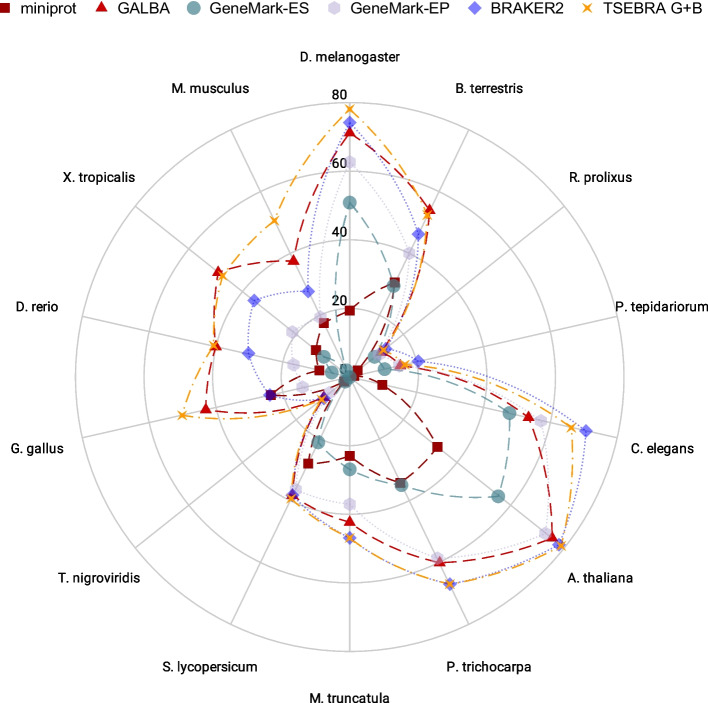

# 第 5 章 蛋白证据

*本章收录[主页第 4 节](../../README.zh.md#section-4)：该节说明、含论文、实验室、权威度和评价的完整工具表，以及评测要点。链接指回仓库。*

将蛋白比对到基因组，为基因模型提供提示（hint）或同源草案（A2 输入）。

**需要：** 来自近缘物种或审定数据库的蛋白集（`PROTEIN_DB`），用于比对到基因组（miniprot、GeneMark-EP、GALBA / GeMoMa）。[按场景列出的数据需求](../../README.zh.md#data-needs)

**分组：**
- *全基因组蛋白提示*（可替代）：miniprot、ProtHint、MetaEuk、Spaln、GenomeThreader。默认用 miniprot，GALBA2 用的也是它；ProtHint 是 BRAKER（GeneMark-EP+/ETP 模式）中处理蛋白证据的步骤。MetaEuk 输出的是基因模型，不是提示：只作只用蛋白的快速旁证。
- *单位点精确比对*（可替代）：Exonerate、Scipio、GeneWise。速度较慢；仅在人工校对时用于少数位点，不用于全基因组。

*GALBA 在植物数据上的蛋白比对基因预测表现（图 5）。 Brůna 等 2023，《BMC Bioinformatics》图 5，doi:10.1186/s12859-023-05449-z，PMC10472564，CC BY。*

| 工具 | 角色 | 用途 / 何时用 | 原始论文 | 实验室（通讯作者，机构） | 权威度（档位 · 被引） | 评价（出处） |
|---|---|---|---|---|---|---|
| [miniprot](https://github.com/lh3/miniprot) | 默认（蛋白提示） | 快速的蛋白到基因组剪接比对工具。 | [Bioinformatics 2023](https://doi.org/10.1093/bioinformatics/btad014) | Heng Li (Harvard University) | 标准 · 627 次 | 作者摘要原句：“It is tens of times faster than existing tools while achieving comparable accuracy on real data.”；GitHub 最后提交 2026-01 |
| [GenomeThreader](https://genomethreader.org/) | 备选 | 将蛋白或 cDNA 序列剪接比对到基因组的工具。 | [Information and Software Technology 2005](https://doi.org/10.1016/j.infsof.2005.09.005) | Stefan Kurtz (Universität Hamburg) | 成熟 · 416 次 | 无摘要或仓库说明可引；见原文 |
| Exonerate | 备选 | 通用序列比对工具，支持 protein2genome 剪接比对模式。 | [BMC Bioinformatics 2005](https://doi.org/10.1186/1471-2105-6-31) | Guy Slater (European Bioinformatics Institute) | 标准 · 3332 次 | 作者摘要原句：“The speed and accuracy of this approach compares favourably with existing methods.” |
| [Spaln](https://github.com/ogotoh/spaln) | 备选 | 带物种特异参数的 cDNA/蛋白到基因组剪接比对工具。 | [Bioinformatics 2008](https://doi.org/10.1093/bioinformatics/btn460) | Osamu Gotoh (Kyoto University) | 小众 · 63 次 | 作者摘要原句：“When the query and the target sequences are reasonably similar, e.g. between mammalian orthologs, Spaln runs one to two orders of magnitude faster than conventional approaches that rely on Blast search followed by dynamic-programming-based spliced alignment.”；GitHub 最后提交 2026-07 |
| [ProtHint](https://github.com/gatech-genemark/ProtHint) | 备选 | 把跨物种蛋白的剪接比对转成内含子和起始/终止位点提示；是 BRAKER2/BRAKER3（GeneMark-EP+/ETP 模式）中处理蛋白证据的步骤。GALBA 用的是 miniprot。 | [NAR Genomics and Bioinformatics 2021](https://doi.org/10.1093/nargab/lqaa108) | Mark Yu. Borodovsky (Georgia Institute of Technology) | 标准 · 1815 次 | GitHub 最后提交 2023-10 |
| [MetaEuk](https://github.com/soedinglab/metaeuk) | 备选 | 基于 MMseqs2，利用蛋白引导快速识别真核基因模型；可作为仅依赖蛋白证据的快速旁证。 | [Microbiome 2020](https://doi.org/10.1186/s40168-020-00808-x) | Eli Levy Karin (Max Planck Institute for Biophysical Chemistry) +1 | 成熟 · 360 次 | 作者摘要原句：“We used a benchmark of seven diverse, annotated genomes to show that MetaEuk is highly sensitive even under conditions of low sequence similarity to the reference database.”；GitHub 最后提交 2026-09 |
| [Scipio](https://www.webscipio.org/) | 备选 | 将已知蛋白映射回基因组以还原精确的外显子-内含子结构；适合人工校对少量基因家族成员。 | [BMC Research Notes 2011](https://doi.org/10.1186/1756-0500-4-265) | Martin Kollmar (Max Planck Institute for Biophysical Chemistry) | 小众 · 57 次 | 作者摘要原句：“Scipio and WebScipio have fundamentally been extended to better reconstruct very short exons and intron splice sites and to be better suited for cross-species gene structure predictions.” |
| GeneWise | 备选 | 经典的容忍移码蛋白-基因组比对工具；在疑难位点上仍可作为核对 miniprot 和 Spaln 结果的参照。 | [Genome Research 2004](https://doi.org/10.1101/gr.1865504) | Ewan Birney (European Bioinformatics Institute) | 标准 · 3142 次 | 论文摘要：“We present two algorithms in this paper: GeneWise, which predicts gene structure using similar protein sequences, and Genomewise, which provides a gene structure final parse across cDNA- and EST-defined spliced structure.” |
