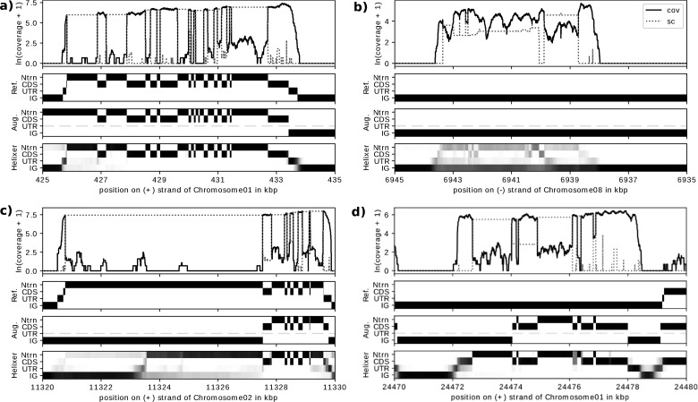
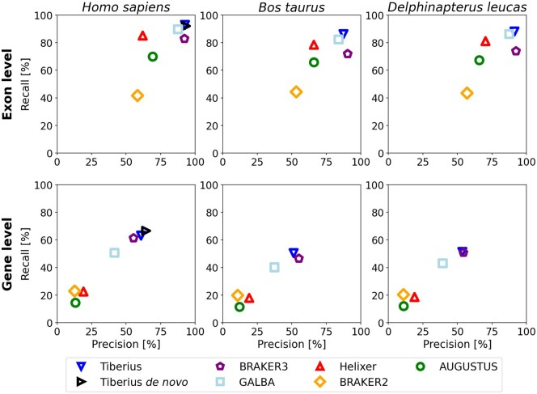
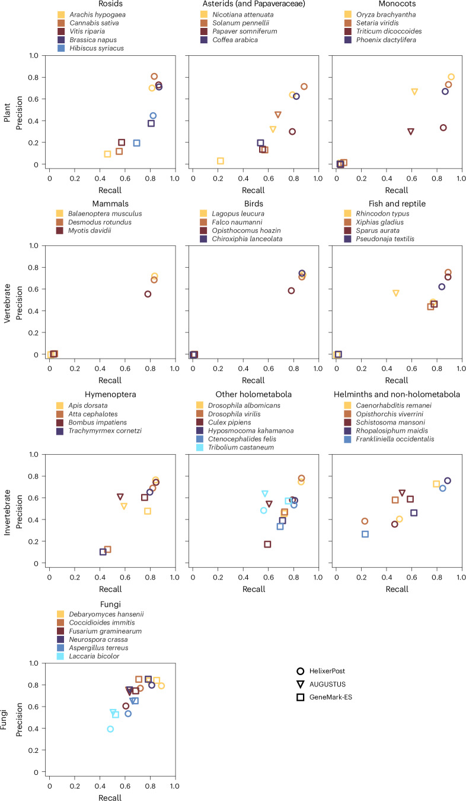

# Chapter 6. Ab initio gene finders

*This chapter reproduces [README section 5](../../README.md#section-5): the section notes, the full tool table with paper, lab, tier and evaluation, and the benchmark notes. Links point back into the repository.*

Ab initio or evidence-hinted gene finders that invent gene models on the masked genome (A2).

**Needs:** the soft-masked genome; RNA and/or proteins if the engine can take hints (BRAKER). Helixer / Tiberius can run from the genome alone, but should not silently replace an evidence-based S1 draft. [Data needs by scenario](../../README.md#data-needs)

**Clusters:**
- *Evidence-trained pipelines* (alternatives): BRAKER4, GALBA2. BRAKER4 for S1 (RNA-seq + proteins, the BRAKER3 method); with proteins only BRAKER4 runs the BRAKER2 mode; GALBA2 for S2 with close-species proteins.
- *Engines inside the pipelines* (complementary): GeneMark-ETP, AUGUSTUS. GeneMark-ETP trains on the evidence and AUGUSTUS is trained on its predictions; run them on their own only for debugging or comparison.
- *Deep-learning finders (no training)* (alternatives): Helixer, Tiberius, ANNEVO. The S13 compare track; Helixer has plant models, Tiberius is strongest where trained clades match.
- *Legacy HMM finders* (complementary): SNAP, GlimmerHMM. Use only as extra inputs for MAKER2 or EVM comparisons.

*Helixer gene models at a cassava locus (Fig. 3). Stiehler et al. 2021, Bioinformatics, Fig. 3, doi:10.1093/bioinformatics/btaa1044, PMC8016489, CC BY.*

*Tiberius precision-recall compared with peer gene finders (Fig. 3). Gabriel, Becker, Hoff and Stanke 2024, Bioinformatics, Fig. 3, doi:10.1093/bioinformatics/btae685, PMC11645249, CC BY.*

*Helixer exon-level precision-recall in the 2026 methods paper (Fig. 1). Holst et al. 2026, Nat. Methods, Fig. 1, doi:10.1038/s41592-025-02939-1, PMC13076211, CC BY.*

| Tool | Role | What it does / when to use | Paper | Lab (corresponding author, institution) | Tier · citations | Evaluation (source) |
|---|---|---|---|---|---|---|
| [AUGUSTUS](https://github.com/Gaius-Augustus/Augustus) | alternative | HMM gene finder with hints from RNA/protein evidence. | [Bioinformatics 2008](https://doi.org/10.1093/bioinformatics/btn013) | Mario Stanke (University of California, Santa Cruz) | standard · 2763 | GitHub last push 2026-11 |
| [BRAKER4](https://github.com/Gaius-Augustus/BRAKER4) | default (S1) | BRAKER4 is the Snakemake reimplementation of BRAKER3 that runs GeneMark-ETP and AUGUSTUS with RNA-seq and protein evidence and merges predictions with TSEBRA. The method paper is BRAKER3 (below); the braker.pl BRAKER3 release remains the fallback when containers are unavailable. With proteins only, it runs the mode first published as BRAKER2 (GeneMark-EP+, doi:10.1093/nargab/lqaa108). | [Genome Research 2024](https://doi.org/10.1101/gr.278090.123) | Katharina J. Hoff (Universität Greifswald) | standard · 1004 | Cited BRAKER3 paper: beat BRAKER1, BRAKER2, MAKER2, Funannotate and FINDER on 11 genomes; transcript F1 about 20 points above BRAKER1/2 (doi:10.1101/gr.278090.123).; GitHub last push 2026-11 |
| [GALBA2](https://github.com/Gaius-Augustus/GALBA2) | branch S2 | GALBA2 is the Snakemake port of GALBA that trains AUGUSTUS from miniprot alignments of proteins from a related species (S2). The method paper is GALBA (below); the original GALBA release serves as the fallback. | [BMC Bioinformatics 2023](https://doi.org/10.1186/s12859-023-05449-z) | Katharina J. Hoff (Universität Greifswald) | established · 127 | GitHub last push 2026-11 |
| [SNAP](https://github.com/KorfLab/SNAP) | alternative | Semi-HMM ab initio gene finder trainable on new genomes. | [BMC Bioinformatics 2004](https://doi.org/10.1186/1471-2105-5-59) | Ian F. Korf (Wellcome Sanger Institute) | standard · 3585 | GitHub last push 2022-10 |
| [GlimmerHMM](https://ccb.jhu.edu/software/glimmerhmm/) | alternative | Generalized HMM eukaryotic gene finder. | [Bioinformatics 2004](https://doi.org/10.1093/bioinformatics/bth315) | William H. Majoros | standard · 2180 | no abstract or repo text available; see paper |
| [Tiberius](https://github.com/Gaius-Augustus/Tiberius) | branch S13 | End-to-end deep learning plus HMM ab initio gene prediction. | [Bioinformatics 2024](https://doi.org/10.1093/bioinformatics/btae685) | Lars Gabriel (Universität Greifswald) +1 | newer · 69 | Authors: trained and tested on mammalian genomes; gene-level F1 62% on human versus 21% for the next ab initio tool, and ab initio accuracy matching BRAKER3 there (doi:10.1093/bioinformatics/btae685). Plant use needs a plant-trained model.; Authors: “It significantly outperforms existing ab initio methods, achieving F1 scores of 62% at gene level for the human genome, compared to 21% for the next best ab initio method.”; GitHub last push 2026-11 |
| [GeneMark-ETP](https://github.com/gatech-genemark/GeneMark-ETP) | alternative | Gene finder integrating transcript and protein evidence with self-training (core of BRAKER3). | [Genome Research 2024](https://doi.org/10.1101/gr.278373.123) | Mark Yu. Borodovsky (Georgia Institute of Technology) | established · 276 | Authors: “GeneMark-ETP outperforms gene finders using a single type of extrinsic evidence.”; GitHub last push 2025-04 |
| [ANNEVO](https://github.com/xjtu-omics/ANNEVO) | branch S13 | Deep-learning ab initio gene annotation modelling evolutionary context. [preprint] | [Nature Methods 2026](https://doi.org/10.21203/rs.3.rs-6402260/v1) | Kai Ye (First Affiliated Hospital of Xi'an Jiaotong University) | newer · 56 | Authors: “Through extensive benchmarking on 566 species, we demonstrate that ANNEVO significantly outperforms existing ab initio methods and achieves performance comparable to state-of-the-art annotation pipelines.”; GitHub last push 2026-08 |
| [Helixer](https://github.com/weberlab-hhu/Helixer) | branch S13 | Deep-learning and HMM ab initio gene predictor that runs from genome sequence alone using pretrained plant models; serves as the S13 comparison track. The 2020 paper (doi:10.1093/bioinformatics/btaa1044) describes the earlier base-wise version. | [Nature Methods 2025](https://doi.org/10.1038/s41592-025-02939-1) | Marie Bolger (Forschungszentrum Jülich) | established · 239 | Authors: “The accurate identification of genes is vital for understanding biological function, yet this remains challenging across many newly sequenced or less-studied species.”; GitHub last push 2026-11 |
| [GeneMark-ES](https://github.com/gatech-genemark/GeneMark-E-Docs) | alternative | Self-trained ab initio gene finder that needs no external evidence; the base of GeneMark-ET/EP+/ETP. | [Nucleic Acids Research 2005](https://doi.org/10.1093/nar/gki937) | Alexandre Lomsadze (Georgia Institute of Technology) | standard · 1098 | GitHub last push 2020-10 |
| [GeneMark-ET](https://github.com/gatech-genemark/GeneMark-E-Docs) | alternative | GeneMark self-training guided by RNA-seq intron hints; used inside BRAKER1. | [Nucleic Acids Research 2014](https://doi.org/10.1093/nar/gku557) | Mark Yu. Borodovsky (Georgia Institute of Technology) | standard · 607 | Authors: “We demonstrated in computational experiments that the proposed method of incorporation of 'unassembled' RNA-Seq reads improves the accuracy of gene prediction; particularly, for the 1.3 GB genome of Aedes aegypti the mean value of prediction Sensitivity and …”; GitHub last push 2020-10 |
| [BRAKER2](https://github.com/Gaius-Augustus/BRAKER) | alternative | BRAKER mode trained from protein hints (GeneMark-EP+ and AUGUSTUS) when RNA-seq is missing. | [NAR Genomics and Bioinformatics 2021](https://doi.org/10.1093/nargab/lqaa108) | Mark Yu. Borodovsky (Georgia Institute of Technology) | standard · 1815 | GitHub last push 2026-11 |

> Benchmark note: G3PO, an independent benchmark of widely used ab initio predictors on curated genes from 147 organisms, found ab initio structure prediction very challenging on draft assemblies (doi:10.1186/s12864-020-6707-9). The plant benchmark of BRAKER and MAKER on five plant genomes recommends combining evidence-based and ab initio prediction (doi:10.1002/aps3.11533).
