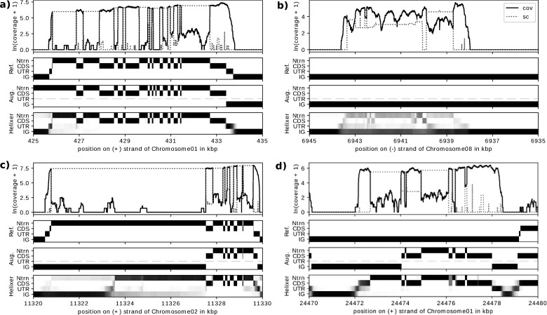
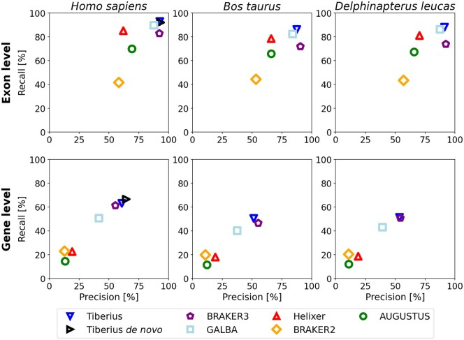
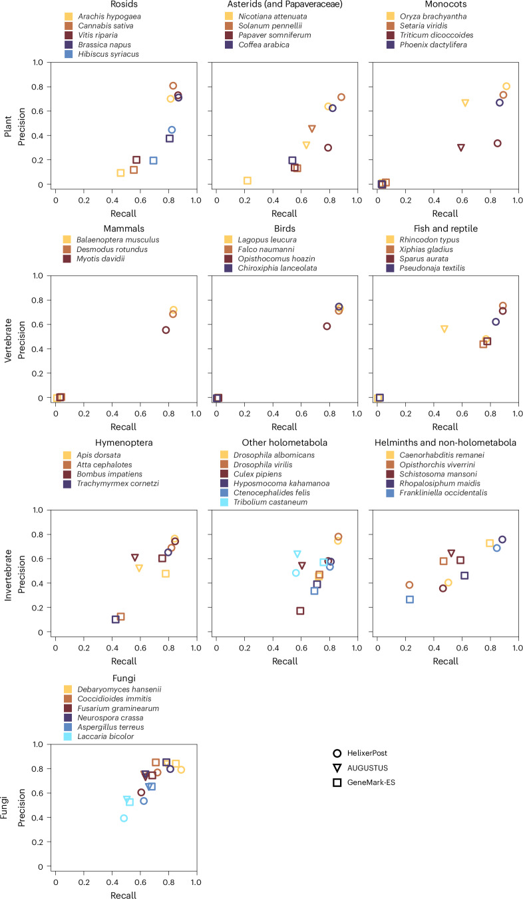

# 第 6 章 从头基因预测

*本章收录[主页第 5 节](../../README.zh.md#section-5)：该节说明、含论文、实验室、权威度和评价的完整工具表，以及评测要点。链接指回仓库。*

在屏蔽后的基因组上预测基因模型的从头预测或证据引导预测工具（A2）。

**需要：** 已做 soft-mask 的基因组；若预测工具支持引入证据提示（BRAKER），再附上 RNA 和/或蛋白。Helixer / Tiberius 可仅凭基因组运行，但在有 RNA 数据时，不应悄悄替代基于证据的 S1 草案。[按场景列出的数据需求](../../README.zh.md#data-needs)

**分组：**
- *证据训练的流程*（可替代）：BRAKER4、GALBA2。S1（RNA-seq + 蛋白，即 BRAKER3 方法）用 BRAKER4；只有蛋白时 BRAKER4 运行 BRAKER2 模式；有近缘物种蛋白的 S2 用 GALBA2。
- *流程内部的引擎*（互补）：GeneMark-ETP、AUGUSTUS。GeneMark-ETP 用证据训练，AUGUSTUS 再用它的预测结果训练；单独运行只用于调试或对照。
- *深度学习预测器（无需训练）*（可替代）：Helixer、Tiberius、ANNEVO。S13 对照轨道；Helixer 有植物模型，Tiberius 在训练类群相符时最强。
- *传统 HMM 预测器*（互补）：SNAP、GlimmerHMM。仅在 MAKER2 或 EVM 对比中作为补充输入。

*Helixer 在木薯某一位点预测的基因模型（图 3）。 Stiehler 等 2021，《Bioinformatics》图 3，doi:10.1093/bioinformatics/btaa1044，PMC8016489，CC BY。*

*Tiberius 与同类基因预测工具的精确率-召回率对比（图 3）。 Gabriel、Becker、Hoff 与 Stanke 2024，《Bioinformatics》图 3，doi:10.1093/bioinformatics/btae685，PMC11645249，CC BY。*

*Helixer 2026 方法论文中的外显子级别精确率-召回率（图 1）。 Holst 等 2026，《Nature Methods》图 1，doi:10.1038/s41592-025-02939-1，PMC13076211，CC BY。*

| 工具 | 角色 | 用途 / 何时用 | 原始论文 | 实验室（通讯作者，机构） | 权威度（档位 · 被引） | 评价（出处） |
|---|---|---|---|---|---|---|
| [AUGUSTUS](https://github.com/Gaius-Augustus/Augustus) | 备选 | 结合 RNA 与蛋白证据提示（hints）的 HMM 基因预测工具。 | [Bioinformatics 2008](https://doi.org/10.1093/bioinformatics/btn013) | Mario Stanke (University of California, Santa Cruz) | 标准 · 2763 次 | GitHub 最后提交 2026-11 |
| [BRAKER4](https://github.com/Gaius-Augustus/BRAKER4) | 默认（S1） | BRAKER4 是 BRAKER3 的 Snakemake 重构版：结合 RNA-seq 和蛋白证据运行 GeneMark-ETP 与 AUGUSTUS，并由 TSEBRA 合并结果。方法论文仍引 BRAKER3（见下）；无法使用容器时回退至基于 braker.pl 的 BRAKER3。仅输入蛋白时，运行的是最早作为 BRAKER2 发表的模式（GeneMark-EP+，doi:10.1093/nargab/lqaa108）。 | [Genome Research 2024](https://doi.org/10.1101/gr.278090.123) | Katharina J. Hoff (Universität Greifswald) | 标准 · 1004 次 | 所引 BRAKER3 论文：在 11 个基因组上优于 BRAKER1、BRAKER2、MAKER2、Funannotate 和 FINDER，转录本 F1 比 BRAKER1/2 平均高约 20 个百分点（doi:10.1101/gr.278090.123）。；GitHub 最后提交 2026-11 |
| [GALBA2](https://github.com/Gaius-Augustus/GALBA2) | 分支 S2 | GALBA2 是 GALBA 的 Snakemake 移植版，利用近缘物种蛋白的 miniprot 比对结果训练 AUGUSTUS（S2）。方法论文仍引 GALBA（见下）；原版 GALBA 作为回退方案。 | [BMC Bioinformatics 2023](https://doi.org/10.1186/s12859-023-05449-z) | Katharina J. Hoff (Universität Greifswald) | 成熟 · 127 次 | GitHub 最后提交 2026-11 |
| [SNAP](https://github.com/KorfLab/SNAP) | 备选 | 可在新基因组上重新训练的半隐马尔可夫（semi-HMM）从头基因预测工具。 | [BMC Bioinformatics 2004](https://doi.org/10.1186/1471-2105-5-59) | Ian F. Korf (Wellcome Sanger Institute) | 标准 · 3585 次 | GitHub 最后提交 2022-10 |
| [GlimmerHMM](https://ccb.jhu.edu/software/glimmerhmm/) | 备选 | 基于广义隐马尔可夫模型（GHMM）的真核从头基因预测工具。 | [Bioinformatics 2004](https://doi.org/10.1093/bioinformatics/bth315) | William H. Majoros | 标准 · 2180 次 | 无摘要或仓库说明可引；见原文 |
| [Tiberius](https://github.com/Gaius-Augustus/Tiberius) | 分支 S13 | 结合端到端深度学习与 HMM 的从头基因预测工具。 | [Bioinformatics 2024](https://doi.org/10.1093/bioinformatics/btae685) | Lars Gabriel (Universität Greifswald) +1 | 较新 · 69 次 | 作者：在哺乳动物基因组上训练和测试；人类基因层面 F1 为 62%，次优从头工具为 21%，从头精度可与 BRAKER3 相当（doi:10.1093/bioinformatics/btae685）。用于植物需有植物训练的模型。；作者摘要原句：“It significantly outperforms existing ab initio methods, achieving F1 scores of 62% at gene level for the human genome, compared to 21% for the next best ab initio method.”；GitHub 最后提交 2026-11 |
| [GeneMark-ETP](https://github.com/gatech-genemark/GeneMark-ETP) | 备选 | 整合转录本与蛋白证据并支持自训练的基因预测工具（BRAKER3 的核心组件）。 | [Genome Research 2024](https://doi.org/10.1101/gr.278373.123) | Mark Yu. Borodovsky (Georgia Institute of Technology) | 成熟 · 276 次 | 作者摘要原句：“GeneMark-ETP outperforms gene finders using a single type of extrinsic evidence.”；GitHub 最后提交 2025-04 |
| [ANNEVO](https://github.com/xjtu-omics/ANNEVO) | 分支 S13 | 对演化上下文建模的深度学习从头基因注释工具。 [preprint] | [Nature Methods 2026](https://doi.org/10.21203/rs.3.rs-6402260/v1) | Kai Ye (First Affiliated Hospital of Xi'an Jiaotong University) | 较新 · 56 次 | 作者摘要原句：“Through extensive benchmarking on 566 species, we demonstrate that ANNEVO significantly outperforms existing ab initio methods and achieves performance comparable to state-of-the-art annotation pipelines.”；GitHub 最后提交 2026-08 |
| [Helixer](https://github.com/weberlab-hhu/Helixer) | 分支 S13 | 结合深度学习与 HMM 的从头基因预测工具，仅凭基因组序列即可运行，自带预训练植物模型；作为 S13 对照轨道。2020 年论文（doi:10.1093/bioinformatics/btaa1044）描述的是早期逐碱基预测版本。 | [Nature Methods 2025](https://doi.org/10.1038/s41592-025-02939-1) | Marie Bolger (Forschungszentrum Jülich) | 成熟 · 239 次 | 作者摘要原句：“The accurate identification of genes is vital for understanding biological function, yet this remains challenging across many newly sequenced or less-studied species.”；GitHub 最后提交 2026-11 |
| [GeneMark-ES](https://github.com/gatech-genemark/GeneMark-E-Docs) | 备选 | 无需外部证据的自训练从头基因预测；GeneMark-ET/EP+/ETP 的基础。 | [Nucleic Acids Research 2005](https://doi.org/10.1093/nar/gki937) | Alexandre Lomsadze (Georgia Institute of Technology) | 标准 · 1098 次 | GitHub 最后提交 2020-10 |
| [GeneMark-ET](https://github.com/gatech-genemark/GeneMark-E-Docs) | 备选 | 以 RNA-seq 内含子提示引导的 GeneMark 自训练；BRAKER1 内部使用。 | [Nucleic Acids Research 2014](https://doi.org/10.1093/nar/gku557) | Mark Yu. Borodovsky (Georgia Institute of Technology) | 标准 · 607 次 | 作者摘要原句：“We demonstrated in computational experiments that the proposed method of incorporation of 'unassembled' RNA-Seq reads improves the accuracy of gene prediction; particularly, for the 1.3 GB genome of Aedes aegypti the mean value of prediction Sensitivity and …”；GitHub 最后提交 2020-10 |
| [BRAKER2](https://github.com/Gaius-Augustus/BRAKER) | 备选 | 缺少 RNA-seq 时用蛋白提示训练的 BRAKER 模式（GeneMark-EP+ 与 AUGUSTUS）。 | [NAR Genomics and Bioinformatics 2021](https://doi.org/10.1093/nargab/lqaa108) | Mark Yu. Borodovsky (Georgia Institute of Technology) | 标准 · 1815 次 | GitHub 最后提交 2026-11 |

> 评测要点： G3PO 用 147 个物种的人工核对基因独立评测常用从头预测工具，结论是在草图组装上从头预测结构非常困难（doi:10.1186/s12864-020-6707-9）。在五个植物基因组上比较 BRAKER 与 MAKER 的研究建议把证据预测与从头预测结合（doi:10.1002/aps3.11533）。
