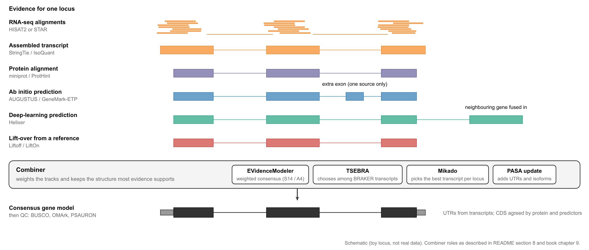
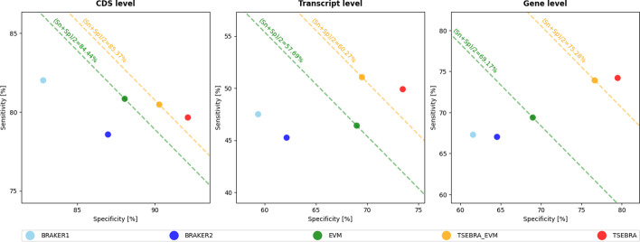
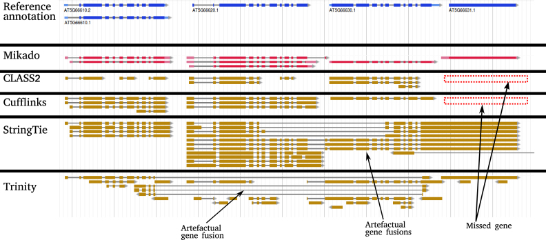
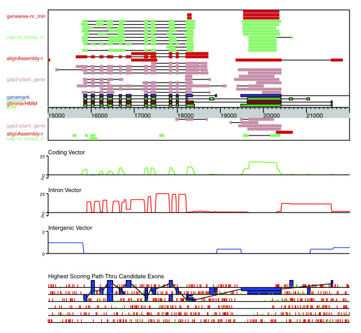

# Chapter 9. Combiners and annotation pipelines

*This chapter reproduces [README section 8](../../README.md#section-8): the section notes, the full tool table with paper, lab, tier and evaluation, and the benchmark notes. Links point back into the repository.*

Tools that merge several draft gene sets or wrap a whole annotation stack (A4).

**Needs:** two or more draft gene sets and/or transcript assemblies, plus the evidence used to score them (RNA, proteins, junctions). EVM is for S14 or a true dual-track merge, not every genome. [Data needs by scenario](../../README.md#data-needs)

*Figure. What a combiner does at one locus: transcript, protein, ab initio, deep-learning and lift-over evidence often disagree (an extra exon from one source, a neighbouring gene fused in). EVidenceModeler, TSEBRA, Mikado or a PASA update keep the structure that most evidence supports. Toy locus; schematic drawn for this repository, not redrawn from a published figure.*

**Clusters:**
- *Combiners (pick by inputs)* (alternatives): TSEBRA, Mikado, EVidenceModeler (EVM). Use TSEBRA for BRAKER outputs, Mikado for multiple transcript sets, and EVM for multiple weighted sources (S14).
- *End-to-end pipelines* (alternatives): MAKER2, funannotate, EGAPx, GETA, REAT, EASEL, Sylvan, Ensembl automatic annotation pipeline (ensembl-anno), EviAnn. EGAPx is the S8 parallel run; EviAnn provides a fast evidence-only check. The remaining pipelines are alternatives to the BRAKER3 trunk, not add-ons.

*TSEBRA sensitivity and specificity on Arabidopsis (Fig. 3). Gabriel et al. 2021, BMC Bioinformatics, Fig. 3, doi:10.1186/s12859-021-04482-0, PMC8620231, CC BY.*

*Mikado transcript selection at an Arabidopsis locus (Fig. 1). Venturini et al. 2018, GigaScience, Fig. 1, doi:10.1093/gigascience/giy093, PMC6105091, CC BY.*

*EVidenceModeler gene-model consensus at a rice locus (Fig. 5). Haas et al. 2008, Genome Biol., Fig. 5, doi:10.1186/gb-2008-9-1-r7, PMC2395244, CC BY.*

| Tool | Role | What it does / when to use | Paper | Lab (corresponding author, institution) | Tier · citations | Evaluation (source) |
|---|---|---|---|---|---|---|
| [EVidenceModeler (EVM)](https://github.com/EVidenceModeler/EVidenceModeler) | branch S14 (A4) | Weighted consensus of predictions and alignments into gene models. | [Genome biology 2008](https://doi.org/10.1186/gb-2008-9-1-r7) | Brian J. Haas (Broad Institute) | standard · 4661 | GitHub last push 2026-09 |
| [TSEBRA](https://github.com/Gaius-Augustus/TSEBRA) | alternative | Transcript selector combining BRAKER predictions using extrinsic evidence. | [BMC Bioinformatics 2021](https://doi.org/10.1186/s12859-021-04482-0) | Mario Stanke (Universität Greifswald) | established · 426 | Authors: “We show in computational experiments on genomes of 11 species that TSEBRA achieves higher accuracy than either BRAKER1 or BRAKER2 running alone and that TSEBRA compares favorably with the combiner tool EVidenceModeler.”; GitHub last push 2026-11 |
| [Mikado](https://github.com/EI-CoreBioinformatics/mikado) | alternative | Picks best transcript models at each locus from multiple assemblies/predictions. | [GigaScience 2018](https://doi.org/10.1093/gigascience/giy093) | David Swarbreck (Norwich Research Park) | established · 231 | Authors: “Here, we show that the accuracy of transcript reconstruction can be boosted by combining multiple methods, and we present a novel algorithm to integrate multiple RNA-seq assemblies into a coherent transcript annotation.”; GitHub last push 2026-01 |
| MAKER2 | alternative | Annotation pipeline combining evidence alignment and ab initio predictors with AED scores. | [BMC Bioinformatics 2011](https://doi.org/10.1186/1471-2105-12-491) | Mark D. Yandell (University of Utah) | standard · 2370 | Scored below BRAKER3 in the 11-genome BRAKER3 benchmark (doi:10.1101/gr.278090.123).; Authors: “We show that MAKER2 can produce accurate annotations for novel genomes where training-data are limited, of low quality or even non-existent.” |
| [funannotate](https://github.com/nextgenusfs/funannotate) | alternative | Eukaryotic annotation pipeline (predict, update, annotate) built on EVM/PASA. | [Zenodo (CERN European Organization for Nuclear Research) 2018](https://doi.org/10.5281/zenodo.1134477) | Winter, David | established · 407 | Scored below BRAKER3 in the 11-genome BRAKER3 benchmark (doi:10.1101/gr.278090.123).; GitHub last push 2026-11 |
| [EGAPx](https://github.com/ncbi/egapx) | alternative | Public release of NCBI's Eukaryotic Genome Annotation Pipeline. | no paper | — | no paper | Repo description: “Eukaryotic Genome Annotation Pipeline-External caller scripts and documentation”; GitHub last push 2026-09 |
| [GETA](https://github.com/chenlianfu/geta) | alternative | Genome-wide Electronic Transcript Annotation pipeline (transcripts, homology, AUGUSTUS). | no paper | — | no paper | GitHub last push 2026-10 |
| [REAT](https://github.com/EI-CoreBioinformatics/reat) | alternative | Robust Eukaryotic Annotation Toolkit (transcriptome, homology and prediction workflows, Mikado-based). | no paper | — | no paper | Repo description: “Robust Eukaryotic Annotation Toolkit”; GitHub last push 2025-02 |
| [EASEL](https://gitlab.com/PlantGenomicsLab/easel) | alternative | Nextflow pipeline: StringTie2/PsiCLASS transcripts, TransDecoder, AUGUSTUS trained on transcript and OrthoDB protein hints, random-forest filtering using RNA-folding and other features. | no paper | — | no paper | no abstract or repo text available; see paper |
| [Sylvan](https://github.com/plantgenomicslab/Sylvan) | alternative | Snakemake pipeline combining EVM/PASA, GETA, Helixer, Liftoff and miniprot evidence, then semi-supervised random-forest filtering and boundary refinement. | no paper | — | no paper | Repo description: “Comprehensive genome annotation pipeline for plant combining EVM/PASA, GETA, AUGUSTUS and Helixer with semi-supervised filtering for high-quality gene models.”; GitHub last push 2026-11 |
| [Ensembl automatic annotation pipeline (ensembl-anno)](https://github.com/Ensembl/ensembl-anno) | alternative | Public code of Ensembl's automatic gene annotation pipeline. | no paper | — | no paper | Repo description: “Ensembl Automatic annotation pipeline”; GitHub last push 2026-11 |
| [EviAnn](https://github.com/alekseyzimin/EviAnn_release) | alternative | Builds gene models directly from RNA and protein evidence without ab initio training; fast, and a useful check against BRAKER4. | [Nature Methods 2026](https://doi.org/10.1038/s41592-026-03156-0) | Aleksey V. Zimin (Johns Hopkins University) | newer · 36 | GitHub last push 2026-11 |
| [MAKER-P](https://github.com/Yandell-Lab/maker) | alternative | Plant-tuned MAKER setup for large plant genomes, with repeat and ncRNA handling. | [PLANT PHYSIOLOGY 2013](https://doi.org/10.1104/pp.113.230144) | Mark D. Yandell | established · 451 | Authors: “We have optimized and extended the widely used annotation engine MAKER in order to better support plant genome annotation efforts.”; GitHub last push 2024-08 |
| [FINDER](https://github.com/sagnikbanerjee15/Finder) | alternative | Automated eukaryotic gene annotation from RNA-seq data and associated protein sequences. | [BMC Bioinformatics 2021](https://doi.org/10.1186/s12859-021-04120-9) | Carson M. Andorf (Agricultural Research Service) | niche · 47 | Scored below BRAKER3 in the 11-genome BRAKER3 benchmark (doi:10.1101/gr.278090.123).; Authors: “This hinders the creation of an accurate and holistic representation of the transcriptomic landscape across multiple tissue types and experimental conditions.”; GitHub last push 2023-07 |
| [GenSAS](https://www.gensas.org/) | alternative | Web platform that runs repeat masking, gene prediction and evidence combination without local installs. | [Methods in molecular biology 2019](https://doi.org/10.1007/978-1-4939-9173-0_3) | Jodi L. Humann (Washington State University) | established · 173 | no abstract or repo text available; see paper |

> Benchmark note: The plant benchmark of BRAKER and MAKER workflows found that transcripts from RNA alignments alone are not enough, and that combining evidence-based and ab initio prediction, with short plus long reads, improves annotation (doi:10.1002/aps3.11533).
