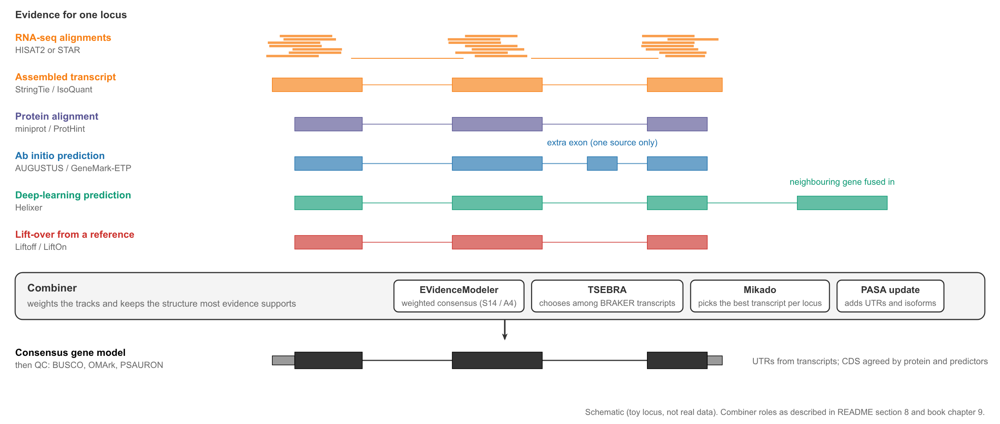
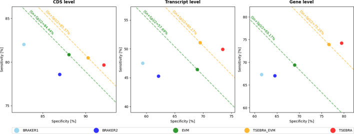
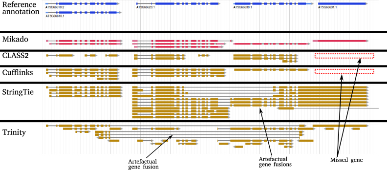
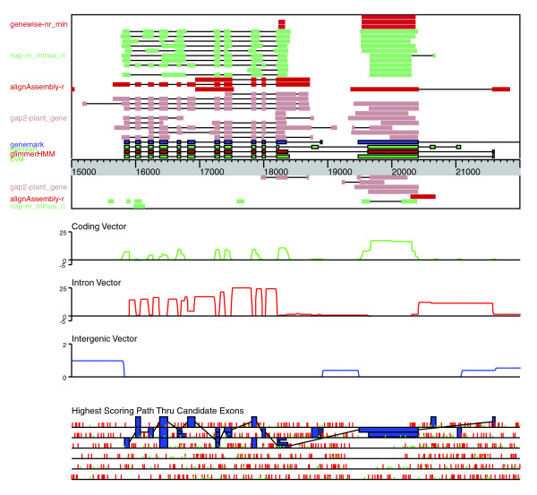

# 第 9 章 合并器与注释流程

*本章收录[主页第 8 节](../../README.zh.md#section-8)：该节说明、含论文、实验室、权威度和评价的完整工具表，以及评测要点。链接指回仓库。*

合并多套草案基因集，或封装整套注释流程的工具（A4）。

**需要：** 两套及以上的草案基因集和/或转录本组装结果，以及用于打分的证据（RNA、蛋白、剪接位点）。EVM 仅用于 S14 或真正的双轨合并，并非每个基因组都要跑。[按场景列出的数据需求](../../README.zh.md#data-needs)

*图：合并器在一个位点上做什么。转录本、蛋白、从头预测、深度学习和注释转移的证据常常不一致（例如只有一个来源多出一个外显子，或把相邻基因并了进来）。EVidenceModeler、TSEBRA、Mikado 或 PASA 更新保留多数证据支持的结构。演示位点；示意图，为本仓库绘制，不是对已发表图的重画。*

**分组：**
- *合并器（按输入选）*（可替代）：TSEBRA、Mikado、EVidenceModeler (EVM)。BRAKER 输出用 TSEBRA，多套转录本用 Mikado，多来源加权合并用 EVM（S14）。
- *端到端流程*（可替代）：MAKER2、funannotate、EGAPx、GETA、REAT、EASEL、Sylvan、Ensembl automatic annotation pipeline (ensembl-anno)、EviAnn。EGAPx 用于 S8 平行运行；EviAnn 可快速完成纯证据核对。其余工具均为 BRAKER3 主干的替代方案，而非附加步骤。

*TSEBRA 在拟南芥上的敏感度与特异度表现（图 3）。 Gabriel 等 2021，《BMC Bioinformatics》图 3，doi:10.1186/s12859-021-04482-0，PMC8620231，CC BY。*

*Mikado 在拟南芥某一位点的转录本筛选过程（图 1）。 Venturini 等 2018，《GigaScience》图 1，doi:10.1093/gigascience/giy093，PMC6105091，CC BY。*

*EVidenceModeler 在水稻某一位点生成的共识基因模型（图 5）。 Haas 等 2008，《Genome Biology》图 5，doi:10.1186/gb-2008-9-1-r7，PMC2395244，CC BY。*

| 工具 | 角色 | 用途 / 何时用 | 原始论文 | 实验室（通讯作者，机构） | 权威度（档位 · 被引） | 评价（出处） |
|---|---|---|---|---|---|---|
| [EVidenceModeler (EVM)](https://github.com/EVidenceModeler/EVidenceModeler) | 分支 S14（A4） | 对多套基因预测与序列比对结果做加权整合，生成共识基因模型。 | [Genome biology 2008](https://doi.org/10.1186/gb-2008-9-1-r7) | Brian J. Haas (Broad Institute) | 标准 · 4661 次 | GitHub 最后提交 2026-09 |
| [TSEBRA](https://github.com/Gaius-Augustus/TSEBRA) | 备选 | 利用外部证据对多套 BRAKER 预测结果做筛选合并的转录本选择器。 | [BMC Bioinformatics 2021](https://doi.org/10.1186/s12859-021-04482-0) | Mario Stanke (Universität Greifswald) | 成熟 · 426 次 | 作者摘要原句：“We show in computational experiments on genomes of 11 species that TSEBRA achieves higher accuracy than either BRAKER1 or BRAKER2 running alone and that TSEBRA compares favorably with the combiner tool EVidenceModeler.”；GitHub 最后提交 2026-11 |
| [Mikado](https://github.com/EI-CoreBioinformatics/mikado) | 备选 | 在每个基因位点上从多套转录本组装或预测结果中筛选最优转录本模型。 | [GigaScience 2018](https://doi.org/10.1093/gigascience/giy093) | David Swarbreck (Norwich Research Park) | 成熟 · 231 次 | 作者摘要原句：“Here, we show that the accuracy of transcript reconstruction can be boosted by combining multiple methods, and we present a novel algorithm to integrate multiple RNA-seq assemblies into a coherent transcript annotation.”；GitHub 最后提交 2026-01 |
| MAKER2 | 备选 | 整合序列比对证据与从头预测工具、并给出 AED 质量评分的注释流程。 | [BMC Bioinformatics 2011](https://doi.org/10.1186/1471-2105-12-491) | Mark D. Yandell (University of Utah) | 标准 · 2370 次 | 在 BRAKER3 的 11 个基因组评测中得分低于 BRAKER3（doi:10.1101/gr.278090.123）。；作者摘要原句：“We show that MAKER2 can produce accurate annotations for novel genomes where training-data are limited, of low quality or even non-existent.” |
| [funannotate](https://github.com/nextgenusfs/funannotate) | 备选 | 基于 EVM/PASA 构建的真核基因组注释流程（含 predict、update、annotate 模块）。 | [Zenodo (CERN European Organization for Nuclear Research) 2018](https://doi.org/10.5281/zenodo.1134477) | Winter, David | 成熟 · 407 次 | 在 BRAKER3 的 11 个基因组评测中得分低于 BRAKER3（doi:10.1101/gr.278090.123）。；GitHub 最后提交 2026-11 |
| [EGAPx](https://github.com/ncbi/egapx) | 备选 | NCBI 真核基因组注释流程（EGAP）的公开版本。 | 无文章 | — | 无论文 | 仓库简介：“Eukaryotic Genome Annotation Pipeline-External caller scripts and documentation”；GitHub 最后提交 2026-09 |
| [GETA](https://github.com/chenlianfu/geta) | 备选 | 全基因组电子转录本注释流程，串联转录本、同源比对与 AUGUSTUS 预测。 | 无文章 | — | 无论文 | GitHub 最后提交 2026-10 |
| [REAT](https://github.com/EI-CoreBioinformatics/reat) | 备选 | 基于 Mikado 整合转录组、同源证据与基因预测工作流的真核注释工具包。 | 无文章 | — | 无论文 | 仓库简介：“Robust Eukaryotic Annotation Toolkit”；GitHub 最后提交 2025-02 |
| [EASEL](https://gitlab.com/PlantGenomicsLab/easel) | 备选 | Nextflow 注释流程：串联 StringTie2/PsiCLASS 转录本组装、TransDecoder、基于转录本与 OrthoDB 蛋白提示训练的 AUGUSTUS，并利用 RNA 二级结构等特征做随机森林过滤。 | 无文章 | — | 无论文 | 无摘要或仓库说明可引；见原文 |
| [Sylvan](https://github.com/plantgenomicslab/Sylvan) | 备选 | Snakemake 注释流程：整合 EVM/PASA、GETA、Helixer、Liftoff 与 miniprot 证据，再经半监督随机森林过滤与边界校正。 | 无文章 | — | 无论文 | 仓库简介：“Comprehensive genome annotation pipeline for plant combining EVM/PASA, GETA, AUGUSTUS and Helixer with semi-supervised filtering for high-quality gene models.”；GitHub 最后提交 2026-11 |
| [Ensembl automatic annotation pipeline (ensembl-anno)](https://github.com/Ensembl/ensembl-anno) | 备选 | Ensembl 自动基因注释流程的公开代码库。 | 无文章 | — | 无论文 | 仓库简介：“Ensembl Automatic annotation pipeline”；GitHub 最后提交 2026-11 |
| [EviAnn](https://github.com/alekseyzimin/EviAnn_release) | 备选 | 不经从头训练，直接用 RNA 和蛋白证据构建基因模型；速度快，可用来和 BRAKER4 结果互相核对。 | [Nature Methods 2026](https://doi.org/10.1038/s41592-026-03156-0) | Aleksey V. Zimin (Johns Hopkins University) | 较新 · 36 次 | GitHub 最后提交 2026-11 |
| [MAKER-P](https://github.com/Yandell-Lab/maker) | 备选 | 面向大型植物基因组调整过的 MAKER，含重复和非编码 RNA 处理。 | [PLANT PHYSIOLOGY 2013](https://doi.org/10.1104/pp.113.230144) | Mark D. Yandell | 成熟 · 451 次 | 作者摘要原句：“We have optimized and extended the widely used annotation engine MAKER in order to better support plant genome annotation efforts.”；GitHub 最后提交 2024-08 |
| [FINDER](https://github.com/sagnikbanerjee15/Finder) | 备选 | 利用 RNA-seq 数据及相关蛋白序列做自动真核基因注释。 | [BMC Bioinformatics 2021](https://doi.org/10.1186/s12859-021-04120-9) | Carson M. Andorf (Agricultural Research Service) | 小众 · 47 次 | 在 BRAKER3 的 11 个基因组评测中得分低于 BRAKER3（doi:10.1101/gr.278090.123）。；作者摘要原句：“This hinders the creation of an accurate and holistic representation of the transcriptomic landscape across multiple tissue types and experimental conditions.”；GitHub 最后提交 2023-07 |
| [GenSAS](https://www.gensas.org/) | 备选 | 网页平台，免本地安装即可做重复屏蔽、基因预测与证据合并。 | [Methods in molecular biology 2019](https://doi.org/10.1007/978-1-4939-9173-0_3) | Jodi L. Humann (Washington State University) | 成熟 · 173 次 | 无摘要或仓库说明可引；见原文 |

> 评测要点： 比较 BRAKER 与 MAKER 流程的植物评测发现，仅靠 RNA 比对得到的转录本不够；证据预测与从头预测结合、短读长加长读长可提高注释质量（doi:10.1002/aps3.11533）。
