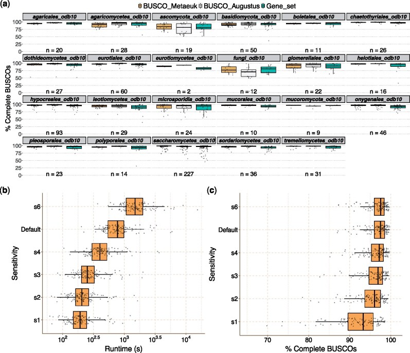
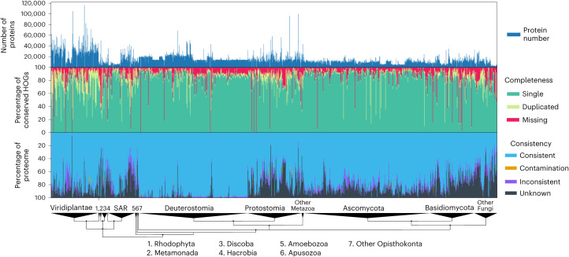
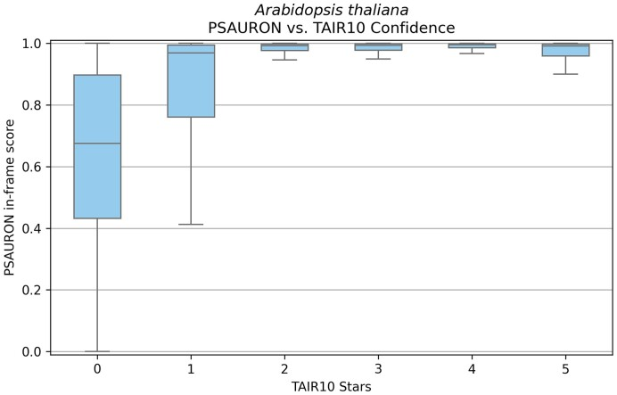

# Chapter 11. Gene-model QC

*This chapter reproduces [README section 10](../../README.md#section-10): the section notes, the full tool table with paper, lab, tier and evaluation, and the benchmark notes. Links point back into the repository.*

Checks on gene models and the proteins translated from them (A3, A5, last-mile 01–02).

**Needs:** proteins translated from the GFF (`PROTEINS_FA`) and a BUSCO lineage; PSAURON and OMArk use the same proteins. RNA BAM is optional but useful for support checks. [Data needs by scenario](../../README.md#data-needs)

**Clusters:**
- *Completeness* (complementary): BUSCO, OMArk. Use BUSCO for the standard score; OMArk adds contamination and fragment checks.
- *Per-model scores* (complementary): PSAURON, GeneValidator, ABAQS. Rank models by score and check the weakest ones first.
- *Format and compare* (complementary): gffread / gffcompare, AGAT. Use gffcompare against a previous release, and AGAT for summary statistics and fixes.

*BUSCO v5 workflows for eukaryotic assessments (Fig. 2). Manni et al. 2021, Mol. Biol. Evol., Fig. 2, doi:10.1093/molbev/msab199, PMC8476166, CC BY.*

*OMArk consistency on UniProt reference proteomes (Fig. 4). Nevers et al. 2025, Nat. Biotechnol. 43(1):124-133, Fig. 4, doi:10.1038/s41587-024-02147-w (online 2024-02-21), PMC11738984, CC BY.*

*PSAURON scores on TAIR10 CDS (Fig. 5). Sommer, Zimin and Salzberg 2025, NAR Genom. Bioinform., Fig. 5, doi:10.1093/nargab/lqae189, PMC11704789, CC BY.*

| Tool | Role | What it does / when to use | Paper | Lab (corresponding author, institution) | Tier · citations | Evaluation (source) |
|---|---|---|---|---|---|---|
| [gffread / gffcompare](https://github.com/gpertea/gffread) | alternative | Extract CDS/proteins from GFF (gffread) and compare two annotations at base/exon/locus level (gffcompare). | [F1000Research 2020](https://doi.org/10.12688/f1000research.23297.2) | Mihaela Pertea (Johns Hopkins University) | standard · 2151 | GitHub last push 2026-11 |
| [AGAT](https://github.com/NBISweden/AGAT) | alternative | GFF/GTF toolkit: statistics, fixing, longest-isoform selection, ID management, format conversion. | [Zenodo (CERN European Organization for Nuclear Research) 2019](https://doi.org/10.5281/zenodo.3552717) | tayyrov | established · 409 | GitHub last push 2026-09 |
| BUSCO | alternative | Evaluates gene-set completeness against lineage single-copy orthologs (protein mode). Lineage datasets now come from OrthoDB v12 (2024 update, doi:10.1093/nar/gkae987); compleasm (section 1) runs the same lineages faster. | [Molecular Biology and Evolution 2021](https://doi.org/10.1093/molbev/msab199) | Evgeny M. Zdobnov (University of Geneva) | standard · 6853 | compleasm paper: compleasm ran 14 times faster than BUSCO on human assemblies and reported 99.6% versus 95.7% completeness on T2T-CHM13 (doi:10.1093/bioinformatics/btad595).; Authors: “Here, we present new functionalities and major improvements of the BUSCO software, as well as the renewal and expansion of the underlying data sets in sync with the OrthoDB v10 release.” |
| [ABAQS](https://github.com/mycocosm-lbl/abaqs) | alternative | Accuracy-Based Annotation Quality Score combining completeness, gene-model validity and protein-profile checks. | no paper | — | no paper | Repo description: “Accuracy-Based Annotation Quality Score (ABAQS)”; GitHub last push 2026-11 |
| [GeneValidator](https://github.com/wurmlab/genevalidator) | alternative | Flags problem gene models by comparing each protein with database homologs (length, coverage, duplication, merged genes). | [Bioinformatics 2016](https://doi.org/10.1093/bioinformatics/btw015) | Yannick Wurm (Queen Mary University of London) | niche · 39 | Paper: “We developed GeneValidator (GV) to automatically identify problematic gene predictions and to aid manual curation.”; GitHub last push 2024-03 |
| [OMArk](https://github.com/DessimozLab/OMArk) | alternative | Assesses a predicted proteome for completeness, lineage consistency and contamination against OMA gene families; flags fragments and spurious genes missed by BUSCO. | [Nature Biotechnology 2024](https://doi.org/10.1038/s41587-024-02147-w) | Yannis Nevers (SIB Swiss Institute of Bioinformatics) | established · 228 | Authors: also checks consistency and contamination, which completeness scores such as BUSCO do not catch (doi:10.1038/s41587-024-02147-w).; Paper: “We introduce OMArk, a software package that relies on fast, alignment-free sequence comparisons between a query proteome and precomputed gene families across the tree of life.”; GitHub last push 2026-10 |
| [PSAURON](https://github.com/salzberg-lab/PSAURON) | alternative | Scores each predicted protein-coding model using a machine-learning classifier; low scores flag likely spurious genes for checking. | [NAR Genomics and Bioinformatics 2025](https://doi.org/10.1093/nargab/lqae189) | Markus J. Sommer (Johns Hopkins University) | newer · 40 | Authors: “Validation against established benchmarks demonstrates PSAURON's effectiveness and correlation with recognized measures of protein quality, highlighting its potential use as a widely applicable method to evaluate precision in gene annotation.”; GitHub last push 2026-05 |

> Benchmark note: No single QC number is enough: BUSCO/compleasm measure completeness, OMArk adds consistency and contamination (doi:10.1038/s41587-024-02147-w), and PSAURON scores whether each protein looks like a real coding sequence (doi:10.1093/nargab/lqae189).
