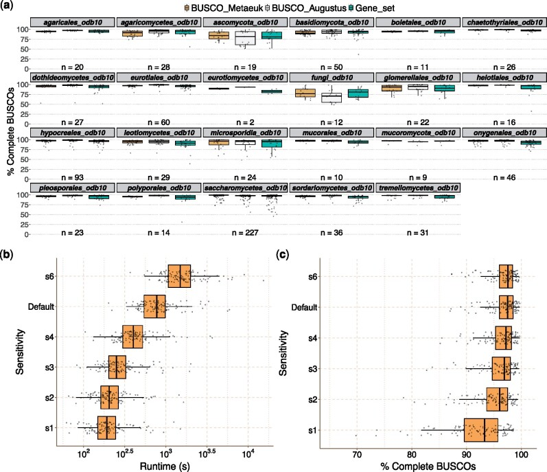
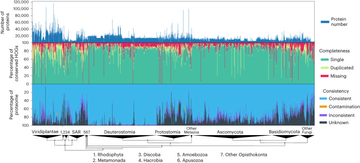
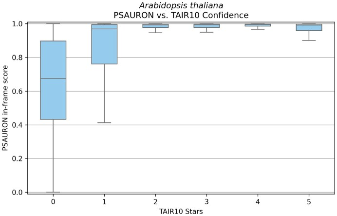

# 第 11 章 基因模型质控

*本章收录[主页第 10 节](../../README.zh.md#section-10)：该节说明、含论文、实验室、权威度和评价的完整工具表，以及评测要点。链接指回仓库。*

检查基因模型及其翻译所得蛋白序列（A3、A5、last-mile 01–02）。

**需要：** 由 GFF 翻译出的蛋白序列（`PROTEINS_FA`）与 BUSCO lineage；PSAURON 和 OMArk 使用同一套蛋白。RNA BAM 非必需，但有助于检查证据支持率。[按场景列出的数据需求](../../README.zh.md#data-needs)

**分组：**
- *完整性*（互补）：BUSCO、OMArk。BUSCO 给出标准完整度指标；OMArk 补充污染与片段化检查。
- *逐模型评分*（互补）：PSAURON、GeneValidator、ABAQS。按得分排序，优先复查得分最低的模型。
- *格式与比较*（互补）：gffread / gffcompare、AGAT。用 gffcompare 与旧版对比；用 AGAT 做统计与修正。

*BUSCO v5 的真核基因组评估流程（图 2）。 Manni 等 2021，《Molecular Biology and Evolution》图 2，doi:10.1093/molbev/msab199，PMC8476166，CC BY。*

*OMArk 在 UniProt 参考蛋白组上的一致性评估（图 4）。 Nevers 等 2025，《Nature Biotechnology》43(1):124-133，图 4，doi:10.1038/s41587-024-02147-w（线上发表于 2024-02-21），PMC11738984，CC BY。*

*PSAURON 在 TAIR10 CDS 上的打分分布（图 5）。 Sommer、Zimin 与 Salzberg 2025，《NAR Genomics and Bioinformatics》图 5，doi:10.1093/nargab/lqae189，PMC11704789，CC BY。*

| 工具 | 角色 | 用途 / 何时用 | 原始论文 | 实验室（通讯作者，机构） | 权威度（档位 · 被引） | 评价（出处） |
|---|---|---|---|---|---|---|
| [gffread / gffcompare](https://github.com/gpertea/gffread) | 备选 | 从 GFF 提取 CDS 或蛋白序列（gffread），并在碱基、外显子与位点水平比对两套注释（gffcompare）。 | [F1000Research 2020](https://doi.org/10.12688/f1000research.23297.2) | Mihaela Pertea (Johns Hopkins University) | 标准 · 2151 次 | GitHub 最后提交 2026-11 |
| [AGAT](https://github.com/NBISweden/AGAT) | 备选 | GFF/GTF 处理工具包：提供统计、结构修复、最长转录本提取、ID 管理与格式转换功能。 | [Zenodo (CERN European Organization for Nuclear Research) 2019](https://doi.org/10.5281/zenodo.3552717) | tayyrov | 成熟 · 409 次 | GitHub 最后提交 2026-09 |
| BUSCO | 备选 | 基于谱系单拷贝直系同源基因集评估基因集完整性（蛋白模式）。谱系数据集现由 OrthoDB v12 提供（2024 年更新，doi:10.1093/nar/gkae987）；compleasm（第 1 节）使用同一套谱系但运行更快。 | [Molecular Biology and Evolution 2021](https://doi.org/10.1093/molbev/msab199) | Evgeny M. Zdobnov (University of Geneva) | 标准 · 6853 次 | compleasm 论文：在人类组装上比 BUSCO 快 14 倍，T2T-CHM13 完整度 99.6% 对 BUSCO 的 95.7%（doi:10.1093/bioinformatics/btad595）。；作者摘要原句：“Here, we present new functionalities and major improvements of the BUSCO software, as well as the renewal and expansion of the underlying data sets in sync with the OrthoDB v10 release.” |
| [ABAQS](https://github.com/mycocosm-lbl/abaqs) | 备选 | 综合完整性、基因模型合法性与蛋白结构域特征检查的注释质量评分工具（ABAQS）。 | 无文章 | — | 无论文 | 仓库简介：“Accuracy-Based Annotation Quality Score (ABAQS)”；GitHub 最后提交 2026-11 |
| [GeneValidator](https://github.com/wurmlab/genevalidator) | 备选 | 将每个预测蛋白与数据库同源序列做比对（检查长度、覆盖度、重复与融合基因），标记存疑基因模型。 | [Bioinformatics 2016](https://doi.org/10.1093/bioinformatics/btw015) | Yannick Wurm (Queen Mary University of London) | 小众 · 39 次 | 论文摘要：“We developed GeneValidator (GV) to automatically identify problematic gene predictions and to aid manual curation.”；GitHub 最后提交 2024-03 |
| [OMArk](https://github.com/DessimozLab/OMArk) | 备选 | 对照 OMA 基因家族，检查预测蛋白组的完整性、谱系一致性和污染；能标出 BUSCO 发现不了的片段化基因和可疑（虚假）基因模型。 | [Nature Biotechnology 2024](https://doi.org/10.1038/s41587-024-02147-w) | Yannis Nevers (SIB Swiss Institute of Bioinformatics) | 成熟 · 228 次 | 作者：还检查一致性与污染，这是 BUSCO 这类完整度指标看不到的（doi:10.1038/s41587-024-02147-w）。；论文摘要：“We introduce OMArk, a software package that relies on fast, alignment-free sequence comparisons between a query proteome and precomputed gene families across the tree of life.”；GitHub 最后提交 2026-10 |
| [PSAURON](https://github.com/salzberg-lab/PSAURON) | 备选 | 利用机器学习模型为每个预测的蛋白编码基因打分；低分项提示可能为假阳性基因，需重点复查。 | [NAR Genomics and Bioinformatics 2025](https://doi.org/10.1093/nargab/lqae189) | Markus J. Sommer (Johns Hopkins University) | 较新 · 40 次 | 作者摘要原句：“Validation against established benchmarks demonstrates PSAURON's effectiveness and correlation with recognized measures of protein quality, highlighting its potential use as a widely applicable method to evaluate precision in gene annotation.”；GitHub 最后提交 2026-05 |

> 评测要点： 单一质控数字不够：BUSCO/compleasm 衡量完整度，OMArk 增加一致性和污染检查（doi:10.1038/s41587-024-02147-w），PSAURON 为每个蛋白打分判断其是否像真实编码序列（doi:10.1093/nargab/lqae189）。
