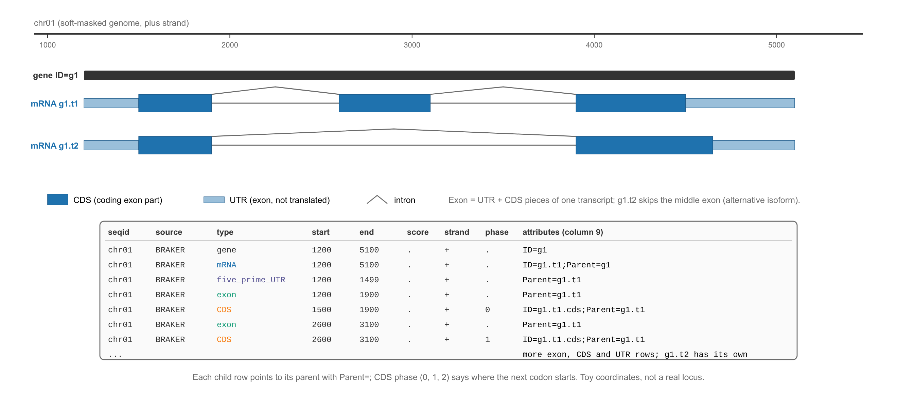

# Chapter 13. GFF3 cleanup and release

*This chapter reproduces [README section 12](../../README.md#section-12): the section notes, the full tool table with paper, lab, tier and evaluation, and the benchmark notes. Links point back into the repository.*

GFF3 cleanup, validation and submission (last-mile 06, A6).

**Needs:** the curated GFF and genome only, plus the METHODS / checklist fields already listed in `docs/PLAYBOOK.md`. [Data needs by scenario](../../README.md#data-needs)

*Figure. A gene model is a hierarchy: one gene, one or more transcripts (mRNA), and exons made of UTR and CDS parts. The table shows the same model as GFF3 rows linked by `ID` and `Parent`, with the CDS phase. Toy coordinates, not a real locus; schematic drawn for this repository.*

**Clusters:**
- *Validate* (complementary): GenomeTools (gt gff3validator), GFF3toolkit, gxfkit, noodles. Validate before every release.
- *Submission converters* (alternatives): table2asn, EMBLmyGFF3, Genome Annotation Generator (GAG). Use table2asn for NCBI and EMBLmyGFF3 for ENA.
- *Utilities* (complementary): SeqKit 2, GTFtools, CrossMap. Handle sequence extraction, summary statistics and coordinate conversion between assembly versions.

| Tool | Role | What it does / when to use | Paper | Lab (corresponding author, institution) | Tier · citations | Evaluation (source) |
|---|---|---|---|---|---|---|
| [SeqKit 2](https://github.com/shenwei356/seqkit) | alternative | FASTA/Q toolkit (stats, grep, translate, dedup). | [iMeta 2024](https://doi.org/10.1002/imt2.191) | Wei Shen (Second Affiliated Hospital of Chongqing Medical University) | standard · 667 | Authors: “SeqKit2 consistently outperforms its predecessor, albeit with marginally higher memory usage, while maintaining competitive runtimes against other tools.”; GitHub last push 2026-11 |
| [Genome Annotation Generator (GAG)](https://github.com/genomeannotation/GAG) | alternative | Generates and corrects NCBI .tbl annotation tables from GFF3. | [GigaScience 2018](https://doi.org/10.1093/gigascience/giy018) | Scott M. Geib (Daniel K. Inouye U.S. Pacific Basin Agricultural Research Center) | niche · 73 | Authors: “With WGS becoming commonplace, genome sequencing projects are moving away from the genome centers and into the ecology or biology lab, where fewer resources are present to support the process of genome assembly curation.”; GitHub last push 2018-03 |
| [GenomeTools (gt gff3validator)](https://github.com/genometools/genometools) | alternative | GFF3 validation, sorting, tidy. | [IEEE Transactions on Computational Biology and Bioinformatics 2013](https://doi.org/10.1109/TCBB.2013.68) | Stefan Kurtz (Universität Hamburg) | standard · 547 | Paper: “In this paper, we present the GenomeTools, a convenient and efficient software library and associated software tools for developing bioinformatics software intended to create, process or convert annotation graphs.”; GitHub last push 2026-11 |
| [EMBLmyGFF3](https://github.com/NBISweden/EMBLmyGFF3) | alternative | Converts GFF3 + FASTA to EMBL flat file for ENA submission. | [BMC Research Notes 2018](https://doi.org/10.1186/s13104-018-3686-x) | Jacques Dainat (Uppsala University) | niche · 49 | Paper: “Here we present EMBLmyGFF3, a robust universal converter from GFF3 format to EMBL format compatible with genome annotation submission to the European Nucleotide Archive.”; GitHub last push 2025-07 |
| [table2asn](https://www.ncbi.nlm.nih.gov/genbank/table2asn/) | alternative | NCBI tool converting GFF3/FASTA to ASN.1 submission with validation report. | no paper | — | no paper | no abstract or repo text available; see paper |
| [GFF3toolkit](https://github.com/NAL-i5K/GFF3toolkit) | alternative | GFF3 QC/fix/merge utilities from the i5k Workspace@NAL. | no paper | — | no paper | Repo description: “Python programs for processing GFF3 files”; GitHub last push 2026-11 |
| [noodles](https://github.com/zaeleus/noodles) | alternative | Rust I/O libraries including GFF3/GTF readers and writers. | no paper | — | no paper | Repo description: “Bioinformatics I/O libraries in Rust”; GitHub last push 2026-11 |
| [gxfkit](https://github.com/benngaihk/gxfkit) | alternative | Rust GFF3/GTF conversion aiming at AGAT-compatible output with large speedups. | no paper | — | no paper | GitHub last push 2026-07 |
| GTFtools | alternative | Calculates gene-model features from GTF files (lengths, intron and UTR sets, isoform statistics) for release summaries. | [Bioinformatics 2022](https://doi.org/10.1093/bioinformatics/btac561) | Hong‐Dong Li (Central South University) | niche · 33 | Paper: “We introduce GTFtools, a stand-alone command-line software that provides a set of functions to calculate various gene features, including splice sites, independent introns, transcription start sites (TSS)-flanking regions, UTRs, isoform coordination and …” |
| [CrossMap](https://github.com/liguowang/CrossMap) | alternative | Converts GFF, BED, VCF and BAM coordinates between assembly versions using a chain file, for example from PN40024 v4 to T2T. | [Bioinformatics 2013](https://doi.org/10.1093/bioinformatics/btt730) | Jean‐Pierre Kocher (Mayo Clinic) +1 | standard · 829 | Paper: “Here we developed CrossMap, a versatile and efficient tool for converting genome coordinates between assemblies.”; GitHub last push 2026-07 |
| [GFF3sort](https://github.com/billzt/gff3sort) | alternative | Sorts GFF3 so that parent features come before children, for tabix indexing in browsers. | [BMC Bioinformatics 2017](https://doi.org/10.1186/s12859-017-1930-3) | Sandui Guo (Chinese Academy of Agricultural Sciences) +1 | niche · 12 | Authors: “Based on our test datasets from seven species, GFF3sort produced accurate sorting results with acceptable efficiency compared with currently available tools.”; GitHub last push 2020-06 |
