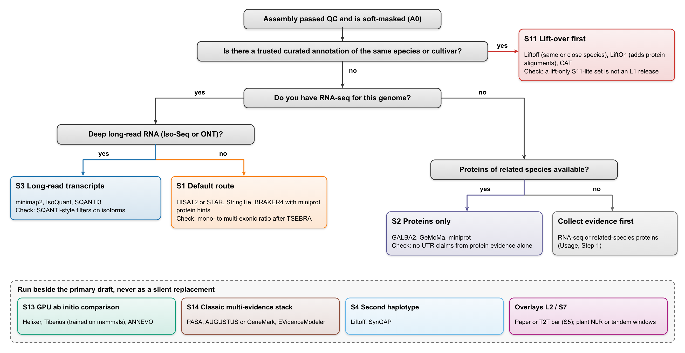
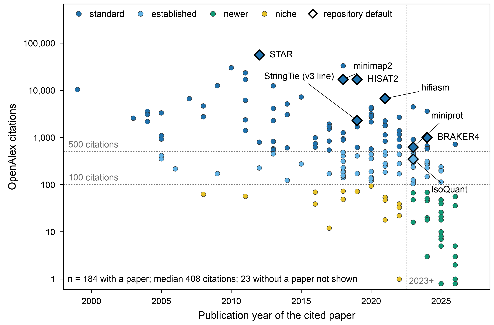

# 第 18 章 怎么选工具

仓库按手头数据为每个基因组选一条主路线（主页“默认路线”和“分支”；`docs/SCENARIOS.md`）。下表复述这一选择，并补上每个首选工具背后的证据。

| 数据情况 | 路线 | 首选工具 | 理由（出处） | 主要检查 |
|---|---|---|---|---|
| 有 RNA-seq 和蛋白，无近缘可信注释 | S1（默认） | HISAT2 或 STAR、StringTie、BRAKER3/4 | BRAKER3 在 11 个基因组上优于 BRAKER1、BRAKER2、MAKER2、Funannotate 和 FINDER（[doi:10.1101/gr.278090.123](https://doi.org/10.1101/gr.278090.123)） | TSEBRA 后检查单外显子与多外显子基因比例（主页“通用注意事项”） |
| 有同种或同品种的可信人工注释 | S11 先做转移 | Liftoff、LiftOn | Liftoff 在同种或近缘物种组装间映射基因（[doi:10.1093/bioinformatics/btaa1016](https://doi.org/10.1093/bioinformatics/btaa1016)）；LiftOn 加入蛋白比对，可到更远物种（[doi:10.1101/gr.279620.124](https://doi.org/10.1101/gr.279620.124)） | 只做转移的 S11-lite 不能叫 L1 发布（主页“所需数据”） |
| 只有蛋白 | S2 | GALBA、GeMoMa、miniprot | GALBA 把 miniprot 和 AUGUSTUS 结合；作者称在大型脊椎动物基因组上最强，并给出一个陆生植物用例（[doi:10.1186/s12859-023-05449-z](https://doi.org/10.1186/s12859-023-05449-z)） | 不要凭蛋白证据声称 UTR 完整（主页“所需数据”） |
| 深度长读长 RNA（Iso-Seq 或 ONT） | S3 | minimap2、IsoQuant、SQANTI3 | IsoQuant 作者称在有参考模式下 ONT 新转录本假阳性率降低五倍（[doi:10.1038/s41587-022-01565-y](https://doi.org/10.1038/s41587-022-01565-y)）；LRGASP 发现读长更长、更准比加深测序更能提高转录本准确度（[doi:10.1038/s41592-024-02298-3](https://doi.org/10.1038/s41592-024-02298-3)） | 做 SQANTI 式过滤（[doi:10.1038/s41592-024-02229-2](https://doi.org/10.1038/s41592-024-02229-2)） |
| 有 GPU，想做从头预测对比 | S13 | Helixer、Tiberius、ANNEVO | Helixer 有植物预训练模型，不需要 RNA-seq（[doi:10.1038/s41592-025-02939-1](https://doi.org/10.1038/s41592-025-02939-1)）；Tiberius 在哺乳动物上训练（[doi:10.1093/bioinformatics/btae685](https://doi.org/10.1093/bioinformatics/btae685)） | 与证据草稿并列，不要悄悄替换 S1（主页“所需数据”） |
| 经典多证据组合 | S14 | PASA、AUGUSTUS 或 GeneMark、EVidenceModeler | EVM 加权共识在水稻和人类上接近人工校对（[doi:10.1186/gb-2008-9-1-r7](https://doi.org/10.1186/gb-2008-9-1-r7)） | 写明 EVM 权重；并非每个基因组都要跑 EVM（主页“所需数据”） |
| 第二套单倍型 | S4 | Liftoff、SynGAP | SynGAP 用共线性修正基因结构（[doi:10.1186/s13059-024-03359-8](https://doi.org/10.1186/s13059-024-03359-8)） | 不要只为降低 BUSCO 重复率去掉单倍型（主页“通用注意事项”） |

*图：按手头数据选主分支，并列出每条分支的首选工具和主要检查项（与第 18 章表格及 README 分支路线一致）。S13、S14、S4 和叠加项只在主草案旁边并行运行。示意图，为本仓库绘制；可编辑 SVG：[`structure_branch_decision_v2.svg`](../../docs/figures/guide/structure_branch_decision_v2.svg)。*

## 权威度怎么看

各表的权威度（标准：被引 500 及以上；成熟：100 至 499；新近：不足 100 且 2023 年及以后发表；小众：不足 100 且更早）衡量论文被引的广度，不代表在你的基因组上更准。比对器、浏览器这类通用工具会从所有领域获得引用。换默认工具之前，先读各步骤章末尾的评测说明，再在自己的数据上比较，这也是主页的要求（主页“所需数据”：未经测试的改动不改变默认路线）。

*图：184 条有论文的目录条目的发表年份与 OpenAlex 被引数；菱形为本仓库默认工具。被引数只说明论文被引用得多不多，不说明工具在你的基因组上准不准。数据：`catalog/SOFTWARE_AUTHORITY.tsv`；脚本 `docs/figures/guide/src/make_catalog_charts.py`。*

## 加新工具前要问的问题

1. 它替换或新增哪个阶段？主页是否已为该阶段指定工具？
2. 有没有独立评测，还是只有作者自述？独立评测例子：从头预测看 G3PO（[doi:10.1186/s12864-020-6707-9](https://doi.org/10.1186/s12864-020-6707-9)），植物上 BRAKER 与 MAKER 的比较（[doi:10.1002/aps3.11533](https://doi.org/10.1002/aps3.11533)），转录本看 RGASP 和 LRGASP。
3. 是否在植物上测试过？例如 Tiberius 是为哺乳动物训练的（[doi:10.1093/bioinformatics/btae685](https://doi.org/10.1093/bioinformatics/btae685)）。
4. 代码是否还在维护？表中的 GitHub 最后提交日期可以快速判断。
