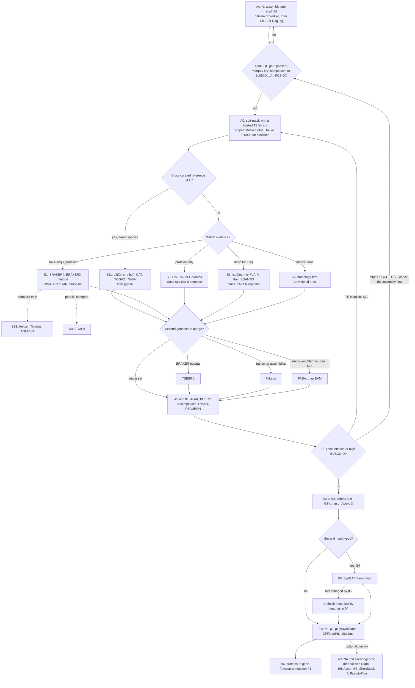

# Branch roadmap — gene structure

One page: **what is the trunk**, **which S-IDs pick a draft engine**, **which only overlay**.  
Recipes: [`SCENARIOS.md`](SCENARIOS.md) · chooser detail: [`steps/MAIN.md`](steps/MAIN.md) · reviews: [`REVIEWS.md`](REVIEWS.md).

Sibling function layer (after proteins): [gene-function-annotation `ROADMAP`](https://github.com/Xuzhen-Li/gene-function-annotation/blob/main/docs/ROADMAP.md).

---

## Big picture (three layers)

**Structure is primary and hard** (coordinates / GFF / proteins).  
TE soft-mask = prerequisite **inside** structure (trusted lib). TE *library construction* = separate job.  
GO/KEGG/names = **only** in function — structure never ships FA tables.  
Boundary: [`BOUNDARY.md`](BOUNDARY.md).

```text
genome + evidence
        │
        ▼
┌───────────────────────────────┐
│  1. Structure (PRIMARY)       │  ← this repo
│  A0 soft-mask (trusted TE)    │
│  trunk → ONE draft branch     │
│  → merge → QC → curated GFF   │
│  → proteins.faa + METHODS     │
└───────────────┬───────────────┘
                │ hand proteins (A6)
                ▼
┌───────────────────────────────┐
│  2. Function                  │  gene-function-annotation
│  F0 → F1 → optional add-ons   │
│  → functional_master.tsv      │
└───────────────────────────────┘

┌───────────────────────────────┐
│  3. TE library build          │  vitis-te / TE_LIBRARY.md
│  (separate job — not FA)      │
└───────────────────────────────┘
```

---

## Trunk (every successful run rejoins)

Do these in order. Branches only replace the **draft** middle.

```text
Asm0   assemble / phase / purge / scaffold
  │
Asm1   assembly QC gate  (fail → back to Asm0)
  │
A0     soft-mask with **trusted** TE lib   ← docs/TE_LIBRARY.md
  │
  ├──── DRAFT BRANCH (pick ONE primary) ────┐
  │         S11 / S1 / S2 / S3 / S13 / S14 / S6
  │                                         │
  ▼                                         ▼
A4/A5  merge + AGAT (if dual draft)   ◄─────┘
  │
A3     proteins from GFF
  │
01     BUSCO proteins + PSAURON (+ optional OMArk)
  │
02     priority loci list
  │
04     GSAman (depth depends on goal; see overlays)
  │
05     SynGAP if multi-haplotype
  │
06     re-QC → qualified release (PLAYBOOK checklist)
  │
       proteins → gene-function-annotation (F1)
```

Default when unsure and you have RNA+proteins: **S1**, then rejoin at A4/A5.

---

## A. Draft branches — pick **one** primary

These decide *how gene models are invented*. Start from evidence (Ji *NRG* 2026).

| Pick | Evidence you have | Engine (short) | Do not treat as |
|------|-------------------|----------------|-----------------|
| **S11** | Close, curated reference GFF | Liftoff / LiftOn / CAT (± TOGA2 if WGA) | Optional afterthought — prefer **before** de novo |
| **S1** | Illumina RNA + proteins, no close ref | BRAKER4/3 (± GeMoMa) + StringTie→TransDecoder compare | Ab initio-only story |
| **S2** | Proteins, little/no RNA | GALBA / GALBA2 / GeMoMa | Complete UTR claims |
| **S3** | Deep Iso-seq / evidence CDS | IsoQuant→SQANTI3 (± EviAnn) + BRAKER orphans | Ignoring SQANTI filters |
| **S13** | GPU / thin-evidence ab initio **compare** | Helixer / Tiberius / ANNEVO (± SegmentNT watchlist) | Silent replace of S1 when RNA exists |
| **S14** | Classic EVM consensus stack | PASA → Augustus/GeneMark → EVM → polish ([`steps/dclab/`](steps/dclab/)) | Required for every genome |
| **S6** | Thin evidence, provisional OK | Homology-first draft | “Publication-final” without saying provisional |

**Chooser (one glance):**

```text
Close curated ref?     → S11 first
RNA + proteins?        → S1
Proteins only?         → S2
Heavy Iso-seq?         → S3
Want GPU compare?      → S13 (alongside, not instead of S1 if RNA exists)
Want full EVM/PASA?    → S14
Almost no evidence?    → S6 provisional
```

### When is a reference “close” enough for S11?

1. **Yes (prefer S11):** same species / cultivar (or near-identical haplotype) with a **curated** GFF you trust.
2. **Maybe:** same genus — use LiftOn/CAT carefully; plan gap-fill; if lift quality collapses, switch to **S1**.
3. **No (use S1/S2):** only “same family/order GFF exists,” half-done Liftoff, or untrusted models — do **not** hard-lift and call it S11/L1.
4. Full **S11** = liftover **+ gap-fill + trunk QC** (can reach L1). Lift with no gap-fill = **S11-lite / provisional L0** only.

5. **Provisional ≠ L1:** Liftoff-only / Helixer-only / MoGAAAP-style provisional merge ≠ evidence-based L1. Grades live in [`EVALUATION.md`](EVALUATION.md) (L0 vs L1). Classroom compare of Helixer vs BRAKER: [`COMPARE_HELIXER_BRAKER.md`](COMPARE_HELIXER_BRAKER.md).

---

## B. Overlay branches — **not** a second draft pick

These modify QC depth, compare packs, or loop back. They sit **on top of** a draft branch (usually S1/S11/S14).

| ID | Role | Typical attach |
|----|------|----------------|
| **S4** | Multi-haplotype transfer + SynGAP | After S1 or S3 |
| **S5** | Paper / T2T bar (OMArk + deeper GSAman) | On S1 or S14 — see [`cases/vitis-t2t-s1-s5.md`](cases/vitis-t2t-s1-s5.md) |
| **S7** | Family / QTL / NLR window focus | Any draft + HRP windows |
| **S8** | Parallel NCBI EGAPx / Gnomon compare ([`EGAPX_COMPARE.md`](EGAPX_COMPARE.md)) | Beside S1 (not instead) |
| **S9** | High BUSCO-D / don’t purge haplotypes blind | Asm1 / filter policy |
| **S10** | TE gene inflation → remask → re-enter draft | Loop to A0 then same draft ID |
| **S12** | Stop / freeze rules | End of curation |

```text
Example paper path:   Asm* → A0 → S1 → (+S5 bar) → trunk QC → release
Example liftover:     Asm* → A0 → S11 → fill gaps with S1/S2 → trunk
Example TE blow-up:   … → S10 remask → re-run same draft branch
```

---

## C. What is **not** an S-branch

| Need | Where |
|------|--------|
| GO / KEGG / domains / names | [gene-function-annotation](https://github.com/Xuzhen-Li/gene-function-annotation) F-line |
| TE library build / panEDTA | [`TE_LIBRARY.md`](TE_LIBRARY.md) · [vitis-te](https://github.com/Xuzhen-Li/vitis-te) |
| PAV / graphs | vitis-pangenome (sibling) |

---

## Quick links

| Doc | Use |
|-----|-----|
| [`QUICKSTART.md`](QUICKSTART.md) | Run default S1 once |
| [`STAGE_IO.md`](STAGE_IO.md) | Inputs → products per stage |
| [`EVALUATION.md`](EVALUATION.md) | **Final** L0/L1/L2 criteria |
| [`PLAYBOOK.md`](PLAYBOOK.md) | Short qualification checklist |
| [`SCENARIOS.md`](SCENARIOS.md) | Step recipes per S-ID |
| [`steps/MAIN.md`](steps/MAIN.md) | Same map, tool-oriented |
| [`SELF_AUDIT.md`](SELF_AUDIT.md) | 2026-09-14 lit/peer gap table |
| [`PEER_PIPELINES.md`](PEER_PIPELINES.md) | Peer stacks (incl. Haul 2026-09-14) |
| [`LINEAGES.md`](LINEAGES.md) | BUSCO/Compleasm plant lineage names (odb10 vs odb12) |
| [`TRUSTED_TE_PATH.md`](TRUSTED_TE_PATH.md) | Trusted TE → A0 checklist (own build / borrow) |
| [`../pipeline/A2e_s11_gapfill.md`](../pipeline/A2e_s11_gapfill.md) | S11 gap-fill after Liftoff (S11 vs S11-lite) |
| [`../examples/golden_pack/`](../examples/golden_pack/) | EXAMPLE L0/L1 pack file list + METHODS stub |
| [`COMPARE_HELIXER_BRAKER.md`](COMPARE_HELIXER_BRAKER.md) | Classroom Helixer↔BRAKER compare (S13; not default prod) |
| [`MERGE_AND_ENTRIES.md`](MERGE_AND_ENTRIES.md) | Entry modes + merge QC narrative (no Snakemake here) |
| [`EGAPX_COMPARE.md`](EGAPX_COMPARE.md) | S8 EGAPx 对照 / GenBank door (not default; no runners here) |
| [`POST_ASSEMBLY.md`](POST_ASSEMBLY.md) | One-page Asm1 → TE → draft → golden → FA |
| [`../pipeline/A2_protein_db.md`](../pipeline/A2_protein_db.md) | PROTEIN_DB for BRAKER / GALBA |
| [`CATALOG_BY_TYPE_2026-11.md`](CATALOG_BY_TYPE_2026-11.md) | 2026-11 type catalog (combined inventory 135) |
| [`CATALOG_NEW_TOOLS_2026-11.md`](CATALOG_NEW_TOOLS_2026-11.md) | 2026-11 first-pass list (57 cards in `catalog/`) |
| [`../catalog/README.md`](../catalog/README.md) | Stage-folder cards, in execution order |
| [`../README.md`](../README.md) | Homepage catalog by type, Needs lines, data-needs summary |
| [`SCENARIOS.md#data-needs-details`](SCENARIOS.md#data-needs-details) | Data needed alongside the genome (appended 2026-11-13) |

## Status 2026-11-13 / 已完成 · 仍待做

Documentation status as of 2026-11-13 (Asia/Shanghai). The scientific trunk and the S11 / S1 / S2 / S3 / S13 / S14 rules above are unchanged.

### 已完成 / Done (in open PR #10, not merged yet)

- A 2026-11 methods catalog, in two passes: 57 entries filed by stage in `catalog/` and `docs/CATALOG_NEW_TOOLS_2026-11.md`, then 78 further entries in `docs/CATALOG_BY_TYPE_2026-11.md`. Combined inventory: 135. This is a reading list; it does not change the default path in `docs/TOOLS.md`.
- The repository homepage (`README.md` / `README.zh.md`) is now the catalog by type (15 sections, jump links, counts, a one-line intro per entry, a **Needs:** line, a data-needs summary, and credited figures). Long data-needs text is appended to the existing `SCENARIOS.md`. Stage order stays in this roadmap and in `catalog/`.
- Two errata files were added in that PR (NLR/plantiSMASH boundary; GSAman DOI). They do not change the trunk.
- The GSAman tool paper is Chen, Wu et al. 2026 (doi:10.1016/j.xinn.2026.101471); the last-mile opinion article is Chen, Chen and Xia 2026 (doi:10.1016/j.xinn.2026.101537).

### 仍待做 / Still to do

- Review the homepage and data-needs text; merge PR #10 only when the owner asks.
- Some first-pass stage folders are still thin or empty (`catalog/A4_aggregation`, `A3_proteins`, `LM01`–`LM03`, `A6`). The type catalog already lists tools for several of these stages. Filling the thin folders means editing those existing README cards, not adding new markdown files.
- Proposed tools stay off the default path until they are tested on this repo's data and evaluation checklist.
- Figures in the homepage must stay CC BY or OSI-licensed software output (no NC/ND). Self-drawn overview figures already in `docs/figures/` are kept.

Chooser, trunk order (Asm0 → Asm1 → A0 → one draft branch → A4/A5 → proteins → last-mile QC → release), and the branch rules in the sections above remain the same.

<a id="workflow-2026-11-14"></a>
## Workflow chart (2026-11-14) / 流程图

The same trunk and S-IDs as above, shown in a single chart with tool choices at each decision point. Solid arrows mark the default path; dotted arrows mark optional comparison or overlay steps. Every tool named in the chart appears in the homepage catalog ([`../README.md`](../README.md)); the chart introduces no new defaults.

将上文相同的主干和 S 分支绘成一张图，并在各判断点标出工具选择。实线为默认路径，虚线为可选的对照或叠加步骤。图中列出的工具均收录于主页目录（[`../README.md`](../README.md)），本图不新增默认工具。



**Decision notes / 判断说明**

- Close reference: same species or cultivar with a curated GFF → S11. Same genus only → LiftOn or CAT with planned gap-filling; switch to S1 if lift quality drops sharply. / 近缘参考：同种或同品种且有人工审校的 GFF → S11。仅同属 → 用 LiftOn 或 CAT 并预先安排补缺；若转移质量明显下降则改走 S1。
- RNA-seq + proteins → BRAKER4 (which runs the BRAKER3 method); use the braker.pl BRAKER3 release when containers are unavailable. Helixer, Tiberius and ANNEVO remain comparison tracks (S13). / 有 RNA-seq 和蛋白 → BRAKER4（底层运行 BRAKER3 方法）；容器不可用时改用 braker.pl 的 BRAKER3 版本。Helixer、Tiberius 和 ANNEVO 仍仅作对照（S13）。
- Second gene set → choose the combiner by input type: TSEBRA for BRAKER outputs, Mikado for transcript assemblies, PASA followed by EVM for multiple weighted sources (S14). / 第二套基因集 → 按输入类型选择合并工具：BRAKER 输出用 TSEBRA，转录本组装用 Mikado，多种加权来源先用 PASA 再接 EVM（S14）。
- QC loop: TE-derived gene inflation returns the workflow to A0 (S10); if BUSCO-D is high, check the assembly (S9) before purging anything. / 质控回路：若因 TE 导致基因数虚高，需退回 A0 重新屏蔽（S10）；BUSCO-D 偏高时先核对组装结果（S9），再决定是否去冗余。
- Several haplotypes: loci that SynGAP (05) changes go back to manual review (04), so automatic fixes do not overwrite curated edits. / 多个单倍型：被 SynGAP（05）改动的位点要回到人工校对（04）复核，避免自动修正覆盖人工编辑。
- Release: run the GFF3 validators before table2asn, then pass the proteins to gene-function-annotation F1. / 发布：运行 table2asn 前先做 GFF3 校验，随后将蛋白序列交由 gene-function-annotation 的 F1 处理。

## Status 2026-11-14 / 已完成 · 仍待做

Documentation status as of 2026-11-14 (Asia/Shanghai). The trunk, chooser and S11 / S1 / S2 / S3 / S13 / S14 rules above are unchanged.

### 已完成 / Done (prepared 2026-11-14, not committed yet)

- Homepage catalog: 41 new entries, each with a verified DOI or project link and a one-line English and Chinese summary. Total entries: 135 → 174.
- Version merges and renames (one entry per program, named for the latest version; older versions only in the entry note): BRAKER2, BRAKER3 → BRAKER4, GALBA → GALBA2, TOGA (paper) → TOGA2, Apollo (2019 paper) → Apollo 3, ANNEVO (paper) → ANNEVO. BUSCO entry now points to the OrthoDB v12 lineages.
- Each of the 15 sections opens with a **Clusters:** list (alternatives / complementary / in order) and notes on when to use each. Section anchors are unchanged.
- Moved the Tiberius and Helixer 2026 figures from section 6 to section 5 next to their entries; captions and credits are unchanged.
- Added the workflow chart above.

### 仍待做 / Still to do

- Verify that the mermaid chart renders on GitHub (only a static syntax check has been run).
- BRAKER4, GALBA2 and TOGA2 do not yet have standalone papers; cite the original method papers and record the release or commit used.
- New entries still marked [待确认]:
- none
