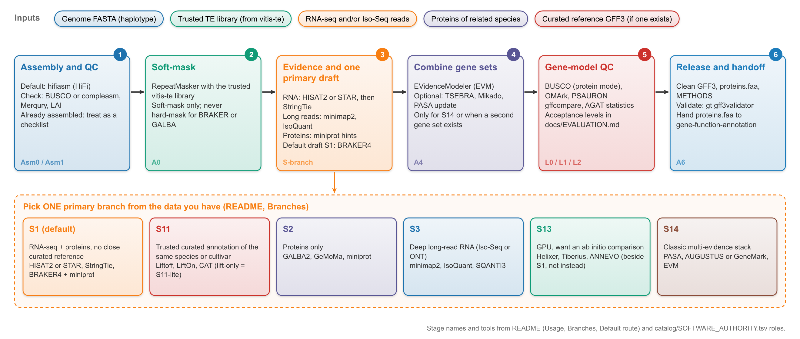
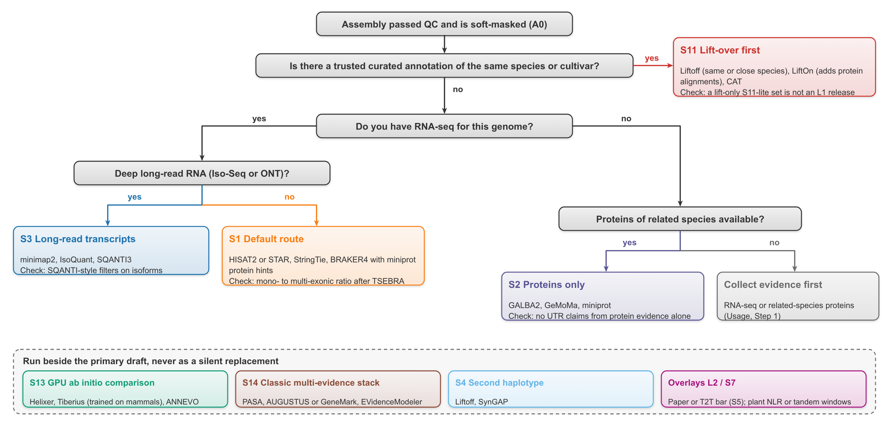
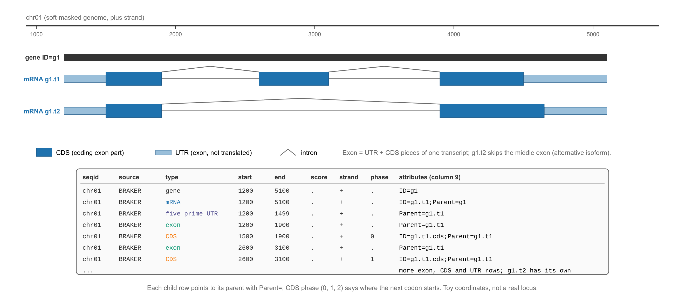
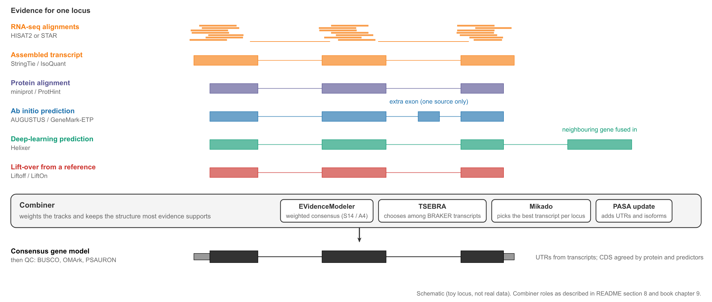
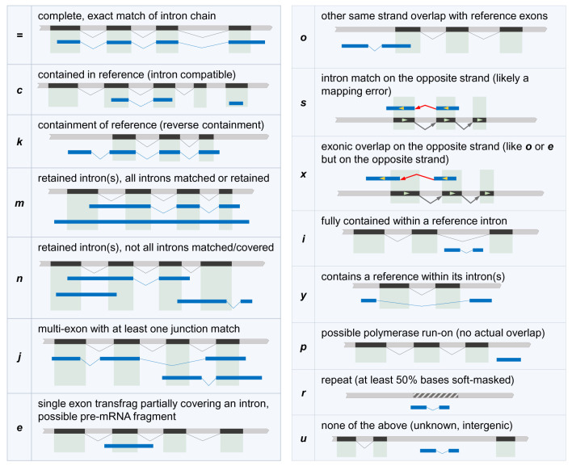
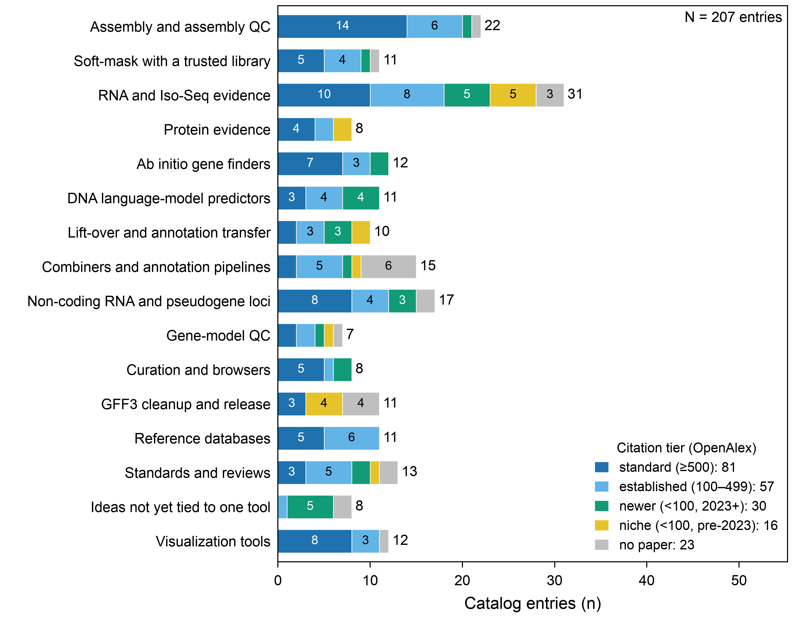
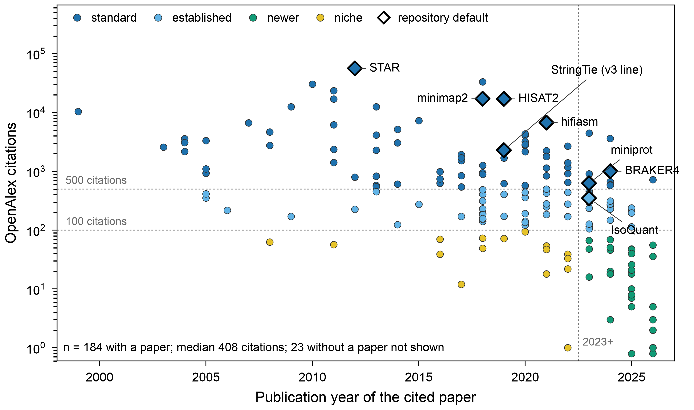

# Figures for the guide

Figures linked from the README files and the book chapters. Three kinds:

1. Published figures under CC BY 4.0, reproduced without changes, with full credit (folder `published/`, or files already in `book/illustrated_v3_p2d/figures/`). Figures from papers that are not openly licensed are not copied.
2. Schematics drawn for this repository (editable SVG with live text, plus a PNG at 2x).
3. Charts computed from `catalog/SOFTWARE_AUTHORITY.tsv` (SVG with live text, plus a PNG at 600 dpi).

## Regenerate

From the repository root (Python 3 with matplotlib; Google Chrome or Chromium for the PNG of each schematic). Existing outputs are never overwritten, so write into an empty folder:

```bash
mkdir new_figs
python3 docs/figures/guide/src/make_structure_schematics.py new_figs
python3 docs/figures/guide/src/make_catalog_charts.py structure catalog/SOFTWARE_AUTHORITY.tsv new_figs structure
bash docs/figures/guide/src/render_svg.sh new_figs/NAME.svg new_figs/NAME.png WIDTH HEIGHT
```

## Figures and credits

### Structural annotation route



File: `structure_route_map.png`

Figure. The structural annotation route of this repository: six stages from assembly QC to the release handed to gene-function-annotation, with the default tool at each stage and the six primary branches (S1, S11, S2, S3, S13, S14). Pick one primary branch from the data you have. Schematic drawn for this repository from README (Usage, Branches, Default route); editable SVG: `structure_route_map.svg`.

### Which branch to run



File: `structure_branch_decision.png`

Figure. Choosing the primary branch from the data at hand, with the first tools and the main check for each branch (the same choice as the table in book chapter 18 and README, Branches). S13, S14, S4 and the overlays run beside the primary draft. Schematic drawn for this repository; editable SVG: `structure_branch_decision.svg`.

### Gene model and GFF3 rows



File: `structure_gene_model_gff3.png`

Figure. A gene model is a hierarchy: one gene, one or more transcripts (mRNA), and exons made of UTR and CDS parts. The table shows the same model as GFF3 rows linked by `ID` and `Parent`, with the CDS phase. Toy coordinates, not a real locus; schematic drawn for this repository.

### Evidence combination at one locus



File: `structure_evidence_combination.png`

Figure. What a combiner does at one locus: transcript, protein, ab initio, deep-learning and lift-over evidence often disagree (an extra exon from one source, a neighbouring gene fused in). EVidenceModeler, TSEBRA, Mikado or a PASA update keep the structure that most evidence supports. Toy locus; schematic drawn for this repository, not redrawn from a published figure.

### GffCompare transcript class codes



File: `published/gffcompare_2020_fig1.jpg`

Figure. Transcript class codes that GffCompare reports when a predicted or assembled transcript set is compared with a reference annotation (for example `=` complete intron-chain match, `j` at least one junction match, `u` intergenic). Reproduced without changes from Pertea G and Pertea M (2020), GFF Utilities: GffRead and GffCompare, F1000Research 9:304, Fig. 1, doi:10.12688/f1000research.23297.2, PMC7222033, licensed CC BY 4.0 (https://creativecommons.org/licenses/by/4.0/).

### Catalog entries per section by tier



File: `structure_catalog_by_step.png`

Figure. Catalog entries per type section, coloured by citation tier (tier rule above). Counts computed from `catalog/SOFTWARE_AUTHORITY.tsv` (207 entries; OpenAlex counts retrieved 2026-11-25) by `docs/figures/guide/src/make_catalog_charts.py`.

### Publication year against citations



File: `structure_catalog_year_citations.png`

Figure. Publication year against OpenAlex citations for the 184 catalog entries with a paper; diamonds mark repository defaults. A citation count says how widely a paper is cited, not how accurate the tool is on your genome. Source: `catalog/SOFTWARE_AUTHORITY.tsv`; script `docs/figures/guide/src/make_catalog_charts.py`.
