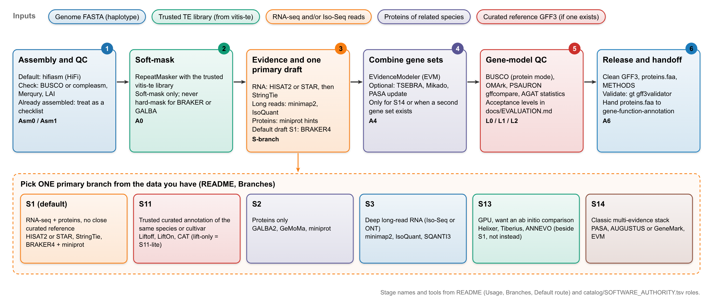

# Workflow index

[中文](README.zh.md) · [Home page](../../README.md) · [Knowledge map](../KNOWLEDGE_MAP.md)

This repository is a knowledge base. The workflow is one reference route through it, with small example scripts. This page says which page is authoritative for each workflow question, so that repeated text elsewhere can be read as a copy.

## The route in one line

Assembly and assembly QC (Asm0, Asm1) → soft-mask with a trusted TE library (A0) → engine and RNA evidence (A1) → one primary draft branch (A2: S1, S11, S2, S3, S13 or S14) → aggregation (A4) → structure QC (A5) → proteins from GFF (A3) → last mile 01–06 → hand-off to function (A6) (stage order as listed in [`catalog/README.md`](../../catalog/README.md) and [`docs/STAGE_IO.md`](../STAGE_IO.md)).

## Which page is authoritative

| Question | Authoritative page | Pages that repeat or teach it |
|---|---|---|
| Step order, branches and overlays | [`docs/ROADMAP.md`](../ROADMAP.md) | README, Usage; [`catalog/_branches.md`](../../catalog/_branches.md); book chapter 18 |
| The route chosen for your data | `my_plan.md`, written by [`pipeline/flow_tool/flow.py`](../../pipeline/flow_tool/flow.py) from your answers | README, Usage |
| Inputs and outputs of each stage | [`docs/STAGE_IO.md`](../STAGE_IO.md) | [`pipeline/00_overview.md`](../../pipeline/00_overview.md) |
| Commands for each tool | [`docs/TOOLS.md`](../TOOLS.md) and the scripts in [`pipeline/`](../../pipeline/00_overview.md) | `docs/tools/`, `docs/notes/` |
| When a result is good enough | [`docs/EVALUATION.md`](../EVALUATION.md) | [`docs/EVALUATION_CHECKLIST.md`](../EVALUATION_CHECKLIST.md); knowledge units on criteria |
| TE soft-mask (A0) | [`docs/TE_LIBRARY.md`](../TE_LIBRARY.md) | [`docs/TRUSTED_TE_PATH.md`](../TRUSTED_TE_PATH.md); [TE-Lib](https://github.com/Xuzhen-Li/TE-Lib) builds the library |
| Hand-off between structure and function | [`docs/HANDOFF_STRUCTURE_TO_FUNCTION.md`](../HANDOFF_STRUCTURE_TO_FUNCTION.md) | README, Usage |
| A first walk through | [`docs/QUICKSTART.md`](../QUICKSTART.md) | [`docs/START_HERE.md`](../START_HERE.md) |

## Older workflow pages

These pages are kept as a record. Where they differ from the authoritative page above, the authoritative page wins.

- [`docs/CLASSROOM_TONIGHT.md`](../CLASSROOM_TONIGHT.md) and the wiki page Start-tonight: an early quick start.
- The dated status sections at the end of [`docs/ROADMAP.md`](../ROADMAP.md): progress notes of their date.
- Step cards in the stage folders of [`catalog/`](../../catalog/README.md): the 2026-11 first pass; see [`docs/kb/NUMBERING.md`](../kb/NUMBERING.md).
