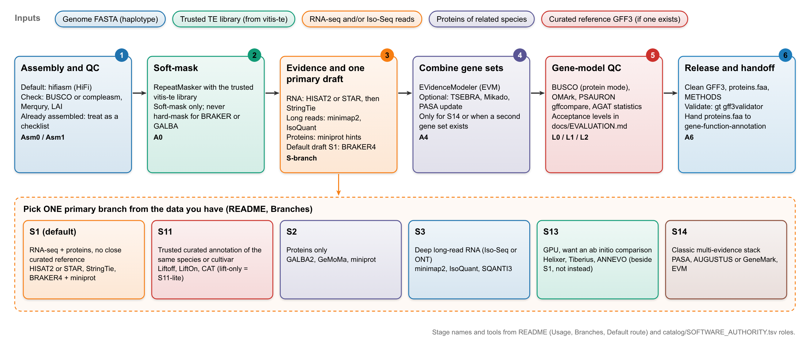

# 流程索引

[English](README.md) · [首页](../../README.zh.md) · [知识地图](../KNOWLEDGE_MAP.zh.md)

本仓库是知识库，流程是贯穿其中的一条参考路线，配有小型示例脚本。本页说明每个流程问题以哪一页为准，其他页面中重复的内容按副本理解。

## 一句话路线

组装与组装质控（Asm0、Asm1）→ 用可信 TE 库做 soft-mask（A0）→ 引擎与 RNA 证据（A1）→ 一条主草稿分支（A2：S1、S11、S2、S3、S13 或 S14）→ 合并（A4）→ 结构质控（A5）→ 由 GFF 生成蛋白（A3）→ 收尾 01–06 → 交给功能注释（A6）。

## 以哪一页为准

| 问题 | 以此为准 | 重复或讲解它的页面 |
|---|---|---|
| 步骤顺序、分支与叠加 | [`docs/ROADMAP.md`](../ROADMAP.md) | README 使用方法；[`catalog/_branches.md`](../../catalog/_branches.md)；书第 18 章 |
| 按你的数据选出的路线 | 由 [`pipeline/flow_tool/flow.py`](../../pipeline/flow_tool/flow.py) 根据你的回答生成的 `my_plan.md` | README 使用方法 |
| 每个阶段的输入输出 | [`docs/STAGE_IO.md`](../STAGE_IO.md) | [`pipeline/00_overview.md`](../../pipeline/00_overview.md) |
| 各工具的命令 | [`docs/TOOLS.md`](../TOOLS.md) 和 [`pipeline/`](../../pipeline/00_overview.md) 中的脚本 | `docs/tools/`、`docs/notes/` |
| 结果是否合格 | [`docs/EVALUATION.md`](../EVALUATION.md) | [`docs/EVALUATION_CHECKLIST.md`](../EVALUATION_CHECKLIST.md)；判据类知识单元 |
| TE soft-mask（A0） | [`docs/TE_LIBRARY.md`](../TE_LIBRARY.md) | [`docs/TRUSTED_TE_PATH.md`](../TRUSTED_TE_PATH.md)；库在 [TE-Lib](https://github.com/Xuzhen-Li/TE-Lib) 中构建 |
| 结构与功能之间的交接 | [`docs/HANDOFF_STRUCTURE_TO_FUNCTION.md`](../HANDOFF_STRUCTURE_TO_FUNCTION.md) | README 使用方法 |
| 第一次走一遍 | [`docs/QUICKSTART.md`](../QUICKSTART.md) | [`docs/START_HERE.md`](../START_HERE.md) |

## 旧的流程页面

以下页面作为记录保留；与上面所列页面不一致时，以上面所列为准。

- [`docs/CLASSROOM_TONIGHT.md`](../CLASSROOM_TONIGHT.md) 和 Wiki 页面 Start-tonight：早期的快速开始。
- [`docs/ROADMAP.md`](../ROADMAP.md) 末尾带日期的进度小节：各自日期的进度记录。
- [`catalog/`](../../catalog/README.md) 阶段文件夹中的步骤卡片：2026-11 首批，见 [`docs/kb/NUMBERING.zh.md`](../kb/NUMBERING.zh.md)。
